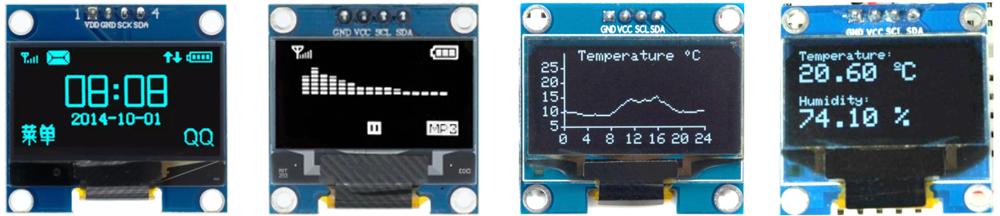
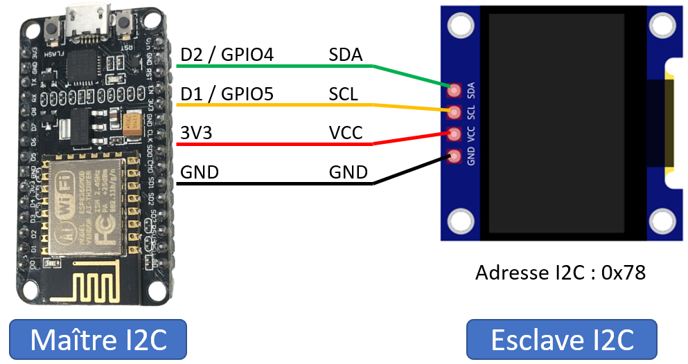
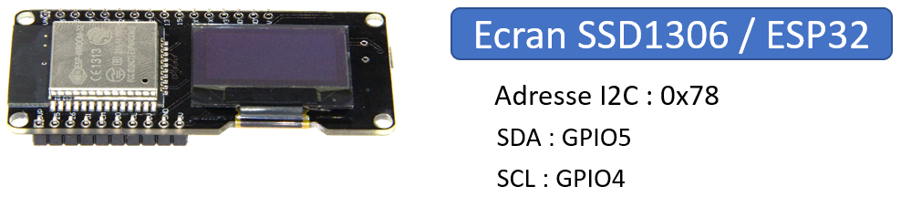
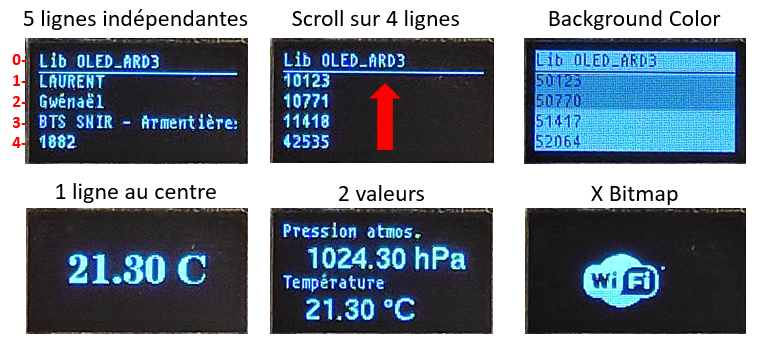
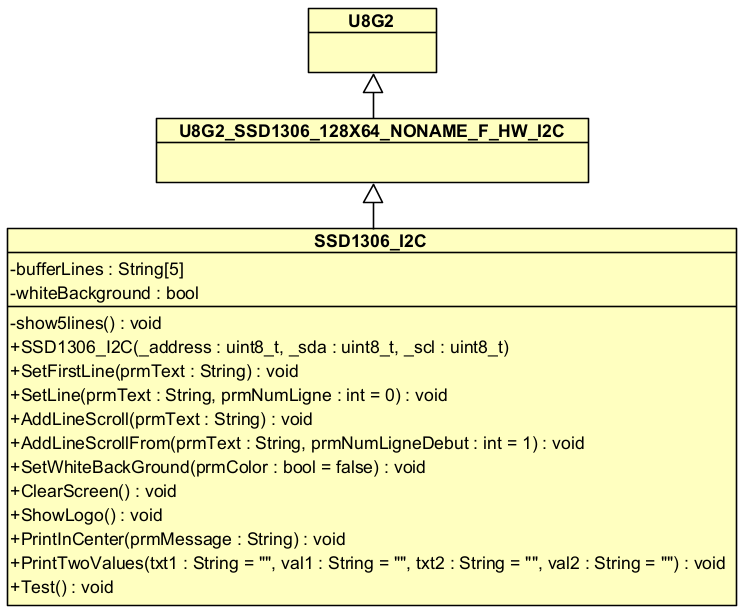

# Affichage sur écran OLED SSD1306 128x64

> * Auteur : Gwénaël LAURENT
> * Date : 07/02/2022
<!-- I:\temp\esp32oled-rc522 -->

 [Licence Creative Commons](https://creativecommons.org/licenses/by-nc-sa/3.0/fr/)

- [Affichage sur écran OLED SSD1306 128x64](#affichage-sur-écran-oled-ssd1306-128x64)
- [1. Ecran OLED SSD1306 0.96"](#1-ecran-oled-ssd1306-096)
  - [1.1 Présentation de l'écran](#11-présentation-de-lécran)
  - [1.2 Bibliothèques](#12-bibliothèques)
  - [1.3 Connexion avec les ESP](#13-connexion-avec-les-esp)
  - [1.4 Affichage de base avec la bibliothèque U8G2](#14-affichage-de-base-avec-la-bibliothèque-u8g2)
- [2. Bibliothèque SSD1306\_I2C](#2-bibliothèque-ssd1306_i2c)
  - [2.1 Présentation de la bibliothèque SSD1306\_I2C](#21-présentation-de-la-bibliothèque-ssd1306_i2c)
  - [2.2 Méthodes disponibles et dépendances](#22-méthodes-disponibles-et-dépendances)
  - [2.3 Intégration dans VScode PlatformIO](#23-intégration-dans-vscode-platformio)
  - [2.4 Exemple d'affichage fixe sur 5 lignes](#24-exemple-daffichage-fixe-sur-5-lignes)
  - [2.5 Exemple d'affichage avec scroll sur 4 lignes](#25-exemple-daffichage-avec-scroll-sur-4-lignes)
  - [2.6 Ajout de fonctionnalités](#26-ajout-de-fonctionnalités)

# 1. Ecran OLED SSD1306 0.96"
## 1.1 Présentation de l'écran



L'écran OLED SSD1306 0.96" est un très petit écran graphique monochrome avec une diagonale d'écran de 2.4 cm. 
* L'écran se compose de **128x64 pixels** OLED qui sont contrôlés individuellement par la puce SSD1306 intégrée.
* L'écran est contrôlé via l'interface **I2C** et ne nécessite que 4 fils pour la connexion.
* Alimentation : **3.3V**
* Consommation : 0,04 W en fonctionnement normal

## 1.2 Bibliothèques
Plusieurs bibliothèques sont disponibles pour contrôler l'affichage sur l'écran SSD1306. Certaines permettent d'afficher du texte, d'autres des graphes, des images ... 

Quelques bibliothèques très utilisées :
* [U8g2: Library for monochrome displays](https://github.com/olikraus/u8g2/)
* [Adafruit_SSD1306](https://github.com/adafruit/Adafruit_SSD1306)
* [Adafruit GFX Library](https://github.com/adafruit/Adafruit-GFX-Library)
* [OLED SSD1306 Chart](https://github.com/elC0mpa/OLED_SSD1306_Chart/)

## 1.3 Connexion avec les ESP
L'écran OLED SSD1306 se connecte sur un **[bus I2C](bus-I2C.md)**. Son adresse I2C est par défaut **0x78**.

Exemple de connexion avec un **ESP8266** :



Les **ESP32 WEMOS lolin 32 + OLED** sont équipés d'un écran OLED SSD1306 connecté comme ceci : addr = 0x78, SDA=GPIO5, SCL=GPIO4 :



## 1.4 Affichage de base avec la bibliothèque U8G2
U8G2 est une bibliothèque qui gère l'affichage sur les écrans graphiques monochromes. U8G2 est développée par oliver (olikraus@gmail.com) [Dépôt GitHub](https://github.com/olikraus/u8g2)

U8G2 utilise l'affichage bufferisé :
1. On enregistre en RAM (mémoire tampon = buffer) tous les éléments à afficher (textes, graphiques, images ...) et leur position à l'écran (position x, y par rapport à la dimension de l'écran 128 x 64)
2. On envoie la totalité du buffer d'affichage sur l'écran en appelant la fonction ```sendBuffer()```

U8G2 propose des classes C++ adaptées à une multitude d'écran monochromes, qu'ils soient connectées en I2C, SPI ou même en parallèle. Quelque soit la classe choisie, elle dérive toujours de la classe mère U8G2 et elles s'utilisent donc de la même façon. [Liste des classes Setup](https://github.com/olikraus/u8g2/wiki/u8g2setupc)

Installation de la bibliothèque : Menu PlatformIO > Library > ```U8g2 by oliver (olikraus@gmail.com)```

Exemple de codage :
```cpp
#include <Arduino.h>
#include <Wire.h>
#include <U8g2lib.h>

//création d'un objet de la lib U8G2 pour l'écran OLED SSD1306 connecté en I2C
U8G2_SSD1306_128X64_NONAME_F_HW_I2C u8g2(U8G2_R0, U8X8_PIN_NONE, /*scl_pin=*/ 4, /*sda_pin=*/ 5);

void setup(void)
{
  u8g2.setI2CAddress(/*i2c_addr*/ 0x78); // Pour adapter l'adresse du périphérique I2C
  u8g2.begin();
}

void loop(void)
{
  //effacer le buffer d'affichage
  u8g2.clearBuffer();

  //Choisir la police de caractères et écrire du texte
  u8g2.setFont(u8g2_font_ncenB14_tr);
  u8g2.drawUTF8(0, 15, "BTS SNIR");

  u8g2.setFont(u8g2_font_t0_12b_me); //21 caractères par ligne (8 Pixel Height +2 -2)
  u8g2.drawUTF8(0, 60, "Armentières");

  //Envoyer le buffer (affichage sur écran)
  u8g2.sendBuffer();
  delay(1000);
}

```


# 2. Bibliothèque SSD1306_I2C
## 2.1 Présentation de la bibliothèque SSD1306_I2C
La bibliothèque SSD1306_I2C est une classe wrapper de la bibliothèque U8G2. Elle est utilisable avec le framework Arduino.

Elle permet de simplifier l'affichage des messages courants sur l'écran OLED sd1306 128x64 connecté en I2C. 
* Choix des broches SDA, SCL
* Affichage bufferisé sur 5 lignes indépendantes
* Scroll automatique sur 4 ou 5 lignes
* Affichage de logos, images (format xbm)
* Affichage au centre de l'écran
* Affichage de 2 valeurs de capteurs



## 2.2 Méthodes disponibles et dépendances
La bibliothèque SSD1306_I2C est composée d'une classe C++ qui **dérive de la classe U8G2** par l'intermédiaire de la classe U8G2_SSD1306_128X64_NONAME_F_HW_I2C.




## 2.3 Intégration dans VScode PlatformIO
1. Menu PlatformIO > Library : Installation de la lib ```U8g2 by oliver (olikraus@gmail.com)``` - [Dépôt GitHub](https://github.com/olikraus/u8g2)
2. Copie du dossier de la lib ```SSD1306_I2C``` dans le dossier ```/lib``` du projet (la lib est dispo sur GitLab dans le même dossier que ce document [platformio/SSD1306_I2C](./platformio/) )
3. utilisation dans ```/src/main.cpp```

## 2.4 Exemple d'affichage fixe sur 5 lignes
> Cet exemple est adapté à l'ESP32 OLED. Il faut adapter les broches du bus I2C pour les autres ESP.

```cpp
#include <Arduino.h>
#include "SSD1306_I2C.hpp" //inclusion de la lib SSD1306_I2C

//création d'un objet de la lib : SSD1306_I2C u8g2(addrI2C, sda_pin, scl_pin);
SSD1306_I2C u8g2(0x78, 5, 4);

void setup(void)
{
  //initialisation de l'afficheur OLED
  u8g2.begin();
  //affichage sur les 4 premières lignes
  u8g2.SetLine("Lib SSD1306_I2C", 0);
  u8g2.SetLine("LAURENT", 1);
  u8g2.SetLine("Gwénaël", 2);
  u8g2.SetLine("BTS SNIR Armentières", 3);
}

void loop(void)
{
  //affichage sur la 5ème ligne
  u8g2.SetLine(String(millis()), 4);
  delay(1000);
}
```

## 2.5 Exemple d'affichage avec scroll sur 4 lignes
> Cet exemple est adapté à l'ESP32 OLED. Il faut adapter les broches du bus I2C pour les autres ESP.

* Affichage d'un logo au format X BitMap ([cf explications XBM](05d.pio-ESP32-ecran-TFT-ILI9341.md#35-afficher-une-image-au-format-x-bitmap-xbm))
* Affichage de l'adresse MAC
* Affichage fixe sur 5 lignes
* Scroll des 4 dernières lignes

```cpp
#include <Arduino.h>
#include "SSD1306_I2C.hpp" //inclusion de la lib SSD1306_I2C
#include "WiFi.h"          //pour afficher adresse MAC

//création d'un objet de la lib : SSD1306_I2C u8g2(addrI2C, sda_pin, scl_pin);
SSD1306_I2C u8g2(0x78, 5, 4);

void setup(void)
{
  //initialisation de l'afficheur OLED
  u8g2.begin();
  //initialisation du WiFi en station
  WiFi.mode(WIFI_MODE_STA);
  //affichage du logo
  u8g2.ShowLogo();
  delay(2000);
  //affichage sur les 5 lignes
  u8g2.SetLine(WiFi.macAddress(), 0);
  u8g2.SetLine("LAURENT", 1);
  u8g2.SetLine("Gwénaël", 2);
  u8g2.SetLine("BTS SNIR Armentières", 3);
  u8g2.SetLine(String(millis()), 4);
  delay(2000);
}

void loop(void)
{
  //scroll sur les 4 dernières lignes
  u8g2.AddLineScroll(String(millis()));
  delay(1000);
}
```

## 2.6 Ajout de fonctionnalités
Il suffit d'ajouter des méthodes à la classe SSD1306_I2C et d'utiliser les méthodes de la classe U8G2. Comme la classe SSD1306_I2C dérive de la classe U8G2, toutes les méthodes de la classe U8G2 sont accessibles directement.

Documentation sur la lib U8G2
[https://github.com/olikraus/u8g2/wiki/u8g2reference](https://github.com/olikraus/u8g2/wiki/u8g2reference)

> **ATTENTION** : Utiliser les exemples "C++/Arduino"
