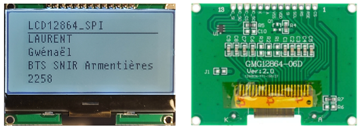
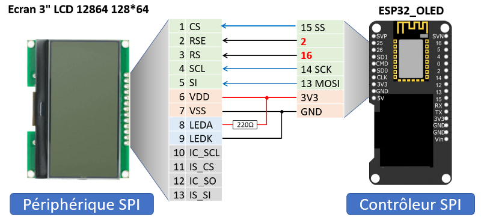
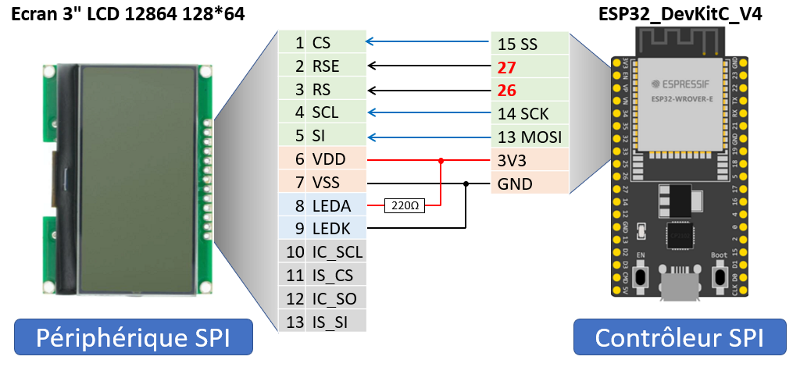
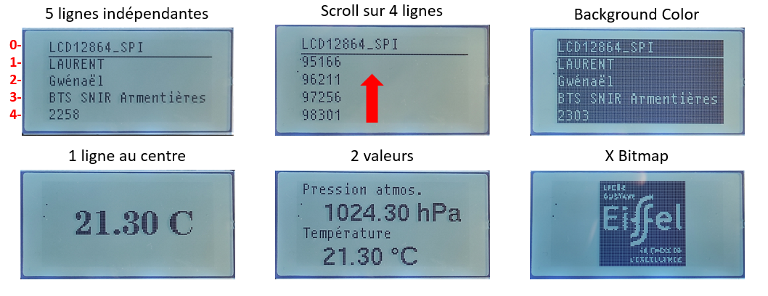
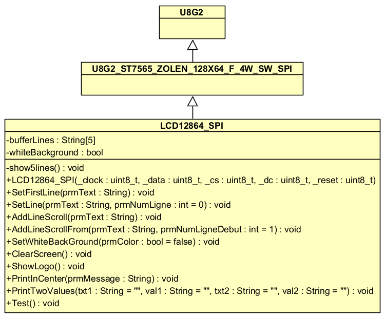

# Affichage sur écran LCD12864 128x64

> * Auteur : Gwénaël LAURENT
> * Date : 25/03/2022


 [Licence Creative Commons](https://creativecommons.org/licenses/by-nc-sa/3.0/fr/)

- [Affichage sur écran LCD12864 128x64](#affichage-sur-écran-lcd12864-128x64)
- [1. Ecran LCD12864](#1-ecran-lcd12864)
  - [1.1 Présentation de l'écran](#11-présentation-de-lécran)
  - [1.2 Connexion avec les ESP32_OLED](#12-connexion-avec-les-esp32_oled)
  - [1.3 Connexion avec les ESP32_DevKitC_V4](#13-connexion-avec-les-esp32_devkitc_v4)
  - [1.4 Affichage de base avec la bibliothèque U8G2](#14-affichage-de-base-avec-la-bibliothèque-u8g2)
- [2. Bibliothèque LCD12864_SPI](#2-bibliothèque-lcd12864_spi)
  - [2.1 Présentation de la bibliothèque LCD12864_SPI](#21-présentation-de-la-bibliothèque-lcd12864_spi)
  - [2.2 Méthodes disponibles et dépendances](#22-méthodes-disponibles-et-dépendances)
  - [2.3 Intégration dans VScode PlatformIO](#23-intégration-dans-vscode-platformio)
  - [2.4 Exemple d'affichage fixe sur 5 lignes](#24-exemple-daffichage-fixe-sur-5-lignes)
  - [2.5 Exemple d'affichage avec scroll sur 4 lignes](#25-exemple-daffichage-avec-scroll-sur-4-lignes)
  - [2.6 Ajout de fonctionnalités](#26-ajout-de-fonctionnalités)

# 1. Ecran LCD12864
## 1.1 Présentation de l'écran



L'écran LCD12864 est un petit écran graphique monochrome avec une diagonale d'écran de 5.4 cm. 
* L'écran se compose de **128x64 pixels** LCD qui sont contrôlés individuellement par la puce **ST7565R** intégrée.
* L'écran est contrôlé via l'interface **SPI**.
* Alimentation : **3.3V**
* Référence : GMG12864-06D


## 1.2 Connexion avec les ESP32_OLED
L'écran LCD12864 se connecte sur un **[bus SPI](bus-SPI.md)**. Il est préférable d'utiliser le bus SPI matériel (HSPI).

Exemple de connexion avec un **ESP32 WEMOS lolin 32** (équipé d'une puce ESP-WROOM-32):



| Pin | LCD 12864 SPI | ESP32_OLED       | Fonction                            |
|-----|---------------|------------------|-------------------------------------|
| 1   | CS            | GPIO15 HSPI_SS   | SPI Chip Select                     |
| 2   | RSE           | GPIO2            | LCD reset signal                    |
| 3   | RS            | GPIO16           | (DC) LCD register / data selection  |
| 4   | SCL           | GPIO14 HSPI_SCK  | SPI Clock line                      |
| 5   | SI            | GPIO13 HSPI_MOSI | (Data) SPI MOSI                     |
| 6   | VDD           | 3V3              | Power                               |
| 7   | VSS           | GND              | Ground                              |
| 8   | LEDA          | 3V3 ou 220ohms   | Backlight LED Anode                 |
| 9   | LEDK          | GND              | Backlight LED Cathode               |
| 10  | IC_SCL        |                  |                                     |
| 11  | IS_CS         |                  |                                     |
| 12  | IC_SO         |                  |                                     |
| 13  | IS_SI         |

## 1.3 Connexion avec les ESP32_DevKitC_V4
L'écran LCD12864 se connecte sur un **[bus SPI](bus-SPI.md)**. Il est préférable d'utiliser le bus SPI matériel (HSPI).

Exemple de connexion avec un **ESP32_DevKitC_V4** (équipé d'une puce ESP32-WROVER-E):



| Pin | LCD 12864 SPI | ESP32_DevKitC_V4 | Fonction                           |
|-----|---------------|------------------|------------------------------------|
| 1   | CS            | GPIO15 HSPI_SS   | SPI Chip Select                    |
| 2   | RSE           | GPIO27           | LCD reset signal                   |
| 3   | RS            | GPIO26           | (DC) LCD register / data selection |
| 4   | SCL           | GPIO14 HSPI_SCK  | SPI Clock line                     |
| 5   | SI            | GPIO13 HSPI_MOSI | SPI MOSI                           |
| 6   | VDD           | 3V3              | Power                              |
| 7   | VSS           | GND              | Ground                             |
| 8   | LEDA          | 3V3 ou 220ohms   | Backlight LED Anode                |
| 9   | LEDK          | GND              | Backlight LED Cathode              |
| 10  | IC_SCL        |                  |                                    |
| 11  | IS_CS         |                  |                                    |
| 12  | IC_SO         |                  |                                    |
| 13  | IS_SI         |

## 1.4 Affichage de base avec la bibliothèque U8G2
U8G2 est une bibliothèque qui gère l'affichage sur les écrans graphiques monochromes. U8G2 est développée par oliver (olikraus@gmail.com) [Dépôt GitHub](https://github.com/olikraus/u8g2)

U8G2 utilise l'affichage bufferisé :
1. On enregistre en RAM (mémoire tampon = buffer) tous les éléments à afficher (textes, graphiques, images ...) et leur position à l'écran (position x, y par rapport à la dimension de l'écran 128 x 64)
2. On envoie la totalité du buffer d'affichage sur l'écran en appelant la fonction ```sendBuffer()```

U8G2 propose des classes C++ adaptées à une multitude d'écran monochromes, qu'ils soient connectées en I2C, SPI ou même en parallèle. Quelque soit la classe choisie, elle dérive toujours de la classe mère U8G2 et elles s'utilisent donc de la même façon. [Liste des classes Setup](https://github.com/olikraus/u8g2/wiki/u8g2setupc)

Installation de la bibliothèque : Menu PlatformIO > Library > ```U8g2 by oliver (olikraus@gmail.com)```

Exemple de codage :
```cpp
#include <Arduino.h>
#include <U8g2lib.h>
#include <SPI.h>

//création d'un objet de la lib U8G2 pour l'écran LCD 12864 connecté en SPI sur un ESP-WROOM-32 :
U8G2_ST7565_ZOLEN_128X64_F_4W_SW_SPI u8g2(U8G2_MIRROR, /*clock=*/14, /*data=*/13, /*cs=*/15, /*dc=*/16, /*reset=*/2);

void setup()
{
  u8g2.begin();
  u8g2.setContrast(60);
}

void loop()
{
  //effacer le buffer d'affichage
  u8g2.clearBuffer();

  //Choisir la police de caractères et écrire du texte
  u8g2.setFont(u8g2_font_ncenB14_tr);
  u8g2.drawUTF8(0, 15, "BTS SNIR");

  u8g2.setFont(u8g2_font_t0_12b_me); //21 caractères par ligne (8 Pixel Height +2 -2)
  u8g2.drawUTF8(0, 60, "Armentières");

  //Envoyer le buffer (affichage sur écran)
  u8g2.sendBuffer();
  delay(1000);
}
```


# 2. Bibliothèque LCD12864_SPI
## 2.1 Présentation de la bibliothèque LCD12864_SPI
La bibliothèque LCD12864_SPI est une classe wrapper de la bibliothèque U8G2. Elle est utilisable avec le framework Arduino dans VScode / PlatformIO.

Elle permet de simplifier l'affichage des messages courants sur l'écran LCD12864 128x64 connecté en SPI. 
* Choix des broches de connexion
* Affichage bufferisé sur 5 lignes indépendantes
* Scroll automatique sur 4 ou 5 lignes
* Affichage de logos, images (format xbm)
* Affichage au centre de l'écran
* Affichage de 2 valeurs de capteurs



## 2.2 Méthodes disponibles et dépendances
La bibliothèque LCD12864_SPI est composée d'une classe C++ qui **dérive de la classe U8G2** par l'intermédiaire de la classe U8G2_ST7565_ZOLEN_128X64_F_4W_SW_SPI.




## 2.3 Intégration dans VScode PlatformIO
1. Menu PlatformIO > Library : Installation de la lib ```U8g2 by oliver (olikraus@gmail.com)``` - [Dépôt GitHub](https://github.com/olikraus/u8g2)
2. Copie du dossier de la lib ```LCD12864_SPI``` dans le dossier ```/lib``` du projet (la lib est dispo sur GitLab dans le même dossier que ce document [platformio/LCD12864_SPI](./platformio/) )
3. utilisation dans ```/src/main.cpp```

## 2.4 Exemple d'affichage fixe sur 5 lignes
> Cet exemple est adapté à l'ESP32 OLED (ESP-WROOM-32). Il faut adapter les broches du bus SPI pour les autres ESP.

```cpp
#include <Arduino.h>
#include "LCD12864_SPI.hpp" //inclusion de la lib LCD12864_SPI

//création d'un objet de la lib pour ESP-WROOM-32 :
// LCD12864_SPI u8g2( _clock, _data, _cs, _dc, _reset);
LCD12864_SPI u8g2(14, 13, 15, 16, 2);

void setup(void)
{
  //initialisation de l'afficheur OLED
  u8g2.begin();
  u8g2.setContrast(60);

  //affichage sur les 4 premières lignes
  u8g2.SetLine("Lib LCD12864_SPI", 0);
  u8g2.SetLine("LAURENT", 1);
  u8g2.SetLine("Gwénaël", 2);
  u8g2.SetLine("BTS SNIR Armentières", 3);
}

void loop(void)
{
  //affichage sur la 5ème ligne
  u8g2.SetLine(String(millis()), 4);
  delay(1000);
}
```

## 2.5 Exemple d'affichage avec scroll sur 4 lignes
> Cet exemple est adapté à l'ESP32 OLED (ESP-WROOM-32). Il faut adapter les broches du bus SPI pour les autres ESP.

* Affichage d'un logo au format X BitMap ([cf explications XBM](05d.pio-ESP32-ecran-TFT-ILI9341.md#35-afficher-une-image-au-format-x-bitmap-xbm))
* Affichage de l'adresse MAC
* Affichage fixe sur 5 lignes
* Scroll des 4 dernières lignes

```cpp
#include <Arduino.h>
#include "LCD12864_SPI.hpp" //inclusion de la lib LCD12864_SPI
#include "WiFi.h"           //pour afficher adresse MAC

//création d'un objet de la lib pour ESP-WROOM-32 :
// LCD12864_SPI u8g2( _clock, _data, _cs, _dc, _reset);
LCD12864_SPI u8g2(14, 13, 15, 16, 2);

void setup(void)
{
  //initialisation de l'afficheur OLED
  u8g2.begin();
  u8g2.setContrast(60);
  //initialisation du WiFi en station
  WiFi.mode(WIFI_MODE_STA);
  //Affichage de l'image XBM
  u8g2.ShowLogo();
  delay(2000);
  //affichage sur les 5 lignes
  u8g2.SetLine(WiFi.macAddress(), 0);
  u8g2.SetLine("LAURENT", 1);
  u8g2.SetLine("Gwénaël", 2);
  u8g2.SetLine("BTS SNIR Armentières", 3);
  u8g2.SetLine(String(millis()), 4);
  delay(2000);
}

void loop(void)
{
  //scroll sur les 4 dernières lignes
  u8g2.AddLineScroll(String(millis()));
  delay(1000);
}
```

## 2.6 Ajout de fonctionnalités
Il suffit d'ajouter des méthodes à la classe LCD12864_SPI et d'utiliser les méthodes de la classe U8G2. Comme la classe LCD12864_SPI dérive de la classe U8G2, toutes les méthodes de la classe U8G2 sont accessibles directement.

Documentation sur la lib U8G2
[https://github.com/olikraus/u8g2/wiki/u8g2reference](https://github.com/olikraus/u8g2/wiki/u8g2reference)

> **ATTENTION** : Utiliser les exemples "C++/Arduino"
