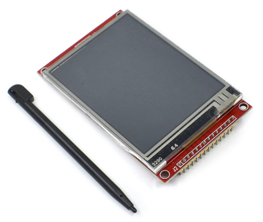
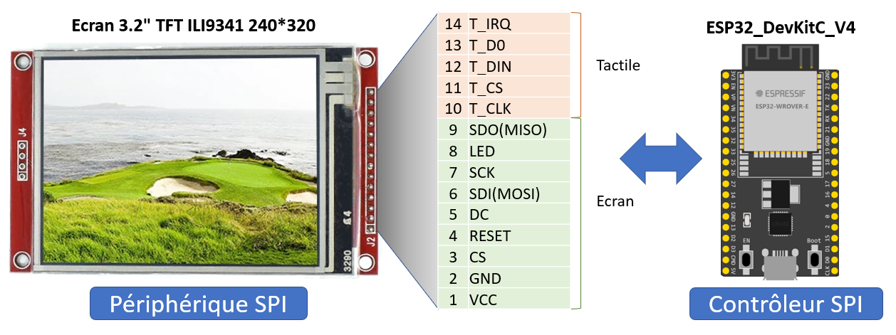
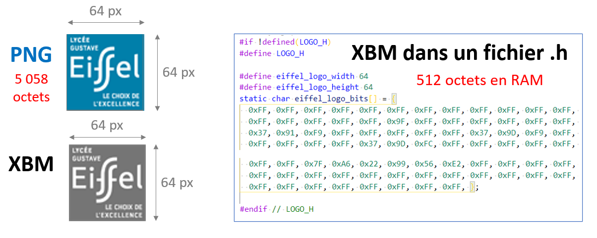
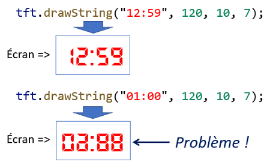
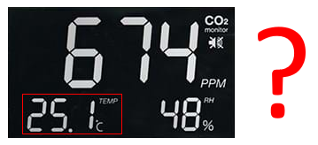
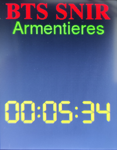
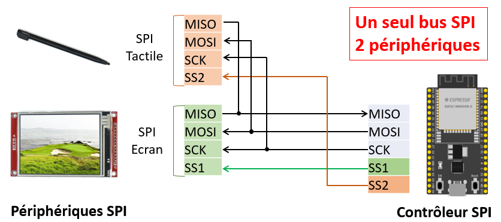
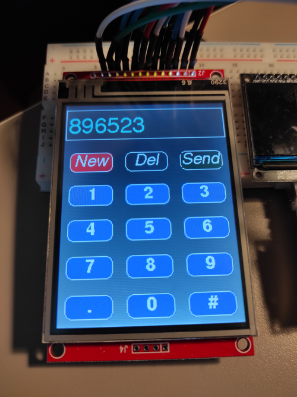

# Affichage sur écran tactile TFT ILI9341 240*320 3.2"

> * Auteur : Gwénaël LAURENT
> * Date : 12/03/2022

 [Licence Creative Commons](https://creativecommons.org/licenses/by-nc-sa/3.0/fr/)

- [Affichage sur écran tactile TFT ILI9341 240\*320 3.2"](#affichage-sur-écran-tactile-tft-ili9341-240320-32)
- [1. Ecran TFT ILI9341 240\*320 3.2"](#1-ecran-tft-ili9341-240320-32)
  - [1.1 Présentation de l'écran](#11-présentation-de-lécran)
  - [1.2 Documentation](#12-documentation)
- [2. Connexion avec les ESP](#2-connexion-avec-les-esp)
  - [2.1 Généralités](#21-généralités)
  - [2.2 Pour connecter l'écran à un ESP32 DevKitC V4](#22-pour-connecter-lécran-à-un-esp32-devkitc-v4)
  - [2.3 Pour connecter l'écran à un ESP32 OLED](#23-pour-connecter-lécran-à-un-esp32-oled)
- [3. Programmation dans VScode / PlatformIO](#3-programmation-dans-vscode--platformio)
  - [3.1 Bibliothèque TFT\_eSPI](#31-bibliothèque-tft_espi)
  - [3.2 Configuration du type d'écran et de la connexion](#32-configuration-du-type-décran-et-de-la-connexion)
  - [3.3 Afficher des textes avec les polices standards](#33-afficher-des-textes-avec-les-polices-standards)
  - [3.4 Afficher des textes avec les polices 'Free Fonts'](#34-afficher-des-textes-avec-les-polices-free-fonts)
  - [3.5 Afficher une image au format X BitMap (XBM)](#35-afficher-une-image-au-format-x-bitmap-xbm)
    - [3.5.1 Le format XBM](#351-le-format-xbm)
    - [3.5.2 Création d'un fichier XBM](#352-création-dun-fichier-xbm)
    - [3.5.3 Insérer une image XBM avec TFT\_eSPI](#353-insérer-une-image-xbm-avec-tft_espi)
  - [3.6 Afficher une image JPG stockée sur la SPIFFS](#36-afficher-une-image-jpg-stockée-sur-la-spiffs)
  - [3.7 Mettre à jour une zone de l'écran avec un 'sprite'](#37-mettre-à-jour-une-zone-de-lécran-avec-un-sprite)
    - [3.7.1 Mise en évidence du problème](#371-mise-en-évidence-du-problème)
    - [3.7.2 Créer un sprite avec TFT\_eSPI](#372-créer-un-sprite-avec-tft_espi)
- [4. Gestion du tactile](#4-gestion-du-tactile)
  - [4.1 Connexion avec l'ESP](#41-connexion-avec-lesp)
  - [4.2 Pour connecter l'écran et le tactile à un ESP32 DevKitC V4](#42-pour-connecter-lécran-et-le-tactile-à-un-esp32-devkitc-v4)
  - [4.3 Pour connecter l'écran et le tactile à un ESP32 OLED](#43-pour-connecter-lécran-et-le-tactile-à-un-esp32-oled)
  - [4.4 Configuration de platformio.ini pour la gestion du tactile](#44-configuration-de-platformioini-pour-la-gestion-du-tactile)
  - [4.5 Programmation dans VScode / PlatformIO](#45-programmation-dans-vscode--platformio)

# 1. Ecran TFT ILI9341 240*320 3.2"
## 1.1 Présentation de l'écran


L'écran TFT ILI9341 3.2" est un petit écran graphique couleur avec une diagonale d'écran de 8.2 cm. 
* L'écran se compose de **240x320 pixels**.
* Driver matériel intégré : **ILI9341**
* Les couleurs sont gérées sur 16 bits => **65 000 couleurs**
* Technologie **TFT** (Thin Film Transistor => intensité de la couleur)
* L'écran est contrôlé via l'interface **SPI** (Bus SPI sur 4 fils) et nécessite 6 fils pour la connexion avec l'ESP (+ alimentation).
* L'écran est **tactile**
* L'écran possède un lecteur de **carte SD**
* Alimentation : **3.3V**
* Référence / Sérigraphie : 3.2" TFT SPI 240*320 v1.0

## 1.2 Documentation
* Ecran 3.2inch SPI Module ILI9341 : http://www.lcdwiki.com/3.2inch_SPI_Module_ILI9341_SKU:MSP3218
* Achat Aliexpress : https://fr.aliexpress.com/item/1005003120684423.html


# 2. Connexion avec les ESP
## 2.1 Généralités
L'écran se connecte sur un **[bus SPI](bus-SPI.md)** de l'ESP. Pour la rapidité de la communication, il est préférable d'utiliser le bus **HSPI** de l'ESP (Hardware SPI).



## 2.2 Pour connecter l'écran à un ESP32 DevKitC V4
(*puce ESP32-WROVER-E*)

| Pin | Ecran 3.2" TFT ILI9341 | ESP32_DevKitC_V4 | Fonction                                                                    |
|-----|------------------------|------------------|-----------------------------------------------------------------------------|
| 14  | T_IRQ (touch)          |                  | Touch screen interrupt signal, low level when touch is detected             |
| 13  | T_D0 (touch)           |                  | Touch SPI bus output                                                        |
| 12  | T_DIN (touch)          |                  | Touch SPI bus input                                                         |
| 11  | T_CS (touch)           |                  | Touch screen chip select signal, low level enable                           |
| 10  | T_CLK (touch)          |                  | Touch SPI bus clock signal                                                  |
| 9   | SDO(MISO)              | GPIO12 HSPI_MISO | SPI MISO                                                                    |
| 8   | LED                    | 3V3              | Backlight control, default floating, low level off                          |
| 7   | SCK                    | GPIO14 HSPI_SCK  | SPI clock line                                                              |
| 6   | SDI(MOSI)              | GPIO13 HSPI_MOSI | SPI MOSI                                                                    |
| 5   | DC                     | GPIO26           | LCD register / data selection signal, high level: register, low level: data |
| 4   | RESET                  | GPIO27           | LCD reset signal, low level reset                                           |
| 3   | CS                     | GPIO15 HSPI_SS   | LCD chip select signal, low level enable                                    |
| 2   | GND                    | GND              | Power Ground                                                                |
| 1   | VCC                    | 3V3              | 3.3V (DC)                                                                   |


## 2.3 Pour connecter l'écran à un ESP32 OLED
(*puce ESP-WROOM-32*)

| Pin | Ecran 3.2" TFT ILI9341 | ESP32_OLED       | Fonction                                                                    |
|-----|------------------------|------------------|-----------------------------------------------------------------------------|
| 14  | T_IRQ (touch)          |                  | Touch screen interrupt signal, low level when touch is detected             |
| 13  | T_D0 (touch)           |                  | Touch SPI bus output                                                        |
| 12  | T_DIN (touch)          |                  | Touch SPI bus input                                                         |
| 11  | T_CS (touch)           |                  | Touch screen chip select signal, low level enable                           |
| 10  | T_CLK (touch)          |                  | Touch SPI bus clock signal                                                  |
| 9   | SDO(MISO)              | GPIO12 HSPI_MISO | SPI MISO                                                                    |
| 8   | LED                    | 3V3              | Backlight control, default floating, low level off                          |
| 7   | SCK                    | GPIO14 HSPI_SCK  | SPI clock line                                                              |
| 6   | SDI(MOSI)              | GPIO13 HSPI_MOSI | SPI MOSI                                                                    |
| 5   | DC                     | GPIO16           | LCD register / data selection signal, high level: register, low level: data |
| 4   | RESET                  | GPIO2            | LCD reset signal, low level reset                                           |
| 3   | CS                     | GPIO15 HSPI_SS   | LCD chip select signal, low level enable                                    |
| 2   | GND                    | GND              | Power Ground                                                                |
| 1   | VCC                    | 3V3              | 3.3V (DC)                                                                   |

# 3. Programmation dans VScode / PlatformIO
## 3.1 Bibliothèque TFT_eSPI
La bibliothèque **TFT_eSPI** est une lib complète qui permet de gérer les écrans couleurs connectés sur un bus SPI :
* Affichage de textes
* Choix des polices de caractères
* Affichage de formes géométriques
* Affichage d'images (format JPEG, XBM)
* Gestion bufferisée de l'affichage
* Gestion du bus SPI
* Adaptable à une multitude d'écrans
* Très bonne intégration dans PlatformIO 👍
* Une multitude d'exemples fournis directement fonctionnels 👍


Intégration dans VScode / PlatformIO :
1. Menu PlatformIO > Library : Installation de la lib ```TFT_eSPI by Bodmer``` - [Dépôt GitHub](https://github.com/Bodmer/TFT_eSPI)
2. Configuration du type d'écran et des broches de connexion dans platformio.ini
3. Création d'un objet TFT_eSPI dans le code C++.

Les fichiers de la lib et les exemples sont disponibles dans le sous-dossier du projet :\
**```.pio\libdeps\[board]\TFT_eSPI\```**

## 3.2 Configuration du type d'écran et de la connexion

Normalement la lib se configure avec des constantes ```#define``` dans les 2 fichiers :
* ```\TFT_eSPI\User_Setup_Select.h```
* ```\TFT_eSPI\User_Setup.h```

Mais avec PlatformIO on peut faire beaucoup plus simple. Il suffit de paramétrer la lib dans **platformio.ini** à l'aide des **build_flags** (cf \TFT_eSPI\Tools\PlatformIO\Configuring options.txt)

Les "build_flags" reprennent le même nom que les constantes précédé de **```-D```**. Il faut en plus ajouter ```-DUSER_SETUP_LOADED=1```  pour que la lib soit entièrement configurée dans platform.ini (et donc les fichiers User_Setup ne sont plus utilisés)

> **Avantage de la configuration dans platformio.ini** :
> * La plupart des exemples de la lib sont directement opérationnels avec un copier/coller du code
> * Le code est identique quelque soit le type d'écran utilisé

Configuration de la lib TFT_eSPI pour l'**écran TFT ILI9341 240*320 3.2"** :

```ini
[env:esp-wrover-kit]
platform = espressif32
board = esp-wrover-kit
framework = arduino
lib_deps = bodmer/TFT_eSPI@^2.4.42

build_flags = 
    ;-Os
    ;-DCORE_DEBUG_LEVEL=ARDUHAL_LOG_LEVEL_DEBUG
	-DUSER_SETUP_LOADED=1

	-DILI9341_DRIVER=1
    -DTFT_WIDTH=320
    -DTFT_HEIGHT=240
    -DTFT_MISO=12
    -DTFT_MOSI=13
    -DTFT_SCLK=14
    -DTFT_CS=15
    -DTFT_DC=26
    -DTFT_RST=27
    ;-DTFT_BL=21
    ;-DTOUCH_CS=25
    -DLOAD_GLCD=1
    -DLOAD_FONT2=1
    -DLOAD_FONT4=1
    -DLOAD_FONT6=1
    -DLOAD_FONT7=1
    -DLOAD_FONT8=1
    -DLOAD_GFXFF=1
    -DSMOOTH_FONT=1
    -DSPI_FREQUENCY=40000000
    -DSPI_READ_FREQUENCY=20000000
    -DSPI_TOUCH_FREQUENCY=2500000
```

## 3.3 Afficher des textes avec les polices standards

> Explorez les exemples de la bibliothèque. 
 
Pour l'affichage de textes standards, essayez par exemple :\
```\TFT_eSPI\examples\320 x 240\RLE_Font_test\RLE_Font_test.ino```

```cpp
#include <Arduino.h>
#include <TFT_eSPI.h>

// Création d'un objet de la lib
TFT_eSPI tft = TFT_eSPI(); 

unsigned long targetTime = millis();

void setup()
{
  tft.begin();
  tft.setRotation(0);

  //couleur fond d'écran
  tft.fillScreen(TFT_BLACK);
  // Couleur du texte + couleur de fond du texte
  tft.setTextColor(TFT_RED, TFT_YELLOW);
  // afficher le texte à la position x=60, y=50
  // Police de caractère n°4
  tft.drawString("BTS SNIR", 60, 50, 4);
  delay(1000);
  // Couleur du texte + fond transparent
  // Police de caractère n°4
  tft.setTextColor(TFT_GREEN);
  tft.drawString("Armentieres", 40, 100, 4);
  delay(1000);
  // Police de caractère n°7 pour les chiffres (7 segments)
  tft.setTextColor(TFT_RED);
  int nb = millis() - targetTime;
  tft.drawNumber(nb, 20, 160, 7);
  delay(1000);
}

void loop()
{

}
```

Les polices de caractères standards sont numérotées comme ceci :
```cpp
Remarque sur les Fonts de base :
#define LOAD_GLCD   // Font 1. Original Adafruit 8 pixel font needs ~1820 bytes in FLASH
#define LOAD_FONT2  // Font 2. Small 16 pixel high font, needs ~3534 bytes in FLASH, 96 characters
#define LOAD_FONT4  // Font 4. Medium 26 pixel high font, needs ~5848 bytes in FLASH, 96 characters
#define LOAD_FONT6  // Font 6. Large 48 pixel font, needs ~2666 bytes in FLASH, only characters 1234567890:-.apm
#define LOAD_FONT7  // Font 7. 7 segment 48 pixel font, needs ~2438 bytes in FLASH, only characters 1234567890:-.
#define LOAD_FONT8  // Font 8. Large 75 pixel font needs ~3256 bytes in FLASH, only characters 1234567890:-.
//#define LOAD_FONT8N // Font 8. Alternative to Font 8 above, slightly narrower, so 3 digits fit a 160 pixel TFT
#define LOAD_GFXFF  // FreeFonts. Include access to the 48 Adafruit_GFX free fonts FF1 to FF48 and custom fonts
```

## 3.4 Afficher des textes avec les polices 'Free Fonts'
Les polices 'Free_Fonts' permettent d'avoir plus de choix de polices et de taille des caractères (FreeFonts FF1 à FF48).

Pour l'affichage de textes 'Free_Fonts', inspirez vous de l'exemple :\
```\TFT_eSPI\examples\320 x 240\All_Free_Fonts_Demo\All_Free_Fonts_Demo.ino```

Pour sélectionner une des polices 'Free_Fonts' :
* Copiez ```Free_Fonts.h``` dans ```/include```
* Dans main.cpp, ajoutez ```#include "Free_Fonts.h"```
* Sélectionnez la police avec ```setFreeFont(Fxxx)```
* Ecrivez le texte avec ```drawString("...", x, y, GFXFF)```

> Les noms des polices sont définis dans le fichier Free_Fonts.h

```cpp
#include <TFT_eSPI.h>
#include "Free_Fonts.h"
// Création d'un objet de la lib
TFT_eSPI tft = TFT_eSPI();

void setup()
{
  tft.begin();
  tft.setRotation(0);

  //couleur fond d'écran
  tft.fillScreen(TFT_BLACK);

  // Set text datum to middle centre
  tft.setTextDatum(MC_DATUM);

  // Police FF44 "Serif bold 24"
  tft.setTextColor(TFT_RED);
  tft.setFreeFont(FF44);
  tft.drawString("BTS SNIR", 120, 50, GFXFF);

  // Police FF19 "Sans 18"
  tft.setTextColor(TFT_GREEN);
  tft.setFreeFont(FF19);
  tft.drawString("Armentieres", 120, 100, GFXFF);

  delay(1000);
}

void loop()
{
  delay(1000);
}
```


## 3.5 Afficher une image au format X BitMap (XBM)
### 3.5.1 Le format XBM
> **X BitMap**, abrégé **XBM**, est un format d'image numérique **monochrome** originellement conçu pour le système X Window, notamment pour les images de pointeur et d'icône.\
> Le format XBM **décrit les images en langage C**, ce qui permet à un programmeur d'intégrer très facilement des images XBM à un logiciel écrit en C.\
> ([Source Wikipédia](https://fr.wikipedia.org/wiki/X_BitMap))

Les images XBM sont très utilisées sur les petits écrans des systèmes embarqués. **L'intérêt principal est la très petite taille en mémoire vive**.\
L'autre intérêt est que l'image est stockée dans le code source du programme : pas besoin d'avoir un stockage externe pour les fichiers.

Vous trouverez un exemple de fichier XBM ici : [eiffel-logo-64-64.h](xbm/eiffel-logo-64-64.h)



*Dans cet exemple l'image est composée de 4096 pixels (64x64). Comme le format XBM est monochrome Noir ou Transparent, chaque pixel sera codé sur un seul bit (Noir 1, Transparent 0). La taille de l'image en RAM est donc de 64x64 = 4096 bits = 512 octets.*

### 3.5.2 Création d'un fichier XBM
Le plus simple est d'utiliser un site web spécialisé dans la conversion au format XBM :
1. On fournit un fichier image standard (PNG, JPG, BMP)
2. On clique sur convertir
3. On télécharge le fichier XBM
4. On change l'extension du fichier en .h
5. On modifie le nom des constantes
6. On ajoute des directives d'inclusions conditionnelles

Voici deux sites qui exportent au format XBM :
* https://convertio.co/fr/png-xbm/
* https://www.online-utility.org/image/convert/to/XBM

On peut aussi utiliser GIMP pour générer le fichier XBM à partir d'un fichier image standard (PNG, JPG, BMP) :
1. Ouvrir l'image PNG, JPG, ...
2. Convertir en Noir/Blanc 1 bit : Image > Mode > Couleurs indexées :
   * Utiliser une palette noir et blanc (1-bit)
   * Tramage des couleurs : Couleurs qui déteignent le moins
   * Activer le tramage de la transparence
   * Activer le tramage des calques de texte
   * Convertir
3. Fichier > Exporter sous :
   * Sélectionner le type de fichier : Image bitmap X
   * Exporter
   * Préfixe d'identification : c'est le nom du tableau d'octets créé dans le fichier XBM
   * Exporter

### 3.5.3 Insérer une image XBM avec TFT_eSPI
> Attention à fixer la taille des images telle qu'elle apparaitra sur l'écran. La lib permet d'afficher des images à l'écran dans leur taille d'origine, pas de les redimensionner. On peut choisir l'emplacement de l'image, mais si l'image fait 64x64 pixels, elle occupera la même zone sur l'écran.

Inspirez vous de l'exemple :\
```\TFT_eSPI\examples\Generic\drawXBitmap\drawXBitmap.ino```

Copiez le fichier ```eiffel-logo-64-64.h``` qui contient l'image XBM dans ```/include```

```cpp
#include <TFT_eSPI.h>
#include "eiffel-logo-64-64.h"

// Création d'un objet de la lib
TFT_eSPI tft = TFT_eSPI();

void setup()
{
  tft.begin();
  tft.setRotation(0);

  //couleur fond d'écran
  tft.fillScreen(TFT_BLACK);
  //insertion XBM
  // Couleur foreground 0x007faa et background white
  tft.drawXBitmap(88, 100, (uint8_t *)eiffel_logo_bits, eiffel_logo_width, eiffel_logo_height, (uint16_t)tft.color24to16(0x007faa), TFT_WHITE);

  delay(1000);
}
```
## 3.6 Afficher une image JPG stockée sur la SPIFFS
> Attention à fixer la taille des images telle qu'elle apparaitra sur l'écran. La lib permet d'afficher des images à l'écran dans leur taille d'origine, pas de les redimensionner. On peut choisir l'emplacement de l'image, mais si l'image fait 64x64 pixels, elle occupera la même zone sur l'écran.

Inspirez vous des exemples :\
```\TFT_eSPI\examples\Generic\TFT_SPIFFS_BMP\TFT_SPIFFS_BMP.ino```\
et ```\TFT_eSPI\examples\Generic\ESP32_SDcard_jpeg\ESP32_SDcard_jpeg.ino```

Ajoutez la lib **JPEGDecoder by Bodmer** au projet.\
Il faudra ensuite inclure la lib => ```#include <JPEGDecoder.h>```

Copiez ```\JPEGDecoder\examples\Other libraries\SPIFFS_Jpeg\JPEG_functions.ino``` dans ```/src``` et renommez le en **```JPEG_functions.cpp```**

Pour que le compilateur puisse utiliser main.cpp et JPEG_functions.cpp conjointement, il faut **ajouter au début du fichier JPEG_functions.cpp** :
```cpp
// Déclaration des variables et fonctions externes
// pour le compilateur
#ifndef GLOBAL_VARS_H
#define GLOBAL_VARS_H
/* types for global vars */
#include <Arduino.h>
#include <TFT_eSPI.h>
#include <SPIFFS.h>
#include <JPEGDecoder.h>
/* global vars */
extern TFT_eSPI tft;
extern JPEGDecoder JpegDec;
/* function declaration */
void drawJpeg(const char *filename, int xpos, int ypos);
void jpegRender(int xpos, int ypos);
void jpegInfo();
void createArray(const char *filename);
#endif
```

**Uploadez une image sur la spiffs** (eiffel-logo-240-240.jpg)

```cpp
#include <Arduino.h>
#include <TFT_eSPI.h>
#include <SPIFFS.h>
#include <JPEGDecoder.h>

// Déclaration de la fonctions externe pour le compilateur
void drawJpeg(const char *filename, int xpos, int ypos);

// Création d'un objet de la lib
TFT_eSPI tft = TFT_eSPI();

void setup()
{
  Serial.begin(9600);
  tft.begin();
  tft.setRotation(0);
  tft.fillScreen(TFT_BLACK);
  
if (!SPIFFS.begin(true))
  {
    Serial.println("Une erreur est survenue lors du montage de la partition SPIFFS");
  }
  else
  {
    drawJpeg("/eiffel-logo-240-240.jpg", 0, 0);
    SPIFFS.end();
  }

  delay(1000);
}
```

## 3.7 Mettre à jour une zone de l'écran avec un 'sprite'
### 3.7.1 Mise en évidence du problème
Tout ce qu'on affiche sur l'écran reste affiché sauf si :
* on efface totalement l'écran avec ```tft.fillScreen()```
* on écrit autre chose sur les mêmes pixels avec une fonction ```tft.draw____()```

Si on n'efface pas l'écran, on se retrouve à superposer les affichages, par exemple comme ceci :



Quand on a plusieurs informations affichées en même temps sur l'écran, par exemple comme ceci :



... comment faire pour mettre à jour une seule donnée sans avoir à ré-afficher toutes les données de l'écran ?

C'est là que les sprites entre en jeux ! Ils permettent :
* de définir une zone (width, height)
* de préparer en RAM le contenu de la zone (= buffer d'affichage)
* d'afficher la zone du sprite à l'emplacement voulu de l'écran (tp, left), sans effacer le reste de l'écran

### 3.7.2 Créer un sprite avec TFT_eSPI
Inspirez vous de l'exemple :\
```\TFT_eSPI\examples\Sprite\Sprite_RLE_Font_test\Sprite_RLE_Font_test.ino```

Le code suivant permet d'afficher le temps depuis le démarrage de l'ESP.
* l'affichage du chronomètre utilise un sprite
* Le texte en haut de l'écran est affiché une seule fois dans setup().
* La fonction loop() met à jour l'affichage du chronomètre toutes les secondes.



```cpp
#include <Arduino.h>
#include <TFT_eSPI.h>
#include "Free_Fonts.h"

// Création d'un objet de la lib
TFT_eSPI tft = TFT_eSPI();

//Création d'un objet sprite
TFT_eSprite spriteChrono = TFT_eSprite(&tft);

unsigned long millisStart = millis();

//fonction utilitaire pour formater l'affichage du chronomètre
String GetTimeSinceBoot()
{
  int milliseconds = millis();
  int seconds = milliseconds / 1000;
  milliseconds %= 1000;
  int minutes = seconds / 60;
  seconds %= 60;
  int hours = minutes / 60;
  minutes %= 60;
  hours %= 24;
  char timeSinceBoot[9];
  sprintf(timeSinceBoot, "%02d:%02d:%02d", hours, minutes, seconds);
  return (String)timeSinceBoot;
}

void setup()
{
  Serial.begin(9600);

  // Initialisation de la lib TFT_eSPI
  tft.begin();
  tft.setRotation(2);

  // Affichage du texte au démarrage
  tft.fillScreen(TFT_BLACK);
  tft.setTextDatum(MC_DATUM);
  tft.setTextColor(TFT_RED);
  tft.setFreeFont(FF44);
  tft.drawString("BTS SNIR", 120, 24, GFXFF);
  tft.setTextColor(TFT_GREEN);
  tft.setFreeFont(FF19);
  tft.drawString("Armentieres", 120, 60, GFXFF);

  //initialisation du sprite (width, height)
  spriteChrono.createSprite(220, 48);
  spriteChrono.fillSprite(TFT_BLACK);
}

void loop()
{
  // Toutes les secondes, mettre à jour l'affichage du chronomètre
  if ((millis() - millisStart) >= 1000)
  {
    millisStart = millis();

    //mise à jour du sprite en RAM
    spriteChrono.fillSprite(TFT_BLACK);
    spriteChrono.setTextColor(TFT_YELLOW, TFT_BLACK);
    spriteChrono.drawString(GetTimeSinceBoot().c_str(), 0, 0, 7);

    //affichage du sprite sur l'écran (position x, y dans l'écran)
    spriteChrono.pushSprite(10, 215);
  }

  delay(10);
}
```

# 4. Gestion du tactile
## 4.1 Connexion avec l'ESP
L'affichage sur l'écran et la gestion du tactile sont deux périphériques SPI. On peut relier les deux sur le même **[bus SPI](bus-SPI.md)** de l'ESP.

L'ESP sélectionne le périphérique SPI avec lequel il veut communiquer grâce aux connexions SS1 et SS2 (Slave Select ou CS Chip Select).




## 4.2 Pour connecter l'écran et le tactile à un ESP32 DevKitC V4
(*puce ESP32-WROVER-E*)


| Pin | Ecran 3.2" TFT ILI9341 | ESP32_DevKitC_V4 | Fonction                                                                    |
|-----|------------------------|------------------|-----------------------------------------------------------------------------|
| 14  | T_IRQ (touch)          |                  | Touch screen interrupt signal, low level when touch is detected             |
| 13  | T_D0 (touch)           | GPIO12 HSPI_MISO | Touch SPI bus output                                                        |
| 12  | T_DIN (touch)          | GPIO13 HSPI_MOSI | Touch SPI bus input                                                         |
| 11  | T_CS (touch)           | **GPIO25**       | Touch screen chip select signal, low level enable                           |
| 10  | T_CLK (touch)          | GPIO14 HSPI_SCK  | Touch SPI bus clock signal                                                  |
| 9   | SDO(MISO)              | GPIO12 HSPI_MISO | SPI MISO                                                                    |
| 8   | LED                    | 3V3              | Backlight control, default floating, low level off                          |
| 7   | SCK                    | GPIO14 HSPI_SCK  | SPI clock line                                                              |
| 6   | SDI(MOSI)              | GPIO13 HSPI_MOSI | SPI MOSI                                                                    |
| 5   | DC                     | GPIO26           | LCD register / data selection signal, high level: register, low level: data |
| 4   | RESET                  | GPIO27           | LCD reset signal, low level reset                                           |
| 3   | CS                     | GPIO15 HSPI_SS   | LCD chip select signal, low level enable                                    |
| 2   | GND                    | GND              | Power Ground                                                                |
| 1   | VCC                    | 3V3              | 3.3V (DC)                                                                   |

## 4.3 Pour connecter l'écran et le tactile à un ESP32 OLED
(*puce ESP-WROOM-32*)

| Pin | Ecran 3.2" TFT ILI9341 | ESP32_OLED       | Fonction                                                                    |
|-----|------------------------|------------------|-----------------------------------------------------------------------------|
| 14  | T_IRQ (touch)          |                  | Touch screen interrupt signal, low level when touch is detected             |
| 13  | T_D0 (touch)           | GPIO12 HSPI_MISO | Touch SPI bus output                                                        |
| 12  | T_DIN (touch)          | GPIO13 HSPI_MOSI | Touch SPI bus input                                                         |
| 11  | T_CS (touch)           | **GPIO0**        | Touch screen chip select signal, low level enable                           |
| 10  | T_CLK (touch)          | GPIO14 HSPI_SCK  | Touch SPI bus clock signal                                                  |
| 9   | SDO(MISO)              | GPIO12 HSPI_MISO | SPI MISO                                                                    |
| 8   | LED                    | 3V3              | Backlight control, default floating, low level off                          |
| 7   | SCK                    | GPIO14 HSPI_SCK  | SPI clock line                                                              |
| 6   | SDI(MOSI)              | GPIO13 HSPI_MOSI | SPI MOSI                                                                    |
| 5   | DC                     | GPIO16           | LCD register / data selection signal, high level: register, low level: data |
| 4   | RESET                  | GPIO2            | LCD reset signal, low level reset                                           |
| 3   | CS                     | GPIO15 HSPI_SS   | LCD chip select signal, low level enable                                    |
| 2   | GND                    | GND              | Power Ground                                                                |
| 1   | VCC                    | 3V3              | 3.3V (DC)                                                                   |


## 4.4 Configuration de platformio.ini pour la gestion du tactile
La bibliothèque **TFT_eSPI** permet également de gérer les écrans tactiles. Il faut juste ajouter le numério GPIO sur lequel est branché la ligne Chip Select ```-DTOUCH_CS=25```


```ini
[env:esp-wrover-kit]
platform = espressif32
board = esp-wrover-kit
framework = arduino
lib_deps = bodmer/TFT_eSPI@^2.4.42

build_flags = 
    ;-Os
    ;-DCORE_DEBUG_LEVEL=ARDUHAL_LOG_LEVEL_DEBUG
	-DUSER_SETUP_LOADED=1

	-DILI9341_DRIVER=1
    -DTFT_WIDTH=320
    -DTFT_HEIGHT=240
    -DTFT_MISO=12
    -DTFT_MOSI=13
    -DTFT_SCLK=14
    -DTFT_CS=15
    -DTFT_DC=26
    -DTFT_RST=27
    ;-DTFT_BL=21
    -DTOUCH_CS=25
    -DLOAD_GLCD=1
    -DLOAD_FONT2=1
    -DLOAD_FONT4=1
    -DLOAD_FONT6=1
    -DLOAD_FONT7=1
    -DLOAD_FONT8=1
    -DLOAD_GFXFF=1
    -DSMOOTH_FONT=1
    -DSPI_FREQUENCY=40000000
    -DSPI_READ_FREQUENCY=20000000
    -DSPI_TOUCH_FREQUENCY=2500000
```

## 4.5 Programmation dans VScode / PlatformIO
Pour commencer, inspirez vous de l'exemple :\
```\TFT_eSPI\examples\Generic\Touch_calibrate\Touch_calibrate.ino```

Cet exemple montre comment calibrer la gestion du tactile :

```cpp
#include <Arduino.h>
#include <TFT_eSPI.h>      // Hardware-specific library

TFT_eSPI tft = TFT_eSPI(); // Invoke custom library

//------------------------------------------------------------------------------------------
// Code to run a screen calibration, not needed when calibration values set in setup()
void touch_calibrate(uint16_t * calData)
{
  //uint16_t calData[5];
  // uint8_t calDataOK = 0;

  // Calibrate
  tft.fillScreen(TFT_BLACK);
  tft.setCursor(20, 0);
  tft.setTextFont(2);
  tft.setTextSize(1);
  tft.setTextColor(TFT_WHITE, TFT_BLACK);

  tft.println("Touch corners as indicated");

  tft.setTextFont(1);
  tft.println();

  tft.calibrateTouch(calData, TFT_MAGENTA, TFT_BLACK, 15);

  Serial.println(); Serial.println();
  Serial.println("// Use this calibration code in setup():");
  Serial.print("  uint16_t calData[5] = ");
  Serial.print("{ ");

  for (uint8_t i = 0; i < 5; i++)
  {
    Serial.print(calData[i]);
    if (i < 4) Serial.print(", ");
  }

  Serial.println(" };");
  Serial.print("  tft.setTouch(calData);");
  Serial.println(); Serial.println();

  tft.fillScreen(TFT_BLACK);
  
  tft.setTextColor(TFT_GREEN, TFT_BLACK);
  tft.println("Calibration complete!");
  tft.println("Calibration code sent to Serial port.");

  // delay(4000);
}
//------------------------------------------------------------------------------------------

void setup() {
  // Use serial port
  Serial.begin(9600);

  // Initialise the TFT screen
  tft.init();

  // Set the rotation to the orientation you wish to use in your project before calibration
  // (the touch coordinates returned then correspond to that rotation only)
  tft.setRotation(2);

  // Calibrate the touch screen and retrieve the scaling factors
  uint16_t calData[5]; //Pour le calibrage du tactile
  touch_calibrate(calData);


  // Replace above line with the code sent to Serial Monitor
  // once calibration is complete, e.g.:
  //uint16_t calData[5] = { 239, 3513, 184, 3676, 2 }; //test gwen
  tft.setTouch(calData);


  // Clear the screen
  tft.fillScreen(TFT_BLACK);
  tft.drawCentreString("Touch screen to test!",tft.width()/2, tft.height()/2, 2);
}
//------------------------------------------------------------------------------------------
void loop(void) {
  uint16_t x = 0, y = 0; // To store the touch coordinates

  // Pressed will be set true is there is a valid touch on the screen
  bool pressed = tft.getTouch(&x, &y);

  // Draw a white spot at the detected coordinates
  if (pressed) {
    tft.fillCircle(x, y, 2, TFT_WHITE);
    Serial.print("x,y = ");
    Serial.print(x);
    Serial.print(",");
    Serial.println(y);
  }
}
```


Pour aller plus loin avec des boutons et une sauvegarde de la config sur la flash (ça serait mieux en NVS !) :
* ```\TFT_eSPI\examples\Generic\On_Off_Button\On_Off_Button.ino```
* ```\TFT_eSPI\examples\320 x 240\Keypad_240x320\Keypad_240x320.ino```

