# Affichage sur écran e-paper

> * Auteur : Gwénaël LAURENT
> * Date : 23-02-2025

 [Licence Creative Commons](https://creativecommons.org/licenses/by-nc-sa/3.0/fr/)

<!-- I:\temp\esp32v2-e-link1 -->

- [Affichage sur écran e-paper](#affichage-sur-écran-e-paper)
- [1. Présentation du papier électronique](#1-présentation-du-papier-électronique)
  - [1.1 Technologies](#11-technologies)
  - [1.2 Avantages - inconvénients](#12-avantages---inconvénients)
  - [1.3 Domaines d'utilisation](#13-domaines-dutilisation)
- [2. Module d'affichage e-paper 2.13" Noir et Blanc](#2-module-daffichage-e-paper-213-noir-et-blanc)
  - [2.1 Présentation du module](#21-présentation-du-module)
  - [2.2 Documentation](#22-documentation)
- [3. Connexion avec un ESP32](#3-connexion-avec-un-esp32)
- [4. Programmation dans VScode / PlatformIO](#4-programmation-dans-vscode--platformio)
  - [4.1 Installation de la bibliothèque GxEPD2](#41-installation-de-la-bibliothèque-gxepd2)
  - [4.2 Création d'un objet GxEPD2 et initialisation](#42-création-dun-objet-gxepd2-et-initialisation)
  - [4.3 Initialisation en choisissant les broches SPI (éventuellement)](#43-initialisation-en-choisissant-les-broches-spi-éventuellement)
  - [4.4 Système de coordonnées et unités](#44-système-de-coordonnées-et-unités)
  - [4.5 Choisir l'orientation de l'affichage](#45-choisir-lorientation-de-laffichage)
  - [4.6 Rafraichissement total de l'écran au démarrage](#46-rafraichissement-total-de-lécran-au-démarrage)
  - [4.7 Affichage avec mise à jour complète de l'écran](#47-affichage-avec-mise-à-jour-complète-de-lécran)
  - [4.8 Affichage avec mise à jour partielle de l'écran](#48-affichage-avec-mise-à-jour-partielle-de-lécran)
  - [4.9 Mise à jour partielle d'une zone de l'écran](#49-mise-à-jour-partielle-dune-zone-de-lécran)
  - [4.10 Afficher des formes géométriques](#410-afficher-des-formes-géométriques)
  - [4.11 Calculer la taille d'un texte avant de l'afficher](#411-calculer-la-taille-dun-texte-avant-de-lafficher)
  - [4.12 Arrêter l'alimentation de l'écran](#412-arrêter-lalimentation-de-lécran)
  - [4.13 Afficher une image au format X BitMap (XBM)](#413-afficher-une-image-au-format-x-bitmap-xbm)
    - [4.13.1 Le format XBM](#4131-le-format-xbm)
    - [4.13.2 Création d'un fichier XBM](#4132-création-dun-fichier-xbm)
    - [4.13.3 Afficher une image XBM sur l'écran e-paper](#4133-afficher-une-image-xbm-sur-lécran-e-paper)
  - [4.14 Affichage partiel après un deepsleep de l'ESP](#414-affichage-partiel-après-un-deepsleep-de-lesp)


# 1. Présentation du papier électronique
Le papier électronique (e-paper), également appelé encre électronique (e-ink), est une technique d'affichage modifiable électroniquement, cherchant à imiter l'apparence d'une feuille imprimée et qui, comme le papier, ne nécessite pas d'énergie pour laisser un texte ou une image affiché. (Source : [Wikipedia](https://fr.wikipedia.org/wiki/Papier_%C3%A9lectronique))

## 1.1 Technologies
Il existe deux technologies principales pour réaliser des e-paper :
* Affichage électrophorétique (EPD : Electro phoretic Display)
* Cristaux liquides bistables

## 1.2 Avantages - inconvénients
* **Avantage** : Sa très faible consommation de courant électrique : ce système consomme uniquement lors du changement de page, ensuite la page reste telle quelle sans consommation d'énergie. Comme pour un livre, l'éclairage vient de la lumière ambiante.
* **Inconvénient** : La lenteur d'affichage

## 1.3 Domaines d'utilisation
* [Lecteurs de livres électroniques](https://fr.wikipedia.org/wiki/Liseuse) (liseuses)\
    
* [Étiquette électronique de gondole](https://fr.wikipedia.org/wiki/%C3%89tiquette_%C3%A9lectronique_de_gondole)\
    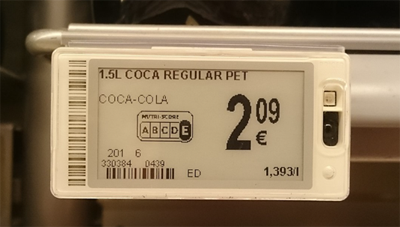
* [Étiquette numérique industrielle](https://fr.wikipedia.org/wiki/%C3%89tiquette_num%C3%A9rique_industrielle)\
    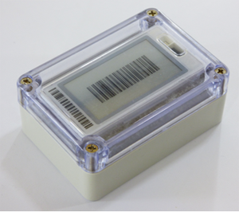


# 2. Module d'affichage e-paper 2.13" Noir et Blanc

## 2.1 Présentation du module
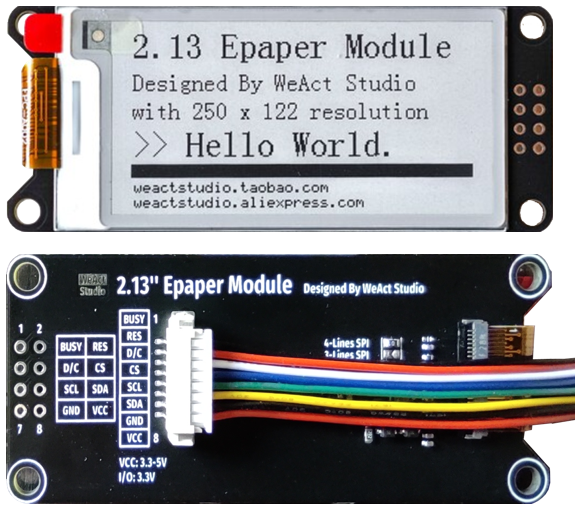

* Le module noir-blanc prend en charge la mise à jour partielle de l'écran (**FastPartialUpdate**)
  * Temps de mise à jour complète de l'écran : < 3s
  * Temps de mise à jour partielle de l'écran : < 0.3s
* Taille de l'écran: 2.13 pouces
* Résolution d'affichage: **250x122 pixels**
* Couleur d'affichage: noir-blanc
* Alimentation et Niveaux e/s: **3.3V**
* Type de connecteur: MX1.25-8P
* Taille du Module: 72mm x 30mm
* Technologie : Active Matrix **Electro phoretic Display** (AM EPD)
* Display controller/driver : **SSD1680**
* Marque : WeAct Studio
* Achat : 9€ - https://fr.aliexpress.com/item/1005004644515880.html

## 2.2 Documentation
* Documentation : https://github.com/WeActStudio/WeActStudio.EpaperModule
* Datasheet : https://github.com/WeActStudio/WeActStudio.EpaperModule/blob/master/Doc/ZJY122250-0213BBDMFGN-R.pdf


# 3. Connexion avec un ESP32
L'écran se connecte sur un **[bus SPI](bus-SPI.md)** de l'ESP et utilise quelques autres broches GPIO.

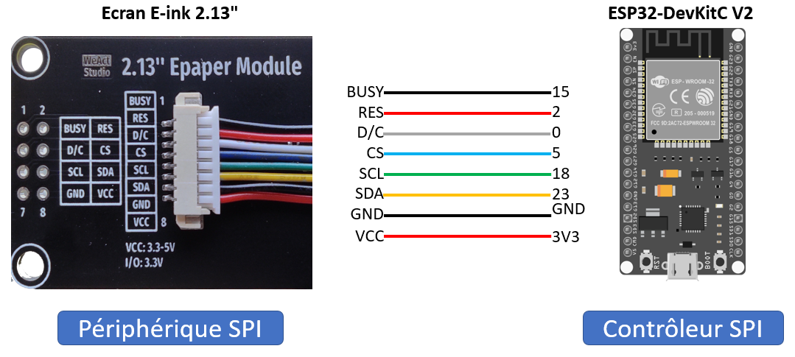

| Ecran E-paper 250x122 2.3" | ESP32_DevKitC_V2 | Fonction                       |
|--------------------------|------------------|--------------------------------|
| BUSY                     | 15               | Busy state output pin          |
| RES                      | 2                | Reset signal input. Active Low |
| D/C                      | 0                | Data / Command control pin     |
| CS                       | 5                | SPI Chip Select (CS)           |
| SCL                      | 18               | SPI serial clock line (SCK)    |
| SDA                      | 23               | SPI data line (MOSI)           |
| GND                      | GND              | Ground                         |
| VCC                      | 3V3              | Power                          |


# 4. Programmation dans VScode / PlatformIO
## 4.1 Installation de la bibliothèque GxEPD2
La bibliothèque **GxEPD2** est une lib complète qui permet de gérer les écrans e-paper connectés en SPI. ([Github de la lib GxEPD2](https://github.com/ZinggJM/GxEPD2))\
GxEPD2 utilise la lib standard **Adafruit_GFX** pour l'affichage du texte et des graphiques ([documentation ici](https://learn.adafruit.com/adafruit-gfx-graphics-library)).

Intégration dans VScode / PlatformIO :\
Menu PlatformIO > Library : Installation de la lib ```GxEPD2 by Jean-Marc Zingg``` - [Dépôt GitHub](https://github.com/ZinggJM/GxEPD2)

Les fichiers de la lib et les exemples sont disponibles dans le sous-dossier du projet :\
**```.pio\libdeps\[board]\GxEPD2\```**

## 4.2 Création d'un objet GxEPD2 et initialisation
> L'initialisation présenté ici s'inspire de l'[exemple du constructeur WeActStudio](https://github.com/WeActStudio/WeActStudio.EpaperModule/tree/master/Example/EpaperModuleTest_Arduino_ESP32)\
> Par contre, le modèle d'e-paper est différent (GxEPD2_290_BS) pour une meilleure gestion lors du réveil du l'ESP32 après un deepsleep.

```cpp
#include <Arduino.h>
#define ENABLE_GxEPD2_GFX 0
#include <GxEPD2_BW.h>

// EPD Module GxEPD2_290_BS avec controller SSD1680
GxEPD2_BW<GxEPD2_290_BS, GxEPD2_290_BS::HEIGHT> display(GxEPD2_290_BS(/*CS=5*/ 5, /*DC=*/0, /*RST=*/2, /*BUSY=*/15));

void setup()
{
  Serial.begin(115200);
  // initialisation de l'objet GxEPD2_213_BN
  display.init(115200,true,50,false);
}
void loop()
{}
```

## 4.3 Initialisation en choisissant les broches SPI (éventuellement)
Si vous voulez utiliser d'autres broches pour le bus VSPI à la place des broches standards 5, 18, 19 and 23, il faut modifier display.init(...) :

```cpp
#include <Arduino.h>
#define ENABLE_GxEPD2_GFX 0
#include <GxEPD2_BW.h>

// EPD Module GxEPD2_290_BS avec controller SSD1680
GxEPD2_BW<GxEPD2_290_BS, GxEPD2_290_BS::HEIGHT> display(GxEPD2_290_BS(/*CS=5*/ 5, /*DC=*/0, /*RST=*/2, /*BUSY=*/15));

void setup()
{
  Serial.begin(115200);
  // Choix des broches du bus SPI
  SPI.end();
  SPI.begin(/*sck*/ 18, /*miso*/ 19, /*mosi*/ 22, /*ss*/ 5);
  
  //initialisation de l'objet GxEPD2_213_BN
  display.init(115200, true, 50, false, SPI, SPISettings(4000000, MSBFIRST, SPI_MODE0));
}
void loop()
{}
```

## 4.4 Système de coordonnées et unités
L'affichage sur l'écran (texte ou graphiques) utilise la bibliothèque Adafruit_GFX ([documentation ici](https://learn.adafruit.com/adafruit-gfx-graphics-library)).

Chaque élément à afficher devra donc être placé sur la surface de l'écran en utilsant le pixel comme unité.

L'origine des coordonnées est le coin supérieur gauche. Chaque élément est donc placé à un certains nombre de pixels du bord gauche et du bord haut.

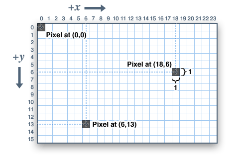

Le positionnement d'un élément graphique s'effectue avec ```display.setCursor(int16_t x, int16_t y)```

Le positionnement prend automatiquement en compte l'orientation choisie avec ```display.setRotation();```

**Remarque importante** : La taille de l'écran est de 122 x 250 pixels. La bibliothèque GxEPD2 utilise un buffer de 128 x 250.\
Quand on place les éléments sur l'écran avec les fonctions de la lib, il faut se rappeler que les pixels affichables sur notre écran sont dans la zone suivante :
* x entre 0 et 249
* y entre 6 et127

## 4.5 Choisir l'orientation de l'affichage
> Fonction principale : ```display.setRotation(uint8_t x)```

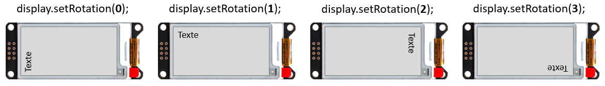

## 4.6 Rafraichissement total de l'écran au démarrage
> Fonction principale : ```display.clearScreen();```

L'appel de cette fonction est nécessaire pour initialiser l'écran et la mémoire du contrôleur SSD1680 avant tout affichage.

Cependant, cette fonction est automatiquement appelée si le premier affichage se fait avec une mise à jour complète de l'écran (display.setFullWindow())

> L'initialisation de l'écran provoque un gros scintillement de l'écran pendant environ 2 secondes.

## 4.7 Affichage avec mise à jour complète de l'écran
> Fonction principale : ```display.setFullWindow();```

L'utilisation de cette fonction permet d'afficher sur n'importe quelle zone de l'écran. 

**Inconvénient** : Cette fonction initialise également l'écran à chaque fois qu'elle est appelée. Elle commence donc par un scintillement de l'écran pendant environ 2 secondes.

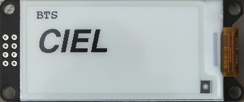

L'affichage de texte se fait de la façon suivante :
```cpp
#include <Fonts/FreeMonoBold9pt7b.h>
#include <Fonts/FreeSansBoldOblique24pt7b.h>
//--

display.setFullWindow();

display.firstPage();
do
{
  display.fillScreen(GxEPD_WHITE);
  display.setTextColor(GxEPD_BLACK);

  display.setFont(&FreeMonoBold9pt7b);
  display.setCursor(10, 20);
  display.print("BTS");

  display.setFont(&FreeSansBoldOblique24pt7b);
  display.setCursor(10, 70);
  display.print("CIEL");
} while (display.nextPage());
```

**Doc pour choisir une police de caractères** : Adafruit GFX > [Using Fonts](https://learn.adafruit.com/adafruit-gfx-graphics-library/using-fonts)

<!-- On peut aussi utiliser les fonts u8g2, cf example GxEPD2_U8G2_Fonts_Example.ino et https://github.com/olikraus/u8g2/wiki/fnticons -->

**Remarque** : Tous les affichages doivent se faire à l'intérieur d'une "boucle d'affichage" :
```cpp
display.firstPage();
do { ... } while (display.nextPage());
```
Des explications sur le rôle de cette boucle : https://github.com/olikraus/u8glib/wiki/tpictureloop

<!-- sinon /examples/GxEPD2_NotPagedExample/GxEPD2_NotPagedExample.ino -->


## 4.8 Affichage avec mise à jour partielle de l'écran
> Fonction principale : ```display.setPartialWindow(uint16_t x, uint16_t y, uint16_t width, uint16_t height)```

Cette fois ci, il n'y a pas de scintillement de l'écran à chaque appel de la fonction.

> Il faudra néanmoins appeler une fois (au démarrage) la fonction display.clearScreen()

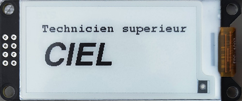

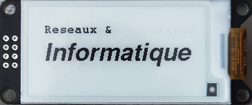

```cpp
#include <Fonts/FreeMonoBold9pt7b.h>
#include <Fonts/FreeSansBoldOblique24pt7b.h>
#include <Fonts/FreeSansBoldOblique18pt7b.h>
//--

display.setPartialWindow(0, 0, display.width(), display.height());
// Premier écran
display.firstPage();
do
{
  display.fillScreen(GxEPD_WHITE);
  display.setTextColor(GxEPD_BLACK);

  display.setFont(&FreeMonoBold9pt7b);
  display.setCursor(20, 40);
  display.print("Technicien superieur");

  display.setFont(&FreeSansBoldOblique24pt7b);
  display.setCursor(20, 90);
  display.print("CIEL");
} while (display.nextPage());
delay(1000);

//Deuxième écran
display.firstPage();
do
{
  display.fillScreen(GxEPD_WHITE);
  display.setTextColor(GxEPD_BLACK);

  display.setFont(&FreeMonoBold9pt7b);
  display.setCursor(20, 40);
  display.print("Reseaux &");

  display.setFont(&FreeSansBoldOblique18pt7b);
  display.setCursor(20, 80);
  display.print("Informatique");
} while (display.nextPage());
```

## 4.9 Mise à jour partielle d'une zone de l'écran
> Fonction principale : ```display.setPartialWindow(box_x, box_y, box_w, box_h);```

Cette fonction permet de mettre à jour une zone de l'écran, en laissant inchangés les affichages en dehors de cette zone.

> Toutes la zone sera "effacée" avant d'afficher autre chose

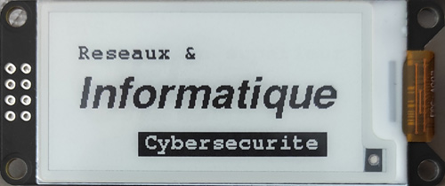

```cpp
#include <Fonts/FreeMonoBold9pt7b.h>
//--

display.setPartialWindow(70, 100, 155, 20);

display.firstPage();
do
{
  display.fillRect(70, 100, 155, 20, GxEPD_BLACK);
  display.setTextColor(GxEPD_WHITE);
  display.setFont(&FreeMonoBold9pt7b);
  display.setCursor(70 + 5, 100 + 20 - 7);
  display.print("Cybersecurite");
} while (display.nextPage());
```

## 4.10 Afficher des formes géométriques
Il existe plusieurs fonctions pour tracer des points, des lignes, des rectangles, des cercles.

Documentation : Adafruit GFX > [Graphics Primitives](https://learn.adafruit.com/adafruit-gfx-graphics-library/graphics-primitives)

Par exemple, pour tracer un rectangle :

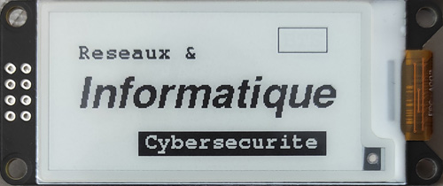

```cpp
display.setPartialWindow(185, 15, 41, 21);

display.firstPage(); 
do
{
  display.drawRect(185, 15, 41, 21, GxEPD_BLACK);
} while (display.nextPage());
```

**Remarque** : l'intérieur du rectangle est réinitialisé en blanc. Si vous voulez écrire dans le rectangle, il faut donc commencer par tracer le rectangle, puis écrire le texte dedans.

## 4.11 Calculer la taille d'un texte avant de l'afficher
> Fonction principale : ```display.getTextBounds("texte", 0, 0, &tbx, &tby, &tbw, &tbh);```

En fonction de la police de caractères, la zone d'affichage d'un texte varie. Cette fonction permet de connaitre les dimensions de la zone d'affichage d'un texte AVANT de l'afficher à l'écran. Cela permet de délimiter la zone à mettre à jour.

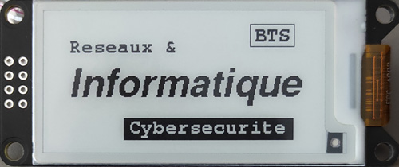

```cpp
int16_t tbx, tby;  // TextBounds X, Y coordinates
uint16_t tbw, tbh; // TextBounds width, height
String texte = "BTS";
uint16_t posX = 190; // position X du texte sur l'écran
uint16_t posY = 20;  // position Y du texte sur l'écran

display.setFont(&FreeMonoBold9pt7b);
display.getTextBounds(texte, 0, 0, &tbx, &tby, &tbw, &tbh);
display.setPartialWindow(posX, posY, tbw, tbh);

display.firstPage();
do
{
  display.fillRect(posX, posY, tbw, tbh, GxEPD_WHITE);
  display.setTextColor(GxEPD_BLACK);
  display.setCursor(posX - tbx, posY - tby);
  display.print(texte);
} while (display.nextPage());
```

## 4.12 Arrêter l'alimentation de l'écran
> Fonction principale : ```display.hibernate();```

Cette fonction permet d'éteindre l'alimentation de l'écran et de passer le controleur en mode "Deep Sleep". Cela permet de diminuer au maximum l'énergie consommée.

**Remarques** : 
* Le dernier affichage reste présent sur l'écran, même sans énergie !
* Cette fonction peut être appelée n'importe quand, y compris entre deux affichages.
* Il n'y a pas de scintillement de l'écran au réveil
* N'importe quelle fonction d'affichage réveille automatiquement l'écran

```cpp
display.hibernate();
```


## 4.13 Afficher une image au format X BitMap (XBM)

### 4.13.1 Le format XBM
> **X BitMap**, abrégé **XBM**, est un format d'image numérique **monochrome** originellement conçu pour le système X Window, notamment pour les images de pointeur et d'icône.\
> Le format XBM **décrit les images en langage C**, ce qui permet à un programmeur d'intégrer très facilement des images XBM à un logiciel écrit en C.\
> ([Source Wikipédia](https://fr.wikipedia.org/wiki/X_BitMap))

Les images XBM sont très utilisées sur les petits écrans des systèmes embarqués. **L'intérêt principal est la très petite taille en mémoire vive**.\
L'autre intérêt est que l'image est stockée dans le code source du programme : pas besoin d'avoir un stockage externe pour les fichiers.

Vous trouverez un exemple de fichier XBM ici : [eiffel-logo-100-100.h](xbm/eiffel-logo-100-100.h)

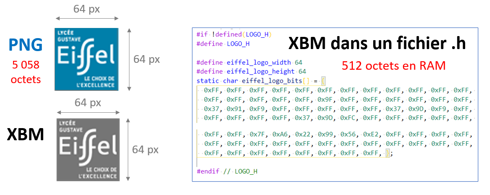

*Dans cet exemple l'image est composée de 4096 pixels (64x64). Comme le format XBM est monochrome Noir ou Transparent, **chaque pixel sera codé sur un seul bit** (Noir 1, Transparent 0). La taille de l'image en RAM est donc de 64x64 = 4096 bits = 512 octets.*

### 4.13.2 Création d'un fichier XBM
Le plus simple est d'utiliser un site web spécialisé dans la conversion au format XBM :
1. On fournit un fichier image standard (PNG, JPG, BMP) aux bonnes dimensions (préférez le format Noir&Blanc sur 1 bit) 
2. On clique sur convertir
3. On télécharge le fichier XBM
4. On change l'extension du fichier en .h
5. On modifie le nom des constantes
6. On ajoute des directives d'inclusions conditionnelles

Voici deux sites qui exportent au format XBM :
* https://convertio.co/fr/png-xbm/
* https://www.online-utility.org/image/convert/to/XBM

Et un site pour convertir une image en Noir&Blanc sur 1 bit :
* https://observablehq.com/@iamgrahamallen/convert-image-to-one-bit

On peut aussi utiliser GIMP pour générer le fichier XBM à partir d'un fichier image standard (PNG, JPG, BMP) :
1. Ouvrir l'image PNG, JPG, ...
2. Convertir en Noir/Blanc 1 bit : Image > Mode > Couleurs indexées :
   * Utiliser une palette noir et blanc (1-bit)
   * Tramage des couleurs : Couleurs qui déteignent le moins
   * Activer le tramage de la transparence
   * Activer le tramage des calques de texte
   * Convertir
3. Fichier > Exporter sous :
   * Sélectionner le type de fichier : Image bitmap X
   * Exporter
   * Préfixe d'identification : c'est le nom du tableau d'octets créé dans le fichier XBM
   * Exporter

### 4.13.3 Afficher une image XBM sur l'écran e-paper
> Attention à fixer la taille de l'image telle qu'elle apparaitra sur l'écran.

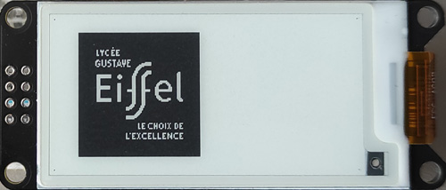

Copiez le fichier ```eiffel-logo-100-100.h``` qui contient l'image XBM dans ```/include``` du projet platformIO.

Ajoutez la directive d'inclusion dans votre programme :
```cpp
#include "eiffel-logo-100-100.h"
```

Déclarez la fonction d'affichage AVANT setup() :
```cpp
void drawXBM_encod1pix1bit(int16_t x, int16_t y, const uint8_t bitmap[], int16_t w, int16_t h, uint16_t color)
{
  int16_t byteWidth = (w + 7) / 8;
  uint8_t byte = 0;
  for (int16_t j = 0; j < h; j++)
  {
    for (int16_t i = 0; i < w; i++)
    {

      byte = pgm_read_byte(&bitmap[j * byteWidth + i / 8]) & (1 << (i & 7));

      if (byte != 0)
      {
        display.drawPixel(x + i, y + j, color);
      }
    }
  }
}
```

Appelez la fonction d'affichage XBM :
```cpp
display.setPartialWindow(20, 17, eiffel_logo_width, eiffel_logo_height);

display.firstPage();
do
{
  display.fillScreen(GxEPD_WHITE);
  drawXBM_encod1pix1bit(20, 17, (const uint8_t *)eiffel_logo_bits, eiffel_logo_width, eiffel_logo_height, GxEPD_BLACK);
} while (display.nextPage());
```

## 4.14 Affichage partiel après un deepsleep de l'ESP

Pour économiser un maximum d'énergie entre chaque affichage, il faut :
- Mettre l'e-paper en mode hibernate
- Mettre l'ESP en mode deepsleep

Au premier démarrage de l'ESP :
- il faut initialiser **complètement** l'écran e-paper
- on fait un affichage avec mise à jour complète de l'écran

A chaque réveil de l'ESP après le deepsleep :
- il faut faire une initialisation **partielle** de l'écran (ça évite les scintillement au réveil)
- on fait des mises à jour partielles d'une zone de l'écran.


Pour savoir s'il s'agit du premier démarrage ou un réveil de deepsleep, on peut utiliser une variable stoquée en RAM RTC (cf plus d'explication dans "[ESP32 Deep Sleep and Wake Up Sources](21.esp32-deep-sleep.md)")

```cpp
RTC_DATA_ATTR bool first_boot = true;

//...

  if (first_boot == true)
  {
    first_boot = false;
    // initialisation COMPLETE de l'objet GxEPD2_290_BS
    display.init(115200, true, 50, false);
    display.setRotation(1);
    display.clearScreen();
  }
  else
  {
    // initialisation PARTIELLE de l'objet GxEPD2_290_BS
    display.init(115200, false, 50, false);
    display.setRotation(1);
  }
```

Vous trouverez des explications supplémentaires [ici](https://www.makerguides.com/partial-refresh-e-paper-display-esp32/#Partial_Refresh_with_Deep_Sleep)