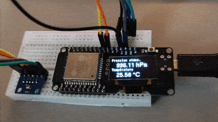
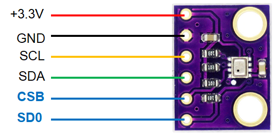
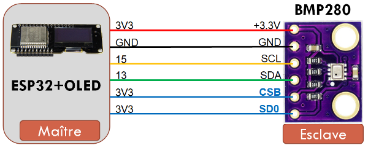

# Capteur de température / pression BMP280 sur ESP32

> * Auteur : Gwénaël LAURENT
> * Date : 23/01/2021
> * OS : Windows 10 (version 1903)
> * VScode : version 1.52.1 (system setup)
> * Node.js : version 12.16.2
> * PlatformIO : Core 5.0.4 Home 3.3.1

- [Capteur de température / pression BMP280 sur ESP32](#capteur-de-température--pression-bmp280-sur-esp32)
- [1. Le capteur BMP280](#1-le-capteur-bmp280)
- [2. Documentation](#2-documentation)
- [3. Connexion en I2C](#3-connexion-en-i2c)
- [4. Programmation dans VScode / PlatformIO](#4-programmation-dans-vscode--platformio)
- [5. Affichage sur l'écran OLED](#5-affichage-sur-lécran-oled)
- [6. Pour aller plus loin ...](#6-pour-aller-plus-loin-)

# 1. Le capteur BMP280
Le BMP280 (marque BOSH) est un capteur de la pression atmosphérique et de la température.





Il peut être connecté à l'ESP sur un ```bus I2C``` ou sur un bus ```SPI```. Le choix du mode de communication se fait grâce à la broche ```CSB (chip select)```
* **Bus I2C** : Relier CSB à +3.3V.
* **Bus SPI** : Relier CSB à GND.

Le capteur BMP280 est un esclave I2C. Son adresse I2C est définie par l'état de la broche SDO :
* **SDO relié à GND** : L'adresses I2C du capteur est **```0x76```**
* **SDO relié à +3.3V** : L'adresses I2C du capteur est **```0x77```**

> **ATTENTION** : il ne faut surtout pas avoir une tension sur les broches SDA et SCL AVANT de brancher VCC (+3.3V). Destruction immédiate du capteur !

Le BMP280 peut fonctionner suivant 3 modes d'économie d'énergie :
* sleep mode (aucune mesure)
* normal mode (mesures périodiques)
* forced mode (une mesure puis retourne en sleep mode)

Gamme de mesure et précision :
* pression atmosphérique : 300...1100 hPa (précision +/- 1 hPa, résolution 0.0016hPa)
* température : -40...+85°C (précision +/-1°C, résolution 0.01°C)

Consommation électrique : 
* tension d'alimentation : 1.71 ... 3.6 V
* 1 mesure par seconde : 2.74 μA
* sleep mode : 0.1 µA


# 2. Documentation
* Documentation technique du BMP280 : [https://cdn-shop.adafruit.com/datasheets/BST-BMP280-DS001-11.pdf](https://cdn-shop.adafruit.com/datasheets/BST-BMP280-DS001-11.pdf)

# 3. Connexion en I2C
Branchement sur l'ESP32 PIN SDA=13 et SCL=15. Adresse I2C = 0x77



> **Attention sur l'ESP32 + OLED** : on ne peut pas brancher le BMP280 sur le même bus I2C que l'afficheur OLED (addrI2C=0x78, sda=5, scl=4). Il y a vraisemblablement un conflit des bibliothèques concernant l'accès simultané au bus I2C.

> **Pour un ESP8266**, la programmation est identique mais il faut évidemment changer les numéros de broches du bus I2C. \
> Vous pouvez par exemple utiliser pour les lignes SDA/SCL = GPIO4(D2)/GPIO5(D1) ou GPIO12(D6)/GPIO14(D5).

# 4. Programmation dans VScode / PlatformIO
Créer un nouveau projet PlatformIO
* Board : **```WEMOS LOLIN32```**
* Framework : **```Arduino```**

Installer la lib ```SparkFun BME280 (SparkFun Electronics)``` (Menu PlatformIO > Library)

> [Dépôt GitHub](https://github.com/sparkfun/SparkFun_BME280_Arduino_Library)

> La lib SparkFun est faite pour un autre capteur plus complet que le BMP280 (le capteur BME280 permet en plus de mesurer le pourcentage d'humidité dans l'air). Donc, il ne faut pas utiliser les fonctions relatives à l'humidité et tout le reste fonctionne pour le BMP280.

Pour utiliser la lib SparkFun, il faut explorer les exemples fournis et les commentaires dans son codage.

Le code de ```main.cpp``` qui suit s'inspire de l'exemple 1 (\.pio\libdeps\lolin32\SparkFun BME280\examples\Example1_BasicReadings).

Il y a quelques modifications :
* choix des pins du bus I2C (SDA et SCL)
* variables pour stocker la pression et la température
* température en °C
* pression en hPa

L'affichage de la température et de la pression se fait dans la console série paramétrée en 115200 bit/s. Il faut ajouter dans le **fichier de configuration du projet** ```/platformio.ini``` : 

```ini
[env:lolin32]
monitor_speed = 115200
```

Codage du programme principal ```main.cpp``` :
```cpp
#include <Arduino.h>
#include <Wire.h> //pour accéder au bus I2C
#include "SparkFunBME280.h" //inclusion de la lib BMP280

BME280 capteurBMP280; //pour communiquer avec le capteur
int sdaBMP280 = 13; //broche SDA BMP280
int sclBMP280 = 15; //broche SCL BMP280
int addrI2CBMP280 = 0x77; //adresses I2C BMP280
float pression = 0.0; //pour stocker la pression
float temperature = 0.0; //pour stocker la température
String msgConsole = ""; //message pour la console

void setup()
{
  Serial.begin(115200);
  Wire.begin(sdaBMP280, sclBMP280); //Conf de la liaison I2C
  capteurBMP280.setI2CAddress(addrI2CBMP280); //adresse I2C du BMP280
  
  if (capteurBMP280.beginI2C(Wire) == false)
    Serial.println("BMP280 : communication impossible");
}

void loop()
{
  //Pression atmosphérique
  pression = capteurBMP280.readFloatPressure() / 100; // en hPa
  msgConsole = "Pression : " + (String)pression + " hPa - ";

  //température
  temperature = capteurBMP280.readTempC();
  msgConsole += "Température : " + (String)temperature + " °C";

  Serial.println(msgConsole);
  delay(500);
}
```

# 5. Affichage sur l'écran OLED
<!-- I:\temp\esp32-bmp280 -->
En intégrant également au projet la bibliothèque ```SSD1306_I2C``` pour gérer l'affichage sur l'écran OLED ([documentation ici](05a.pio-esp-OLED-ssd1306.md)), on peut facilement afficher la pression et la température sur l'écran OLED.

Exemple d'affichage géré dans ```main.cpp```  :
```cpp
#include <Arduino.h>
#include <Wire.h>           //pour accéder au bus I2C
#include "SparkFunBME280.h" //inclusion de la lib BMP280
#include "SSD1306_I2C.hpp" //inclusion de la lib SSD1306_I2C

//création d'un objet de la lib : SSD1306_I2C u8g2(addrI2C, sda_pin, scl_pin);
SSD1306_I2C u8g2(0x78, 5, 4);

BME280 capteurBMP280;     //pour communiquer avec le capteur
int sdaBMP280 = 13;       //broche SDA BMP280
int sclBMP280 = 15;       //broche SCL BMP280
int addrI2CBMP280 = 0x77; //adresses I2C BMP280
float pression = 0.0;     //pour stocker la pression
float temperature = 0.0;  //pour stocker la température
String msgConsole = "";   //message pour la console

void setup()
{
  u8g2.begin();
  // u8g2.SetLine("Pression atmosphérique :", 0);
  // u8g2.SetLine("Température :", 3);

  Serial.begin(115200);
  Wire.begin(sdaBMP280, sclBMP280);           //Conf de la liaison I2C
  capteurBMP280.setI2CAddress(addrI2CBMP280); //adresse I2C du BMP280

  if (capteurBMP280.beginI2C(Wire) == false)
    Serial.println("BMP280 : communication impossible");
}

void loop()
{
  //Pression atmosphérique
  pression = capteurBMP280.readFloatPressure() / 100; // en hPa
  msgConsole = "Pression : " + (String)pression + " hPa - ";

  //température
  temperature = capteurBMP280.readTempC();
  msgConsole += "Température : " + (String)temperature + " °C";

  Serial.println(msgConsole);
  u8g2.Afficher2Valeurs("Pression atmos.", (String)pression + " hPa", "Température", (String)temperature + " " + "\xb0" + "C");

  delay(500);
}
```

# 6. Pour aller plus loin ...
Explorez les exemples de la lib SparFun, notamment :
* Economie d'énergie avec le ```forced mode``` : *Example6_LowPower.ino*
* Lire toutes les données du capteur en une seule fois : *Example11_BurstRead.ino*

