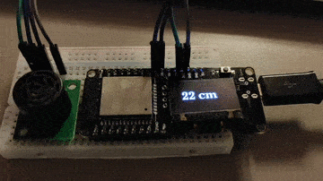
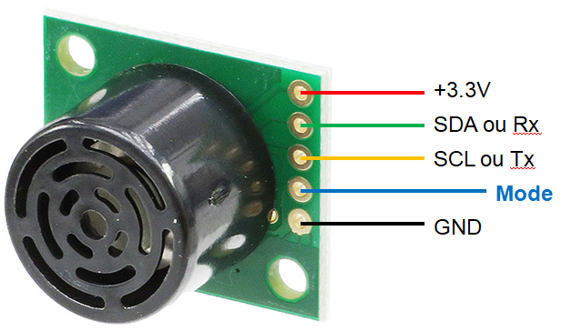
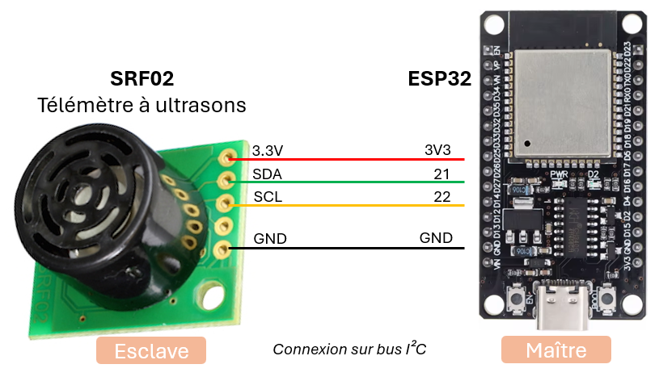

# Télémètre à ultrasons SRF02 sur ESP32

> * Auteur : Gwénaël LAURENT
> * Date : 28/03/2026


- [Télémètre à ultrasons SRF02 sur ESP32](#télémètre-à-ultrasons-srf02-sur-esp32)
- [1. Le capteur SRF02](#1-le-capteur-srf02)
- [2. Documentation](#2-documentation)
- [3. Connexion en I2C](#3-connexion-en-i2c)
- [4. Programmation dans VScode / PlatformIO](#4-programmation-dans-vscode--platformio)

# 1. Le capteur SRF02
C'est un transducteur à ultrasons. Il permet de mesurer des distances en mesurant le temps entre l'émission d'un ultrason (40kHz) et la réception de son echo.





Il peut être connecté à l'ESP sur un ```bus I2C``` ou en ```liaison série```. Le choix du mode de communication se fait grâce à la broche ```Mode```
* **Liaison série** : Relier la broche `Mode` à la GND. >> TTL level UART format at 9600 baud,1 start, 2 stop and no parity bits
* **Bus I2C** : Ne rien connecter sur la broche `Mode` >> Adresse I2C par défaut = 0x70, Pas de résistance de pull-up en interne


# 2. Documentation
* Documentation technique du SRF02 : [http://robot-electronics.co.uk/htm/srf02tech.htm](http://robot-electronics.co.uk/htm/srf02tech.htm)
* Exemple de codage Arduino : [https://wiki.dfrobot.com/SRF02_Ultrasonic_sensor__SKU_SEN0005_#target_4](https://wiki.dfrobot.com/SRF02_Ultrasonic_sensor__SKU_SEN0005_#target_4)

# 3. Connexion en I2C
Branchement sur l'ESP32 PIN SDA=21 et SCL=22




# 4. Programmation dans VScode / PlatformIO
Créer un nouveau projet PlatformIO
* Board : **```Espressif ESP32 Dev Module```**
* Framework : **```Arduino```**

Pas besoin de bibliothèque spéciale, le code de test utilise seulement la bibliothèque standard pour le bus I2C **```Wire.h```**. L'affichage de la distance mesurée se fait dans la console série.

```cpp
#include <Arduino.h>

#include <Wire.h>

const int sda_pin = 21;    // Bus I2C
const int scl_pin = 22;    // Bus I2C
const int addr_i2c = 0x70; // Addr I2C de capteur SRF02

int reading = 0;

void setup()
{
  Serial.begin(9600);           // start serial communication at 9600bps
  Wire.begin(sda_pin, scl_pin); // join i2c bus (address optional for master)
}

void loop()
{
  // step 1: instruct sensor to read echoes
  Wire.beginTransmission(addr_i2c); // transmit to device #112 (0x70)
  // the address specified in the datasheet is 224 (0xE0)
  // but i2c adressing uses the high 7 bits so it's 112
  Wire.write(byte(0x00)); // sets register pointer to the command register (0x00)
  Wire.write(byte(0x51)); // command sensor to measure in "centimeters" (0x51)
  // use 0x51 for centimeters
  // use 0x52 for ping microseconds
  Wire.endTransmission(); // stop transmitting

  // step 2: wait for readings to happen
  delay(70); // datasheet suggests at least 65 milliseconds

  // step 3: instruct sensor to return a particular echo reading
  Wire.beginTransmission(addr_i2c); // transmit to device #112
  Wire.write(byte(0x02));           // sets register pointer to echo #1 register (0x02)
  Wire.endTransmission();           // stop transmitting

  // step 4: request reading from sensor
  Wire.requestFrom(addr_i2c, 2); // request 2 bytes from slave device #112

  // step 5: receive reading from sensor
  if (2 <= Wire.available()) // if two bytes were received
  {
    reading = Wire.read();  // receive high byte (overwrites previous reading)
    reading = reading << 8; // shift high byte to be high 8 bits
    reading |= Wire.read(); // receive low byte as lower 8 bits
    Serial.print(reading);  // print the reading
    Serial.println("cm");
  }

  delay(250); // wait a bit since people have to read the output :)
}
```


