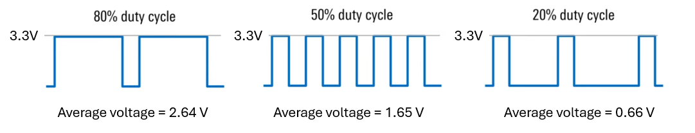
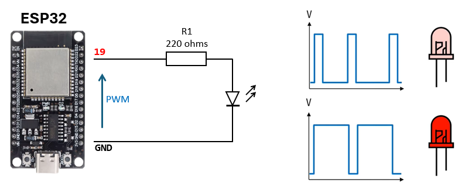
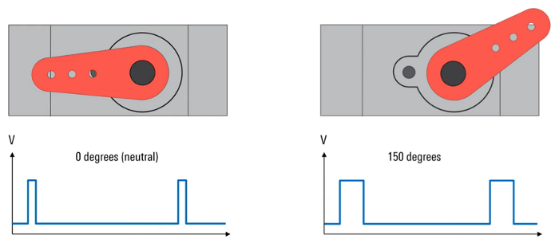
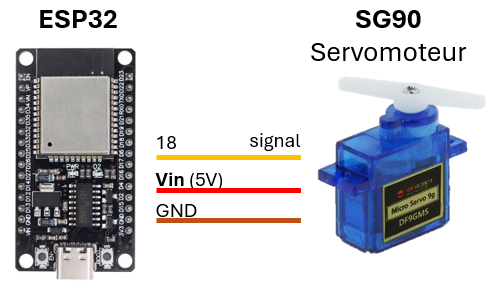

# Le PWM sur ESP32

> * Auteur : Gwénaël LAURENT
> * Date : 28/03/2026
> * Framework : ESP32 Arduino Core v2.x

 [Licence Creative Commons](https://creativecommons.org/licenses/by-nc-sa/3.0/fr/)

- [Le PWM sur ESP32](#le-pwm-sur-esp32)
- [1. Qu'est-ce que le PWM ?](#1-quest-ce-que-le-pwm-)
- [2. Les paramètres clés](#2-les-paramètres-clés)
- [3. Le PWM sur ESP32 : le périphérique LEDC](#3-le-pwm-sur-esp32--le-périphérique-ledc)
- [4. Exemple 1 — LED à intensité variable](#4-exemple-1--led-à-intensité-variable)
- [5. Exemple 2 — Commande d'un servomoteur](#5-exemple-2--commande-dun-servomoteur)
  - [5.1. Principe de fonctionnement](#51-principe-de-fonctionnement)
  - [5.2. Calcul du duty cycle](#52-calcul-du-duty-cycle)
  - [5.3. Montage](#53-montage)
  - [5.4. Codage](#54-codage)


# 1. Qu'est-ce que le PWM ?

Le **PWM** (*Pulse Width Modulation* — Modulation de Largeur d'Impulsion) est une technique qui consiste à faire varier la **durée à l'état haut** d'un signal numérique périodique, afin de **simuler une tension analogique**.

> ⚡ Un microcontrôleur ne sait produire que du 0 V ou du 3,3 V.  
> Le PWM "triche" en allumant et éteignant très rapidement pour donner l'impression d'une tension intermédiaire.

Les signaux PWM sont couramment utilisés pour :
* faire varier l'intensité d'éclairage des LEDS
* commander la vitesse d'un moteur
* commander l'angle d'inclinaison d'un servo-moteur

# 2. Les paramètres clés



[*Crédit Schéma*](https://randomnerdtutorials.com/esp8266-pwm-arduino-ide/)


| Paramètre | Définition | Exemple |
|---|---|---|
| **Fréquence** | Nombre de cycles par seconde (Hz) | 50 Hz pour un servo, 5 kHz pour une LED |
| **Rapport cyclique** *(Duty Cycle)* | % du temps à l'état haut | 50 % → tension "moyenne" de 1,65 V |
| **Résolution** | Précision du réglage (bits) | 8 bits → 256 niveaux (0–255) |


# 3. Le PWM sur ESP32 : le périphérique LEDC

Sur ESP32, le PWM est géré par le périphérique matériel **LEDC** (*LED Controller*).  
Il dispose de **16 canaux indépendants** (numérotés de 0 à 15).

La configuration se fait en **3 étapes** :

```cpp
// Initialisation (à mettre dans setup())
ledcSetup(canal, frequence, resolution_bits); // 1. Configure le canal
ledcAttachPin(pin, canal);                    // 2. Associe le pin GPIO au canal

// Utilisation (à mettre dans loop() ou dans une fonction)
ledcWrite(canal, valeur);                     // 3. Règle le rapport cyclique
```

> ⚠️ **Important :** avec cette API, on écrit sur le **numéro de canal**, pas sur le numéro de pin.  
> Chaque canal utilisé doit avoir un numéro différent.

---

# 4. Exemple 1 — LED à intensité variable



| Paramétrage| LED  |
|---|---|
| GPIO utilisé |  19 |
| Canal LEDC | 0 | 
| Fréquence | 5 000 Hz |
| Résolution | 8 bits  |
| Grandeur réglée | Luminosité  |
| Plage de duty | 0 – 255  |
| Alimentation | 3,3 V via résistance  |

```cpp
// Contrôle de luminosité d'une LED par PWM sur ESP32

#include <Arduino.h>

const int PIN_LED    = 19;   // GPIO connecté à la LED
const int CANAL      = 0;    // Canal LEDC utilisé (0 à 15)
const int FREQ_PWM   = 5000; // Fréquence PWM en Hz
const int RESOLUTION = 8;    // 8 bits → valeurs de 0 à 255

void setup() {
    Serial.begin(115200);

    ledcSetup(CANAL, FREQ_PWM, RESOLUTION); // Configuration du canal
    ledcAttachPin(PIN_LED, CANAL);          // Association du pin au canal
}

void loop() {
    // Augmentation progressive de la luminosité (0 → 255)
    Serial.println("→ Augmentation...");
    for (int duty = 0; duty <= 255; duty++) {
        ledcWrite(CANAL, duty);
        delay(10);
    }

    // Diminution progressive de la luminosité (255 → 0)
    Serial.println("→ Diminution...");
    for (int duty = 255; duty >= 0; duty--) {
        ledcWrite(CANAL, duty);
        delay(10);
    }
}
```

# 5. Exemple 2 — Commande d'un servomoteur

## 5.1. Principe de fonctionnement

Un servomoteur **standard** attend un signal PWM à **50 Hz** (période = 20 ms).  
La **position angulaire** de l'axe dépend uniquement de la **durée de l'impulsion haute** :

```
 Durée de l'impulsion  →  Position de l'axe
 ────────────────────────────────────────────
    ~0,5 ms (500 µs)   →     0°
    ~1,5 ms (1500 µs)  →    +90°
    ~2,5 ms (2500 µs)  →    +180°
```



## 5.2. Calcul du duty cycle

Avec une résolution de **16 bits** (65 535 niveaux) et une fréquence de **50 Hz** (période = 20 000 µs) :

```
duty = (durée_µs / 20 000) × 65 535
```

| Position | Durée impulsion | Duty cycle (16 bits) |
|---|---|---|
| 0° (gauche) | 500 µs | ≈ 1 638 |
| 90° (centre) | 1 500 µs | ≈ 4 915 |
| 180° (droite) | 2 500 µs | ≈ 8 192 |

> 💡 On utilise une résolution de **16 bits** (au lieu de 8) pour avoir une précision angulaire bien meilleure.

## 5.3. Montage



> ⚠️ **Attention alimentation :** un servomoteur peut consommer jusqu'à 1 A sous charge.  
> Ne **pas** l'alimenter depuis la broche 3,3 V de l'ESP32 — utiliser le **5 V externe** ou la broche **VIN** (si alimenté par USB).

## 5.4. Codage

| Paramétrage| Servomoteur  |
|---|---|
| GPIO utilisé |  18 |
| Canal LEDC | 1 | 
| Fréquence | 50 Hz |
| Résolution | 16 bits  |
| Grandeur réglée | Angle  |
| Plage de duty | ~1 638 – 8 192  |
| Alimentation | 5 V externe  |


```cpp
// Commande d'un servomoteur par PWM sur ESP32

#include <Arduino.h>

const int PIN_SERVO = 18;  // GPIO connecté au signal du servo
const int CANAL_SERVO = 1;       // Canal LEDC (différent du canal LED !)
const int FREQ_SERVO = 50; // 50 Hz obligatoire pour un servo standard
const int RESOLUTION = 16; // 16 bits → 0 à 65535 (meilleure précision)

// Si le servo force ou vibre en bout de course → réduire les limites suivantes
const int PULSE_MIN = 500;  // µs — à ajuster si le servo force
const int PULSE_MAX = 2500; // µs — à ajuster si le servo force

/**  Fonction de conversion : angle (0°–180°) → duty cycle 16 bits
Impulsion : de 500 µs (0°) à 2500 µs (180°), pour une période de 20 000 µs */
uint32_t angleToDuty(int angle)
{
  angle = constrain(angle, 0, 180);                             // Sécurité : limiter l'angle
  long impulsion_us = map(angle, 0, 180, PULSE_MIN, PULSE_MAX); // Interpolation linéaire
  return (uint32_t)((impulsion_us * 65535UL) / 20000UL);        // Conversion en duty 16 bits
}

void setup()
{
  Serial.begin(9600);

  ledcSetup(CANAL_SERVO, FREQ_SERVO, RESOLUTION); // Configuration du canal
  ledcAttachPin(PIN_SERVO, CANAL_SERVO);          // Association du pin au canal
}

void loop()
{
  Serial.println("→ Position 0°");
  ledcWrite(CANAL_SERVO, angleToDuty(0));
  delay(1500);

  Serial.println("→ Position 90°");
  ledcWrite(CANAL_SERVO, angleToDuty(90));
  delay(1500);

  Serial.println("→ Position 180°");
  ledcWrite(CANAL_SERVO, angleToDuty(180));
  delay(1500);
}
```

> 📌 La fonction `constrain()` est une bonne pratique : elle évite d'envoyer des valeurs hors plage qui pourraient endommager un servomoteur.

> ⚠️ **Conseil pratique :** si le servo **vibre ou chauffe** en position extrême, c'est qu'on est au-delà de sa limite mécanique. Il faut alors réduire `PULSE_MIN` (monter vers 600–700 µs) ou `PULSE_MAX` (descendre vers 2300–2400 µs) jusqu'à ce que le servo soit silencieux.
