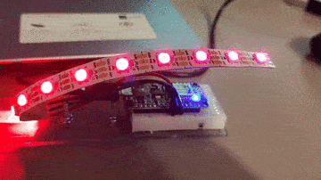
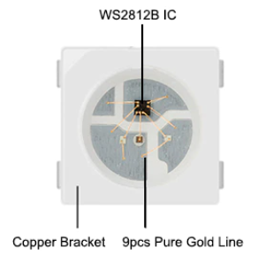
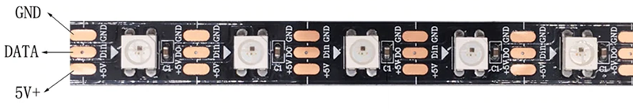
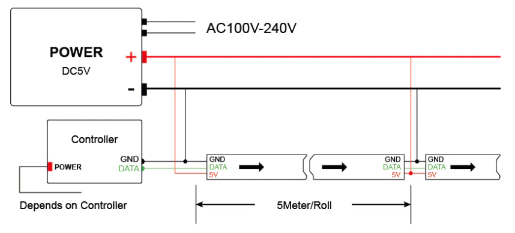
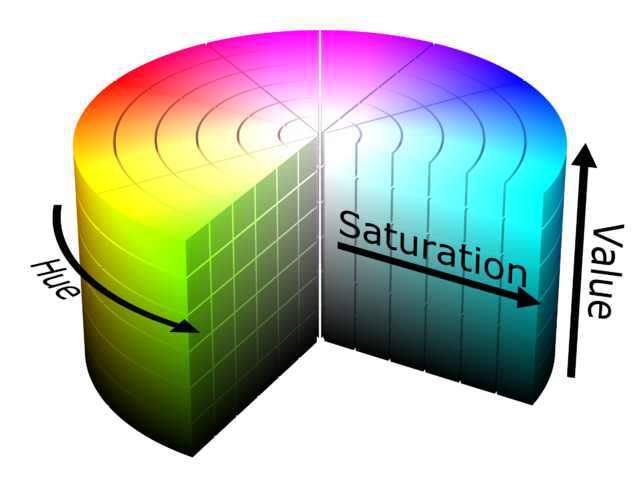

# Ruban de LEDs adressables WS2812 sur ESP8266

> * Auteur : Gwénaël LAURENT
> * Date : 08/01/2023

 [Licence Creative Commons](https://creativecommons.org/licenses/by-nc-sa/3.0/fr/)

- [Ruban de LEDs adressables WS2812 sur ESP8266](#ruban-de-leds-adressables-ws2812-sur-esp8266)
- [1. Présentation](#1-présentation)
- [2. Bibliothèques](#2-bibliothèques)
- [3. Documentation FastLED](#3-documentation-fastled)
- [4. Branchement](#4-branchement)
- [5. Commander l'allumage des LEDs avec la lib FastLED](#5-commander-lallumage-des-leds-avec-la-lib-fastled)
- [6. Utiliser les exemples de la bibliothèque](#6-utiliser-les-exemples-de-la-bibliothèque)

# 1. Présentation
Les rubans de LED dont on parle ici ne sont pas juste des LEDS connectées en parallèle. Il s'agit de LEDS disposées sur un ruban mais commandables individuellement : **```individually-addressable RGB color LEDs```**. Adafruit appelle ça des *NeoPixels*.



Chaque "LED" est composée de 3 LEDs RVB et d'un circuit électronique pour la commander (WS2812B). Toutes les LEDS d'un ruban sont adressables individuellement sur un bus One-Wire (1 seul fil).





Sites marchands :
* [Adafruit NeoPixels](https://www.adafruit.com/category/168)
* [Bande LED intelligente adressable individuellement RVB, WS2812B](https://fr.aliexpress.com/item/32682015405.html)
* [Bande Led WS2812B WS2812, 30/60/74/96/144Pixels/diodes/m, adressable individuellement, intelligent, rvb, 1m/4m/5m, DC5V](https://fr.aliexpress.com/item/32742461421.html)
* [WS2812B 5050 RVB LED Bande 5 M 150 300 LED s 144 30 LED/M Adressable Individuelle 5 V](https://fr.aliexpress.com/item/32776589396.html)

# 2. Bibliothèques
Il existe 2 bibliothèques couramment utilisées pour commander les rubans de LEDs :
* [FastLED by Daniel Garcia](https://github.com/FastLED/FastLED/wiki/Basic-usage)
* [NeoPixelBus by Michael Miller](https://github.com/Makuna/NeoPixelBus/wiki)

Ici, nous utiliserons la bibliothèque **```FastLED```**.

# 3. Documentation FastLED
* Site officiel : [http://fastled.io/](http://fastled.io/)
* Bibliothèque : [https://github.com/FastLED/FastLED](https://github.com/FastLED/FastLED)
* Documentation : [https://github.com/FastLED/FastLED/wiki/Basic-usage](https://github.com/FastLED/FastLED/wiki/Basic-usage)
* API Reference : [http://fastled.io/docs/](http://fastled.io/docs/)


# 4. Branchement
Pour un petit ruban de LEDS WS2812, on peut connecter le ruban directement sur l'ESP8266 en 3.3V. Par exemple :

| Ruban  | ESP8266 |
|:------:|:-------:|
|  +5V   |  3.3V   |
|  Data  |  GPIO2  |
|  GND   |  GND    |

.
> Les grands rubans doivent être alimentés par une alimentation spécifique.



Calcul de puissance de l'alimentation :
* Une LED RVB WS2812 consomme environ 0.3W et doit être alimenté en DC5V.
* Pour éclairer à pleine puissance 300 LEDs, il faut donc une alimentation de 0.3*300 = 90W
* soit une alimentation de 5V * 18A (I=P/U = 90/5 = 18A)


# 5. Commander l'allumage des LEDs avec la lib FastLED
Créer un nouveau projet PlatformIO
* Board : **```NodeMCU 1.0 (ESP-12E Module)```**
* Framework : **```Arduino```**

Installer la lib **```FastLED by Daniel Garcia```** (Menu PlatformIO > Library) - [Dépôt GitHub](https://github.com/FastLED/FastLED)

Initialisation du ruban :
```cpp
#include <Arduino.h>
//Pour adapter la lib FastLED à l'ESP
#define FASTLED_ESP8266_RAW_PIN_ORDER
//ajout de la lib
#include <FastLED.h>

#define NUM_LEDS 10 //nombre de LED du ruban
#define DATA_PIN 2 //D4 broche du bus de commande du ruban

//Création d'un tableau pour stocker et contrôler les LEDS
CRGB leds[NUM_LEDS];

void setup()
{
  //configuration du ruban de LEDs
  FastLED.addLeds<NEOPIXEL, DATA_PIN>(leds, NUM_LEDS);
}

void loop()
{
  // commander les LEDS
}
```
Pour éteindre toutes les LEDS du ruban :
```cpp
FastLED.clear();
```

Pour allumer la première LED en rouge et la deuxième en vert :
```cpp
leds[0] = CRGB::Red;
leds[1] = CRGB::Green;
FastLED.show();
```
Pour éteindre la première LED :
```cpp
leds[0] = CRGB::Black;
FastLED.show();
```

On peut également utiliser toute la gamme **```RVB```** :
```cpp
leds[2] = CRGB(0, 0, 255);
leds[3] = CRGB(127, 127, 0);
FastLED.show();
```

Et on peut aussi utiliser l'espace colorimétrique **```HSV (Hue, Saturation, Value)```** = TSV (Teinte, Saturation, Valeur). La valeur correspond à la luminosité. Chacune des 3 composantes est codée sur 8 bits.
```cpp
leds[4] = CHSV( 224, 187, 255);
FastLED.show();
```

> Le système HSV permet plus facilement de représenter les couleurs de l'arc en ciel, et de faire de beaux dégradés...


[Photo Wikipedia](https://fr.wikipedia.org/wiki/Fichier:HSV_color_solid_cylinder.png)

# 6. Utiliser les exemples de la bibliothèque
**Attention** : les exemples de la bibliothèque sont fait pour fonctionner dans le logiciel *Arduino IDE*. Pour PlatformIO **l'ordre des fonctions est mauvais** (dans le code source). 

Pour le compilateur de PlatformIO, il faut respecter les règles standards du langage C : **```une fonction doit être déclarée AVANT d'être appelée```**.

Donc quand vous copiez dans **```main.cpp```** le code d'un exemple de la bibliothèque, par exemple **```ColorPalette.ino```** :
1. N'oubliez pas d'adapter le code à l'ESP en ajoutant au début :
    ```cpp
    #include <Arduino.h>
    #define FASTLED_ESP8266_RAW_PIN_ORDER
    ```
2. Si lors de la compilation vous avez un message du style :
    ```
    src\main.cpp: In function 'void loop()':
    src\main.cpp:53:31: error: 'ChangePalettePeriodically' was not declared in this scope
        ChangePalettePeriodically();
                                  ^
    ```
    C'est que dans la fonction ```loop()```, il y a un appel à la fonction ```ChangePalettePeriodically()``` et que le code de cette fonction devrait se trouver AVANT la fonction ```loop()``` :
    ```cpp
    ...
    void loop()
    {
      ChangePalettePeriodically();
      ...
    }
    ...
    void ChangePalettePeriodically()  //définition de la fonction
    { ... }
    ```
    Vous avez alors deux possibilités :
    * Déplacer le code de toutes ces fonctions au dessus des fonctions qui les appellent (*c'est vite fastidieux ...*)
    * Ou simplement indiquer au compilateur qu'il trouvera le code de la fonction plus bas dans le fichier. Pour cela il suffit de **déclarer le prototype des fonctions** juste après les #include

    ```cpp
    #include <Arduino.h>
    #define FASTLED_ESP8266_RAW_PIN_ORDER

    void ChangePalettePeriodically(); //déclaration pour le compilateur
    ...
    void loop()
    {
      ChangePalettePeriodically();
      ...
    }
    ...
    void ChangePalettePeriodically()  //définition de la fonction
    { ... }
    ```


Pour voir les possibilités offertes par la lib FastLED, adaptez le code de l'exemple **```ColorPalette```**.

