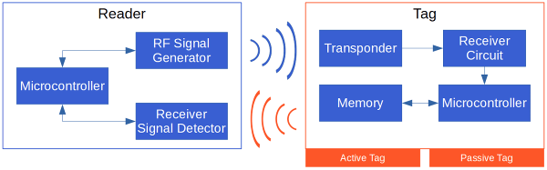
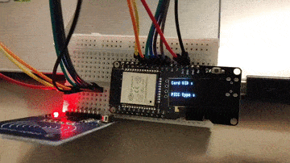
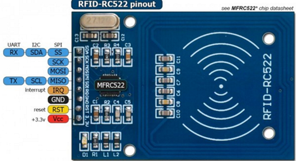
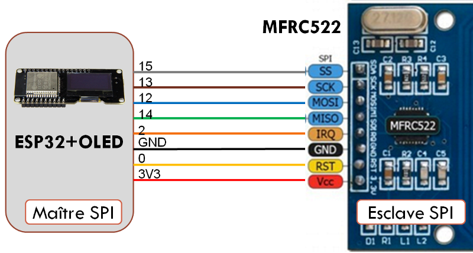
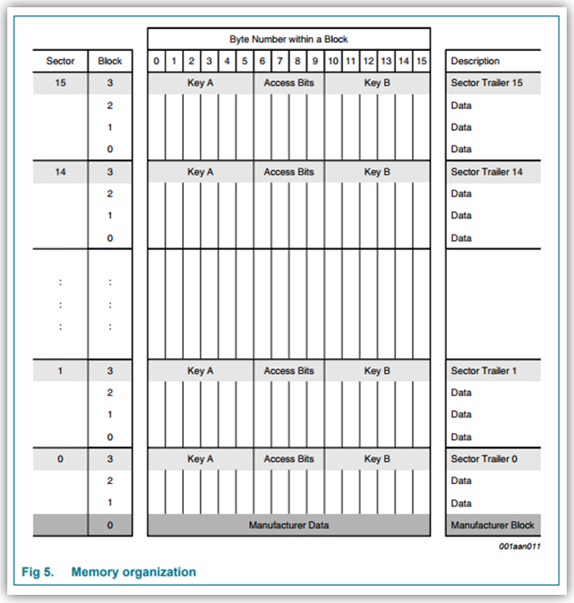

# Lecteur de tag RFID MFRC522 sur ESP32

> * Auteur : Gwénaël LAURENT
> * Date : 09/01/2026

- [Lecteur de tag RFID MFRC522 sur ESP32](#lecteur-de-tag-rfid-mfrc522-sur-esp32)
- [1. RFID](#1-rfid)
  - [PICC (Proximity Integrated Circuit Card)](#picc-proximity-integrated-circuit-card)
  - [PCD (Proximity Coupling Device)](#pcd-proximity-coupling-device)
- [2. Le lecteur RFID MFRC522](#2-le-lecteur-rfid-mfrc522)
- [3. Documentation](#3-documentation)
- [4. Connexion en SPI](#4-connexion-en-spi)
- [5. Programmation dans VScode / PlatformIO](#5-programmation-dans-vscode--platformio)
- [6. Lecture des tags avec interruption](#6-lecture-des-tags-avec-interruption)
- [7. Pour aller plus loin ...](#7-pour-aller-plus-loin-)
- [8. Organisation de l'EEPROM](#8-organisation-de-leeprom)

# 1. RFID
RFID (Radio-Frequency IDentification) est une technique de communication sans fil très utilisée pour identifier des objets :
* livre de bibliothèque
* télépéage
* cartes de transport, restauration
* antivol
* gestion des accès en entreprise


## PICC (Proximity Integrated Circuit Card)
Les PICC = **```tags RFID```** (puces RFID, étiquettes RFID) contiennent un identifiant unique (UID, par exemple "9C CB 51 32") et une EEPROM permettant de stocker des données.

Il existe plusieurs types de tags RFID :
* Ils n'utilisent pas les mêmes fréquences pour communiquer
* Ils ne contiennent pas les mêmes informations
* La distance et la vitesse de lecture sont différentes

Les plus utilisés en TP sont des "MIFARE 1KB" (EEPROM de 1ko)

> **ATTENTION** : l'UID ne doit pas être le seul moyen d'identification pour les applications sécurisées. Bien que cet identifiant soit inscrit une fois pour toute sur chaque tag, il existe des moyens de le dupliquer sur des cartes vierges. Pour plus de sécurité, on enregistre d'autres moyens d'identication dans l'EEPROM (avec cryptage des données). Malgré cela, dans ce tuto, on se concentre uniquement sur la lecture de l'UID.

## PCD (Proximity Coupling Device)
On accède au contenu des tags grâce à un PCD =  **```lecteur RFID```**. Il sert également à alimenter en énergie les puces passives.




# 2. Le lecteur RFID MFRC522
Le lecteur MFRC522 permet de lire les tags ISO/IEC 14443 A/MIFARE et NTAG. La fréquence utilisée pour communiquer avec les tags est de 13.56 MHz. Ce sont les caractéristiques typiques des badges et cartes utilisés pour le contrôle d'accès.

Pour lire un tag avec le MFRC522, il faut positionner le tag très prêt du lecteur (<5cm). 





Il peut être connecté à l'ESP sur un bus ```SPI```. Le lecteur MFRC522 est un esclave SPI.


# 3. Documentation
* Comprendre la RFID en 10 points : [https://sbedirect.com/fr/blog/article/comprendre-la-rfid-en-10-points.html](https://sbedirect.com/fr/blog/article/comprendre-la-rfid-en-10-points.html)
* Wikipedia : [https://fr.wikipedia.org/wiki/Radio-identification](https://fr.wikipedia.org/wiki/Radio-identification)
* Présentation du RFID et du lecteur MFRC522 : [https://diyi0t.com/rfid-sensor-tutorial-for-arduino-and-esp8266/](https://diyi0t.com/rfid-sensor-tutorial-for-arduino-and-esp8266/)
* La bibliothèque MFRC522 : [https://github.com/miguelbalboa/rfid](https://github.com/miguelbalboa/rfid)
*  Documentation technique du MFRC522 : [https://www.nxp.com/docs/en/data-sheet/MFRC522.pdf](https://www.nxp.com/docs/en/data-sheet/MFRC522.pdf)


# 4. Connexion en SPI
Branchement sur l'ESP32 OLED :



Pour un ESP32 v2, on préfèrera choisir :
```
#define SS_PIN 15
#define SCK_PIN 14
#define MOSI_PIN 13
#define MISO_PIN 12
#define IRQ_PIN 17
#define RST_PIN 16
```

# 5. Programmation dans VScode / PlatformIO
Créer un nouveau projet PlatformIO
* Board : **```WEMOS LOLIN32```**
* Framework : **```Arduino```**

Installer la lib ```MFRC522-spi-i2c-uart-async (GithubCommunity & miguelbalboa)``` (Menu PlatformIO > Library) - [Dépôt GitHub](https://github.com/makerspaceleiden/rfid)

Le code de ```main.cpp``` qui suit est un programme de test qui permet de communiquer avec un tag RFID pour afficher :
* l'UID (Card UID)
* Le type de tag (PICC type)
* Le contenu de l'EEPROM

Il s'inspire de l'exemple "DumpInfo" fourni avec la lib (\.pio\libdeps\lolin32\MFRC522-spi-i2c-uart-async\examples\DumpInfo). 
Il permet également de choisir les pins du bus SPI.

L'affichage se fait dans la console série paramétrée en 115200 bit/s. Il faut ajouter dans le **fichier de configuration du projet** ```/platformio.ini``` : 

```ini
[env:lolin32]
monitor_speed = 115200
```

Codage du programme principal ```main.cpp``` :
```cpp
#include <Arduino.h>
#include <SPI.h>     //pour accéder au bus SPI
#include <MFRC522.h> //inclusion de la lib MFRC522

// Affectation des broches
#define SS_PIN 15
#define SCK_PIN 13
#define MOSI_PIN 12
#define MISO_PIN 14
#define IRQ_PIN 2
#define RST_PIN 0

MFRC522 mfrc522(SS_PIN, RST_PIN); //création d'un objet de la lib

void setup()
{

  Serial.begin(115200);
  while (!Serial);

  // Initialisation du Module RFID
  SPI.begin(SCK_PIN, MISO_PIN, MOSI_PIN, SS_PIN);
  mfrc522.PCD_Init();

  // Affichage des données du lecteur RFID
  mfrc522.PCD_DumpVersionToSerial();
  //message d'attente de lecture
  Serial.println(F("Scan PICC to see UID, type, and data blocks..."));
}
void loop()
{
  // Détecter la présence d'une carte RFID
  if (!mfrc522.PICC_IsNewCardPresent())
  {
    return;
  }
  // Récupération des informations de la carte RFID
  if (!mfrc522.PICC_ReadCardSerial())
  {
    return;
  }
  // Affichage des informations de la carte RFID
  mfrc522.PICC_DumpToSerial(&(mfrc522.uid));
}
```

# 6. Lecture des tags avec interruption
Le problème du programme précédent est qu'il monopolise la boucle loop(). On ne peut rien faire d'autre car on risque de manquer la présence d'une nouvelle carte.

La technique pour **```être notifié de la présence d'un nouveau tag```** est d'utiliser les interruptions matérielles de l'ESP. L'ESP sera averti de la présence d'un nouveau tag par un changement d'état sur la broche IRQ du MFRC522 et on ne lira les informations du tag que lorsque qu'un nouveau tag est présent.

Plusieurs étapes dans le codage :
1. Configurer la broche IRQ_PIN en INPUT_PULLUP
2. Configurer le MFRC522 pour qu'il envoie une interruption sur sa broche "IRQ" quand un tag est présent
3. Attacher une fonction (isr_readCard) à l'interruption sur IRQ_PIN (front descendant)
4. Dans la boucle loop(), il suffit de tester un booléen (flagPresenceNewCard) pour savoir si on a une lecture de tag à faire.

```cpp
#include <Arduino.h>
#include <SPI.h>         //pour accéder au bus SPI
#include <MFRC522.h>     //inclusion de la lib MFRC522
#include "OLED_ARD3.hpp" //inclusion de la lib OLED_ARD3

// Affectation des broches
#define SS_PIN 15
#define SCK_PIN 13
#define MOSI_PIN 12
#define MISO_PIN 14
#define IRQ_PIN 2
#define RST_PIN 0

//afficheur OLED
OLED_ARD3 u8g2(/* addrI2C=*/0x78, /* sdaBMP280=*/5, /* sclBMP280=*/4);
//création d'un objet de la lib
MFRC522 mfrc522(SS_PIN, RST_PIN);
//booleen de présence d'une interruption
volatile bool flagPresenceNewCard = false;
//valeur à enregistrer dans le registre de la MFRC522
byte regVal = 0x7F;

/***********************************************************/
//fonction utilitaire pour décoder les infos du tag
String HexAlphabet = "0123456789ABCDEF";
String decode_byte_array(byte *buffer, byte bufferSize)
{
  String strDecode = "";
  for (byte i = 0; i < bufferSize; i++)
  {
    strDecode += HexAlphabet[(int)(buffer[i] >> 4)];
    strDecode += HexAlphabet[(int)(buffer[i] & 0xF)];
    strDecode += " ";
  }
  strDecode.trim();
  return strDecode;
}

/***********************************************************/
//fonction d'interruption
void IRAM_ATTR isr_readCard()
{
  flagPresenceNewCard = true;
}

/***********************************************************/
//fonction pour activer l'envoi de l'interruption par la MFRC522
void activateRec(MFRC522 mfrc522)
{
  mfrc522.PCD_WriteRegister(mfrc522.FIFODataReg, mfrc522.PICC_CMD_REQA);
  mfrc522.PCD_WriteRegister(mfrc522.CommandReg, mfrc522.PCD_Transceive);
  mfrc522.PCD_WriteRegister(mfrc522.BitFramingReg, 0x87);
}

/***********************************************************/
//fonction pour effacer la dernière interruption sur la MFRC522
void clearInt(MFRC522 mfrc522)
{
  mfrc522.PCD_WriteRegister(mfrc522.ComIrqReg, 0x7F);
}

/***********************************************************/
void setup()
{

  Serial.begin(115200);
  while (!Serial)
    ;

  // Initialisation du Module MFRC522
  SPI.begin(SCK_PIN, MISO_PIN, MOSI_PIN, SS_PIN);
  mfrc522.PCD_Init();

  // Lecture et affichage des données du lecteur RFID
  mfrc522.PCD_DumpVersionToSerial();

  // Configurer la broche IRQ_PIN de l'ESP
  pinMode(IRQ_PIN, INPUT_PULLUP);

  //Configurer le MFRC522 pour qu'il envoie une interruption
  regVal = 0xA0; //rx irq
  mfrc522.PCD_WriteRegister(mfrc522.ComIEnReg, regVal);

  //Activer la réception des interruptions sur l'ESP
  //si front descendant sur IRQ_PIN, on lance la fonction isr_readCard()
  flagPresenceNewCard = false; //interrupt flag
  attachInterrupt(digitalPinToInterrupt(IRQ_PIN), isr_readCard, FALLING);

  //effacer une fausse interruption au démarrage
  do
  {
    ;
  } while (flagPresenceNewCard);
  flagPresenceNewCard = false;

  //message d'attente de lecture
  Serial.println(F("Scan PICC to see UID and type..."));
}

/***********************************************************/
void loop()
{
  //Test s'il y a une carte disponible pour la lecture
  if (flagPresenceNewCard == true)
  {
    // Lecture des informations de la carte RFID
    mfrc522.PICC_ReadCardSerial();
    //Lire l'UID de la carte
    String cardUID = decode_byte_array(mfrc522.uid.uidByte, mfrc522.uid.size);
    //Lire le type de carte
    MFRC522::PICC_Type piccType = mfrc522.PICC_GetType(mfrc522.uid.sak);
    String cardType = (String)mfrc522.PICC_GetTypeName(piccType);
    //aficher UID et type
    Serial.println("Card UID: " + cardUID);
    u8g2.PrintTwoValues("Card UID :", cardUID, "PICC type :", cardType);
    //effacer l'interruption sur le lecteur MFRC522
    clearInt(mfrc522);
    //arrêter la lecture des données de la carte
    mfrc522.PICC_HaltA();
    //réinitialiser le flag présence carte
    flagPresenceNewCard = false;
  }

  //Autre codage ...

  //réactiver les interrutions du MFRC522 à chaque passage dans la boucle
  activateRec(mfrc522);
  delay(100);
}
```

# 7. Pour aller plus loin ...
Explorez les exemples de la lib MFRC522-spi-i2c-uart-async.

# 8. Organisation de l'EEPROM
Les tags ISO/IEC 14443 A/MIFARE contiennent une EEPROM de 1ko.

La mémoire EEPROM est organisée en 16 secteurs de 4 blocs. Chaque bloc contient 16 octets (16*4*16 = 1024 octets).



