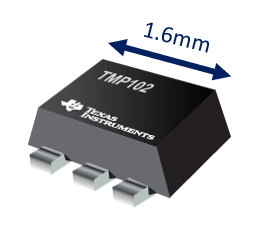
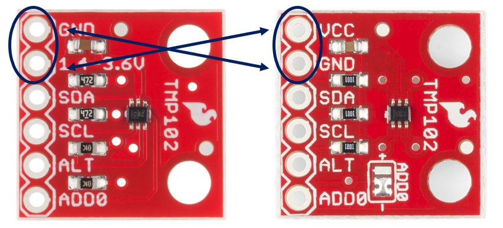
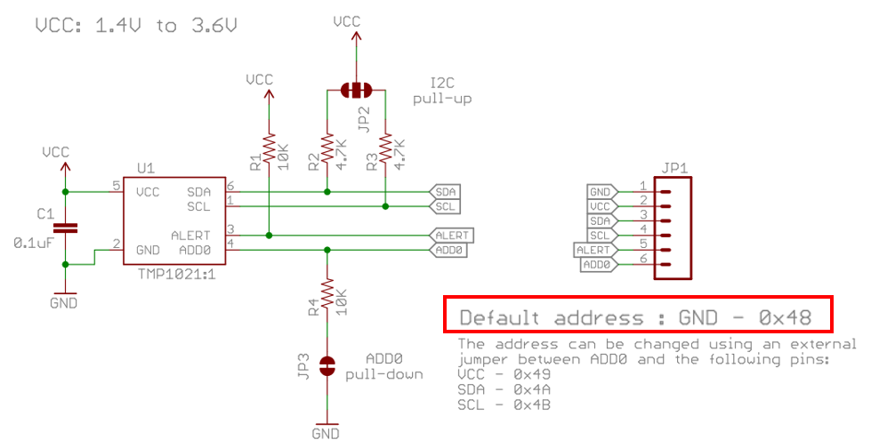
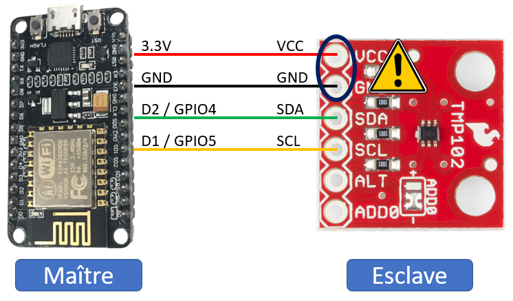

# Capteur de température TMP102 sur ESP8266

> * Auteur : Gwénaël LAURENT
> * Date : 28/01/2022


 [Licence Creative Commons](https://creativecommons.org/licenses/by-nc-sa/3.0/fr/)

- [Capteur de température TMP102 sur ESP8266](#capteur-de-température-tmp102-sur-esp8266)
- [1. Le capteur TMP102](#1-le-capteur-tmp102)
- [2. Documentation](#2-documentation)
- [3. TMP102 Sparkfun breakout](#3-tmp102-sparkfun-breakout)
- [4. Connexion avec l'ESP8266](#4-connexion-avec-lesp8266)
- [5. Programmation dans VScode / PlatformIO](#5-programmation-dans-vscode--platformio)
  - [5.1 Nouveau projet PIO](#51-nouveau-projet-pio)
  - [5.2 Initialisation de la communication](#52-initialisation-de-la-communication)
  - [5.2 Lecture de la température en continu](#52-lecture-de-la-température-en-continu)
  - [5.3 Lecture de la température en "One-Shot mode"](#53-lecture-de-la-température-en-one-shot-mode)

# 1. Le capteur TMP102
Le TMP102 (marque Texas Intruments) est un capteur de température avec connecxion I2C.



Gamme de mesure et précision :
* température : -40...+125°C (précision +/-1°C, résolution 0.0625°C)
* durée de l'acquisition de température : 26 ms

Consommation électrique : 
* tension d'alimentation : 1.4 ... 3.6 V
* Active mode : 10 µA
* Shutdown mode : 0.5 µA
* Pendant la mesure : 40 μA pendant 26 ms


# 2. Documentation
* [Datasheet 2018](https://www.ti.com/lit/ds/symlink/tmp102.pdf?ts=1643385139082&ref_url=https%253A%252F%252Fwww.google.com%252F)
* [Datasheet 2008](https://www.sparkfun.com/datasheets/Sensors/Temperature/tmp102.pdf)
* [SparkFun Digital Temperature Sensor Breakout - TMP102](https://www.sparkfun.com/products/13314)
* [TMP102 Digital Temperature Sensor Hookup Guide](https://learn.sparkfun.com/tutorials/tmp102-digital-temperature-sensor-hookup-guide)

# 3. TMP102 Sparkfun breakout
**ATTENTION** : il existe 2 versions du breakout (=carte de prototypage) Sparkfun TMP102 ! et la différence entre les deux, c'est l'inversion de position des broches d'alimentation !!! Faites donc bien attention à vos branchements pour correspondre à votre version du breakout.



Schéma électronique du breakout TMP102 :



* Le breakout TMP102 intègre les résistances de pull-up sur le bus I2C (4.7kOhms)
* L'adresse du périphérique TMP102 est par défaut 0x48

# 4. Connexion avec l'ESP8266
Branchement sur l'ESP8266 :
* Broche SDA = D2 / GPIO4
* Broche SCL = D1 / GPIO5

Adresse I2C du périphérique TMP102 = 0x48

**ATTENTION au branchement VCC/GND**. Adaptez en fonction de la version du breakout que vous avez.



# 5. Programmation dans VScode / PlatformIO
## 5.1 Nouveau projet PIO
Créez un nouveau projet PlatformIO
* Board : **```NodeMCU 1.0 (ESP-12E Module)```**
* Framework : **```Arduino```**

Installez la lib ```SparkFun TMP102 Breakout by SparkFun Electronics``` (Menu PlatformIO > Library)

> Explorez les exemples et lisez le datasheet du TMP102 pour comprendre les termes utilisés dans les exemples.

## 5.2 Initialisation de la communication
Comme toujours, il faut adapter la connexion I2C pour l'ESP (les exemples de la bibliothèque sont fait pour les arduinos).

```cpp
#include <Wire.h>           // Bibliothèque I2C, un objet 'Wire' est créé dès l'inclusion de la bibliothèque I2C
#include "SparkFunTMP102.h" // bibliothèque TMP102

TMP102 capteurTMP102;         // création d'un objet de la lib TMP102
int sdaTMP102 = 4;            //broche D2 / GPIO4 pour SDA TMP102
int sclTMP102 = 5;            //broche D1 / GPIO5 pour SCL TMP102
uint8_t addrI2CTMP102 = 0x48; //adresse I2C par défaut du TMP102
float temperature = 0.0;      //pour stocker la température

void setup()
{
  //Init du bus I2C sur les bonnes broches de l'ESP
  Wire.begin(sdaTMP102, sclTMP102);
  // Init de la lib TMP102 avec adresse I2C du périphérique et Bus I2C
  capteurTMP102.begin(addrI2CTMP102, Wire);
}
```
## 5.2 Lecture de la température en continu
Par défaut, au démarrage, le TMP102 est en mode "Continuos-Conversion Mode". Il fait donc des mesures de températures régulièrement (par défaut à une fréquence de 4Hz). Les valeurs de températures sont stockées dans un registre interne au TMP102.

Conséquences :
* mode de fonctionnement adapté à une surveillance continu de la température
* la valeur de la température s'ajuste progressivement : la précision de la mesure devient meilleure
* La consommation de courant est maximale

```cpp
void setup()
{
  //...
  //activer le capteur
  capteurTMP102.wakeup(); // consommation = 10µA
}

void loop()
{
  // lire la température en °Celcius 
  temperature = capteurTMP102.readTempC(); // consommation = 40µA pendant 26ms
  // puis consommation = 10µA
  
  delay(1000);
}
```

## 5.3 Lecture de la température en "One-Shot mode"
Il faut paramétrer le TMP102 pour le mettre en  mode éteint (shutdown mode).
Quand on veut obtenir la température il faut lui envoyer un ordre de mesure. Dès que la mesure est effectuée (environ 26ms), on récupère la valeur de la température et on remet le TMP102 en mode shutdown.

Conséquences :
* mode de fonctionnement adapté à des mesures ponctuelles
* La consommation de courant est minimale.

```cpp
void setup()
{
  //...
  // Mettre le capteur en économie d'énergie
  capteurTMP102.sleep(); // consommation < 0.5µA
}

void loop()
{
  // envoyer la demande de mesure de température
  capteurTMP102.oneShot(1); // consommation = 10µA

  //attendre que la mesure soit disponible
  while (capteurTMP102.oneShot() == 0) // consommation = 40µA pendant 26ms
  {
  }
  // lire la température en °Celcius
  temperature = capteurTMP102.readTempC(); // consommation = 10µA
  // Remettre le capteur en économie d'énergie
  capteurTMP102.sleep(); // consommation < 0.5µA
  
  delay(1000);
}
```