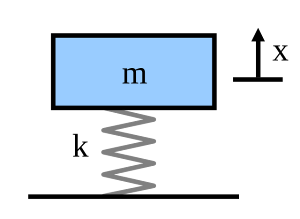
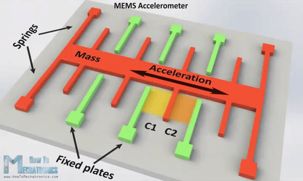
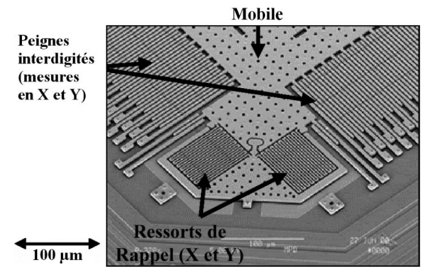
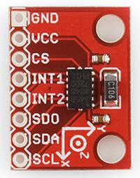

# Accéléromètre ADXL345 sur ESP32

> * Auteur : Gwénaël LAURENT
> * Date : 14/03/2021
> * OS : Windows 10 (version 20H2)
> * VScode : version 1.52.1 (system setup)
> * Node.js : version 12.16.2
> * PlatformIO : Core 5.1.0 Home 3.3.4

 [Licence Creative Commons](https://creativecommons.org/licenses/by-nc-sa/3.0/fr/)

- [Accéléromètre ADXL345 sur ESP32](#accéléromètre-adxl345-sur-esp32)
- [1. Accéléromètre et MEMS](#1-accéléromètre-et-mems)
  - [1.1 Présentation](#11-présentation)
  - [1.2 Domaine d'utilisation](#12-domaine-dutilisation)
  - [1.3 Principe physique de mesure](#13-principe-physique-de-mesure)
  - [1.4 MEMS](#14-mems)
- [2. Caractéristiques du ADXL345 et documentations](#2-caractéristiques-du-adxl345-et-documentations)
  - [2.1 Caractéristiques générales](#21-caractéristiques-générales)
  - [2.2 Carte de prototypage et rôle des broches](#22-carte-de-prototypage-et-rôle-des-broches)
  - [2.3 Documentations](#23-documentations)
- [3. Bibliothèque Sparkfun ADXL345](#3-bibliothèque-sparkfun-adxl345)
- [4. Connexion en I2C](#4-connexion-en-i2c)
- [5. Connexion en SPI](#5-connexion-en-spi)
- [6. Paramétrage de l'accéléromètre](#6-paramétrage-de-laccéléromètre)
- [7. Mesure des accélérations X, Y et Z](#7-mesure-des-accélérations-x-y-et-z)

# 1. Accéléromètre et MEMS
## 1.1 Présentation
Un accéléromètre est un ```capteur``` qui, fixé à un mobile ou tout autre objet, permet de ```mesurer l'accélération linéaire``` de ce dernier. On parle d'accéléromètre même lorsqu'il s'agit en fait de 3 accéléromètres qui calculent les accélérations linéaires selon 3 axes orthogonaux (axes X, Y et Z).

Par contre, lorsqu'on cherche à détecter une rotation ou vitesse angulaire, on parle de gyromètre. Plus généralement on parle de centrale à inertie lorsqu'on cherche à mesurer l'ensemble des 6 accélérations.

Bien que l'accélération linéaire soit définie en **m/s<sup>2</sup>** (unité SI), la majorité des documentations sur ces capteurs exprime l'accélération en « g » (gravitation terrestre, **1 g = 9,81 m/s<sup>2</sup>**).

[Wikipédia > Accéléromètre](https://fr.wikipedia.org/wiki/Acc%C3%A9l%C3%A9rom%C3%A8tre)

## 1.2 Domaine d'utilisation
* Détecter l'orientation des smartphones : c'est grâce à lui que l'écran pivote quand vous tenez le téléphone horizontalement, que le téléphone calcule le nombre de pas ou que l'appareil photo peut stabiliser l'image.
* Déclencher l'airbag d'une voiture : accélération > 20g
* Maintenance prédictive de l'Internet industriel des objets (IIoT) : surveillance de l'état des machines à l'aide de [capteurs de vibrations](https://www.digikey.fr/fr/articles/rapidly-deploy-sensors-iiot-based-predictive-maintenance-mems-accelerometers) 
* ...
## 1.3 Principe physique de mesure
Tous les accéléromètre s'appuient sur le principe physique "masse-ressort" pour mesurer l'accélération suivant un axe donné.


(crédit image : [wikipédia](https://fr.wikipedia.org/wiki/Acc%C3%A9l%C3%A9rom%C3%A8tre))

## 1.4 MEMS
Il existe plusieurs types d'accéléromètre. L'ADXL 345 fait partie des accéléromètre **```MEMS```** (Microsystèmes électromécaniques). Les MEMS sont de très petits systèmes, composés de microcomposants de l'ordre du micromètre. Ces composants sont faits de silicium, polymères, métaux et/ou céramiques et sont très souvent combinés avec un CPU. 

Dans les MEMS, les accéléromètres sont constitués de 2 "peignes" dont un est fixé sur des ressorts (Springs). L'accélération est mesurée grâce à la variation de capacité électrique (C1/C2)


> (crédit image : [howtomechatronics.com](https://howtomechatronics.com/how-it-works/electrical-engineering/mems-accelerometer-gyrocope-magnetometer-arduino/) et [www.firediy.fr](https://www.firediy.fr/article/calibrer-le-capteur-mpu6050-avec-un-arduino-drone-ch-5))


> Détails d’un accéléromètre type ADXL202 low-g deux axes. Copyright Analog Devices, Inc. All rights reserved.
# 2. Caractéristiques du ADXL345 et documentations
## 2.1 Caractéristiques générales
L'ADXL345 est un accéléromètre MEMS 3 axes à faible consommation. Les accélérations mesurées sont codées sur 10 ou 13 bits (résolution) et jusqu'à +/- 16g. Il peut être interfacé sur un bus I2C ou SPI (3 ou 4 fils).

* Tension d'alimentation: 2,0 - 3,6 VDC
* Consommation : 40 à 145 µA en mesure, 0,1 µA en veille
* Communication : SPI ou I2C
* 2 lignes d'interruption
* Détection de choc
* Détection d'activité / d'inactivité
* Détection de chute

## 2.2 Carte de prototypage et rôle des broches



| Mnemonic          | Description                          |
|:-----------------:|:------------------------------------:|
| GND               | This pin must be connected to ground |
| VCC               | Supply Voltage                       |
| CS                | Chip Select                          |
| INT1              | Interrupt 1 Output                   |
| INT2              | Interrupt 2 Output                   |
| SDO               | Serial Data Output (SPI 4-Wire) / I2C Address Select |
| SDA / SDI / SDIO  | Serial Data I2C / Serial Data Input (SPI 4-WIRE) / Serial Data Input and Output (SPI 3-Wire) |
| SCL/SCLK          | Serial Communications Clock          |

## 2.3 Documentations
* [SparkFun Triple Axis Accelerometer Breakout - ADXL345](https://www.sparkfun.com/products/9836)
* [ADXL345 Hookup Guide](https://learn.sparkfun.com/tutorials/adxl345-hookup-guide/all)
* [SparkFun_ADXL345_Arduino_Library (Github.com)](https://github.com/sparkfun/SparkFun_ADXL345_Arduino_Library)
* [Datasheet ADXL345](https://www.sparkfun.com/datasheets/Sensors/Accelerometer/ADXL345.pdf)


# 3. Bibliothèque Sparkfun ADXL345
Installer la lib ```SparkFun ADXL345 Arduino Library by SparkFun Electronics``` (Menu PlatformIO > Library)

Pour utiliser la lib, il faut explorer les exemples fournis et les commentaires dans son codage. Il faut aussi adapter les exemples pour l'ESP (les exemples sont fait pour tourner sur des cartes Arduino)

Ce tuto s'inspire, en partie, de l'exemple ```SparkFun_ADXL345_Example.ino``` (\.pio\libdeps\lolin32\SparkFun ADXL345 Arduino Library\examples\SparkFun_ADXL345_Example)


# 4. Connexion en I2C
La vitesse max de l'I2C est de 100kHz (mode normal) ou 400kHz (mode rapide). 

Sur l'ESP32, on peut choisir les broches qui serviront à la communication I2C. 

**Remarque** : Sur la carte ESP32 version WEMOS lolin 32 + OLED les broches 4 et 5 sont utilisées pour l'afficheur OLED (addr = 0x3C, SDA=GPIO5, SCL=GPIO4). Pour d'obscures raisons, il vaut mieux ne pas utiliser le même bus I2C pour connecter d'autres périphériques.


**Connexion à l'ESP32 en I2C** :

| ESP32 Pin | ADXL345 Pin |
|:---------:|:-----------:|
| GND       | GND         |
| 3V3       | VCC         |
| 3V3       | CS          |
| GND       | SDO         |
| 13        | SDA         |
| 15        | SCL         |

**Initialisation de la connexion** :

```cpp
#include <Arduino.h>
#include <Wire.h>
#include <SparkFun_ADXL345.h>

#define SDA_PIN 13
#define SCL_PIN 15

// Création d'un objet de la lib ADXL345 
// pour accéléromètre connecté en I2C
ADXL345 adxl = ADXL345();

void setup()
{
  Serial.begin(9600);
  //Initialisation de la communication I2C
  Wire.begin(SDA_PIN, SCL_PIN);
  //Démarrage de l'accéléromètre
  adxl.powerOn();
}
```


# 5. Connexion en SPI
La vitesse max du bus SPI est de 5MHz pour l'ADXL345 (l'ESP32 pourrait aller jusqu'à 80 MHz).

Sur l'ESP32, il y a 2 bus SPI utilisables :
* **VSPI** : bus virtuel, ou logiciel 
* **HSPI** : bus hardware (le plus rapide)

Ici, j'utilise le bus VSPI, suffisant pour notre application.

**Connexion à l'ESP32 en SPI** :

| ESP32 Pin | ADXL345 Pin |
|:---------:|:-----------:|
| GND       | GND         |
| 3V3       | VCC         |
| 15 (CS)   | CS          |
| 12 (MISO) | SDO         |
| 13 (MOSI) | SDA         |
| 14 (SCK)  | SCL         |

**Initialisation de la connexion** :

```cpp
#include <Arduino.h>
#include <SPI.h>
#include <SparkFun_ADXL345.h>

#define CS_PIN 15
#define MISO_PIN 12 //adxl345 SD0
#define MOSI_PIN 13 //adxl345 SDA
#define SCK_PIN 14

// Création d'un objet de la lib ADXL345 
// pour accéléromètre connecté en SPI
ADXL345 adxl = ADXL345(CS_PIN);

void setup()
{
  Serial.begin(9600);
  //Initialisation de la communication SPI
  SPI.end();
  SPI.begin(SCK_PIN, MISO_PIN, MOSI_PIN, CS_PIN);
  SPI.setDataMode(SPI_MODE3);
  SPI.setFrequency(5000000); // bus SPI à 5MHz
  adxl.setSpiBit(0); // 4 wire SPI mode
  adxl.powerOn();    // Power on the ADXL345
}
```

# 6. Paramétrage de l'accéléromètre
Les 3 paramètrages principaux sont :
* Measurement Range : +/2g, +/-4g, +/-8g, +/-16g
* Output resolution : 10 bits (13 bits in full resolution)
* Output Data Rate  : 6.25 - 3200 Hz (datasheet p6 table 6)

**Remarque** : "Output Data Rate" correspond au nombre maximum d'échantillons par seconde que l'ADXL345 peut mesurer. Si on demande une mesure plus souvent, les données seront erronées.

```cpp
void setup()
{
  //...
  adxl.setRangeSetting(16); // gamme de mesure jusqu'à 16G
  adxl.setFullResBit(true); //résolution sur 13 bits (Scale Factor = 4mg/LSB)
  adxl.setRate(3200);       // data rate = 3200Hz
}
```

# 7. Mesure des accélérations X, Y et Z
La lecture des accélérations sur les 3 axes se fait en une seule opération.

```cpp
//variables globales
int x, y, z; //valeurs d'accélération sur les 3 axes

void loop()
{
  //lecture des valeurs d'accélération
  adxl.readAccel(&x, &y, &z);
  //affichage dans la console
  Serial.print(x);
  Serial.print(", ");
  Serial.print(y);
  Serial.print(", ");
  Serial.println(z);

  delay(200);
}
```

Les valeurs lues correspondent aux valeurs en sortie du CAN de l'ADXL345 (Convertisseur analogique > numérique). La conversion en g ou m/s<sup>2</sup> dépend de la configuration de l'accéléromètre.

Pour une gamme d'accélération jusqu'à +/-16 g et une résolution normale de 10 bits, le datasheet donne (p3 > SENSITIVITY):

```Scale Factor at XOUT, YOUT, ZOUT (±16 g,  10-bit resolution) = 31.2 mg/LSB```

Donc, pour convertir une valeur reçue de l'ADXL345 (ex. pour l'axe z):
```cpp
float z_mg = z * 31.2; //unité mg
float z_ms2 = (z_mg / 1000) * 9.81; // unité m/s^2
```
**Attention** : si la résolution est poussée jusqu'à ```13 bits``` pour une gamme de +/- 16 g, alors : ```Scale Factor = 4mg/LSB```
