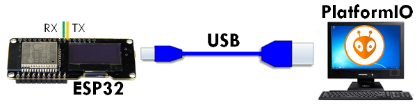
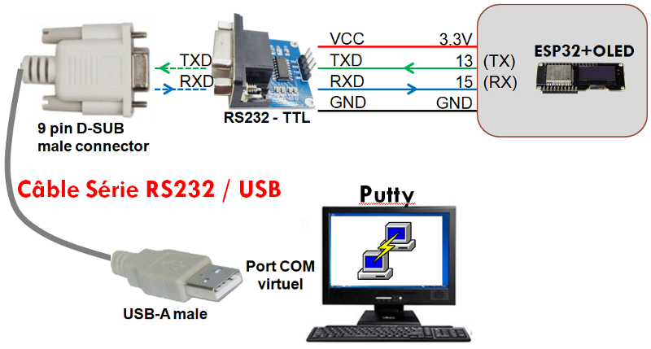
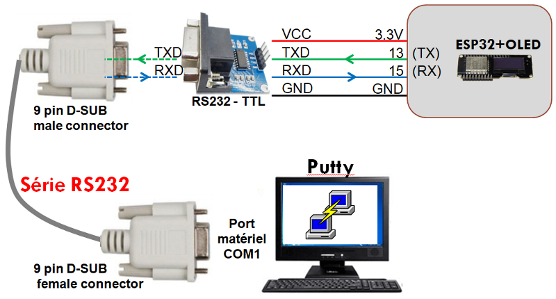
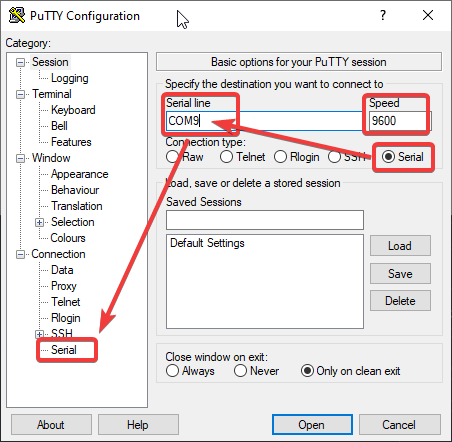
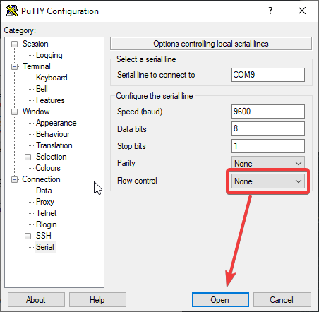
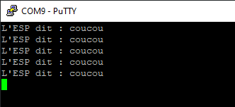
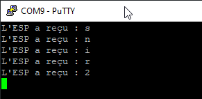
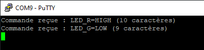

# ESP Serial et SoftwareSerial

> * Auteur : Gwénaël LAURENT
> * Date : 29/01/2021
> * OS : Windows 10 (version 1903)
> * VScode : version 1.52.1 (system setup)
> * Node.js : version 12.16.2
> * PlatformIO : Core 5.0.4 Home 3.3.1

 [Licence Creative Commons](https://creativecommons.org/licenses/by-nc-sa/3.0/fr/)

- [ESP Serial et SoftwareSerial](#esp-serial-et-softwareserial)
- [1. Communication série](#1-communication-série)
- [2. Communication Rx/Tx physique](#2-communication-rxtx-physique)
  - [2.1 Envoi de message par l'ESP, réception dans le moniteur série](#21-envoi-de-message-par-lesp-réception-dans-le-moniteur-série)
  - [2.2 Envoi de caractère par le moniteur série, réception dans l'ESP](#22-envoi-de-caractère-par-le-moniteur-série-réception-dans-lesp)
- [3. Communication Rx/Tx logicielle sur ESP32](#3-communication-rxtx-logicielle-sur-esp32)
  - [3.1 Remarque sur l'utilisation d'une liaison série logicielle](#31-remarque-sur-lutilisation-dune-liaison-série-logicielle)
  - [3.2 Différence entre ESP8266 et ESP32](#32-différence-entre-esp8266-et-esp32)
  - [3.3 Branchement de test](#33-branchement-de-test)
  - [3.4 Envoi de message par l'ESP, réception dans Putty](#34-envoi-de-message-par-lesp-réception-dans-putty)
  - [3.5 Envoi de caractère par Putty, réception dans l'ESP](#35-envoi-de-caractère-par-putty-réception-dans-lesp)
- [4. Réception d'un message complet par la liaison série](#4-réception-dun-message-complet-par-la-liaison-série)

# 1. Communication série
La communication série de type UART (Universal Asynchronous Receiver Transmitter) utilise deux broches **```Rx/Tx```** pour Receive/Transmit.

* [Doc Transmission série](https://fr.wikipedia.org/wiki/Transmission_s%C3%A9rie)
* [Doc UART](https://fr.wikipedia.org/wiki/UART)

Sur les cartes ESP ou arduino, on distingue deux types de communication Rx/Tx :
* **```Communication Rx/TX physique```** (hardware): 
  * Elle utilise les broches dédiées de l'ESP. 
  * Ces broches sont reliées à un composant électronique de type UART.
  * La communication est full/duplex
  * C'est la version la plus performante des communication Rx/Tx. 
  * Elle est utilisé par la connectique USB entre l'ESP et votre ordinateur (upload des programmes, moniteur série de PlatformIO)
* **```Communication Rx/TX logicielle```** (software): 
  * Cette version de la communication Rx/tx est réalisée par le processeur. 
  * Il n'y a pas de composant électronique UART.
  * La communication est half/duplex
  * Elle permet d'utiliser n'importe quelle broche de l'ESP pour la communication. 

> On utilise la communication Rx/TX logicielle que :
> * s'il n'y a plus de communication physique disponible
> * si on veut utiliser la console série en même temps
> * si une communication half/duplex est satisfaisante

# 2. Communication Rx/Tx physique


> Les deux fils de la communication série physique qui passent par l'USB sont également accessibles sur les 2 broches sérigraphiées Rx et Tx

> Pour la communication RxTx physique, il n'y a aucune différence de codage entre l'ESP 32 et l'ESP8266
## 2.1 Envoi de message par l'ESP, réception dans le moniteur série
```cpp
#include <Arduino.h>

void setup() {
  //initialisation de la communication série physique
  Serial.begin(9600); // à 9600 bit/s
}

void loop() {
  Serial.print("L'ESP dit : ");
  Serial.println("coucou");
  delay(1000);
}
```
Dans VScode/PlatformIO les messages sont reçus dans la console du moniteur série. 

Cliquez sur ```Serial Monitor``` (dans la barre d'outils)

```
--- Miniterm on COM4  9600,8,N,1 ---
--- Quit: Ctrl+C | Menu: Ctrl+T | Help: Ctrl+T followed by Ctrl+H ---
L'ESP dit : coucou
L'ESP dit : coucou
L'ESP dit : coucou
L'ESP dit : coucou
```

> Par défaut, le moniteur série est configuré pour une vitesse de communication de 9600 bits/s et détecte le port COM sur lequel est branché l'ESP s'il n'y a qu'un seul port COM utilisé sur l'ordinateur.

La vitesse des communications et le port du moniteur série peuvent être choisis en modifiant ```platformio.ini``` :
```ini
[env:lolin32]
monitor_speed = 115200
monitor_port = COM4
```
Bien sûr, il faut que ça corresponde à la configuration de la communication série dans votre programme :
```cpp
  Serial.begin(115200); //115200 bit/s
```

## 2.2 Envoi de caractère par le moniteur série, réception dans l'ESP
L'exemple de codage suivant fonctionne comme un echo. Chaque caractère reçu par l'ESP est renvoyé sur le même port série.

> La réception série s'effectue toujours **1 octet à la fois**

```cpp
#include <Arduino.h>
char incomingChar = 0;

void setup()
{
  //initialisation de la communication série physique
  Serial.begin(115200); // à 115200 bit/s
}

void loop()
{
  // Si on reçoit quelque chose sur le port série matériel
  // on le renvoie sur le même port série (echo)
  if (Serial.available() > 0)
  {
    // lecture de l'octet reçu
    incomingChar = Serial.read();
    // envoi des données reçues vers le moniteur série
    Serial.print("L'ESP a reçu : ");
    Serial.println(incomingChar);
  }
}
```

Ouvrez le ```Serial Monitor```, cliquez dedans et saisissez des caractères au clavier.
```
--- Miniterm on COM4  115200,8,N,1 ---
--- Quit: Ctrl+C | Menu: Ctrl+T | Help: Ctrl+T followed by Ctrl+H ---
L'ESP a reçu : s
L'ESP a reçu : n
L'ESP a reçu : i
L'ESP a reçu : r
L'ESP a reçu : 1
```

**Echo local dans le moniteur série de PlatformIO** : pour que le moniteur affiche les caractères que vous tapez au clavier, il faut le paramétrer dans ```platformio.ini```
```ini
monitor_flags = --echo
```

# 3. Communication Rx/Tx logicielle sur ESP32
## 3.1 Remarque sur l'utilisation d'une liaison série logicielle
Même si ce n'est pas la meilleure technique, elle est très utilisée. Attention toutefois à **ne pas choisir des vitesses trop élévées** (ça fonctionne bien à 9600 bits/s)

Quelques exemples d'utilisation :
* communiquer entre un ESP8266 et un modem Bluetooth (HC-06)
* communiquer entre l'ESP et un modem Sigfox (SNOC breakout BRKWS01)
* configurer un objet connecté via un port série (utilisation d'un module RS232-TTL et d'un câble série avec connecteur D-SUB 9 broches)

## 3.2 Différence entre ESP8266 et ESP32
La communication série logicielle nécessite l'utilisation d'une bibliothèque.

**Pour l'ESP8266** : il faut utiliser la bibliothèque  **```SoftwareSerial```** qui est inclue automatiquement dans le framework arduinoespressif8266. Il n'y a donc pas besoin de télécharger de bibliothèque, il suffit d'ajouter la directive d'inclusion dans le code et de définir les broches utilisées pour la communication :
```cpp
#include <SoftwareSerial.h>

//Numéro des broches utilisées pour le port série logiciel ESP8266
#define txPin 4 //sérigraphie D2
#define rxPin 5 //sérigraphie D1

//création d'un objet SoftwareSerial
SoftwareSerial swSer1(rxPin, txPin);
```

**Pour l'ESP32** : la version standard *SoftwareSerial* pour arduino ne fonctionne pas sur les ESP32. Pour communiquer sur n'importe quelle broche de l'ESP32, il faut installer la bibliothèque **```EspSoftwareSerial```** by Peter Lerup``` (Menu PlatformIO > Library) - [Dépôt GitHub](https://github.com/plerup/espsoftwareserial)

Une fois la bibliothèque installée, le codage est identique, il suffit d'ajouter la directive d'inclusion dans le code (même nom qu'en ESP8266) et de définir les broches utilisées pour la communication :
```cpp
#include <SoftwareSerial.h>

//Numéro des broches utilisées pour le port série logiciel ESP32
#define txPin 13
#define rxPin 15

//création d'un objet SoftwareSerial
SoftwareSerial swSer1(rxPin, txPin);
```

## 3.3 Branchement de test
Dans la suite de ce tuto, nous utiliserons un ESP32, un module RS232-TTL, un cable série RS232 et le logiciel Putty (configuré en terminal série).



> Remarque : si l'ordinateur dispose d'un connecteur série matériel (COM1), on peut utiliser un câble série standard avec 2 connecteurs D-SUB 9 broches (M/F)



## 3.4 Envoi de message par l'ESP, réception dans Putty

Rappel pour ESP32 seulement : Installer la lib ```EspSoftwareSerial by Peter Lerup``` (Menu PlatformIO > Library) - [Dépôt GitHub](https://github.com/plerup/espsoftwareserial)

Si vous utilisez le même ordi pour Putty et pour uploader votre programme sur l'ESP, vous pouvez sélectionner le port série pour uploader le programme en modifiant ```platformio.ini``` : par exemple pour utiliser COM4
```ini
[env:lolin32]
upload_port = COM4
```

> Remarque : pour connaitre le nom des ports série sur Windows, il faut utiliser la commande console **```mode```**

```cpp
#include <Arduino.h>
#include <SoftwareSerial.h>

//Numéro des broches utilisées pour le port série logiciel
#define txPin  13
#define rxPin 15

//création d'un objet SoftwareSerial
SoftwareSerial swSer1(rxPin, txPin); 

void setup()
{
  //initialisation de la communication série logicielle
  swSer1.begin(9600, SWSERIAL_8N1);
}

void loop()
{
  swSer1.print("L'ESP dit : ");
  swSer1.println("coucou");
  delay(1000);
}
```

Configuration de Putty :







## 3.5 Envoi de caractère par Putty, réception dans l'ESP
L'exemple de codage suivant fonctionne comme un echo. Chaque caractère reçu par l'ESP est renvoyé sur le même port série.

> La réception série s'effectue toujours **1 octet à la fois**

```cpp
#include <Arduino.h>
#include <SoftwareSerial.h>

//Numéro des broches utilisées pour le port série logiciel
#define txPin  13
#define rxPin 15

//caractère (ou byte) reçu
char incomingChar; 

//création d'un objet SoftwareSerial
SoftwareSerial swSer1(rxPin, txPin); 

void setup()
{
  //initialisation de la communication série logicielle
  swSer1.begin(9600, SWSERIAL_8N1);
}

void loop()
{
  if (swSer1.available())
  {
    // lecture du caractère reçu
    incomingChar = (char)swSer1.read();
    // envoi des données reçues vers Putty
    swSer1.print("L'ESP a reçu : ");
    swSer1.println(incomingChar);
  }
}
```

Dans Putty, saisissez des caractères au clavier.




# 4. Réception d'un message complet par la liaison série
Pour envoyer à l'ESP des commandes composées d'une chaine de caractères, il faut que l'ESP recoive tous les caractères de la commande ```et qu'il détecte la fin de la commande```.

Pour cela, il faut définir le caractère de fin de commande. Ce caractère ne doit évidemment pas exister à l'intérieur des commandes ! Par exemple :
* LED_R=HIGH **```\r```**
* LED_R=LOW **```\r```**

Dans l'exemple suivant :
* on utilise le même câblage que précédemment
* on utilise Putty pour envoyer les commandes au clavier (*pensez à forcer l'echo local dans Putty pour voir ce que vous saisissez*)
* les commandes reçues par l'ESP sont renvoyées à Putty (echo)
* on utilise **```\r```** comme caractère de fin de commande.


```cpp
#include <Arduino.h>
#include <SoftwareSerial.h>

//Numéro des broches utilisées pour le port série logiciel
#define txPin 13
#define rxPin 15

//caractère (ou byte) reçu
char incomingChar;
String commande = "";             //chaine construite au fur et à mesure qu'on reçoit des caractères
boolean commandeComplete = false; //true si la commande est reçue entièrement (le dernier caractère est \n)
char charFinCommande = '\r';      //caractère de fin des commandes

//création d'un objet SoftwareSerial
SoftwareSerial swSer1(rxPin, txPin);

//Réception sur la liaison série
void SofwareSerialEvent()
{
  // quand des données arrivent sur le port série logiciel
  while (swSer1.available())
  {
    // enregistrer LE caractère reçu
    incomingChar = (char)swSer1.read();
    // Si le caractère reçu est le caractère de fin de commande
    if (incomingChar == charFinCommande)
    {
      // Active le FLAG commandeComplete (la boucle principale le traitera)
      commandeComplete = true;
    }
    else
    {
      // le concaténer dans commande:
      commande += incomingChar;
    }
  }
}

void setup()
{
  //initialisation de la communication série logicielle
  swSer1.begin(9600, SWSERIAL_8N1);
}

void loop()
{
  //Traitement des données reçues sur la laison série (appel à chaque itération de la boucle)
  SofwareSerialEvent();

  // Si la commande reçue sur la liaison série est complète
  if (commandeComplete)
  {
    // Envoi de la commande reçue vers Putty
    swSer1.print("Commande reçue : ");
    swSer1.println(commande + " (" + commande.length() + " caractères)");
    // réinitialisation
    commande = "";
    commandeComplete = false;
  }
}
```



