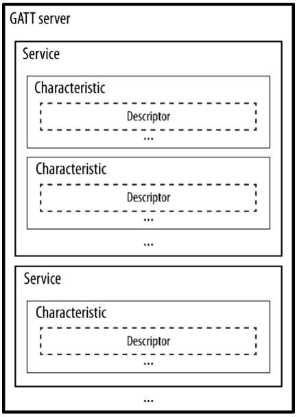
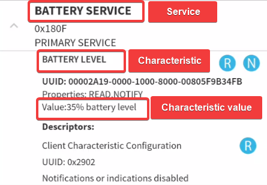
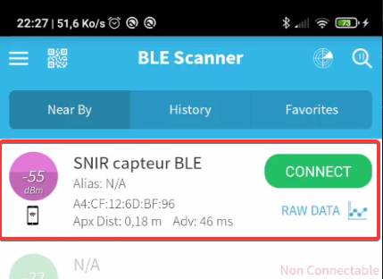
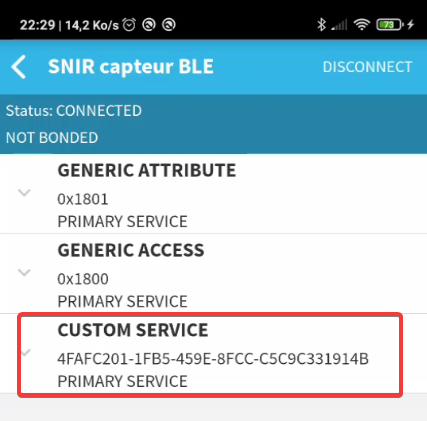
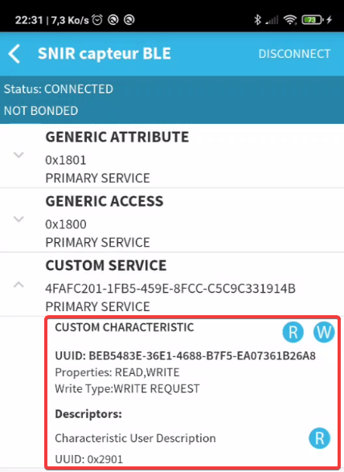
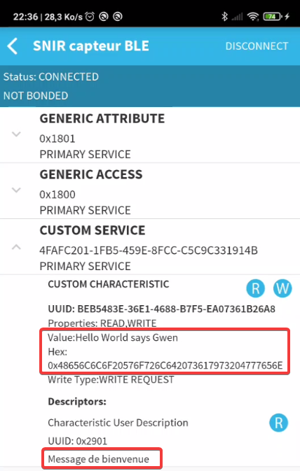
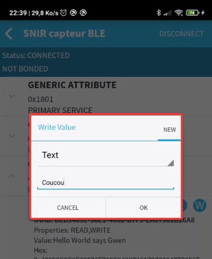
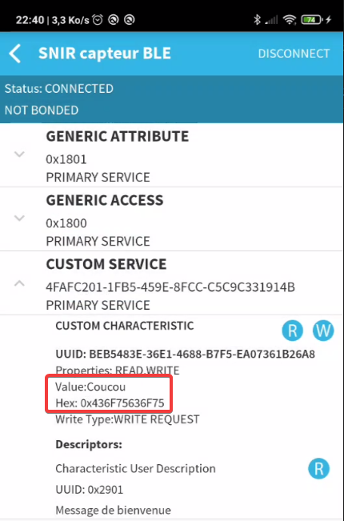
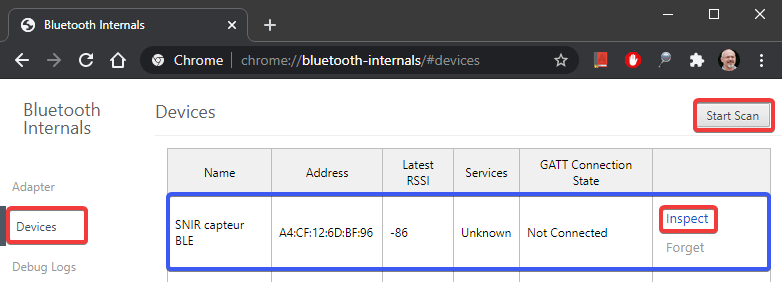
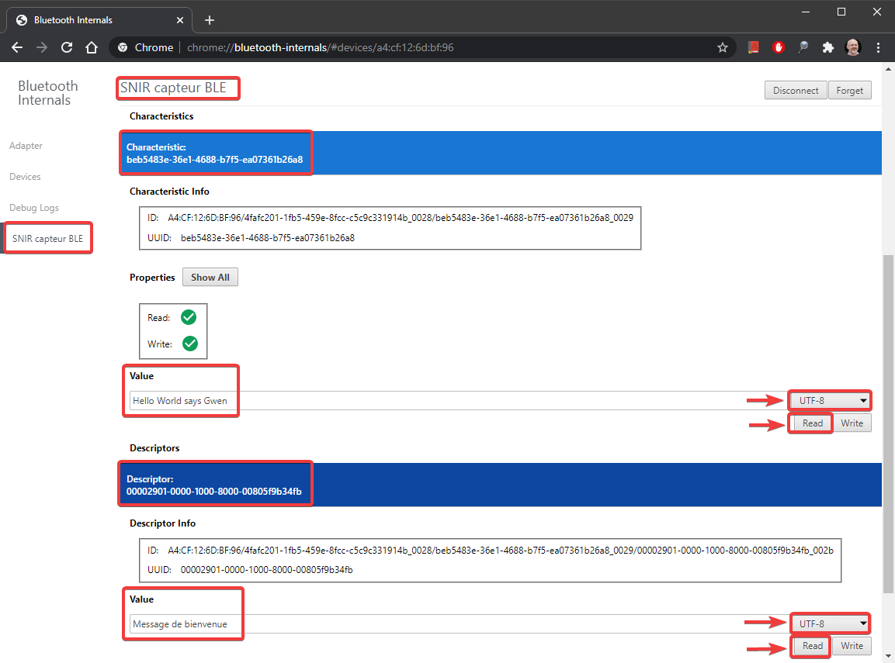

# Bluetooth LE sur ESP32

> * Auteur : Gwénaël LAURENT
> * Date : 06/04/2022

 [Licence Creative Commons](https://creativecommons.org/licenses/by-nc-sa/3.0/fr/)


- [Bluetooth LE sur ESP32](#bluetooth-le-sur-esp32)
- [1. Bluetooth LE (BLE)](#1-bluetooth-le-ble)
  - [1.1 Généralités](#11-généralités)
  - [1.2 Nommer les services et les caractéristiques (UUID)](#12-nommer-les-services-et-les-caractéristiques-uuid)
  - [1.3 Accéder aux données d'un objet BLE (GAP)](#13-accéder-aux-données-dun-objet-ble-gap)
- [2. Documentation sur BLE](#2-documentation-sur-ble)
- [3. Création d'un serveur BLE basique sur ESP32](#3-création-dun-serveur-ble-basique-sur-esp32)
- [4. Appli de test sur Smartphone android](#4-appli-de-test-sur-smartphone-android)
- [5. Web Bluetooth API](#5-web-bluetooth-api)
  - [5.1 Présentation](#51-présentation)
  - [5.2 Client GATT de test dans Chrome](#52-client-gatt-de-test-dans-chrome)
- [6. Serveur GATT avec fonctions de callback](#6-serveur-gatt-avec-fonctions-de-callback)
- [7. Pour aller plus loin ...](#7-pour-aller-plus-loin-)

# 1. Bluetooth LE (BLE)
## 1.1 Généralités
La norme Bluetooth possède une multitude de fonctionnalités. BLE est une des fonctionnalités de Bluetooth depuis sa version 4.0.

BLE définit des serveurs et des clients.
* le **```serveur```** est implémenté dans les objets connectés, par exemple sur un ESP32.
* le **```client```** permet d'accéder aux données des serveurs. Le client peut par exemple être implémenté dans une appli smartphone.

**On peut comparer le serveur BLE à une base de données**, dont les données sont accessibles par les clients BLE. 

Toutes ces données font partie des **```Attributes```** du serveur BLE. Ces attributs sont hiérarchisés et organisés en respectant la norme **```GATT (Generic Attribute Profile)```**

* Un serveur GATT peut contenir un ou plusieurs **```Services```**.
* Un service regroupe zéro ou plusieurs **```Caractéristiques```**. 
  * Les caractéristiques contiennent les ```valeurs``` utiles pour l'utilisateur (donnée de type chaine de caractères, valeur numérique, tableau de nombre)
  * Les caractéristiques possèdent des propriétés qui fixent les ```droits d'accès``` : Lecture, Ecriture, Notification, ...
* Une caractéristique peut inclure zéro ou plusieurs **```Descripteur```**.



Exemple de services et caractéristiques :



Les fabricants d'objets BLE ont défini des **```profiles```** afin d’assurer le maximum de compatibilité entre les produits des différents constructeurs. 

Les profils ne se programment pas, ce sont des "normes" qui définissent les services et les caractéristiques qui doivent être implémentés dans l'objet BLE. Si l'objet respecte ces règles, il pourra ainsi être accessible à partir des applications standards.

> Par exemple : si on fabrique un capteur de pulsation cardiaque accessible en bluetooth et qu'on suit les spécifications du profil "Heart Rate Profile", alors le capteur pourra être intérrogé à partir de n'importe quelle application qui communique avec un capteur cardiaque BLE.

La liste des "profiles" standards est disponible sur le site [bluetooth.com > Specifications List](https://www.bluetooth.com/specifications/specs/)


## 1.2 Nommer les services et les caractéristiques (UUID)
Les services et les caractéristiques ne portent pas de noms standards. Ils sont connus grâce à nombre de 128 bits : un **```UUID (Universally unique identifier)```**. Un UUID ressemble donc à ça : c275819b-38db-4097-9652-b9f1bd6251b4

Les UUID sont globalement uniques. On peut facilement en générer sur le site [https://www.uuidgenerator.net/](https://www.uuidgenerator.net/)

Les UUID sont différents pour les services qui appartiennent à des profils connus. Dans ce cas, L'UUID est codé sur 16 bits. Par exemple, le service GATT "Battery" correspond à l'UUID "0x180F"

La liste des UUID sur 16 bits est disponible sur le site [bluetooth.com > Assigned Numbers > 16-bit UUID Numbers](https://www.bluetooth.com/specifications/assigned-numbers/)

> Si vous créez un objet qui ne correspond pas à un de ces profiles connus, vous devez utiliser des UUID de 128 bits.


## 1.3 Accéder aux données d'un objet BLE (GAP)
La découverte des périphériques BLE et la supervision de la connexion entre deux appareils est effectuée par le protocole réseau **```GAP (Generic Access Profile)```**

Il y a deux façons pour que deux appareils communiquent ensemble.
* En **```mode advertising```**, un appareil émet des trames en permanence et ces trames sont accessibles à tout autre appareil à l’écoute. C'est ce qui est utilisé par les balises iBeacon.
* En **```mode connecté```**, un lien est établi entre deux appareils (entre la connexion et la déconnexion). La connexion entre un client et un serveur GATT est exclusive, c'est à dire qu'il ne peut y avoir qu'un seul client connecté au serveur à la fois. Une fois connecté, on peut accéder aux caractéristiques du serveur.

# 2. Documentation sur BLE
* [Wikipedia anglais BLE](https://en.wikipedia.org/wiki/Bluetooth_Low_Energy)
* [Wikipedia anglais List of Bluetooth profiles](https://en.wikipedia.org/wiki/List_of_Bluetooth_profiles)
* [Bluetooth Specifications List](https://www.bluetooth.com/specifications/specs/)
* [Bluetooth Assigned Numbers (UUID 16 bits des profiles connus)](https://www.bluetooth.com/specifications/assigned-numbers/)
* [learn.adafruit.com](https://learn.adafruit.com/introduction-to-bluetooth-low-energy/gatt)
* [Blog technique groupe SII](https://blog.groupe-sii.com/le-ble-bluetooth-low-energy/)
* [ELA innovation](https://ela.fr/qu-est-ce-que-le-bluetooth-low-energy-ble-.html)
* [Getting Started with ESP32 Bluetooth Low Energy (BLE) on Arduino IDE](https://randomnerdtutorials.com/esp32-bluetooth-low-energy-ble-arduino-ide/)
* [Mise en oeuvre du Bluetooth BLE sur ESP32](http://tvaira.free.fr/bts-sn/activites/activite-ble/activite-ble-esp32.html)
* [GATT (Services and Characteristics)](https://www.oreilly.com/library/view/getting-started-with/9781491900550/ch04.html)

# 3. Création d'un serveur BLE basique sur ESP32
Créer un nouveau projet PlatformIO
* Board : **```WEMOS LOLIN32```**
* Framework : **```Arduino```**

La bibliotèque ESP32 BLE est inclue dans le framework Arduino. Il n'y a pas besoin d'ajouter d'autres bibliothèques.

> Vous trouverez les exemples d'utilisation du BLE sur le github du framework arduino pour ESP32. [Dépôt GitHub](https://github.com/espressif/arduino-esp32/tree/master/libraries/BLE)
>
> Vous trouverez les explications de l'auteur dans [cette video youtube](https://www.youtube.com/watch?v=2_vlF_02VXk&ab_channel=KolbanTechnicalTutorials)

Le code de ```main.cpp``` qui suit permet de créer un **serveur GATT**. Il s'inspire de l'exemple "BLE_server.ino" fourni avec la lib (examples/BLE_server/BLE_server.ino). 

Pour créer un serveur BLE en **mode connecté**, on doit suivre les étapes suivantes :

1. Initialiser le périphérique BLE et lui donner un nom : ```BLEDevice::init()```
2. Créer un serveur BLE : ```BLEDevice::createServer()```
3. Créer un (ou plusieurs) service(s) BLE : ```BLEServer::createService()```
4. Créer une (ou plusieurs) caractéristique(s) BLE associée(s) au service : ```BLEService::createCharacteristic()```
5. Ajouter une description à la caractéristique : ```BLECharacteristic::addDescriptor(BLEDescriptor)```. Le Descriptor est ici de type "Client Characteristic Description (CCCD)", ce qui correspond à l'UUID 0x2902.
6. Initialiser la valeur de la (des) caractéristique(s) (512 octets max) : ```BLECharacteristic::setValue()```. Types de valeur possibles : string, uint8_t [] (évitez les autres types proposés, il y a des problèmes de compatibilités avec les API clientes)
7. Démarrer le(s) service(s) : ```BLEService::start()```
8. Créer un objet de gestion de l'advertising (diffusion du profil BLE pour que les clients puissent découvrir le serveur) : ```BLEDevice::getAdvertising()```
9. Associer le(s) service(s) à l’advertising : ```BLEAdvertising::addServiceUUID()```
10. Démarrer l’advertising : ```BLEDevice::startAdvertising()```

Exemple de serveur BLE en **mode connecté** :
```cpp
#include <Arduino.h>
#include <BLEDevice.h>
#include <BLEUtils.h>
#include <BLEServer.h>

// Définition des UUID des services et caractéristiques
// Pour générer des UUID cf https://www.uuidgenerator.net/
#define SERVICE_BONJOUR_UUID "4fafc201-1fb5-459e-8fcc-c5c9c331914b"
#define CARACT_HELLO_UUID "beb5483e-36e1-4688-b7f5-ea07361b26a8"

//Déclaration des objets du serveur BLE
BLEServer *ptrServeurBLE = NULL;
BLEService *ptrServiceBonjour= NULL;
BLECharacteristic *ptrCaractHello = NULL;
BLEDescriptor *ptrDescrHello = NULL;

void setup()
{
  Serial.begin(115200);
  Serial.println("Configuration du serveur BLE ...");

  // 1. Initialiser le périphérique BLE et lui donner un nom
  BLEDevice::init("SNIR capteur BLE");
  // 2. Créer un serveur BLE
  ptrServeurBLE = BLEDevice::createServer();
  // 3. Créer un service BLE
  ptrServiceBonjour = ptrServeurBLE->createService(SERVICE_BONJOUR_UUID);
  // 4. Créer une caractéristique BLE associée au service
  // accessible en lecture et écriture
  ptrCaractHello = ptrServiceBonjour->createCharacteristic(
      CARACT_HELLO_UUID,
      BLECharacteristic::PROPERTY_READ |
          BLECharacteristic::PROPERTY_WRITE);
  // 5. Ajouter une description textuelle à la caractéristique 
  // Le Descriptor est ici de type "Client Characteristic Description (CCCD)",
  // ce qui correspond à l'UUID 0x2902.
  ptrDescrHello = new BLEDescriptor(BLEUUID((uint16_t)0x2902));
  ptrDescrHello->setValue("Message de bienvenue");
  ptrCaractHello->addDescriptor(ptrDescrHello);
  // 6. Initialiser la valeur de la caractéristique (512 octets max)
  // types de valeur : string, uint8_t [] (évitez les autres types)  
  ptrCaractHello->setValue("Hello World says Gwen");
  // 7. Démarrer le service
  ptrServiceBonjour->start();
  // 8. Créer un objet de gestion de l'advertising
  // diffusion du profil BLE pour que les clients puissent découvrir le serveur
  BLEAdvertising *ptrAdvertising = BLEDevice::getAdvertising();
  // 9. Associer le service à l'advertising
  ptrAdvertising->addServiceUUID(SERVICE_BONJOUR_UUID);
  ptrAdvertising->setScanResponse(true);
  ptrAdvertising->setMinPreferred(0x06); // functions that help with iPhone connections issue
  ptrAdvertising->setMinPreferred(0x12);
  // 10. Démarrer l’advertising
  BLEDevice::startAdvertising();
  Serial.println("Serveur BLE prêt !");
}

void loop()
{
 //relancer l'advertising régulièrement s'il n'y a pas de client connecté
  if (deviceBLEConnected == false)
    BLEDevice::startAdvertising();

  delay(500);
}
```

> Si vous avez une erreur à l'exécution "Brownout detector was triggered", [consultez les solutions ici](Error-ESP32-Brownout-detector-was-triggered.md).

# 4. Appli de test sur Smartphone android
Sur votre smartphone android, installez l'appli [BLE Scanner](https://play.google.com/store/apps/details?id=com.macdom.ble.blescanner&hl=fr&gl=US) 

Au lancement de l'appli, la détection du serveur GATT est active.



En face du serveur **```SNIR capteur BLE```**, cliquez sur Connect pour accéder aux services de ce serveur



Cliquez sur le **```Custom Service```** pour accéder à ses **```Custom Characteristics```**.



Vous remarquerez que le *service* et sa *caractéristique* correspondent aux UUID
de votre codage sur l'ESP32.

```cpp
#define SERVICE_BONJOUR_UUID "4fafc201-1fb5-459e-8fcc-c5c9c331914b"
#define CARACT_HELLO_UUID "beb5483e-36e1-4688-b7f5-ea07361b26a8"
```
Les icônes **```R```** et **```W```** indiquent que cette caractéristique sa description peuvent être lues ou modifiées. Cliquez sur R pour lire la valeur de la caractéristique et la description.



Cliquez sur W et vous pouvez modifier la valeur de cette caractéristique.



La valeur a donc été modifiée à distance via BLE !



# 5. Web Bluetooth API
## 5.1 Présentation
L'API Web Bluetooth permet de coder un client BLE en javascript.

> Attention : cette API n'est pas complètement standardisée. Pour l'instant, elle fonctionne sur Chrome version >=85 (mais pas dans les webview android). [Browser compatibility](https://developer.mozilla.org/en-US/docs/Web/API/Web_Bluetooth_API#browser_compatibility)

Exemples et documentation :
* [Web Bluetooth API sur MDN](https://developer.mozilla.org/en-US/docs/Web/API/Web_Bluetooth_API)
* [web.dev/bluetooth/](https://web.dev/bluetooth/)
* [Web Bluetooth Samples](https://googlechrome.github.io/samples/web-bluetooth/index.html)
* [WebBluetoothCG/demos](https://github.com/WebBluetoothCG/demos)

En utilisant les exemples du site [Web Bluetooth Samples](https://googlechrome.github.io/samples/web-bluetooth/index.html), on peut par exemple lire la caractéristique du programme ESP précédent :

> Attention : l'accès au BLE doit toujours se faire en réponse à un évènement de l'utilisateur (clic sur un bouton par exemple). 

**index.html**
```html
<!DOCTYPE html>
<html lang="fr">
    <head>
        <meta charset="UTF-8">
        <meta http-equiv="X-UA-Compatible" content="IE=edge">
        <meta name="viewport" content="width=device-width, initial-scale=1.0">
        <title>Test Web BLE</title>
        <script src="ble.js" defer></script>
    </head>
    <body>
        <h1>Test Web BLE</h1>
        <button id="btnConnect">Connexion BLE</button>
        <button id="btnClose">Déconnexion BLE</button>
        <p id="text"></p>
    </body>
</html>
```

**ble.js**
```js
// UUID d'un service et d'une caractéristique (créés sur l'ESP)
const SERVICE_BONJOUR_UUID = "4fafc201-1fb5-459e-8fcc-c5c9c331914b";
const CARACT_HELLO_UUID = "beb5483e-36e1-4688-b7f5-ea07361b26a8";

// Référence JS vers le device BLE sur lequel on est connecté
let bluetoothDevice = null;

//Références vers le HTML et gestion du clic sur les boutons
const btnConnect = document.getElementById("btnConnect");  // référence vers le bouton Connexion
const btnClose = document.getElementById("btnClose");  // référence vers le bouton Déonnexion
const p_text = document.getElementById("text");
btnConnect.addEventListener('click', function () {
  connect();
});
btnClose.addEventListener('click', function () {
  disconnect();
});

// Recherche des devices BLE (seulement ceux qui implémentent SERVICE_BONJOUR_UUID
// Connexion automatique au device BLE choisi 
// et lecture de sa caractéristique CARACT_HELLO_UUID, décodage puis affichage
function connect() {
  if (bluetoothDevice == null) {
    var nav = navigator;
    if (nav.bluetooth && nav.bluetooth.requestDevice) {
      //Afficher seulement les devices qui implémentent le service SERVICE_BONJOUR_UUID
      nav.bluetooth.requestDevice({ filters: [{ services: [SERVICE_BONJOUR_UUID] }] })
        .then(device => {
          // Quand un device est sélectionné
          console.log("requestDevice", device);
          console.log("device name", device.name);
          // Enregistrer la référence vers le device BLE
          bluetoothDevice = device;
          // et enregistrement de la fonction de callback pour gérer la déconnexion
          bluetoothDevice.addEventListener('gattserverdisconnected', onDeviceDisconnected);
          // Se connecter au serveur GATT du device
          return device.gatt.connect();
        })
        .then(server => {
          console.log("Connecté sur le serveur GATT", server);
          // Accéder au service...
          return server.getPrimaryService(SERVICE_BONJOUR_UUID);
        })
        .then(service => {
          console.log("Accès au service", service);
          // Accéder à la caractéristique CARACT_HELLO_UUID
          return service.getCharacteristic(CARACT_HELLO_UUID);
        })
        .then(characteristic => {
          console.log("Accès à la caractéristique", characteristic);
          // Lire la valeur de la caractéristique
          return characteristic.readValue();
        })
        .then(value => {
          // Décoder et afficher la valeur de la caractéristique
          console.log("Lecture de la valeur de la caract", value);
          let decoder = new TextDecoder('utf-8');
          let name = decoder.decode(value)
          console.log('value is ' + name);
          p_text.textContent = name;
        })
        .catch(error => { console.log("webbluetooth error", error); });
    }
  } else {
    console.log("Device BLE déjà connecté");
  }
}
// Déconnexion du device BLE
function disconnect() {
  if (bluetoothDevice != null) {
    bluetoothDevice.gatt.disconnect();
  } else {
    console.log("Device BLE déjà déconnecté");
  }
}
// fonction de callback appelée quand le device BLE se déconnecte
function onDeviceDisconnected(event) {
  // Object event.target is Bluetooth Device getting disconnected.
  console.log("Device BLE déconnecté", event.target);
  p_text.textContent = "";
}
```

## 5.2 Client GATT de test dans Chrome
Si votre ordinateur est équipé d'une carte réseau Bluetooth >= 4.0, vous pouvez utiliser Chrome comme client GATT de test.

Dans Chrome, ouvrez la page [chrome://bluetooth-internals](chrome://bluetooth-internals)

Le menu ```Adapter``` affiche les caractéristiques de votre carte bluetooth

Le menu ```Devices``` permet de découvrir les serveurs GATT et d'accéder à leurs services et caractéristiques : cliquez sur **```Start Scan```**



En cliquant sur **```inspect```** vous vous vous connectez au serveur GATT et accédez aux services et caractéristiques.



# 6. Serveur GATT avec fonctions de callback
Dans un serveur GATT, la valeur d'une caractéristique est simplement le contenu d'une variable. On ne peut pas changer ça, mais on peut déclencher des actions suite à la lecture ou l'écriture d'une caractéristique.

Pour cela, il faut associer des **```fonctions de callback```** à la caractéristique. Lors des demandes de lecture ou d'écriture on pourra donc exécuter des instructions telles que la lecture d'un capteur.

> **ATTENTION** : les fonctions de callback se déclenchent **APRÈS** la lecture ou l'écriture de la nouvelle valeur de la caractéristique :
> * Il faut donc modifier la valeur d'une caractéristique (avec ```BLECharacteristic::setValue()```) AVANT qu'un client GATT ne lise cette caractéristique.
> * On ne peut pas contrôler la valeur écrite par un client. La callback onWrite() se déclenche après l'écriture de la nouvelle valeur.

La bibliothèque ```ESP32 BLE Arduino``` utilise les fonctions de callback sur les évènements suivants :
* lecture (```onRead```) et écriture (```onWrite```) d’une caractéristique
* connexion (```onConnect```) et déconnexion (```onDisconnect```) du serveur BLE

Ces fonctions sont des méthodes qui appartiennent aux classes :
* BLECharateristicCallback
* BLEServerCallbacks

Il faudra donc dériver ces classes pour écrire ses propres fonctions de callback :

```cpp
class MyCallback : public BLECharacteristicCallbacks
{
    void onRead(BLECharacteristic* pCharacteristic) 
    {
        // Instructions APRES la lecture de la caractéristique
    }
    void onWrite(BLECharacteristic* pCharacteristic) 
    {
        // Instructions APRES l'écriture de la caractéristique
    }
};

class MyServerCallback : public BLEServerCallbacks 
{
    void onConnect(BLEServer* pServer) 
    {
        // Instructions APRES la connexion
    }

    void onDisconnect(BLEServer* pServer) 
    {
        // Instructions APRES la déconnexion
    }
};
```

Puis, il faudra les installer en appelant :
```cpp
BLECharacteristic::setCallbacks(new MyCallback())
BLEServer::setCallbacks(new MyServerCallbacks())
```

Exemple du serveur BLE précédent avec des fonctions de callback qui affichent des messages sur la console :
```cpp
#include <Arduino.h>
#include <BLEDevice.h>
#include <BLEUtils.h>
#include <BLEServer.h>

// Définition des UUID des services et caractéristiques
// Pour générer des UUID cf https://www.uuidgenerator.net/
#define SERVICE_BONJOUR_UUID "4fafc201-1fb5-459e-8fcc-c5c9c331914b"
#define CARACT_HELLO_UUID "beb5483e-36e1-4688-b7f5-ea07361b26a8"

//Déclaration des pointeurs sur les objets BLE
BLEServer *ptrServSNIR = NULL;
BLEService *ptrServiceBonjour = NULL;
BLECharacteristic *ptrCaractHello = NULL;
BLEDescriptor *ptrDescrHello = NULL;

//flag pour savoir si un client est connecté
bool deviceBLEConnected = false;

// Déclaration des Callbacks de connexion au serveur BLE
class ServSNIRCallbacks : public BLEServerCallbacks
{
  void onConnect(BLEServer *pServer)
  {
    Serial.println("Client connecté");
    deviceBLEConnected = true;
  };

  void onDisconnect(BLEServer *pServer)
  {
    Serial.println("Client déconnecté");
    deviceBLEConnected = false;
  }
};

// Déclaration des Callbacks de lecture / écriture d'une caractéristique
class CaractHelloCallbacks : public BLECharacteristicCallbacks
{
  void onRead(BLECharacteristic *pCharacteristic)
  {
    std::string carcatUUID = pCharacteristic->getUUID().toString();
    std::string value = pCharacteristic->getValue();
    Serial.print("Lecture de la caractéristique : ");
    Serial.print((String)carcatUUID.c_str() + " = ");
    Serial.println((String)value.c_str());
  }

  void onWrite(BLECharacteristic *pCharacteristic)
  {
    std::string carcatUUID = pCharacteristic->getUUID().toString();
    std::string value = pCharacteristic->getValue();
    Serial.print("Modidification de la caractéristique : ");
    Serial.print((String)carcatUUID.c_str() + " = ");
    Serial.println((String)value.c_str());
     }
};

void setup()
{
  Serial.begin(115200);
  Serial.println("Configuration du serveur BLE ...");

  // 1. Initialiser le périphérique BLE et lui donner un nom
  BLEDevice::init("SNIR capteur BLE");
  // 2. Créer un serveur BLE
  ptrServSNIR = BLEDevice::createServer();
  // 2b. Associer les fonctions de callback onConnect et onDisconnect
  ptrServSNIR->setCallbacks(new ServSNIRCallbacks());
  // 3. Créer un service BLE
  ptrServiceBonjour = ptrServSNIR->createService(SERVICE_BONJOUR_UUID);
  // 4. Créer une caractéristique BLE associée au service
  // accessible en lecture et écriture
  ptrCaractHello = ptrServiceBonjour->createCharacteristic(
      CARACT_HELLO_UUID,
      BLECharacteristic::PROPERTY_READ |
          BLECharacteristic::PROPERTY_WRITE);
  // 4b. Associer les fonctions de callback onRead et onWrite
  ptrCaractHello->setCallbacks(new CaractHelloCallbacks());
  // 5. Ajouter une description textuelle à la caractéristique
  // Le Descriptor est ici de type "Client Characteristic Description (CCCD)",
  // ce qui correspond à l'UUID 0x2902.
  ptrDescrHello = new BLEDescriptor(BLEUUID((uint16_t)0x2902));
  ptrDescrHello->setValue("Message de bienvenue");
  ptrCaractHello->addDescriptor(ptrDescrHello);
  // 6. Initialiser la valeur de la caractéristique (512 octets max)
  // types de valeur : string, uint8_t [] (évitez les autres types)
  ptrCaractHello->setValue("Hello World says Gwen");
  // 7. Démarrer le service
  ptrServiceBonjour->start();
  // 8. Créer un objet de gestion de l'advertising
  // diffusion du profil BLE pour que les clients puissent découvrir le serveur
  BLEAdvertising *ptrAdvertising = BLEDevice::getAdvertising();
  // 9. Associer le service à l'advertising
  ptrAdvertising->addServiceUUID(SERVICE_BONJOUR_UUID);
  ptrAdvertising->setScanResponse(true);
  ptrAdvertising->setMinPreferred(0x06); // functions that help with iPhone connections issue
  ptrAdvertising->setMinPreferred(0x12);
  // 10. Démarrer l’advertising
  BLEDevice::startAdvertising();
  Serial.println("Serveur BLE prêt !");
}

void loop()
{
  //relancer l'advertising régulièrement s'il n'y a pas de client connecté
  if (deviceBLEConnected == false)
    BLEDevice::startAdvertising();

  delay(500);
}
```


# 7. Pour aller plus loin ...
* Servez vous des exemples de la bibliothèque *ESP32 BLE Arduino by Neil Kolban*.
* Vous trouverez des exemples sur le web. Par exemple : [ESP32 BLE Server - GATT Service for Battery Level Indication](https://circuitdigest.com/microcontroller-projects/esp32-ble-server-how-to-use-gatt-services-for-battery-level-indication)
* BLE est utilisé pour plusieurs types d'applications. Si vous voulez par exemple explorer les notifications du serveur : [Vidéo de Kolban Technical Tutorials ](https://www.youtube.com/watch?v=oCMOYS71NIU&t=150s&ab_channel=KolbanTechnicalTutorials)
* Google est ton ami ...


