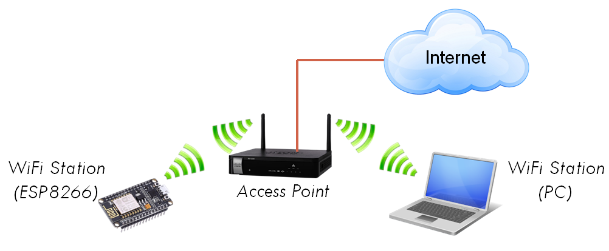
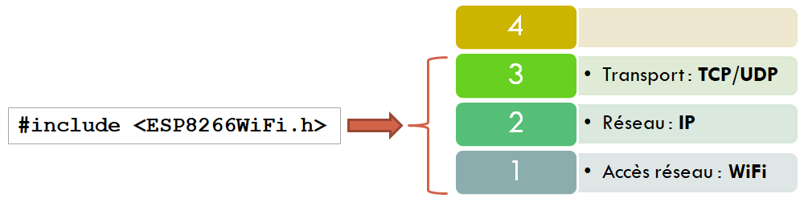
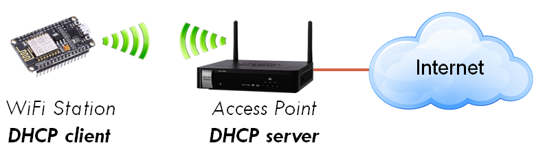
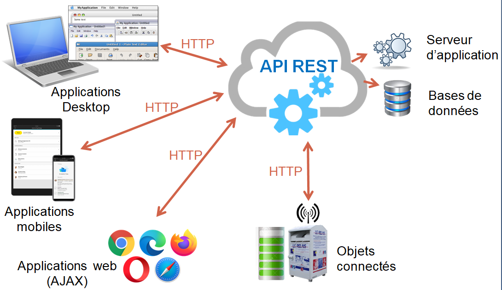
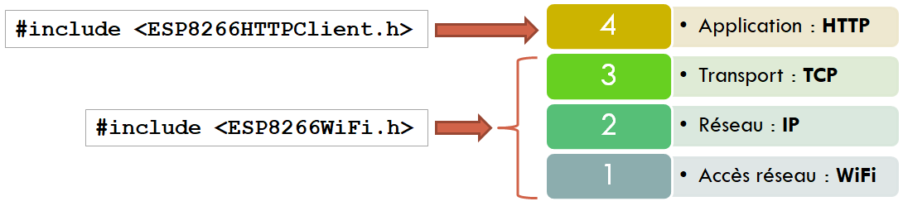
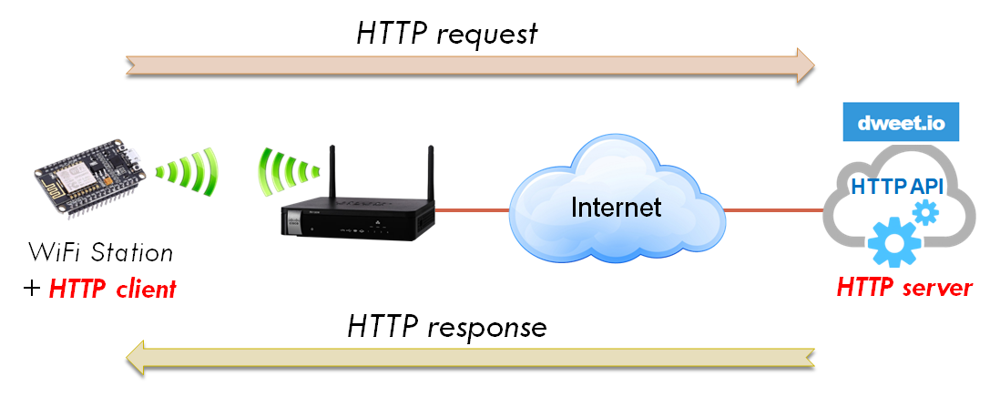

# Client WiFi et client HTTP sur ESP8266

> * Auteur : Gwénaël LAURENT
> * Date : 21/02/2021
> * OS : Windows 10 (version 20H2)
> * VScode : version 1.52.1 (system setup)
> * Node.js : version 12.16.2
> * PlatformIO : Core 5.0.4 Home 3.3.1

 [Licence Creative Commons](https://creativecommons.org/licenses/by-nc-sa/3.0/fr/)

- [Client WiFi et client HTTP sur ESP8266](#client-wifi-et-client-http-sur-esp8266)
- [1. Connexion WiFi et IP](#1-connexion-wifi-et-ip)
  - [1.1 Présentation](#11-présentation)
  - [1.2 Affichage de l'adresse MAC](#12-affichage-de-ladresse-mac)
  - [1.3 Mode Station - Connexion au réseau WiFi](#13-mode-station---connexion-au-réseau-wifi)
- [2. Client HTTP](#2-client-http)
  - [2.1 Présentation](#21-présentation)
  - [2.2 API HTTP de test - Dweet.io](#22-api-http-de-test---dweetio)
  - [2.3 Requête HTTP POST](#23-requête-http-post)
  - [2.4 Requête HTTP GET](#24-requête-http-get)

# 1. Connexion WiFi et IP
## 1.1 Présentation
Les ESP possèdent un module WiFi qui leur permettent de communiquer en réseau en utilisant les protocoles TCP/IP.

Il faut utiliser la bibliothèque WiFi inclue dans le framework arduino. Elle n'a pas le même nom pour les ESP8266 et pour les ESP32 mais elle s'utilise de la même manière.
* **Pour les ESP8266**, il faut utiliser la bibliothèque **```ESP8266WiFi.h```**.
```cpp
#include <ESP8266WiFi.h> //pour ESP8266
```
* **Pour les ESP32**, il faut utiliser la bibliothèque **```WiFi.h```** .
```cpp
#include <WiFi.h> //pour ESP32
```

> Dans la suite de ce tuto, j'utilise les ESP8266 dans les exemples. Pour les ESP32, il suffira de modifier le nom de la bibliothèque

Cette bibliothèque permet 2 modes de fonctionnement :
* **```Station```** : Le mode Station (STA) permet de connecter l'ESP à un point d'accès WiFi (comme un ordinateur ou un smartphone)
* **```Access Point```** : L'ESP se comporte comme un point d'accès WiFi (soft-AP).



La bibliothèque **```ESP8266WiFi.h```** prend en charge les 3 premières couches du modèle de communication internet :



* Documentation pour ESP8266: [https://arduino-esp8266.readthedocs.io/en/latest/esp8266wifi/readme.html](https://arduino-esp8266.readthedocs.io/en/latest/esp8266wifi/readme.html)
* Dépôt Github et exemples pour ESP8266 : [https://github.com/esp8266/Arduino/tree/master/libraries/ESP8266WiFi](https://github.com/esp8266/Arduino/tree/master/libraries/ESP8266WiFi)
* Dépôt Github et exemples pour ESP32 : [https://github.com/espressif/arduino-esp32/tree/master/libraries/WiFi](https://github.com/espressif/arduino-esp32/tree/master/libraries/WiFi)


## 1.2 Affichage de l'adresse MAC
Même sans être connecté à un réseau WiFi (SSID), on peut afficher l'adresse MAC de l'ESP :

```cpp
#include <Arduino.h>
#include <ESP8266WiFi.h> // Bibliothèque WiFi pour ESP8266
//#include <WiFi.h> // Bibliothèque WiFi pour ESP32

void setup()
{
  Serial.begin(9600);
  Serial.println("");

  Serial.println("Adresse MAC ESP = " + WiFi.macAddress());
}

void loop()
{
}
```

## 1.3 Mode Station - Connexion au réseau WiFi
Quand l'ESP se connecte au point d'accès WiFi en temps que station, l'ESP est client DHCP (Dynamic Host Configuration Protocol). Comme toutes les autres stations clientes DHCP, il envoie une trame DHCP sur le réseau pour obtenir sa configuration IP. Le serveur DHCP lui attribue alors sa configuration IP.



> IMPORTANT : Le logiciel serveur DHCP doit être unique dans le réseau. A la maison c'est une fonctionnalité assurée par votre "box" internet.

La connexion réseau de l'ESP se fait donc en 2 étapes :
1. Connexion WiFi au SSID du point d'accès
2. Attribution automatique de la configuration IP par le serveur DHCP


```cpp
#include <Arduino.h>
#include <ESP8266WiFi.h> // Bibliothèque WiFi pour ESP8266
//#include <WiFi.h> // Bibliothèque WiFi pour ESP32

const char *ssid = "SSID_NAME";         // SSID du réseau WiFi
const char *password = "PASSPHRASE"; // passphrase du réseau WiFi

void setup()
{
  Serial.begin(9600);
  Serial.println("");

  // Connexion au réseau WiFi
  WiFi.mode(WIFI_STA);
  WiFi.begin(ssid, password);
  Serial.println("Connexion au SSID = " + (String)ssid + " ...");

  // Attendre que la connexion WiFi soit établie
  while (WiFi.status() != WL_CONNECTED)
  {
    delay(1000);
    Serial.println("Nouvelle tentative");
  }

  // Quand on est connecté au réseau WiFi, le serveur DHCP attribue automatiquement la configuration IP
  Serial.println("Connection établie !");
  Serial.println("Adresse MAC ESP = " + WiFi.macAddress());
  Serial.println("Adresse IP ESP = " + WiFi.localIP().toString());
  Serial.println("Masque ESP = " + WiFi.subnetMask().toString());
  Serial.println("Passerelle ESP = " + WiFi.gatewayIP().toString());
  Serial.println("DNS1 ESP = " + WiFi.dnsIP(0).toString());
  Serial.println();
}

void loop()
{
}
```

Affichage dans la console :
```
Connexion au SSID = SSID_NAME ...
Nouvelle tentative
Nouvelle tentative
Nouvelle tentative
Nouvelle tentative
Connection établie !
Adresse MAC ESP = 18:FE:34:A6:A5:5A
Adresse IP ESP = 172.16.193.25
Masque ESP = 255.255.0.0
Passerelle ESP = 172.16.0.1
DNS1 ESP = 172.16.0.1
```

Puisque l'ESP a reçu une adresse IP, il est possible de communiquer avec lui en utilisant son adresse. Exemple avec un ping :

```sh
ping 172.16.193.25

Envoi d’une requête 'Ping'  172.16.193.25 avec 32 octets de données :
Réponse de 172.16.193.25 : octets=32 temps=6 ms TTL=255
Réponse de 172.16.193.25 : octets=32 temps=2 ms TTL=255
Réponse de 172.16.193.25 : octets=32 temps=2 ms TTL=255
Réponse de 172.16.193.25 : octets=32 temps=3 ms TTL=255

Statistiques Ping pour 172.16.193.25:
    Paquets : envoyés = 4, reçus = 4, perdus = 0 (perte 0%),
Durée approximative des boucles en millisecondes :
    Minimum = 2ms, Maximum = 6ms, Moyenne = 3ms
```

# 2. Client HTTP
## 2.1 Présentation
Le protocole HTTP est le protocole réseau du Web. Evidemment, ce n'est pas la consultation des pages d'un site web qui nous intéresse ici. Le protocole HTTP sera utilisé **```pour communiquer avec une API```** (Application Programming Interface).

> Une API est une interface utilisée par des programmes pour interagir avec une autre application. Les API qui utilisent le protocole HTTP pour communiquer respectent souvent les normes des [API REST](https://www.redhat.com/fr/topics/api/what-is-a-rest-api).



Les API HTTP permettent, par exemple, d'enregistrer les mesures des capteurs dans une base de données.

Les données transmisent ne sont pas des pages web mais des données écritent au [format JSON](https://fr.wikipedia.org/wiki/JavaScript_Object_Notation).

Il faut utiliser la bibliothèque HTTPclient inclue dans le framework arduino. Elle n'a pas le même nom pour les ESP8266 et pour les ESP32 mais elle s'utilise de la même manière.
* **Pour les ESP8266**, il faut utiliser la bibliothèque **```ESP8266HTTPClient.h```**.
```cpp
#include <ESP8266HTTPClient.h> //pour ESP8266
```
* **Pour les ESP32**, il faut utiliser la bibliothèque **```HTTPClient.h```** .
```cpp
#include <HTTPClient.h> //pour ESP32
```

> Dans la suite de ce tuto, j'utilise les ESP8266 dans les exemples. Pour les ESP32, il suffira de modifier le nom de la bibliothèque

La bibliothèque **```ESP8266HTTPClient.h```** prend en charge la couche applicative HTTP du modèle de communication internet :



* Dépôt Github et exemples pour ESP8266: 
[https://github.com/esp8266/Arduino/tree/master/libraries/ESP8266HTTPClient]https://github.com/esp8266/Arduino/tree/master/libraries/ESP8266HTTPClient
* Dépôt Github et exemples pour ESP32: [https://github.com/espressif/arduino-esp32/tree/master/libraries/HTTPClient](https://github.com/espressif/arduino-esp32/tree/master/libraries/HTTPClient)

## 2.2 API HTTP de test - Dweet.io
Le site [**```dweet.io```**](http://dweet.io/) fournit gratuitement une API HTTP pour tester la communication à partir d'un objet connecté (IoT). Le site enregistre (pendant quelques temps) les données qu'il reçoit, ce qui vous permet aussi de tester la lecture des dernières valeurs enregistrées



Pour l'utiliser, rendez vous sur [http://dweet.io/](http://dweet.io/) et cliquez sur **```Play```**.

* Pour envoyer des données vers l'API dweet.io, il faut envoyer une requête **HTTP POST** à cette adresse : http://dweet.io/dweet/for/my-thing-name (remplacez juste **```my-thing-name```** par un nom unique)

* Pour récupérer la dernière donnée enregistrée sur dweet.io, il faut envoyer une requête **HTTP GET** à cette adresse : http://dweet.io/get/latest/dweet/for/my-thing-name (remplacez juste **```my-thing-name```** par le même nom unique que celui de la requête POST)


## 2.3 Requête HTTP POST
Le code qui suit permet d'envoyer la **```requête HTTP```** suivante vers dweet.io :
* adresse du serveur : http://dweet.io/dweet/for/snirtestXXX
* méthode HTTP : **```POST```**
* en-tête HTTP : ```Content-Type: application/json```
* donnée envoyée : ```{"sensorValue":10684}```

La **```réponse HTTP```** de dweet.io permet de confirmer les données reçues. Elle est de cette forme :
```
{
    "this": "succeeded",
    "by": "dweeting",
    "the": "dweet",
    "with": {
        "thing": "snirtestXXX",
        "created": "2021-02-21T21:06:07.860Z",
        "content": {
            "sensorValue": 10684
        },
        "transaction": "912e4ec0-7d88-4b2d-988c-09961ee55c34"
    }
}
```

Code du programme ESP pour envoyer cette requête POST et recevoir la réponse :
```cpp
#include <Arduino.h>
#include <ESP8266WiFi.h> // Bibliothèque WiFi pour ESP8266
//#include <WiFi.h> // Bibliothèque WiFi pour ESP32
#include <ESP8266HTTPClient.h> //Bibliothèque pour les requêtes HTTP sur ESP8266
//#include <HTTPClient.h> //Bibliothèque pour les requêtes HTTP sur ESP32

const char *ssid = "SSID_NAME";         // SSID du réseau WiFi
const char *password = "PASSPHRASE"; // passphrase du réseau WiFi

WiFiClient clientTCP; 
HTTPClient clientHTTP;
int httpCode; //code de retour du serveur web

void setup()
{
  Serial.begin(9600);
  Serial.println("");

  // Connexion au réseau WiFi
  WiFi.mode(WIFI_STA);
  WiFi.begin(ssid, password);
  Serial.println("Connexion au SSID = " + (String)ssid + " ...");

  // Attendre que la connexion soit établie
  while (WiFi.status() != WL_CONNECTED)
  {
    delay(1000);
    Serial.println("Nouvelle tentative");
  }

  // Quand on est connecté au réseau WiFi, affichage de l'adresse IP de l'ESP
  Serial.println("Connection établie !");
}

void loop()
{
  //seulement si on est connecté au réseau WiFi
  if ((WiFi.status() == WL_CONNECTED))
  {
    String urlPost = "http://dweet.io/dweet/for/snirtestXXX";
    //parsing the url for all needed parameters
    clientHTTP.begin(clientTCP, urlPost);
    //ajout des en-têtes HTTP
    clientHTTP.addHeader("Content-Type", "application/json");
    //donnée à envoyée au format JSON
    String postData = "{\"sensorValue\":\"" + String(millis()) + "\"}";

    // start connection and send HTTP header and body
    httpCode = clientHTTP.POST(postData.c_str());

    // httpCode will be negative on error
    if (httpCode > 0)
    {
      if (httpCode == HTTP_CODE_OK) //200
      {
        Serial.println("Requête POST envoyée");
        String payload = clientHTTP.getString();
        Serial.println("Donnée reçue par HTTP POST : " + payload);
      }
    }
    else
    {
      Serial.printf("[HTTP] POST... failed, error: %s\n", clientHTTP.errorToString(httpCode).c_str());
    }

    clientHTTP.end();
    delay(5000);
  }
  else
  {
    delay(10000); //on n'est pas connecté au réseau WiFi
  }
}
```

## 2.4 Requête HTTP GET
Le code qui suit permet d'envoyer la **```requête HTTP```** suivante vers dweet.io :
* adresse du serveur : http://dweet.io/get/latest/dweet/for/snirtestXXX
* méthode HTTP : **```GET```**
* donnée envoyée : rien

La **```réponse HTTP```** de dweet.io est de cette forme :
```
{
    "this": "succeeded",
    "by": "getting",
    "the": "dweets",
    "with": [
        {
            "thing": "snirtestXXX",
            "created": "2021-02-21T21:23:35.632Z",
            "content": {
                "sensorValue": 10684
            }
        }
    ]
}
```

Code du programme ESP pour envoyer cette requête GET et recevoir la réponse :
```cpp
#include <Arduino.h>
#include <ESP8266WiFi.h> // Bibliothèque WiFi pour ESP8266
//#include <WiFi.h> // Bibliothèque WiFi pour ESP32
#include <ESP8266HTTPClient.h> //Bibliothèque pour les requêtes HTTP sur ESP8266
//#include <HTTPClient.h> //Bibliothèque pour les requêtes HTTP sur ESP32

const char *ssid = "SSID_NAME";         // SSID du réseau WiFi
const char *password = "PASSPHRASE"; // passphrase du réseau WiFi

WiFiClient clientTCP;
HTTPClient clientHTTP;
int httpCode;  //code de retour du serveur web

void setup()
{
  Serial.begin(9600);
  Serial.println("");

  // Connexion au réseau WiFi
  WiFi.mode(WIFI_STA);
  WiFi.begin(ssid, password);
  Serial.println("Connexion au SSID = " + (String)ssid + " ...");

  // Attendre que la connexion soit établie
  while (WiFi.status() != WL_CONNECTED)
  {
    delay(1000);
    Serial.println("Nouvelle tentative");
  }

  // Quand on est connecté au réseau WiFi, affichage de l'adresse IP de l'ESP
  Serial.println("Connection établie !");
}

void loop()
{
  //seulement si on est connecté au réseau WiFi
  if ((WiFi.status() == WL_CONNECTED))
  {
    String urlGet = "http://dweet.io/get/latest/dweet/for/snirtestXXX";
    //parsing the url for all needed parameters
    clientHTTP.begin(clientTCP, urlGet);
    // start connection and send HTTP header
    httpCode = clientHTTP.GET(); //norme RFC7231

    // httpCode will be negative on error
    if (httpCode > 0)
    {
      if (httpCode == HTTP_CODE_OK) //200
      {
        Serial.println("Requête GET envoyée");
        String payload = clientHTTP.getString();
        Serial.println("Donnée reçue par HTTP GET : " + payload);
      }
    }
    clientHTTP.end();

    delay(5000);
  }
  else
  {
    delay(10000);  //on n'est pas connecté au réseau WiFi
  }
}
```