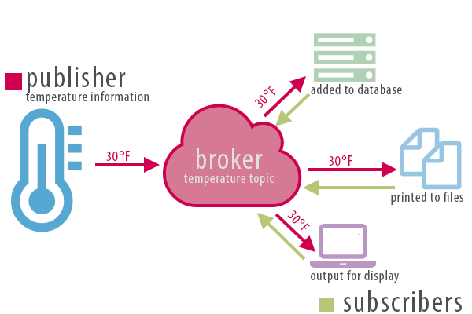
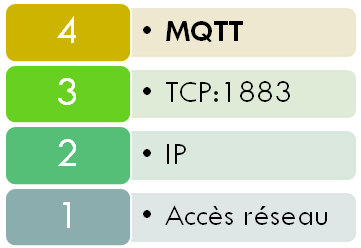
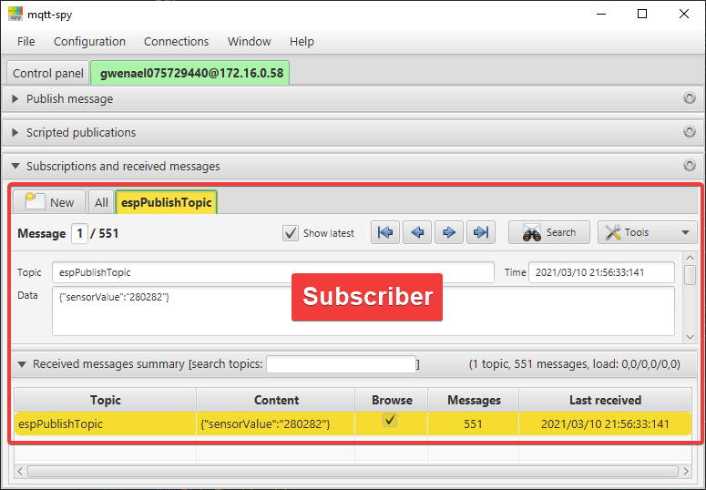
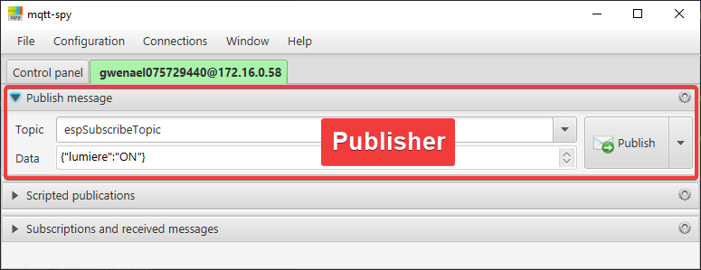

# Client MQTT sur ESP

> * Auteur : Gwénaël LAURENT
> * Date : 10/03/2021
> * OS : Windows 10 (version 20H2)
> * VScode : version 1.52.1 (system setup)
> * Node.js : version 12.16.2
> * PlatformIO : Core 5.0.4 Home 3.3.1

 [Licence Creative Commons](https://creativecommons.org/licenses/by-nc-sa/3.0/fr/)
 
- [Client MQTT sur ESP](#client-mqtt-sur-esp)
- [1. Présentation du protocole MQTT](#1-présentation-du-protocole-mqtt)
- [2. Bibliothèque PubSubClient](#2-bibliothèque-pubsubclient)
- [3. Connexion au broker avec reconnexion automatique](#3-connexion-au-broker-avec-reconnexion-automatique)
- [4. Publier un message MQTT](#4-publier-un-message-mqtt)
  - [4.1 Explications](#41-explications)
  - [4.2 Codage](#42-codage)
  - [4.3 Tests - Réception des messages publiés par l'ESP](#43-tests---réception-des-messages-publiés-par-lesp)
- [5. S'abonner et recevoir les messages MQTT](#5-sabonner-et-recevoir-les-messages-mqtt)
  - [5.1 Explications](#51-explications)
  - [5.2 Codage](#52-codage)
  - [5.3 Tests - Envoyer des messages à l'ESP](#53-tests---envoyer-des-messages-à-lesp)

# 1. Présentation du protocole MQTT
Le protocole MQTT est un protocole de messagerie basé sur une **```architecture « publish/subscribe »```**. 

> Schéma de l’architecture Publish/Subscribe ([KEB america](https://www.kebamerica.com/blog/mqtt-industry-4-0/))


**```Broker```** : un serveur central qui reçoit les messages et les distribue aux abonnés.

**```Topic```** : tous les messages publiés contiennent des données et appartiennent à un sujet / thème, c'est le topic du message.

**```Publisher```** : un client MQTT qui publie un message sur le broker.

**```Subscriber```** : un client MQTT qui s'abonne à un topic. Il recevra automatiquement tous les messages publiés dans ce topic (notification).

Le protocole **MQTT fonctionne sur TCP/IP** :



Plus d'info sur le tuto [```Installer le broker MQTT mosquitto sur Raspberry```](../linux/5.installer_broker_mqtt_mosquitto.md)


# 2. Bibliothèque PubSubClient
Installer la lib ```PubSubClient by Nick O'Leary``` (Menu PlatformIO > Library) - [Dépôt GitHub](https://github.com/knolleary/pubsubclient)

Pour utiliser la lib PubSubClient, il faut explorer les exemples fournis et les commentaires dans son codage.

Ce tuto s'inspire de l'exemple ```mqtt_esp8266.ino``` (\.pio\libdeps\nodemcuv2\PubSubClient\examples\mqtt_esp8266)

Documentation :
* [Arduino Client for MQTT](https://pubsubclient.knolleary.net/)
* [Dépôt GitHub de la bibliothèque](https://github.com/knolleary/pubsubclient/tree/v2.8)
* [API Documentation](https://pubsubclient.knolleary.net/api)

# 3. Connexion au broker avec reconnexion automatique
Pour que l'ESP puisse communiquer en MQTT, il faut :
1. se connecter au réseau WiFi (mode Station)
2. recevoir une adresse IP (il doit y avoir un serveur DHCP sur le réseau)
3. se connecter au broker MQTT
4. s'assurer que la connexion au broker soit toujours active.

La connexion au broker MQTT sera donc codée dans une fonction pour être facilement ré-appelée en cas de déconnexion. C'est également une bonne pratique que de faire pareil pour la connexion au réseau WiFi.

Dans les codages proposés dans ce tuto :
* la fonction de connexion au WiFi s'appelle ```connecter_WiFi()```
* la fonction de connexion au broker s'appelle ```connecter_broker()```

Et dans la fonction loop() principale, il suffit de tester si la connexion au broker est active :
```cpp
if (clientMqtt.connected() == false)
{
  connecter_broker();
}
```
et pour maintenir la connexion au broker et réceptionner les messages, il faut appeler régulièrement :
```cpp
clientMqtt.loop();
```
> la fonction connecter_broker() contient le test de la connexion au WiFi


# 4. Publier un message MQTT
## 4.1 Explications
L'ESP est un client MQTT. Quand il publie un message MQTT, il est **```publisher```**.

Pour publier un message il faut :
1. Déclarer l'adresse du broker (IP + port)
2. Déclarer le nom du topic sur lequel on veut publier
3. Créer un objet ```PubSubClient clientMqtt(clientTCP);```
4. Utiliser la méthode ```clientMqtt.publish()```

Dans l'exemple suivant, la fonction principale loop() publie un message toutes les 5 secondes.

**```IMPORTANT```** : A chaque passage dans la fonction principale loop(), il faut appeler la méthode ```clientMqtt.loop()```. Ca permet de maintenir active la connexion au broker et de réceptionner les messages. Il ne faut donc **```SURTOUT PAS BLOQUER LA FONCTION loop()```**.

Le délai de 5 secondes n'est donc pas codé avec la fonction standard delay(5000) mais avec un petit comptage du temps qui ne bloque pas la fonction loop().

## 4.2 Codage

> Pour vos tests, vous pouvez utiliser le broker de test de mosquitto en utilisant les paramètres suivants :
> ```
> mqtt_server_ip = "test.mosquitto.org"
> mqtt_server_port = 1883
> mqtt_user = ""
> mqtt_password = ""
>```
> Autre broker de test :
> ```
> mqtt_server_ip = "mqtt.eclipseprojects.io"
> mqtt_server_port = 1883
> mqtt_user = ""
> mqtt_password = ""
>```

```cpp
/* Installer la bibliothèque PubSubClientMqtt by Nick O'Leary */
#include <Arduino.h>
#include <ESP8266WiFi.h> // Bibliothèque WiFi pour ESP8266
//#include <WiFi.h>          // Bibliothèque WiFi pour ESP32
#include <PubSubClient.h> //Bibliothèque pour MQTT

// Déclarations pour le réseau WiFi
const char *ssid = "SSID_NAME";         // SSID du réseau WiFi
const char *password = "PASSPHRASE"; // passphrase du réseau WiFi

// Déclarations pour MQTT
#define mqtt_server_ip "172.16.0.58" //broker mosquitto
#define mqtt_server_port 1883        //broker mosquitto
#define mqtt_user "guest"            //s'il a été configuré sur Mosquitto, sinon chaine vide
#define mqtt_password "guest"        //idem
const char *monPublishTopic = "espPublishTopic";

WiFiClient clientTCP;   //socket TCP
PubSubClient clientMqtt(clientTCP);
unsigned long lastMsg = 0; //Horodatage du dernier message publié

/**
 * @brief  Connexion au réseau WiFi (Accès réseau + IP)
 */
void connecter_WiFi()
{
  // Connexion au réseau WiFi
  WiFi.mode(WIFI_STA);
  WiFi.begin(ssid, password);
  Serial.println();
  Serial.println("Connexion au SSID = " + (String)ssid + " ...");

  // Attendre que la connexion WiFi soit établie
  while (WiFi.status() != WL_CONNECTED)
  {
    delay(1000);
    Serial.println("Nouvelle tentative");
  }

  // Quand on est connecté au réseau WiFi, le serveur DHCP attribue automatiquement la configuration IP
  Serial.println("Connection établie !");
  Serial.println("Adresse MAC ESP = " + WiFi.macAddress());
  Serial.println("Adresse IP ESP = " + WiFi.localIP().toString());
  Serial.println();
}

/**
 * @brief  Connexion au broker 
 */
void connecter_broker()
{
  //Reconnecter le WiFi si besoin
  if (WiFi.status() != WL_CONNECTED)
  {
    connecter_WiFi();
  }
  //Boucle jusqu'à obtenir une connexion
  while (clientMqtt.connected() == false)
  {
    Serial.print("Connexion au serveur MQTT...");
    //le premier paramètre de la méthode connect() doit être un identifiant unique de l'ESP (ici c'est son adresse MAC)
    bool etatConnexionBroker = false;
    if (mqtt_user == "")
    {
        etatConnexionBroker = clientMqtt.connect(WiFi.macAddress().c_str());
    }
    else
    {
        etatConnexionBroker = clientMqtt.connect(WiFi.macAddress().c_str(), mqtt_user, mqtt_password);
    }
    if (etatConnexionBroker == true)
    {
      Serial.println("OK");
    }
    else
    {
      Serial.print("Erreur : ");
      Serial.print(clientMqtt.state());
      Serial.println(" On attend 5 secondes avant de recommencer");
      delay(5000);
    }
  }
}

void setup()
{
  Serial.begin(9600);
  // Se connecter au réseau WiFi
  connecter_WiFi();
  // Configurer l'adresse du broker MQTT
  clientMqtt.setServer(mqtt_server_ip, mqtt_server_port);
}

void loop()
{
  // Se reconnecter au broker si besoin
  if (clientMqtt.connected() == false)
  {
    connecter_broker();
  }
  // Maintenir la connexion au broker et réceptionner les messages
  // doit être appelée régulièrement
  clientMqtt.loop();

  // publier un message toutes les 5 secondes
  unsigned long now = millis();
  if (now - lastMsg > 5000)
  {
    lastMsg = now;
    String msg = "{\"sensorValue\":\"" + (String)now + "\"}";
    clientMqtt.publish(monPublishTopic, msg.c_str());
    Serial.println((String) "Message envoyé : " + msg);
  }
}
```

## 4.3 Tests - Réception des messages publiés par l'ESP
Télécharger l'utilitaire Open Source **```mqtt-spy```** sur 
[https://github.com/eclipse/paho.mqtt-spy/wiki/Downloads](https://github.com/eclipse/paho.mqtt-spy/wiki/Downloads)

> Cet utilitaire nécessite une machine virtuelle JAVA version > 8u60

[Doc d'utilisation de mqtt-spy](https://github.com/eclipse/paho.mqtt-spy/wiki/Overview)

Connections > New Connection > Onglet Connectivity :
* Server URL : 172.16.0.58 (adresse IP du raspberry)
* Client ID : generate
* Open connection
* (enregistrer la config)

Sélectionnez l'onglet de la connexion (normalement en vert si la connexion au broker est établie)
* Abonnez vous au topic ```espPublishTopic```



# 5. S'abonner et recevoir les messages MQTT
## 5.1 Explications
L'ESP est un client MQTT. Quand il veut recevoir des messages du broker, il doit s'abonner à un topic, il est **```subscriber```**.

Pour s'abonner et recevoir des messages il faut :
1. Déclarer l'adresse du broker (IP + port)
2. Déclarer le nom du topic auquel on veut s'abonner
3. Créer un objet ```PubSubClient clientMqtt(clientTCP);```
4. Donner le nom de la fonction qui sera exécutée à chaque réception de message avec la méthode ```clientMqtt.setCallback()```
5. S'abonner à un topic avec la méthode ```clientMqtt.subscribe();```

Dans le codage suivant, la fonction ```onReceiveMsg()``` est la fonction appelée quand on reçoit un message. C'est ce qu'on appelle un ```fonction de callback```, ou une fonction ```gestionnaire d'évènement```.

**```IMPORTANT```** : A chaque passage dans la fonction principale loop(), il faut appeler la méthode ```clientMqtt.loop()```. Ca permet de maintenir active la connexion au broker et de réceptionner les messages. Il ne faut donc **```SURTOUT PAS BLOQUER LA FONCTION loop()```**.


## 5.2 Codage

> Pour vos tests, vous pouvez utiliser le broker de test de mosquitto en utilisant les paramètres suivants :
> ```
> mqtt_server_ip = "test.mosquitto.org"
> mqtt_server_port = 1883
> mqtt_user = ""
> mqtt_password = ""
>```

```cpp
/* Installer la bibliothèque PubSubClientMqtt by Nick O'Leary */
#include <Arduino.h>
#include <ESP8266WiFi.h> // Bibliothèque WiFi pour ESP8266
//#include <WiFi.h>          // Bibliothèque WiFi pour ESP32
#include <PubSubClient.h> //Bibliothèque pour MQTT

// Déclarations pour le réseau WiFi
const char *ssid = "SSID_NAME";         // SSID du réseau WiFi
const char *password = "PASSPHRASE"; // passphrase du réseau WiFi

// Déclarations pour MQTT
#define mqtt_server_ip "172.16.0.58" //broker mosquitto
#define mqtt_server_port 1883        //broker mosquitto
#define mqtt_user "guest"            //s'il a été configuré sur Mosquitto, sinon chaine vide
#define mqtt_password "guest"        //idem
const char *monSubscribeTopic = "espSubscribeTopic";

WiFiClient clientTCP;   //socket TCP
PubSubClient clientMqtt(clientTCP);


/**
 * @brief  Connexion au réseau WiFi (Accès réseau + IP)
 */
void connecter_WiFi()
{
  // Connexion au réseau WiFi
  WiFi.mode(WIFI_STA);
  WiFi.begin(ssid, password);
  Serial.println();
  Serial.println("Connexion au SSID = " + (String)ssid + " ...");

  // Attendre que la connexion WiFi soit établie
  while (WiFi.status() != WL_CONNECTED)
  {
    delay(1000);
    Serial.println("Nouvelle tentative");
  }

  // Quand on est connecté au réseau WiFi, le serveur DHCP attribue automatiquement la configuration IP
  Serial.println("Connection établie !");
  Serial.println("Adresse MAC ESP = " + WiFi.macAddress());
  Serial.println("Adresse IP ESP = " + WiFi.localIP().toString());
  Serial.println();
}

/**
 * @brief  Connexion au broker et abonnement
 */
void connecter_broker()
{
  //Reconnecter le WiFi si besoin
  if (WiFi.status() != WL_CONNECTED)
  {
    connecter_WiFi();
  }
  //Boucle jusqu'à obtenir une connexion
  while (clientMqtt.connected() == false)
  {
    Serial.print("Connexion au serveur MQTT...");
    //le premier paramètre de la méthode connect() doit être un identifiant unique de l'ESP (ici c'est son adresse MAC)
    bool etatConnexionBroker = false;
    if (mqtt_user == "")
    {
        etatConnexionBroker = clientMqtt.connect(WiFi.macAddress().c_str());
    }
    else
    {
        etatConnexionBroker = clientMqtt.connect(WiFi.macAddress().c_str(), mqtt_user, mqtt_password);
    }
    if (etatConnexionBroker == true)
    {
      Serial.println("OK");
      // S'abonner au topic
      clientMqtt.subscribe(monSubscribeTopic);
    }
    else
    {
      Serial.print("Erreur : ");
      Serial.print(clientMqtt.state());
      Serial.println(" On attend 5 secondes avant de recommencer");
      delay(5000);
    }
  }
}

/**
 * @brief  Déclenche les actions à la réception d'un message MQTT
 */
void onReceiveMsg(char *topic, byte *payload, unsigned int length)
{
  String message = "";
  for (int i = 0; i < (int)length; i++)
  {
    message += (char)payload[i];
  }
  Serial.print("Message reçu =>  topic: " + String(topic));
  Serial.print(" | longueur: " + String(length, DEC) + " ");
  Serial.println("message = " + message);
}

void setup()
{
  Serial.begin(9600);
  // Se connecter au réseau WiFi
  connecter_WiFi();
  // Configurer l'adresse du broker MQTT
  clientMqtt.setServer(mqtt_server_ip, mqtt_server_port);
  // Donner le nom de la fonction qui sera exécutée à chaque réception de message
  clientMqtt.setCallback(onReceiveMsg);
}

void loop()
{
  // Se reconnecter au broker si besoin
  if (clientMqtt.connected() == false)
  {
    connecter_broker();
  }
  // Maintenir la connexion au broker et réceptionner les messages
  clientMqtt.loop();
}
```

## 5.3 Tests - Envoyer des messages à l'ESP
Utilisez l'utilitaire Open Source **```mqtt-spy```**.

Même connexion sur le broker du raspberry.

Sélectionnez l'onglet de la connexion (normalement en vert si la connexion au broker est établie)
* Publiez un message sur le topic ```espSubscribeTopic```

