# ESP32 : Débogage

> * Auteur : Gwénaël LAURENT
> * Date : 24/05/2022

 [Licence Creative Commons](https://creativecommons.org/licenses/by-nc-sa/3.0/fr/)

- [ESP32 : Débogage](#esp32--débogage)
- [1. Comment déboguer un programme ESP32 ?](#1-comment-déboguer-un-programme-esp32-)
- [2. Messages avec Serial.print()](#2-messages-avec-serialprint)
  - [2.1 Configurer la liaison série pour les messages](#21-configurer-la-liaison-série-pour-les-messages)
  - [2.2 Envoyer des messages sur la liaison série](#22-envoyer-des-messages-sur-la-liaison-série)
  - [2.3 Amélioration en utilisant une macro pour le débogage](#23-amélioration-en-utilisant-une-macro-pour-le-débogage)
  - [2.4 Avantages / Inconvénients des Serial.print()](#24-avantages--inconvénients-des-serialprint)
- [3. Messages avec les fonctions log_x()](#3-messages-avec-les-fonctions-log_x)
  - [3.1 Niveaux de débogage](#31-niveaux-de-débogage)
  - [3.2 Configurer la liaison série pour les logs](#32-configurer-la-liaison-série-pour-les-logs)
  - [3.3 Envoyer des messages sur la liaison série](#33-envoyer-des-messages-sur-la-liaison-série)
  - [3.4 Avantages / Inconvénients des fonctions log_x()](#34-avantages--inconvénients-des-fonctions-log_x)
- [4. On-Chip Debugging avec la carte ESP-Prog](#4-on-chip-debugging-avec-la-carte-esp-prog)
  - [4.1 Connexions JTAG entre ESP-Prog et ESP32](#41-connexions-jtag-entre-esp-prog-et-esp32)
  - [4.2 Installation du Driver FTDI (Virtual COM Port)](#42-installation-du-driver-ftdi-virtual-com-port)
  - [4.3 Installation du driver JTAG](#43-installation-du-driver-jtag)
  - [4.4 Configurer le projet PlatformIO](#44-configurer-le-projet-platformio)
  - [4.5 Débogage avec PlatformIO](#45-débogage-avec-platformio)
  - [4.5 Afficher les messages sur le moniteur série](#45-afficher-les-messages-sur-le-moniteur-série)
  - [4.6 Avantages / Inconvénients du On-Chip Debugging](#46-avantages--inconvénients-du-on-chip-debugging)
- [5. Annexe : Afficher la quantité de RAM disponible](#5-annexe--afficher-la-quantité-de-ram-disponible)

# 1. Comment déboguer un programme ESP32 ?
> Le dégogage consiste à suivre l'état du programme quand il s'exécute sur l'ESP32.

La plupart du temps, **on insère des messages dans le code source** qui seront affichés dans le moniteur série de PlatformIO. \
Il y a 2 types d'instructions qui permettent de générer ces messages :
- les méthodes **```Serial.print()```**
- les fonctions **```log_x()```**

Dans ces messages, on insère souvent des instructions qui permettent de **voir le contenu des variables** ou qui permettent d'**afficher la quantité de RAM disponible** pendant l'exécution.

Pour un débogage complet du programme déployé sur un ESP32 (On-Chip Debugging) avec points d'arrêt, inspection du contenu des variables, ..., il faut utiliser une carte électronique supplémentaire entre l'ESP32 et l'ordinateur. Il s'agit d'une **carte de débogage qui utilise la norme JTAG**, par exemple la carte ESP-Prog.

# 2. Messages avec Serial.print()
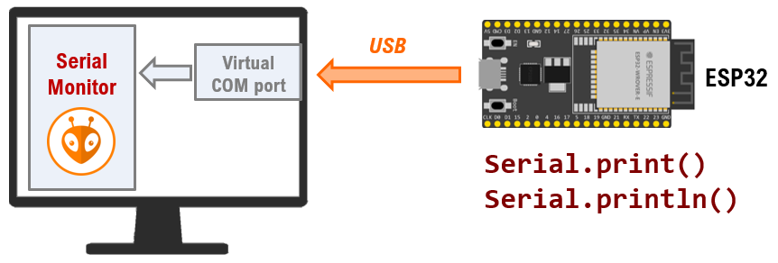

## 2.1 Configurer la liaison série pour les messages
> Par défaut, la communication série est établie sur les broches Rx/Tx reliées à la connexion USB entre l'ESP et l'ordinateur de développement.

Dans le code source, il faut initialiser la communication série dans la fonction setup()
```cpp
void setup()
{
  Serial.begin(115200); // vitesse 115200 bit/s
}
```
> ```Serial``` est un objet de la classe ```HardwareSerial```. Il est créé automatiquement avec le framework Arduino

La vitesse des communications reçues dans le moniteur série doit être spécifiée dans ```platformio.ini``` en ajoutant :
```ini
monitor_speed = 115200
```

Dans VScode/PlatformIO les messages sont reçus dans la console du moniteur série => Cliquez sur ```PlatformIO: Serial Monitor``` (dans la barre d'état).

## 2.2 Envoyer des messages sur la liaison série
On peut envoyer des messages vers l'ordi avec l'une ou l'autre des méthodes suivantes :
```cpp
Serial.print("LED éteinte");
Serial.println("LED éteinte");
```
La seule différence entre les deux méthodes est que ```pintln()``` ajoute un passage à la ligne après le message ("\r\n")

Ces 2 méthodes acceptent différents types d'arguments qu'elles convertissent en chaine de caractères, puis qu'elles envoient sur la liaison série :
```cpp
println(void)
println(const String &s)
println(const char c[])
println(char c)
println(unsigned char b, int base)
println(int num, int base)
println(unsigned int num, int base)
println(long num, int base)
println(unsigned long num, int base)
println(long long num, int base)
println(unsigned long long num, int base)
println(double num, int digits)
println(const Printable& x)
println(struct tm * timeinfo, const char * format)
```

Exemple d'utilisation :
```cpp
int valeur = 16;
double tempMillis = 12.3456789;
String nom = "Toto";

Serial.print("Bonjour ");
Serial.print(nom);
Serial.print(", la valeur est ");
Serial.print(valeur);
Serial.print(" et le temps ");
Serial.print(tempMillis, 3); // 3 décimales
Serial.println(" ms");
```
Cet exemple affichera :
```cmd
Bonjour Toto, la valeur est 16 et le temps 12.346 ms
```

Exemple d'utilisation avec une seule instruction Serial.println et une concaténation de chaine (les valeurs numériques doivent être converties en String):
```cpp
int valeur = 16;
double tempMillis = 12.3456789;
String nom = "Toto";

Serial.println("Bonjour " + nom + ", la valeur est " + (String)valeur + " et le temps " + (String)tempMillis + " ms");
```
Cet exemple affichera :
```cmd
Bonjour Toto, la valeur est 16 et le temps 12.35 ms
```

## 2.3 Amélioration en utilisant une macro pour le débogage
Pour simplifier la création de la version Release du programme, on peut créer une macro "DEBUG" avec ```#define``` qui permettra d'activer ou non les messages ```Serial.print```.

> Il s'agit ici de réaliser une compilation conditionnelle. La compilation conditionnelle consiste à compiler ou non une partie du code en fonction de l'existence ou de la non existence d'une macro.

Exemple :
```cpp
#define DEBUG
...
#if defined(DEBUG)
    Serial.begin(115200);
#endif
...
#if defined(DEBUG)
    Serial.println("Je suis en mode débogage");
#endif
```

Pour la version Release, il suffit de mettre en commentaire la définition de la macro et de re-compiler :
```cpp
//#define DEBUG
```

Le compilateur n'intègrera donc pas les messages ```Serial.print``` dans l'exécutable.


## 2.4 Avantages / Inconvénients des Serial.print()
**Avantages :**
* Simple parce que très couramment utilisé dans les exemples de code Arduino

**Inconvénients :**
* Il ne faut pas oublier d'initialiser la liaison série dans le code source (Serial.begin)
* Débogage limité à des messages insérés à l'avance dans le code source
* Les messages ne sont pas associés à un numéro de ligne dans le code, ou à un  nom de fichier
* Pas de niveau de debug : tous les messages s'affichent avec la même importance, on ne peut pas choisir le niveau de "verbosité"
* Le code source contient du code de débogage : pour la version Release il faut désactiver tous ces messages (ou créer une macro pour cela)


# 3. Messages avec les fonctions log_x()
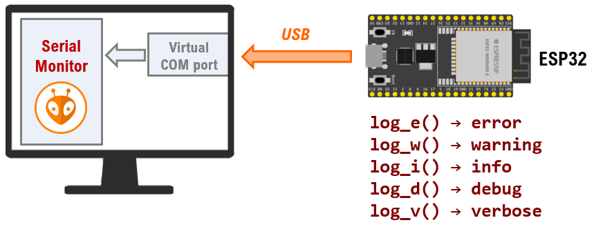

## 3.1 Niveaux de débogage
Le framework ESP32 Arduino intègre une API de journalisation (création de log) inspirée du framework ESP-IDF.

Cette API permet d'utiliser **5 fonctions log_x()** qui génèrent des messages sur la console série :
* Le choix de la fonction correspond au **niveau de débogage** souhaité.
* Le niveau de débogage est pris en compte à la compilation grâce à la **macro CORE_DEBUG_LEVEL** dans ```platformio.ini```


| Fonctions | Niveau de debug | Affichage si CORE_DEBUG_LEVEL |
|-----------|-----------------|-------------------------------|
| log_e()   | error           | >=1                           |
| log_w()   | warning         | >=2                           |
| log_i()   | info            | >=3                           |
| log_d()   | debug           | >=4                           |
| log_v()   | verbose         | =5                            |


## 3.2 Configurer la liaison série pour les logs
> Par défaut, la communication série est établie sur les broches Rx/Tx reliées à la connexion USB entre l'ESP et l'ordinateur de développement.

Le niveau de débogage et la vitesse de la communication série doivent être paramétrés dans ```platformio.ini``` en ajoutant :
```ini
monitor_speed = 115200
build_flags = -DCORE_DEBUG_LEVEL=3
```

Par exemple, si "CORE_DEBUG_LEVEL" est défini dans platformio.ini avec une valeur = 3, seuls les messages créés avec les fonctions log_e, log_w et log_i s'affichent.

Pour désactiver tous les messages de log, il suffit d'affecter 0 à "CORE_DEBUG_LEVEL". Le compilateur n'intègrera donc pas les messages log_x() dans l'exécutable :
```ini
build_flags = -DCORE_DEBUG_LEVEL=0
```

> Attention : certaines bibliothèques comme BLE sont très bavarde en mode debug et verbose. Peut-être vaut-il mieux se cantonner au log_i pour ne pas être parasité par trop de log

> Il n'est pas nécessaire d'initialiser la communication série dans le code CPP avec Serial.begin(115200)

Dans VScode/PlatformIO les messages sont reçus dans la console du moniteur série => Cliquez sur ```PlatformIO: Serial Monitor``` (dans la barre d'état).


## 3.3 Envoyer des messages sur la liaison série
Les fonctions log_x() sont des **[fonctions variadiques](https://fr.wikipedia.org/wiki/Fonction_variadique)** (elles prennent au moins un paramètre et peuvent en prendre un nombre variables)

Le premier paramètre obligatoire est une chaine de caractère qui sera affichée sur le moniteur série :
```cpp
log_i("Bonjour à tous");
```

Pour afficher le contenu des variables il faut "formater" cette chaine de caractère pour indiquer à quel endroit on veut insérer le contenu de la variable. On utilise pour cela le **symbole % suivi du type de la variable** (les symboles % définissent les "placeholder" ou "instructions de formatage). La variable est ensuite passée comme 2ème paramètre de la fonction.

Par exemple, pour afficher le contenu d'une variable entière :
```cpp
int age = 18;
log_i("Romane a %d ans aujourd'hui", age);
```

Les instructions de formatage (placeholder) doivent contenir le type de la variable à afficher. Par exemple :
* **%s** pour une chaine de caractère
* **%d** pour un nombre entier (représentation décimale)
* **%f** pour un nombre réel (**%.3f** permet d'arrondir à 3 décimales)

> Les fonctions log_x() utilisent la même syntaxe que la **commande printf du langage C** ([cf printf sur Wikipedia](https://fr.wikipedia.org/wiki/Printf), [plus d'info en anglais](https://en.wikipedia.org/wiki/Printf_format_string), ou [sur cplusplus.com](https://www.cplusplus.com/reference/cstdio/printf/)).
> 

Pour afficher plusieurs variables dans la chaine de cractère, le principe est le suivant : à chaque fois qu'il y a un %, la fonction écrit la variable qui correspond dans les paramètres. Si c'est le ième %, printf regarde le (ième + 1) paramètre.

Exemple :
```cpp
int valeur = 16;
double tempMillis = 12.3456789;
String nom = "Toto";

log_d("Bonjour %s, la valeur est %d et le temps %.3f ms", nom, valeur, tempMillis);
```
ce qui donne à l'affichage :
```
[D][main.cpp:22] setup(): Bonjour Toto, la valeur est 16 et le temps 12.346 ms
```


**Les messages affichés avec les fonctions log_x()** contiennent toujours les informations suivantes :
* Une lettre indiquant le niveau de debug : E,W,I,D,V
* Le nom du fichier source
* Le numéro de ligne du code source
* Le nom de la fonction
* Le message à afficher


## 3.4 Avantages / Inconvénients des fonctions log_x()
**Avantages :**
* On peut gérer la verbosité du débogage grâce au niveau de debug
* Les messages sont associés à leur emplacement dans le code source
* La configuration du débogage se fait uniquement dans platformio.ini
* Pour créer la version Release, il suffit de fixer le niveau de debug à 0 dans platformio.ini
* Pas besoin d'initialiser la liaison série dans le code source (Serial.begin)

**Inconvénients :**
* Débogage limité à des messages insérés à l'avance dans le code source


# 4. On-Chip Debugging avec la carte ESP-Prog
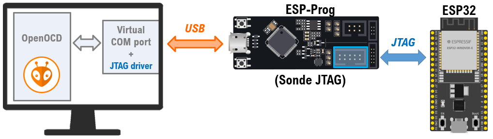

Les ESP32, comme la plupart des processeurs modernes, intègrent la technologie **JTAG** pour donner accès à leurs fonctions intégrées de débogage.

Le JTAG donne un **accès direct à l'intérieur du processeur** (points d'arrêt, lecture et écriture des registres internes, des mémoires internes et externes…) sans perturber ses interactions avec l'extérieur.

Le bus JTAG est **également utilisé pour programmer** la mémoire flash des microcontrôleurs.

Pour déboguer l'ESP32 en JTAG, il faut disposer d'une carte électronique additionnelle qu'on appelle couramment une **sonde JTAG**. Celle que nous utilisons est une **ESP-Prog**  fabriquée par Espressif (le constructeur des ESP32)

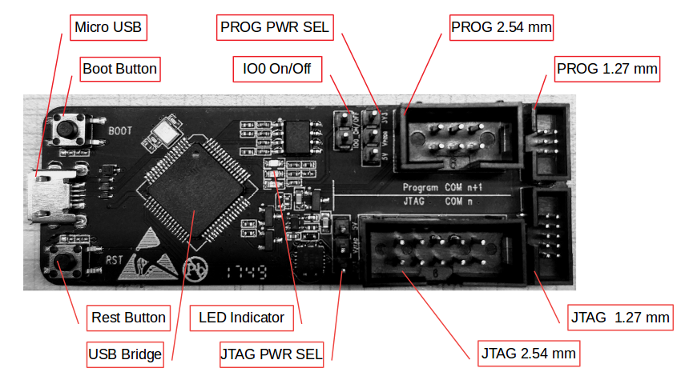

> Le débogage JTAG n'est pas disponible pour les ESP8266.

[Documentation ESP-Prog chez Espressif](https://docs.espressif.com/projects/espressif-esp-iot-solution/en/latest/hw-reference/ESP-Prog_guide.html)

[Disponible pour 20€ chez AliExpress](https://fr.aliexpress.com/item/4001205131144.html)

[Documentation ESP-Prog chez PlatformIO](https://docs.platformio.org/en/stable/plus/debug-tools/esp-prog.html)

[Documentation PlatformIO Debugger with ESP-Prog chez hackster.io](https://www.hackster.io/brian-lough/use-the-platformio-debugger-on-the-esp32-using-an-esp-prog-f633b6)


## 4.1 Connexions JTAG entre ESP-Prog et ESP32
Assurez vous d'abord que les 3 cavaliers (jumpers) de la carte ESP-Prog sont bien positionnés pour fonctionner en 3.3V

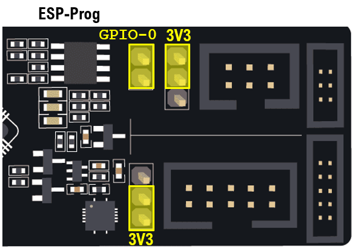

Réalisez ensuite la connexion entre l'ESP-Prog et l'ESP32

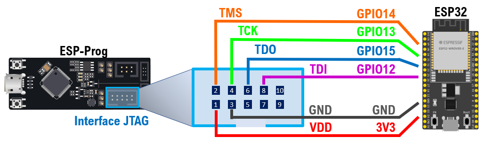

| ESP-Prog JTAG Pin | JTAG Name | ESP32 Pin | Description            |
|--------------|---------------|-----------|------------------------|
| 1            | VDD           | 3V3       | Power supply           |
| 3            | GND           | GND       | Digital ground         |
| 2            | TMS       | GPIO14    | Test Mode State        |
| 4            | TCK       | GPIO13    | JTAG Return Test Clock |
| 6            | TDO       | GPIO15    | Test Data Out          |
| 8            | TDI       | GPIO12    | Test Data In           |


<p style="color:red;font-weight:bold">
<p style="color: red"><span style="font-weight:bold">ATTENTION :</span> quand on débogue en JTAG, les broches GPIO12 à GPIO15 de l'ESP32 sont utilisées pour le bus JTAG. <span style="font-weight:bold">On ne doit rien connecter d'autre sur ces broches</span>. Dommage, car ces broches correspondent aussi au bus HSPI.</p>

## 4.2 Installation du Driver FTDI (Virtual COM Port)
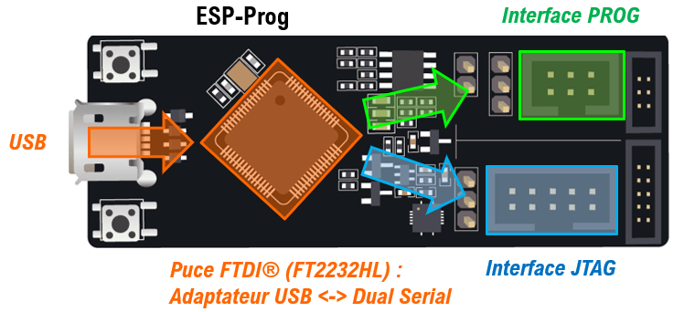

La carte ESP-Prog intègre une puce FTDI® (FT2232HL). 
Ce composant permet de **communiquer en laison série sur le câble USB**.

Si ce n'est pas déjà le cas, il faut installer sur votre ordinateur le driver correspondant de marque FTDI®. Ce driver installera **2 ports COM virtuel (VCP)** :
* un port COM virtuel pour l'interface PROG
* un port COM virtuel pour l'interface JTAG (celle qui nous intéresse pour le débogage)

Branchez la carte ESP-Prog en USB sur l'ordinateur.

Puis ouvrez le gestionnaire de périphériques > Contrôleurs de bus USB : vous devriez voir 2 bus USB **"USB SerialConverter A"** et **"USB SerialConverter B"** (si ce n'est pas le cas, il faut installer le driver FTDI)

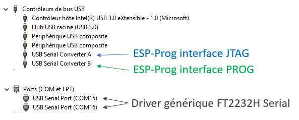

Si besoin, téléchargez le pilote FTDI sur le site https://ftdichip.com/drivers/vcp-drivers/


## 4.3 Installation du driver JTAG
Il faut maintenant remplacer le driver USB pour le bus "USB SerialConverter A" par un driver qui permet la communication JTAG.

Téléchargez l'utilitaire **Zadig** sur https://zadig.akeo.ie/

Lancez Zadig et activez Options > List All Devices

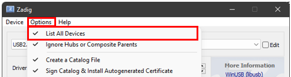


Sélectionnez le bus USB "**Dual RS232-HS (Interface 0)**" (il correspond au bus "USB SerialConverter A", donc à l'interface JTAG) > Sélectionnez le driver "**WinUSB (v6.1...)**" > Cliquez sur "**Replace Driver**"

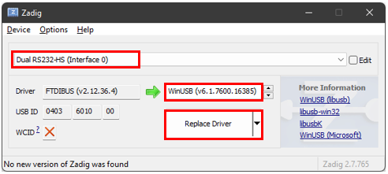

Débranchez / rebranchez le câble USB <span style="color:red;font-weight:bold">sur le même port USB de l’ordi</span> (sinon il faut relancer Zadig)

Dans le gestionnaire de périphériques vous devriez voir :

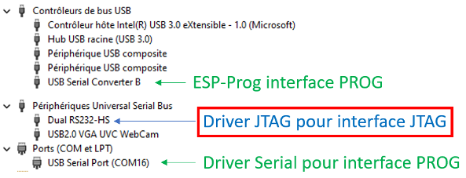


## 4.4 Configurer le projet PlatformIO

Dans platformio.ini, ajoutez la configuration suivante : 
```ini
debug_tool = esp-prog
upload_protocol = esp-prog
debug_init_break = tbreak setup
```
> La configuration ```debug_init_break = tbreak setup``` n'est pas obligatoire. Elle indique seulement au débogueur de s'arrêter automatiquement au début de la fonction setup()


## 4.5 Débogage avec PlatformIO
Pour lancer le débogage, vous pouvez (au choix) :
* taper **F5**
* Menu principal : Run > Start Debugging
* Barre d'activité : Debug > Run and Debug "PIO Debug"

Le débogage de PlatformIO :
* compile le programme et créé l'exécutable
* upload le programme sur l'ESP32 via l'interface JTAG
* attache le débogueur JTAG
* s'arrête sur le début de la fonction setup() 

Les messages du débogueur JTAG (OpenOCD = Open On-Chip Debugger) sont affichés dans la fenêtre BEBUG CONSOLE

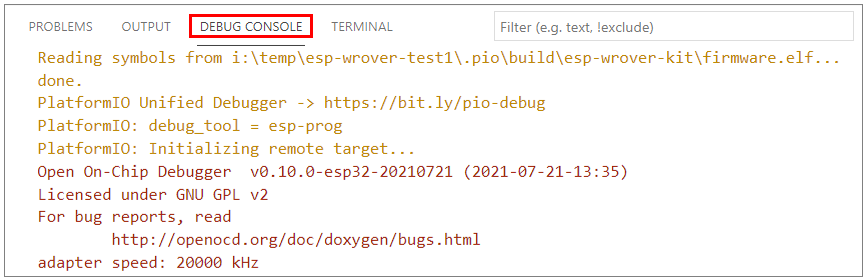

L'exécution du programme s'arrête sur la fonction setup().

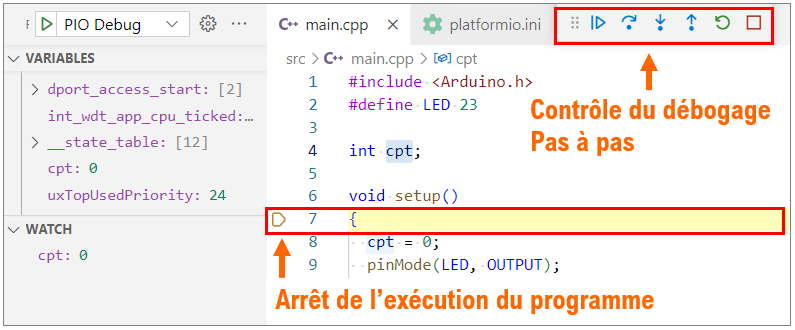

Les points d'arrêt se placent dans la marge, à gauche des numéros de ligne

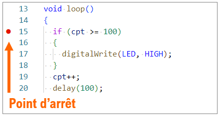

On peut définir des points d'arrêt conditionnels : Clic droit sur le point d'arrêt > Edit Breakpoint... Il suffit d'écrire la condition qui fera s'arrêter le programme sur ce point d'arrêt.

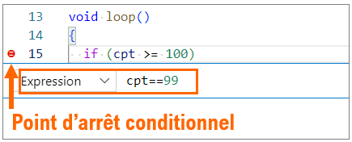

Quand l'exécution du programme est arrêtée sur un point d'arrêt, on peut visualiser le contenu des variables, et même modifier leur valeur.

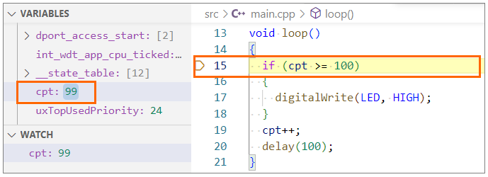


## 4.5 Afficher les messages sur le moniteur série
Si on veut afficher des messages sur le moniteur série en même temps que le débogage JTAG, il faut câbler une liaison supplémentaire entre l'ordinateur et l'ESP32.

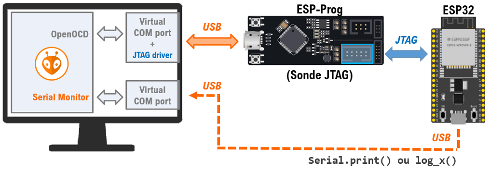

Connectez directement à l'ordinateur le port USB de l'ESP32.

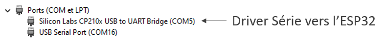

Il faut configurer ```platformio.ini``` pour l'utilisation des instructions Serial.print() ou log_x() et **ajouter le nom du port COM relié au moniteur série** :
```ini
monitor_speed = 115200
build_flags = -DCORE_DEBUG_LEVEL=3
monitor_port = COM5
```
**Redémarrez le débogage JTAG** et ouvrez le moniteur série pour voir les messages.

## 4.6 Avantages / Inconvénients du On-Chip Debugging
**Avantages :**
* Un vrai débogueur avec points d'arrêt et inspection de la mémoire.
* On peut modifier le contenu des variables pendant l'exécution

**Inconvénients :**
* Il faut disposer d'une sonde JTAG
* Il faut câbler la liaison ESP-Prog - ESP32
* On ne peut pas utiliser le bus HSPI (broches GPIO12 à GPIO15 de l'ESP32)


# 5. Annexe : Afficher la quantité de RAM disponible
On peut afficher la taille de la mémoire RAM réservée aux allocations dynamiques (le "tas" = heap)
```cpp
log_d("Total heap: %d", ESP.getHeapSize());
log_w("Free heap: %d", ESP.getFreeHeap());
```

On peut également afficher la taille de la PSRAM (Pseudo RAM) :
```cpp
log_d("Total PSRAM: %d", ESP.getPsramSize());
log_w("Free PSRAM: %d", ESP.getFreePsram());
```

Résultat dans le moniteur série :
```
[D][esp32-hal-psram.c:47] psramInit(): PSRAM enabled
[D][main.cpp:19] setup(): Total heap: 386872
[W][main.cpp:20] setup(): Free heap: 360992
[D][main.cpp:21] setup(): Total PSRAM: 4194252
[W][main.cpp:22] setup(): Free PSRAM: 4194252
```
