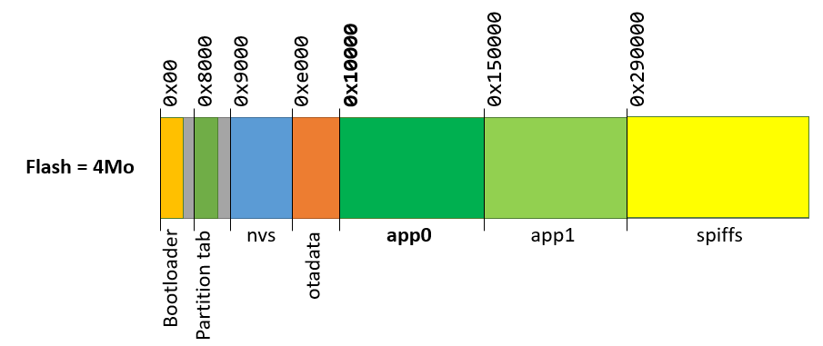
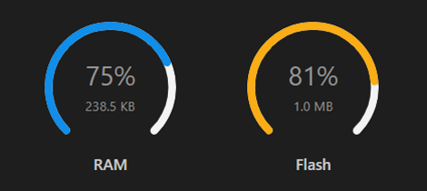
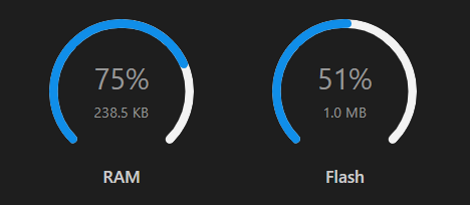
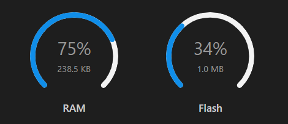

# ESP32 : Organisation de la mémoire flash

> * Auteur : Gwénaël LAURENT
> * Date : 25/02/2022

 [Licence Creative Commons](https://creativecommons.org/licenses/by-nc-sa/3.0/fr/)

- [ESP32 : Organisation de la mémoire flash](#esp32--organisation-de-la-mémoire-flash)
- [1. Connaitre la taille de la mémoire flash disponible](#1-connaitre-la-taille-de-la-mémoire-flash-disponible)
- [2. Organisation du stockage flash pour un ESP32](#2-organisation-du-stockage-flash-pour-un-esp32)
- [3. Lire la table de partition d'un ESP32](#3-lire-la-table-de-partition-dun-esp32)
- [4. Modifier la taille de l'appli principale](#4-modifier-la-taille-de-lappli-principale)
  - [4.1 Par défaut on a 1.25 Mo de fash pour le programme](#41-par-défaut-on-a-125-mo-de-fash-pour-le-programme)
  - [4.2 En utilisant l'espace normalement réservé à l'OTA : 2 Mo de flash pour le programme](#42-en-utilisant-lespace-normalement-réservé-à-lota--2-mo-de-flash-pour-le-programme)
  - [4.3 Sans OTA et en diminuant la SPIFFS : 3 Mo de flash pour le programme](#43-sans-ota-et-en-diminuant-la-spiffs--3-mo-de-flash-pour-le-programme)
- [5. Documentation sur la table de partition](#5-documentation-sur-la-table-de-partition)

# 1. Connaitre la taille de la mémoire flash disponible
Avant de modifier l'organisation de la mémoire flash, il faut absolument connaitre la quantité de mémoire flash disponible sur votre ESP32.

Connectez l'ESP32 en USB et repérez le port COM utilisé. Utilisez la commande console ```mode```.

> Le script **esptool.py** est normalement disponible dans les fichiers du framework esp-idf pour esp32 (installé avec PlatformIO). Si ce n'est pas le cas sur votre poste :
> 1. Créer un projet platformio avec le framework esp-idf
> 2. Compliler le projet. Cela forcera plateformio à télécharger le framework esp-idf
> 3. Dans une console, installer esptool avec la commande : `pip install esptool`

Lnacer la commande suivante :
```sh
python %userprofile%\.platformio\packages\framework-espidf\components\esptool_py\esptool\esptool.py --port COM3 flash_id
```

Si tout se passe bien :
```sh
esptool.py v3.2-dev
Serial port COM3
Connecting...............
Detecting chip type... ESP32
Chip is ESP32-D0WDQ6 (revision 1)
Features: WiFi, BT, Dual Core, Coding Scheme None
Crystal is 40MHz
MAC: 30:ae:a4:6a:ac:a0
Uploading stub...
Running stub...
Stub running...
Manufacturer: c8
Device: 4016
Detected flash size: 4MB
Hard resetting via RTS pin...
```
L'avant dernière ligne vous donne la taille de la flash, **4Mo dans mon cas**.

*Remarque : Si vous avez l'erreur ```Pyserial is not installed for ...```, il faut installer au préalable la bibliothèque python ```pyserial```*

```sh
pip install pyserial
```

# 2. Organisation du stockage flash pour un ESP32
La mémoire flash d'un seul ESP32 peut contenir plusieurs applications, ainsi que de nombreux types de données (données d'étalonnage, systèmes de fichiers, stockage de paramètres, etc.). Pour cette raison, **la mémoire flash est divisée en plusieurs partions**.

La taille et l'emplacement de chaque partition sont enregistrés dans une **table de partition**. Cette table est toujours stockée à l'adresse d'**```offset 0x8000```** dans la flash (*offset = décalage par rapport au début de l'espace de stockage, soit par rapport à l'adresse 0x00*). La longueur de la table de partition est de 0xC00 octets.

Chaque entrée de la table de partition correspond à une partition et possède :
* un nom (label), 
* un type (app, data ou autre), 
* un sous-type,
* l'offset dans la mémoire flash où la partition est stockée,
* et la taille de la partition.

Voici, par exemple, la table de partition utilisée par défaut par PlateformIO :
```
# Name,   Type, SubType, Offset,  Size, Flags
nvs,      data, nvs,     0x9000,  0x5000,
otadata,  data, ota,     0xe000,  0x2000,
app0,     app,  ota_0,   0x10000, 0x140000,
app1,     app,  ota_1,   0x150000,0x140000,
spiffs,   data, spiffs,  0x290000,0x170000,
```



La partition **bootloader** est stockée tout au début de la flash (**```offset 0x00```**). Elle contient le programme qui permet de lancer l'application principale (bootloader = programme de boot)

L'**application principale** se nomme **app0**. Elle contient votre programme. Elle se situe à l'**```offset 0x10000```** de la flash. Quand l'ESP démarre, le programme de boot exécutera cette application par défaut. 

> Les partitions de type ```app``` doivent être placées à des offset multiples de 0x10000 (64K) 

Les **mises à jour OTA (Over The Air)** sont des mises à jour du programme téléchargées en WiFi. Si une mise à jour du programme a été téléchargée, elle sera stockée dans la partition **app1**. La partition **otadata** contiendra les instructions pour la mise à jour OTA. Le bootloader consulte ces données afin de savoir quelle application exécuter. Si otadata est vide, il exécutera l'application par défaut app0. Si otadata contient les instructions de mise à jour, le contenu de app1 sera recopié en app0 puis la nouvelle application contenue en app0 est exécutée.

La partition **nvs (Non Volatile Storage)** contient les données de paramétrage du programme. On peut y stocker des données sous la forme clé/valeur.

La partition **spiffs (SPI Flash File System)** permet de stocker des fichiers, par exemple les pages HTML d'un serveur web embarqué dans l'ESP.

# 3. Lire la table de partition d'un ESP32

On peut lire la table de partition d'un ESP32 grâce aux scripts **esptool.py** et **gen_esp32part.py**. Ces scripts sont disponibles dans les fichiers du framework Espressif 32 (installé dans PlatformIO).

La procédure consiste à lire les données binaires de la table de partition et à les enregistrer dans un fichier binaire ```part_table.bin```, puis à afficher le partitionnement qu'elle contient.

```
python %userprofile%\.platformio\packages\framework-espidf\components\esptool_py\esptool\esptool.py --port COM3 read_flash 0x8000 0xC00 part_table.bin
python %userprofile%\.platformio\packages\framework-espidf\components\partition_table\gen_esp32part.py part_table.bin
```
Ce qui donne :
```sh
Parsing binary partition input...
Verifying table...
# ESP-IDF Partition Table
# Name, Type, SubType, Offset, Size, Flags
nvs,data,nvs,0x9000,20K,
otadata,data,ota,0xe000,8K,
app0,app,ota_0,0x10000,1280K,
app1,app,ota_1,0x150000,1280K,
spiffs,data,spiffs,0x290000,1472K,
```

# 4. Modifier la taille de l'appli principale
> Dans **```platformio.ini```**, on peut définir l'organisation de la mémoire flash grâce à l'option ```board_build.partitions```.
## 4.1 Par défaut on a 1.25 Mo de fash pour le programme
Table des partitions sélectionnée par défaut dans ```platformio.ini``` :
```ìni
[env:lolin32]
board_build.partitions = default.csv
```

Voici la structure de la table de partition **default.csv** :
```
# Name,   Type, SubType, Offset,  Size, Flags
nvs,      data, nvs,     0x9000,  0x5000,
otadata,  data, ota,     0xe000,  0x2000,
app0,     app,  ota_0,   0x10000, 0x140000,
app1,     app,  ota_1,   0x150000,0x140000,
spiffs,   data, spiffs,  0x290000,0x170000,
```

Résultat après le Build d'un programme :
```sh
RAM:   [=         ]   9.9% (used 32476 bytes from 327680 bytes)
Flash: [========  ]  79.1% (used 1037276 bytes from 1310720 bytes)
```

Le programme principal est stocké dans la parttion ```app0```. 
Soit une taille disponible de 0x140000 = 1310720 octets = **1.25 Mo**

Vous pouvez visualiser plus précisément l'utilisation de la RAM et de la Flash à partir du menu ```PlatformIO Home > Project Inspect``` :




## 4.2 En utilisant l'espace normalement réservé à l'OTA : 2 Mo de flash pour le programme
Modification de la table des partitions dans ```platformio.ini``` :
```ìni
[env:lolin32]
board_build.partitions = no_ota.csv
```

Voici la structure de la table de partition **no_ota.csv** :
```
# Name,   Type, SubType, Offset,  Size, Flags
nvs,      data, nvs,     0x9000,  0x5000,
otadata,  data, ota,     0xe000,  0x2000,
app0,     app,  ota_0,   0x10000, 0x200000,
spiffs,   data, spiffs,  0x210000,0x1F0000,
```

Résultat après le Build du même programme :
```sh
RAM:   [=         ]   9.9% (used 32476 bytes from 327680 bytes)
Flash: [=====     ]  49.5% (used 1037276 bytes from 2097152 bytes)
```

Le programme principal est stocké dans la parttion ```app0```. 
Soit une taille disponible de 0x200000 = 2097152 octets = **2 Mo**

Vous pouvez visualiser plus précisément l'utilisation de la RAM et de la Flash à partir du menu ```PlatformIO Home > Project Inspect``` :




## 4.3 Sans OTA et en diminuant la SPIFFS : 3 Mo de flash pour le programme
Modification de la table des partitions dans ```platformio.ini``` :
```ìni
[env:lolin32]
board_build.partitions = huge_app.csv
```

Voici la structure de la table de partition **huge_app.csv** :
```
# Name,   Type, SubType, Offset,  Size, Flags
nvs,      data, nvs,     0x9000,  0x5000,
otadata,  data, ota,     0xe000,  0x2000,
app0,     app,  ota_0,   0x10000, 0x300000,
spiffs,   data, spiffs,  0x310000,0xF0000,
```

Résultat après le Build du même programme :
```sh
RAM:   [=         ]   9.9% (used 32476 bytes from 327680 bytes)
Flash: [===       ]  33.0% (used 1037276 bytes from 3145728 bytes)
```

Le programme principal est stocké dans la parttion ```app0```. 
Soit une taille disponible de 0x300000 = 3145728 octets = **3 Mo**

Vous pouvez visualiser plus précisément l'utilisation de la RAM et de la Flash à partir du menu ```PlatformIO Home > Project Inspect``` :



# 5. Documentation sur la table de partition
* Changement de partitionnement dans PlatformIO : https://docs.platformio.org/en/latest/platforms/espressif32.html#partition-tables
* Diférentes partitions disponibles dans PlatformIO : https://github.com/espressif/arduino-esp32/tree/master/tools/partitions
* La table de partitions chez Espressif : https://docs.espressif.com/projects/esp-idf/en/latest/esp32/api-guides/partition-tables.html
* Partition Tables ( ESP-IDF Programming Guide) : https://my-esp-idf.readthedocs.io/en/latest/api-guides/partition-tables.html
