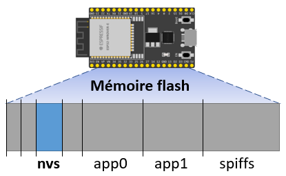
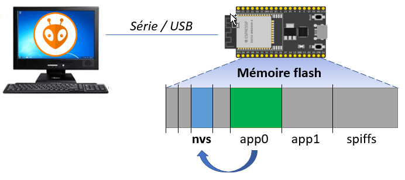
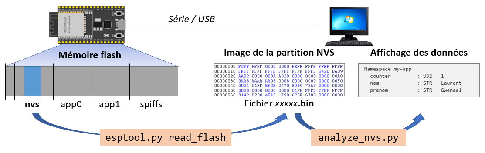
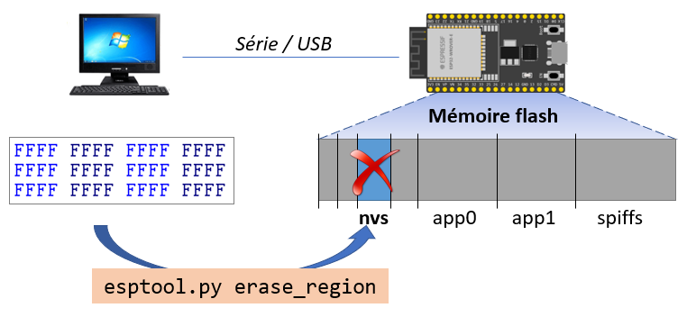
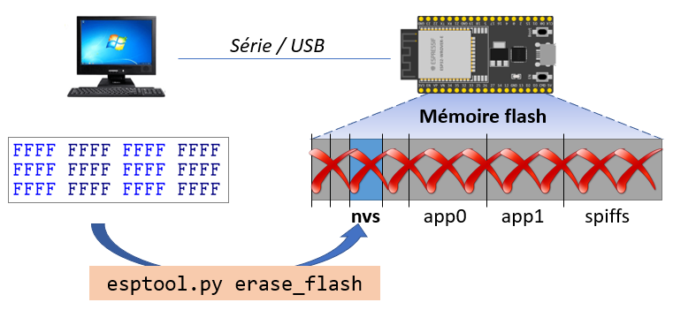
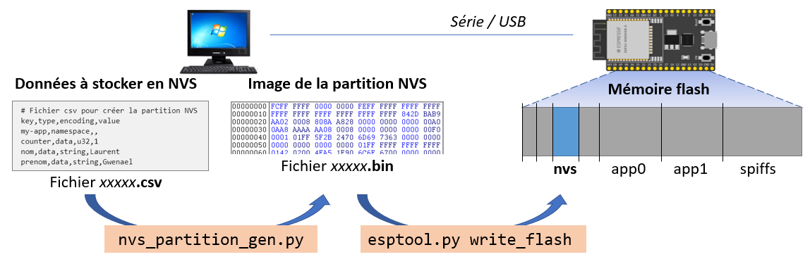

# ESP32 NVS - Stocker les paramètres de façon non volatile

> * Auteur : Gwénaël LAURENT
> * Date : 01/03/2022


 [Licence Creative Commons](https://creativecommons.org/licenses/by-nc-sa/3.0/fr/)

- [ESP32 NVS - Stocker les paramètres de façon non volatile](#esp32-nvs---stocker-les-paramètres-de-façon-non-volatile)
- [1. Utilité du stockage non volatile NVS](#1-utilité-du-stockage-non-volatile-nvs)
- [2. Bibliothèque pour gérér NVS (Non Volatile Storage)](#2-bibliothèque-pour-gérér-nvs-non-volatile-storage)
  - [2.1 Présentation](#21-présentation)
  - [2.2 Clés et valeurs](#22-clés-et-valeurs)
  - [2.3 Espaces de noms](#23-espaces-de-noms)
- [3. Programmation dans VScode : accès à NVS](#3-programmation-dans-vscode--accès-à-nvs)
- [4. Lire le contenu de la partition NVS d'un ESP32](#4-lire-le-contenu-de-la-partition-nvs-dun-esp32)
- [5. Effacer le contenu de la partition NVS](#5-effacer-le-contenu-de-la-partition-nvs)
  - [5.1 Effacer seulement la partition NVS](#51-effacer-seulement-la-partition-nvs)
  - [5.2 Effacer entièrement la mémoire flash](#52-effacer-entièrement-la-mémoire-flash)
- [6. Générer la partition NVS à partir d'un fichier CSV](#6-générer-la-partition-nvs-à-partir-dun-fichier-csv)
  - [6.1 Présentation](#61-présentation)
  - [6.2 Création du fichier CSV avec les paramètres souhaités](#62-création-du-fichier-csv-avec-les-paramètres-souhaités)
  - [6.3 Génération de l'image de la partition NVS](#63-génération-de-limage-de-la-partition-nvs)
  - [6.4 Ecrire l'image NVS sur la flash de l'ESP](#64-ecrire-limage-nvs-sur-la-flash-de-lesp)
- [7. Remarque sur la sécurité](#7-remarque-sur-la-sécurité)
- [8. Documentation](#8-documentation)

# 1. Utilité du stockage non volatile NVS
A chaque fois que votre programme ESP redémarre, le programme recrée les variables en RAM *avec leur valeur initiale*. 

Mais **comment faire pour enregistrer les préférences de l'utilisateur ?** Par exemple, on peut fournir à l'utilisateur un moyen de saisir les paramètres de son réseau WiFi. Si nous stockons le nom de son réseau WiFi dans une variable du programme, comment faire pour que l'utilisateur n'ait pas besoin de ressaisir le nom du réseau à chaque fois que le programme redémarre ?

* Sur un ordinateur, on a l'habitude de créer pour cela un fichier de configuration séparé du programme (fichier .ini ou .xml ou .json)
* Sur un arduino, on stocke les préférences dans l'EEPROM
* Sur un ESP, on va stocker ces valeurs dans une **partition de la mémoire flash** séparée de la partition qui contient le programme : c'est la partition **NVS (Non Volatile Storage)**.



Les données sont stockées de manière non volatile, de sorte qu'elles restent dans la mémoire flash :
* après la mise hors tension ou le redémarrage
* pendant le mode Deep Sleep
* même après l'upload d'un nouveau programme principal (upload avec platformIO ou update OTA)

> Attention, c'est plus lent que des variables en RAM (en lecture et en écriture). A réserver pour des données qui ne changent pas souvent.

Exemples d'utilisation :
* Paramètrage utilisateur (ssid, password, ...)
* Paramétrage constructeur
* Stockage non volatile de données (dernières valeurs de caractéristiques BLE, ...)
* Particulariser chaque objet IoT (numéro de série du matériel)

# 2. Bibliothèque pour gérér NVS (Non Volatile Storage)
## 2.1 Présentation
La bibliothèque de stockage non volatile (NVS) s'appelle **```Preferences```** dans le framework arduino pour ESP32.

Actuellement, la bibliothèque Preferences utilise la partition de la mémoire flash qui s'appelle **nvs**. Par défaut, la taille de la partition nvs est de **20ko** sur un ESP32 (=0x5000 octets). [cf ESP32 : Organisation de la mémoire flash](18.esp32-organisation-memoire-flash.md)

Cette bibliothèque est conçue pour stocker des paires clé-valeur.

> NVS fonctionne mieux pour stocker de nombreuses petites valeurs, plutôt que quelques grandes valeurs de type 'string' et 'blob'. Pour ces grandes valeurs il vaut mieux les stocker en tant que fichiers dans la partition SPIFFS.

> Auparavant, on utilisait la bibliothèque EEPROM par analogie avec les arduino (Bien que les ESP ne possèdent pas d'EEPROM). Cette bibliothèque est obsolète pour les ESP32.

## 2.2 Clés et valeurs
NVS fonctionne sur des **paires clé-valeur**. 

Par exemple, on peut stocker la clé *nom* qui aura pour valeur *Laurent*

**Les clés** sont des chaînes ASCII ; la longueur maximale de la clé est actuellement de 15 caractères.

**Les valeurs** peuvent avoir l'un des types suivants :
* types entiers : uint8_t, int8_t, uint16_t, int16_t, uint32_t, int32_t, uint64_t,int64_t
* chaîne terminée par zéro
* données binaires de longueur variable (blob)

## 2.3 Espaces de noms

Pour atténuer les conflits potentiels dans les noms de clé entre différentes bibliothèques de votre application, NVS attribue chaque paire clé-valeur à l'un des espaces de noms.

Les noms d'espaces de noms suivent les mêmes règles que les noms de clés, c'est-à-dire que la longueur maximale est de 15 caractères. 

# 3. Programmation dans VScode : accès à NVS


Le programme suivant fait partie des exemples fournis avec la bibliothèque Preferences : **[StartCounter](https://github.com/espressif/arduino-esp32/blob/master/libraries/Preferences/examples/StartCounter/StartCounter.ino)**.

Le programme suivant montre comment utiliser la bibliothèque Preferences pour stocker dans la NVS le nombre de redémarrage de l'ESP32.
```cpp
#include <Arduino.h>
#include <Preferences.h>

Preferences prefs;

void setup(void)
{
  Serial.begin(115200);
  Serial.println();

  // Open Preferences with my-app namespace. Each application module, library, etc
  // has to use a namespace name to prevent key name collisions. We will open storage in
  // RW-mode (second parameter has to be false).
  // Note: Namespace name is limited to 15 chars.
  prefs.begin("my-app", false);

  // Remove all preferences under the opened namespace
  //prefs.clear();

  // Or remove the counter key only
  //prefs.remove("counter");

  // Get the counter value, if the key does not exist, return a default value of 0
  // Note: Key name is limited to 15 chars.
  unsigned int counter = prefs.getUInt("counter", 0);

  // Increase counter by 1
  counter++;

  // Print the counter to Serial Monitor
  Serial.printf("Current counter value: %u\n", counter);

  // Store the counter to the Preferences
  prefs.putUInt("counter", counter);

  // Close the Preferences
  prefs.end();
}

void loop(void)
{
  // Wait 10 seconds
  Serial.println("Restarting in 10 seconds...");
  delay(10000);

  // Restart ESP
  ESP.restart();
}
```


Affichage dans le moniteur série :
```
Current counter value: 3
Restarting in 10 seconds...
ets Jul 29 2019 12:21:46

rst:0xc (SW_CPU_RESET),boot:0x13 (SPI_FAST_FLASH_BOOT)
configsip: 0, SPIWP:0xee
clk_drv:0x00,q_drv:0x00,d_drv:0x00,cs0_drv:0x00,hd_drv:0x00,wp_drv:0x00
mode:DIO, clock div:2
load:0x3fff0018,len:4
load:0x3fff001c,len:1044
load:0x40078000,len:10124
load:0x40080400,len:5828
entry 0x400806a8

Current counter value: 4
Restarting in 10 seconds...
ets Jul 29 2019 12:21:46
```

Pour enregistrer des données binaires dans des tableaux d'octets (BLOB : Binary Large Object), inspirez vous du deuxième exemple de la bibliothèque : [Prefs2Struct](https://github.com/espressif/arduino-esp32/blob/master/libraries/Preferences/examples/Prefs2Struct/Prefs2Struct.ino)

# 4. Lire le contenu de la partition NVS d'un ESP32


On peut lire le contenu de la partition NVS grâce aux scripts [**esptool.py**](https://docs.espressif.com/projects/esptool/en/latest/esp32/esptool/basic-commands.html) ou **gen_esp32part.py**. Ces scripts sont disponibles dans les fichiers du framework Espressif 32 (installé dans PlatformIO).

> Le script **esptool.py** est normalement disponible dans les fichiers du framework esp-idf pour esp32 (installé avec PlatformIO). Si ce n'est pas le cas sur votre poste :
> 1. Créer un projet platformio avec le framework esp-idf
> 2. Compliler le projet. Cela forcera plateformio à télécharger le framework esp-idf
> 3. Dans une console, installer esptool avec la commande : `pip install esptool`

La procédure consiste à lire les données binaires de la partition et à les enregistrer dans un fichier binaire ```nvs.bin```, puis à décoder et afficher les données qu'elle contient.

1- Connectez l'ESP32 en USB et repérez le port COM utilisé. Utilisez pour cela la commande console ```mode```.

2- Lire la partition NVS d'un ESP32 et l'enregistrer dans le fichier **nvs.bin**
(modifiez le nom du port série)
```
set IDF_PATH=%userprofile%\.platformio\packages\framework-espidf
python %userprofile%\.platformio\packages\framework-espidf\components\partition_table\parttool.py --port COM3 read_partition --partition-type=data --partition-subtype=nvs --output "nvs.bin"
```
ou si on connait l'emplacement et la taille de la partition NVS :
```
python %userprofile%\.platformio\packages\framework-espidf\components\esptool_py\esptool\esptool.py --port COM3 read_flash 0x9000 0x5000 nvs_ble.bin
```

3- Afficher le contenu de la partition nvs avec Espressif-NVS-Analyzer

Téléchargez le script **```analyze_nvs.py```** à cette adresse :
https://gitlab.com/gwenael.laurent/public/blob/master/platformio/Espressif-NVS-Analyzer/analyze_nvs.py

> Ce script a été modifié par mes soins à partir de l'original disponible sur [github](https://github.com/AFontaine79/Espressif-NVS-Analyzer)


Puis lancez le :
```
python analyze_nvs.py nvs.bin -s -b 32
```

Vous devriez voir votre namespace et la clé "counter" de type uint32_t :
```cmd
Namespace my-app
  counter         : U32   112

```

**Remarque** : Certaines bibliothèques utilisent également la partition NVS pour stocker des données. C'est le cas des bibliothèques WiFi et BLE. Il n'est pas nécessaire de se soucier de ces valeurs, elles sont reconstruites pendant l'exécution du programme.
```cmd
Namespace nvs.net80211
  sta.ssid        : BLOB  tpsnir
  sta.pswd        : BLOB  xxxxxxxxxxx
  sta.mac         : BLOB  30 AE A4 6A AC A0
  ap.mac          : BLOB  30 AE A4 6A AC A1
Namespace bt_config.conf
  bt_cfg_key0     : BLOB  5B 41 64 61 70 74 65 ...
Namespace phy
  cal_mac         : BLOB  30 AE A4 6A AC A0
  cal_version     : U32   4660
Namespace dhcp_state
  IF_STA          : U32   1857949868
```


# 5. Effacer le contenu de la partition NVS
## 5.1 Effacer seulement la partition NVS


Si on connait l'emplacement et la taille de la partition NVS, on peut l'effacer, par défaut à partir de l'adresse 0x9000 sur un zone de 0x5000 octets (20ko) :
```
python %userprofile%\.platformio\packages\framework-espidf\components\esptool_py\esptool\esptool.py --port COM5 erase_region 0x9000 0x5000
```
## 5.2 Effacer entièrement la mémoire flash


PlatformIO > Project tasks > Lolin32 > Platform > Erase Flash

ou avec [esptool.py](https://docs.espressif.com/projects/esptool/en/latest/esp32/esptool/basic-commands.html)
```cmd
python %userprofile%\.platformio\packages\framework-espidf\components\esptool_py\esptool\esptool.py --port COM3 erase_flash
```

# 6. Générer la partition NVS à partir d'un fichier CSV
## 6.1 Présentation
La génération de la partition NVS permet aux fabricants de générer de nombreuses instances du même micrologiciel d'application avec des paramètres personnalisés pour chaque appareil, comme un numéro de série.



[Doc Espressif NVS Partition Generator Utility](https://docs.espressif.com/projects/esp-idf/en/latest/esp32/api-reference/storage/nvs_partition_gen.html)

[Doc github sur nvs_partition_gen.py avec des exemples de fichiers CSV](https://github.com/espressif/esp-idf/tree/229ed084847455da5aeda1dfd17ad3b6ccadc9b0/components/nvs_flash/nvs_partition_generator)

## 6.2 Création du fichier CSV avec les paramètres souhaités
> Chaque ligne du fichier .csv doit contenir 4 paramètres, séparés par une virgule. [Cf. doc Espressif](https://docs.espressif.com/projects/esp-idf/en/latest/esp32/api-reference/storage/nvs_partition_gen.html#csv-file-format)

Créer un fichier CSV avec le namespace et les clés/valeurs souhaitées. Par exemple nvs_perso.csv avec le contenu suivant (1 namespace 'my-app' et 3 clés/valeurs 'counter', 'nom' et 'prenom'):
```csv
# Fichier csv pour créer la partition NVS
key,type,encoding,value
my-app,namespace,,
counter,data,u32,1
nom,data,string,Laurent
prenom,data,string,Gwenael
```

## 6.3 Génération de l'image de la partition NVS
Générer l'image de la partition NVS avec le script **nvs_partition_gen.py**. Il est disponible dans les fichiers du framework Espressif 32 (installé dans PlatformIO).

Pour utiliser ce script il faut installer au préalable les packages python 'future' et 'cryptography'

```sh
pip install future
pip install cryptography
```


Le dernier paramètre de la commande est la taille de la partition NVS (cf [Organisation de la mémoire flash](18.esp32-organisation-memoire-flash.md)).
```cmd
python %userprofile%\.platformio\packages\framework-espidf\components\nvs_flash\nvs_partition_generator\nvs_partition_gen.py generate nvs_perso.csv nvs_perso.bin 0x5000
```

Testez si le fichier image de la partition nvs a bien été créé en affichant son contenu avec Espressif-NVS-Analyzer

```
python analyze_nvs.py nvs_perso.bin -s -b 32
Namespace my-app
  counter         : U32   1
  nom             : STR   Laurent
  prenom          : STR   Gwenael

```

## 6.4 Ecrire l'image NVS sur la flash de l'ESP
Il faut connaitre l'emplacement et la taille de la partition NVS (par défaut offset 0x9000 et taille 0x5000 octets)

Le script [**esptool.py**](https://docs.espressif.com/projects/esptool/en/latest/esp32/esptool/basic-commands.html) permet d'écrire le fichier binaire nvs_perso.bin sur la flash de l'ESP :
```cmd
python %userprofile%\.platformio\packages\framework-espidf\components\esptool_py\esptool\esptool.py --port COM3 write_flash 0x9000 nvs_perso.bin
```

> Si le programme de l'ESP correspond à l'exemple 'StartCounter' de ce tuto, vous remarquerez que le compteur est réinitialisé à la valeur 1

# 7. Remarque sur la sécurité
Les données stockées en NVS peuvent être sensibles (mot de passe, ....). Il faudrait crypter la partition NVS. C'est possible avec le framework ESP-IDF mais pas encore avec le framework arduino.

# 8. Documentation
[Non-volatile storage library (doc pour ESP-IDF dont s'inspire le framework arduino)](https://docs.espressif.com/projects/esp-idf/en/latest/esp32/api-reference/storage/nvs_flash.html)

[Bibliothèque Preferences sur github (pour le framework arduino)](https://github.com/espressif/arduino-esp32/tree/master/libraries/Preferences)


