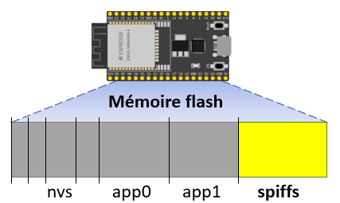
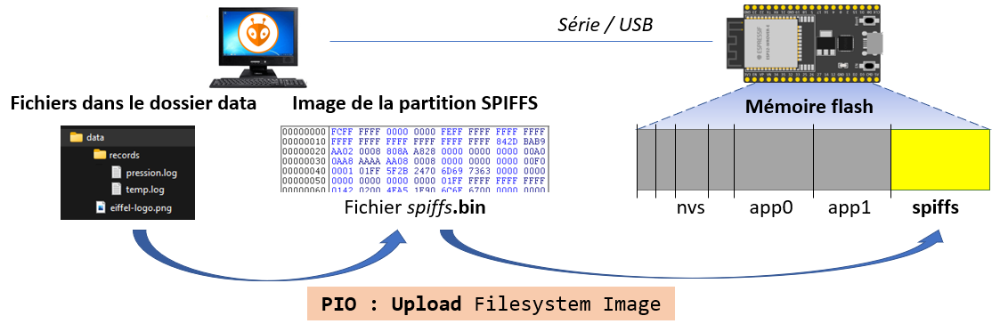
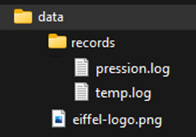
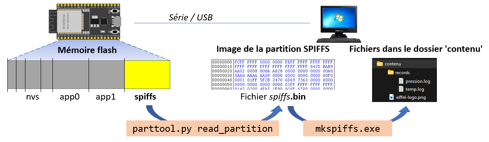
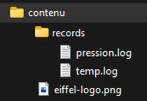
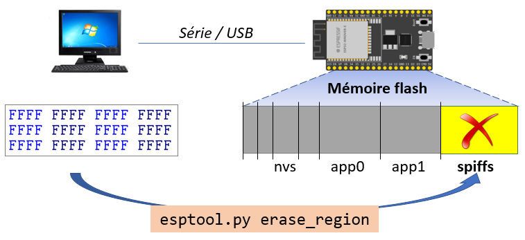
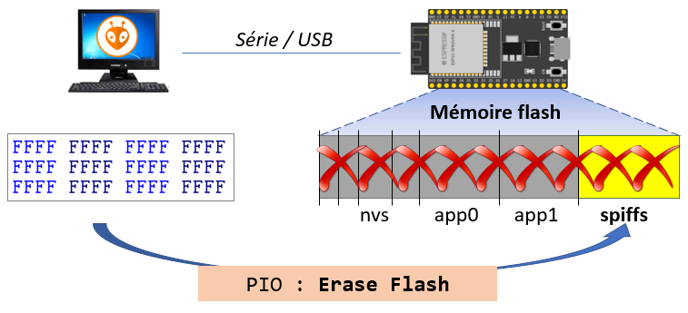
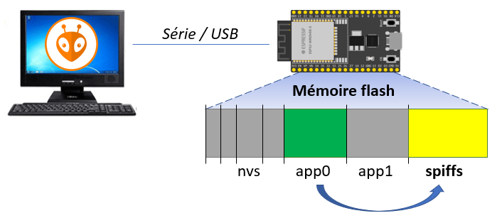

# ESP32 SPIFFS - Stocker des fichiers sur la flash

> * Auteur : Gwénaël LAURENT
> * Date : 07/03/2022


 [Licence Creative Commons](https://creativecommons.org/licenses/by-nc-sa/3.0/fr/)

- [ESP32 SPIFFS - Stocker des fichiers sur la flash](#esp32-spiffs---stocker-des-fichiers-sur-la-flash)
- [1. Utilité du stockage de fichiers en SPIFFS](#1-utilité-du-stockage-de-fichiers-en-spiffs)
- [2. Uploader des fichiers sur la partition SPIFFS avec PlateformIO](#2-uploader-des-fichiers-sur-la-partition-spiffs-avec-plateformio)
- [3. Lire le contenu de la SPIFFS d'un ESP32](#3-lire-le-contenu-de-la-spiffs-dun-esp32)
- [4. Effacer le contenu de la partition SPIFFS](#4-effacer-le-contenu-de-la-partition-spiffs)
  - [4.1 Effacer seulement la partition SPIFFS](#41-effacer-seulement-la-partition-spiffs)
  - [4.2 Effacer entièrement la mémoire flash](#42-effacer-entièrement-la-mémoire-flash)
- [5. Bibliothèques pour gérér la SPIFFS sur ESP32](#5-bibliothèques-pour-gérér-la-spiffs-sur-esp32)
- [6. Programmation dans VScode : accès à la SPIFFS](#6-programmation-dans-vscode--accès-à-la-spiffs)
  - [6.1 Résumé des fonctions disponibles](#61-résumé-des-fonctions-disponibles)
  - [6.2 Accéder au système de fichier (begin - end)](#62-accéder-au-système-de-fichier-begin---end)
  - [6.3 Lire un fichier octet par octet (open "r")](#63-lire-un-fichier-octet-par-octet-open-r)
  - [6.4 Lire un fichier texte (open "r")](#64-lire-un-fichier-texte-open-r)
  - [6.5 Lire un fichier binaire octet par octet (open "r")](#65-lire-un-fichier-binaire-octet-par-octet-open-r)
  - [6.6 Ajouter une ligne en fin de fichier texte (open "a")](#66-ajouter-une-ligne-en-fin-de-fichier-texte-open-a)
  - [6.7 Créer un fichier (open "w")](#67-créer-un-fichier-open-w)
  - [6.8 Ecrire du contenu binaire dans un fichier (open "w")](#68-ecrire-du-contenu-binaire-dans-un-fichier-open-w)
  - [6.9 Ecrire du texte dans un fichier (open "w")](#69-ecrire-du-texte-dans-un-fichier-open-w)
  - [6.10 Renommer un fichier (rename)](#610-renommer-un-fichier-rename)
  - [6.11 Supprimer un fichier (remove)](#611-supprimer-un-fichier-remove)
- [7. Remarque sur la sécurité](#7-remarque-sur-la-sécurité)
- [8. Documentation](#8-documentation)

# 1. Utilité du stockage de fichiers en SPIFFS
Les systèmes numériques embarqués ont très souvent besoin de stocker des données de manière **non volatile**, de sorte qu'elles restent dans la mémoire flash :
* après la mise hors tension ou le redémarrage
* pendant le mode Deep Sleep
* même après l'upload d'un nouveau programme principal (upload avec platformIO ou update OTA)

Il existe deux moyens pour cela :
* le stockage *NVS* adapté au stockage de petites données sous la forme clé-valeur, souvent réservé aux données de configuration. (cf [NVS - Stocker les paramètres de façon non volatile](19.esp32-non-volatile-storage.md))
* le stockage *SPIFFS* pour stocker de grandes valeurs **dans des fichiers**

La **SPIFFS (SPI Flash File System)** permet de stocker :
* les fichiers d'un serveur web embarqué (html, images ...)
* des fichiers de configuration trop grands pour la partition NVS (Non Volatile Storage)
* des fichiers contenant l'historique de mesures issues des capteurs ...

Sur un ESP, la **SPIFFS** (SPI Flash File System) est une **partition de la mémoire flash** séparée de la partition qui contient le programme. (cf [ESP32 : Organisation de la mémoire flash](18.esp32-organisation-memoire-flash.md))




La **taille du système de fichiers** (SPIF**FS**) dépend du modèle d'ESP que vous utilisez et du partitionnement utilisé.

Voici, par exemple, la table de partition utilisée par défaut dans PlateformIO pour les ESP32 :
```
# Name,   Type, SubType, Offset,  Size, Flags
nvs,      data, nvs,     0x9000,  0x5000,
otadata,  data, ota,     0xe000,  0x2000,
app0,     app,  ota_0,   0x10000, 0x140000,
app1,     app,  ota_1,   0x150000,0x140000,
spiffs,   data, spiffs,  0x290000,0x170000,
```

En utilisant le partitionnement standard, la taille du système de fichiers (spiffs) est de 0x170000 = 1 507 328 octets = **1.44 Mo**

Bien que la taille du système de fichiers puisse être augmentée en modifiant le partitionnement de la flash, elle demeure très petite comparée à l'espace disponible sur un ordinateur. Il faut donc faire très attention à la taille des fichiers stockés.

Autre point important à connaitre, l'accès à la partition spiffs est très lent ! Et l'écriture sur la flash est presque 100 fois plus lente que la lecture !


# 2. Uploader des fichiers sur la partition SPIFFS avec PlateformIO


1. Créez un nouveau projet avec PlateformIO
2. Créer un **dossier "data"** directement sur la racine du projet (au même niveau que le dossier "src")
3. Copiez les fichiers du Filesystem dans le dossier "data". Par exemple :\
   
4. Dans le projet PlatformIO :
   * cliquez sur l'icône PlatformIO dans la barre d'activité
   * Project tasks > [esp-wrover-kit] > Platform > **Upload Filesystem Image**

PlateformIO créera le fichier image de la partition SPIFFS et l'uploadera sur l'ESP32 en utilisant la connexion série.

> Pour uploader la spiffs sur votre ESP32, il faut fermer toutes les connexions série avec votre ESP (Serial Monitor ...)

Remarque : si vous souhaitez seulement créer l'image de la partition SPIFFS sans l'uploader sur l'ESP, cliquez sur Project tasks > [esp-wrover-kit] > Platform > *Build Filesystem Image*.\
L'image sera créée dans .pio\build\[esp-wrover-kit]\spiffs.bin


# 3. Lire le contenu de la SPIFFS d'un ESP32


Il faut utiliser le script [**esptool.py**](https://docs.espressif.com/projects/esptool/en/latest/esp32/esptool/basic-commands.html) et le programme **mkspiffs.exe**. Le programme mkspiffs.exe se télécharge à cette adresse : https://github.com/igrr/mkspiffs/releases (pour Windows 10 il est dans l'archive mkspiffs-0.2.3-arduino-esp32-win32.zip). 

> Le script **esptool.py** est normalement disponible dans les fichiers du framework esp-idf pour esp32 (installé avec PlatformIO). Si ce n'est pas le cas sur votre poste :
> 1. Créer un projet platformio avec le framework esp-idf
> 2. Compliler le projet. Cela forcera plateformio à télécharger le framework esp-idf
> 3. Dans une console, installer esptool avec la commande : `pip install esptool`

1. Lire la partition SPIFFS d'un ESP32 et l'enregistrer dans le fichier **spiffs.bin** (modifiez le nom du port série). C'est assez long car tous les octets de la partition sont téléchargés.
```
set IDF_PATH=%userprofile%\.platformio\packages\framework-espidf
python %userprofile%\.platformio\packages\framework-espidf\components\partition_table\parttool.py --port COM5 read_partition --partition-type=data --partition-subtype=spiffs --output "spiffs.bin"
```
2. Lire la fichier spiffs.bin et extraire les fichiers dans le sous dossier 'contenu'
```cmd
mkspiffs.exe -u contenu spiffs.bin
```

Le programme mkspiffs.exe affiche :
```cmd
Directory ./contenu does not exists. Try to create it.
/eiffel-logo.png         > ./contenu/eiffel-logo.png    size: 433 Bytes
/records/pression.log    > ./contenu/records/pression.log       size: 136 Bytes
/records/temp.log        > ./contenu/records/temp.log   size: 268 Bytes
```
et crée le dossier "contenu" :




# 4. Effacer le contenu de la partition SPIFFS

## 4.1 Effacer seulement la partition SPIFFS


Il faut utiliser le script [**esptool.py**](https://docs.espressif.com/projects/esptool/en/latest/esp32/esptool/basic-commands.html). Ce script est disponible dans les fichiers du framework Espressif 32 (installé dans PlatformIO).

1. Connectez l'ESP32 en USB et repérez le port COM utilisé. Utilisez pour cela la commande console ```mode```
2. Si on connait l'emplacement et la taille de la partition SPIFFS, on peut l'effacer, par défaut à partir de l'adresse 0x290000 sur un zone de 0x170000 octets (1.4Mo) :
```
python %userprofile%\.platformio\packages\framework-espidf\components\esptool_py\esptool\esptool.py --port COM5 erase_region 0x290000 0x170000
```

## 4.2 Effacer entièrement la mémoire flash


1. Connectez l'ESP32 en USB
2. Dans le projet PlatformIO :
   * cliquez sur l'icône PlatformIO dans la barre d'activité
   * Project tasks > [esp-wrover-kit] > Platform > **Erase Flash**

ou avec [esptool.py](https://docs.espressif.com/projects/esptool/en/latest/esp32/esptool/basic-commands.html)
```cmd
python %userprofile%\.platformio\packages\framework-espidf\components\esptool_py\esptool\
esptool.py --port COM5 erase_flash
```


# 5. Bibliothèques pour gérér la SPIFFS sur ESP32
> **Remarque 1** : Sur ESP8266, la bibliothèque LittleFS remplace déjà la bibliothèque SPIFFS. Ce n'est pas encore le cas sur ESP32.\
> **Remarque 2** : Platformio 3.5.0 utilise encore Arduino core 1.0.6. Les [exemples de la bibliothèque SPIFFS](https://github.com/espressif/arduino-esp32/tree/master/libraries/SPIFFS/examples) ont besoin de Arduino core 2.0.x. Donc, certaines fonctions ne sont pas disponibles avec platformio (par. ex la fonction path() de la classe File)

Pour un ESP32, on utilise la bibliothèque "SPIFFS"pour accéder à la partition SPIFFS (Fichier à inclure ```SPIFFS.h```). Elle est composée de 2 classes principales :
* **SPIFFSFS** pour accéder aux système de fichiers (savoir si un ficher existe, renommer, supprimer un fichier).
* **File** pour accéder au contenu d'un fichier (lecture, modification)

Actuellement, **SPIFFS ne prend pas en charge les répertoires**. Il produit une structure plate. La création d'un fichier avec le chemin ```/tmp/myfile.txt``` créera un fichier appelé ```/tmp/myfile.txt``` au lieu d'un fichier ```myfile.txt``` sous le répertoire ```tmp``` .

**Le nom des fichiers est limité à 32 caractères au total**. Un '0'de fin de chaine est réservé pour la terminaison de la chaîne de caractères C, ce qui laisse 31 caractères utilisables pour le chemin complet de chaque fichier (y compris les répertoires, les délimitateurs '/', le nom de base, le point et l'extension).

Toutes les mémoires flash ont une **durée de vie limitée** qui correspond au nombre de lecture / écriture dans chaque "block" de l'espace de stockage. Il est donc souhaitable de ne pas toujours écrire dans les mêmes block de la spiffs.\
Par exemple pour enregistrer un fichier d'historique (log de mesures par exemple), il vaut mieux utiliser les fonctions qui ajoutent à la fin du fichier (*append*), plutôt que de réécrire la totalité de l'historique à chaque nouvelle valeur (*write*).


# 6. Programmation dans VScode : accès à la SPIFFS


## 6.1 Résumé des fonctions disponibles
**Remarques** :
* l'upload d'un nouveau programme ne modifie pas le contenu de la SPIFFS.
* l'upload de la partition SPIFFS ne modifie pas le programme
* Les fonctions de lectures de fichiers ressemblent aux fonctions du langage C pour accéder aux fichiers (méthodes de la classe *Stream*) 

**Méthodes utiles de la classe SPIFFSFS** pour accéder au système de fichiers :
* begin() : Monte le système de fichiers de la SPIFFS
* end() : Ferme le système de fichiers de la SPIFFS
* exists() : Teste si un fichier existe
* open() : Ouvre un fichier et retourne un objet de type « File ». Modes d’ouverture : "r", "w", "a"
* rename() : Renomme un fichier
* remove() : Supprime un fichier

**Méthodes utiles de la classe File** pour accéder au contenu d'un fichier :
* close() : Ferme le fichier
* size() : Retourne la taille du fichier en octets
* seek() : Permet de se déplacer dans le fichier
* available() : Retourne le nombre d'octets restants à lire jusqu'à la fin du fichier
* read() : Lecture d’un octet dans le fichier ( + variante pour lecture de 'N' octets dans le fichier)
* readString() : Lecture de texte dans le fichier
* write() : Ecriture d’un octet dans le fichier (+ variante pour écriture de 'N' octets dans le fichier)
* print(), println() : Ecriture de données ASCII dans le fichier

## 6.2 Accéder au système de fichier (begin - end)
> L'accès au FS est obligatoire avant tout accès aux fichiers qu'il contient !

Utilisation des méthodes **SPIFFSFS::begin()** et **SPIFFSFS::end()**

```cpp
#include <SPIFFS.h>
//NB : un objet 'SPIFFS' est créé dans le fichier SPIFFS.h -> pas besoin d'en créer un autre


//Tester l'accès à la SPIFFS (le paramètre true indique que si c'est impossible, la SPIFFS sera formatée)
if (!SPIFFS.begin(true))
{
  Serial.println("Une erreur est survenue lors du montage de la partition SPIFFS");
}else{
    // L'accès à la SPIFFS est actif.
    // On peut maintenant accéder aux fichiers qu'elle contient
    // ...

    // Fermer l'accès à à la SPIFFS quand on n'en a plus besoin
    SPIFFS.end();
}
```

On peut accéder à des informations sur la taille de la SPIFFS :
```cpp
Serial.println("SPIFFS totalbytes : " + String(SPIFFS.totalBytes()));
Serial.println("SPIFFS usedbytes : " + String(SPIFFS.usedBytes()));
```

## 6.3 Lire un fichier octet par octet (open "r")
Dans l'exemple suivant, l'affichage du contenu du fichier se fait au fur et à mesure de la lecture du fichier.

Utilisation des méthodes **SPIFFSFS::open()** et **File::read()**

```cpp
const char *nomFichier1 = "/records/temp.log";
Serial.println("Lecture du fichier : " + (String)nomFichier1);

//Si le fichier existe
if (SPIFFS.exists(nomFichier1))
{
  // Ouverture du fichier en mode 'read' (lecture seule)
  File file = SPIFFS.open(nomFichier1, "r");
  //Affichage de la taille du fichier
  Serial.println("Taille du fichier : " + (String)file.size());

  // Lecture du contenu du fichier octet par octet
  while (file.available())
  {
    int octet = file.read();
    // Affichage du caractère correspondant à l'octet lu
    Serial.print((char)octet);
  }

  // Fermeture du fichier
  file.close();
}
else
{
  Serial.println("Impossible d'accéder au fichier");
}
```

## 6.4 Lire un fichier texte (open "r")
Dans l'exemple suivant, le contenu du fichier est lu tant qu'il reste des caractères dans le flux et concaténé dans une variable String..

Utilisation des méthodes **SPIFFSFS::open()** et **File::readString()**

```cpp
const char *nomFichierText = "/records/temp.log";
Serial.println("Lecture du fichier : " + (String)nomFichierText);

//Si le fichier existe
if (SPIFFS.exists(nomFichierText))
{
  // Ouverture du fichier en mode 'read' (lecture seule)
  File file = SPIFFS.open(nomFichierText, "r");
  //Affichage de la taille du fichier
  Serial.println("Taille du fichier : " + (String)file.size());

  // Lecture du contenu du fichier et stockage dans une String
  String contenuText = "";
  while (file.available())
  {
    String texte = file.readString();
    contenuText += texte;
  }

  //Affichage du contenu du fichier
  Serial.println(contenuText);

  // Fermeture du fichier
  file.close();
}
else
{
  Serial.println("Impossible d'accéder au fichier");
}
Serial.println();
```

On peut aussi faire une lecture ligne par ligne en utilisant la méthode **File::readStringUntil('\n')**. Cette fonction retourne les caractères jusqu'à ce qu'elle trouve le caractère passé en argument. Attention : le caractère recherché est retiré de la chaine retournée.

## 6.5 Lire un fichier binaire octet par octet (open "r")
Dans l'exemple suivant, le contenu du fichier est lu et stocké dans un buffer dynamique (uint8_t *bufferOctets). L'affichage s'effectue ensuite en parcourant le buffer (+ mise en forme de l'affichage en hexa).

La taille du buffer est fixée grâce à la méthode file.size() qui renvoie le nombre d'octets dans le fichier (=taille du fichier)

Intérêts du buffer dynamique :
* le buffer est stocké en RAM dans le tas (HEAP) : il y a plus de place que dans la STACK (la taille du tas est d'environ 300ko). Attention toutefois à ne pas stocker un contenu qui dépasse la taille du HEAP ! => A réserver pour des petits fichiers
* la mémoire utilisée pour le buffer peut être libérée quand on ne l'utilise plus (delete[] bufferOctets)

Utilisation des méthodes **SPIFFSFS::open()** et **File::read()**

```cpp
const char *nomFichier = "/eiffel-logo.png";
Serial.println("Lecture du fichier : " + (String)nomFichier);

//Si le fichier existe
if (SPIFFS.exists(nomFichier))
{
  // Ouverture du fichier en mode 'read' (lecture seule)
  File file = SPIFFS.open(nomFichier, "r");
  //Affichage de la taille du fichier
  Serial.println("Taille du fichier : " + (String)file.size());
  // Lecture du contenu du fichier octet par octet
  uint8_t *bufferOctets = new uint8_t[file.size()];
  int index = 0;
  while (file.available())
  {
    int octet = file.read();
    *(bufferOctets + index) = octet;
    index++;
  }
  //Affichage du contenu du buffer avec mise en forme en hexa
  Serial.println("Contenu du fichier :");
  for (int i = 0; i < file.size(); i++)
  {
    if ((i % 16) == 0)
    {
      Serial.println();
      Serial.print(i, HEX);
      Serial.print("\t| ");
    }
    if (*(bufferOctets + i) < 16)
    {
      Serial.print("0");
    }
    Serial.print(*(bufferOctets + i), HEX);
    Serial.print(" ");
  }

  // Fermeture du fichier
  file.close();
  delete[] bufferOctets;
  bufferOctets = NULL;
}
else
{
  Serial.println("Impossible d'accéder au fichier");
}
```

## 6.6 Ajouter une ligne en fin de fichier texte (open "a")
L'exemple qui suit est bien adapté à l'enregistrement de journaux (log). Le fichier journal est ouvert en mode "**append**", c'est à dire qu'on ajoute des informations à la fin du contenu déjà présent dans le fichier.

> Les ajouts en mode "append" minimisent l'usure de la flash.

Utilisation des méthodes **SPIFFSFS::open()** et **File::print()**

```cpp
  const char *nomFichierAppend = "/records/pression.log";
  Serial.println("Ajout d'une ligne en fin de : " + (String)nomFichierAppend);

  //Si le fichier existe
  if (SPIFFS.exists(nomFichierAppend))
  {
    // Ouverture du fichier en mode 'append' (ajout à la fin du fichier)
    File file = SPIFFS.open(nomFichierAppend, "a");

    compteurLigne++;
    String ligne = "{\"date\":\"0000-00-00 00:00:00\", \"pressure\":" + (String)compteurLigne + "},\r\n";

    // Ajout d'une ligne en fin de fichier
    if (file.print(ligne))
    {
      Serial.println("- ligne ajoutée");
    }
    else
    {
      Serial.println("- l'ajout a échoué !");
    }

    // Fermeture du fichier
    file.close();
  }
  else
  {
    Serial.println("Impossible d'accéder au fichier");
  }
  ```

Cet exemple créé un fichier avec une représentation de chaque mesures sous la forme d'un objet JSON par ligne:
```json
{"date":"2022-03-03 00:00:00", "pressure":1},
{"date":"2022-03-03 00:00:01", "pressure":2},
{"date":"2022-03-03 00:00:02", "pressure":3},

```

Pour respecter le format JSON d'une liste d'objets on devrait avoir des crochets autour de la liste d'objets. Il faut aussi retirer la virgule et le passage à la ligne après le dernier objet :
```json
[{"date":"2022-03-03 00:00:00", "pressure":1},
{"date":"2022-03-03 00:00:01", "pressure":2},
{"date":"2022-03-03 00:00:02", "pressure":3}]
```

On peut réaliser ces transformations lors de la lecture du fichier :
```cpp
String contenuJSON = "[";
while (file.available())
{
  String texte = file.readString();
  contenuJSON += texte;
}
// supprimer les 3 caractères finaux ",\r\n"
contenuJSON.remove(contenuJSON.length() - 3); 
contenuJSON += "]";
```

## 6.7 Créer un fichier (open "w")
Pour créer un fichier vide, il suffit d'ouvrir le fichier en mode "write". Si le fichier n'existe pas, il sera créé.

Utilisation de la méthode **SPIFFSFS::open()**

```cpp
const char *nomFichierACreer = "/records/wind.log";
Serial.println("Création du fichier : " + (String)nomFichierACreer);

//Si le fichier n'existe pas
if (!SPIFFS.exists(nomFichierACreer))
{
  // Créer le fichier : Ouverture du fichier en mode 'write' (écriture)
  File file = SPIFFS.open(nomFichierACreer, "w");
  // On peut insérer du contenu dans le fichier

  // Fermeture du fichier
  file.close();
}
else
{
  Serial.println("Le fichier existe déjà");
}
```

## 6.8 Ecrire du contenu binaire dans un fichier (open "w")
L'exemple suivant créé un fichier s'il n'existe pas déjà, et écrit 512 octets dedans.

Utilisation des méthodes **SPIFFSFS::open()** et **File::write()**

```cpp
const char *nomFichier = "/records/data.bin";
Serial.println("Créer et écrire du binaire dans le fichier : " + (String)nomFichier);

// Si le fichier n'existe pas
if (!SPIFFS.exists(nomFichier))
{
  // Ouverture du fichier en mode 'write' (écriture)
  // S'il n'existe pas, il sera créé
  File file = SPIFFS.open(nomFichier, "w");

  // Ecrire 512 octets dans le fichier
  static uint8_t buf[512] = {'\0'};
  file.write(buf, 512);

  //Affichage de la taille du fichier 
  Serial.println("Taille du fichier : " + (String)file.size()); // 512 octets

  // Fermeture du fichier
  file.close();
}
```

## 6.9 Ecrire du texte dans un fichier (open "w")
L'exemple suivant créé un fichier s'il n'existe pas déjà, et écrit du texte dedans.

Utilisation des méthodes **SPIFFSFS::open()** et **File::print()**

*Note : bizarrement, l'affichage de la taille du fichier ne fonctionne qu'après avoir fermé l'accès en écriture.*

```cpp
const char *nomFichier = "/records/data.txt";
Serial.println("Créer et écrire du texte dans le fichier : " + (String)nomFichier);

// Si le fichier n'existe pas
if (!SPIFFS.exists(nomFichier))
{
  // Ouverture du fichier en mode 'write' (écriture)
  // S'il n'existe pas, il sera créé
  File file = SPIFFS.open(nomFichier, "w");

  // Ecrire du texte dans le fichier
  const char *message = "Bonjour";
  if (file.print(message))
  {
    Serial.println("- message écrit dans le fichier");
  }

  // Fermeture du fichier
  file.close();

  //Affichage de la taille du fichier
  file = SPIFFS.open(nomFichier, "r");
  Serial.println("Taille du fichier : " + (String)file.size()); // 7 octets
}
```

La méthode **File::println()** fonctionne de la même façon mais elle ajoute "\r\n" après le texte. Si on écrit le texte "Bonjour" dans le fichier, sa taille sera donc de 9 octets.

Les méthodes *File::print()* et *File::println()* fonctionnent également avec le type **String** en argument :
```cpp
String message = "Bonjour";
file.print(message);
```

## 6.10 Renommer un fichier (rename)

Utilisation de la méthode **SPIFFSFS::rename()**

```cpp
const char *ancienNomFichier = "/records/data.txt";
const char *nouveauNomFichier = "/records/message.txt";
Serial.println("Renommer le fichier : " + (String)ancienNomFichier);

// Si le fichier existe
if (SPIFFS.exists(ancienNomFichier))
{
  // Renommer le fichier
  if (SPIFFS.rename(ancienNomFichier, nouveauNomFichier))
  {
    Serial.println("- le fichier a été renommé");
  }
}
```

La méthode *SPIFFSFS::rename()* peut également être utilisée pour 'dépacer' des fichiers :

```cpp
const char *ancienNomFichier = "/records/message.txt";
const char *nouveauNomFichier = "/message.txt";
```

## 6.11 Supprimer un fichier (remove)

Utilisation de la méthode **SPIFFSFS::remove()**

```cpp
const char *nomFichier = "/records/data.bin";
Serial.println("Supprimer le fichier : " + (String)nomFichier);

// Si le fichier existe
if (SPIFFS.exists(nomFichier))
{
  Serial.println("fichier à supprimer trouvé");
  // Supprimer le fichier
  if (SPIFFS.remove(nomFichier))
  {
    Serial.println("- le fichier a été supprimé");
  }
}
```

# 7. Remarque sur la sécurité
Attention à ne pas stocker de données sensibles sur la SPIFFS. Si quelqu'un a un accès physqiue à l'ESP, il pourra récupérer toutes les données de la SPIFFS !


# 8. Documentation
> **Attention** : Les exemples de la bibliothèque SPIFFS ont besoin de Arduino core 2.0.x. Donc, certaines fonctions ne sont pas disponibles avec platformio (par. ex la fonction path() de la classe File)

* [Bibliothèque SPIFFS pour arduino-esp32](https://github.com/espressif/arduino-esp32/tree/master/libraries/SPIFFS)
* [Exemple de codage dans la bibliothèque](https://github.com/espressif/arduino-esp32/blob/master/libraries/SPIFFS/examples/SPIFFS_Test/SPIFFS_Test.ino)
* [Exemple de code avec spiffs et arduinoJson](https://byfeel.info/eeprom-ou-spiffs/)

