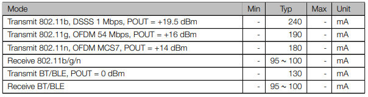
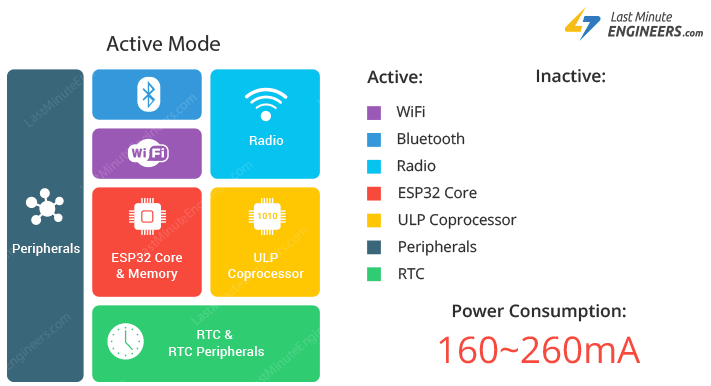
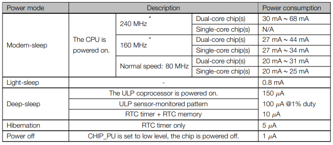
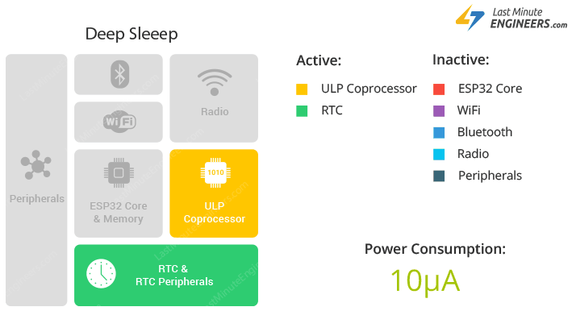
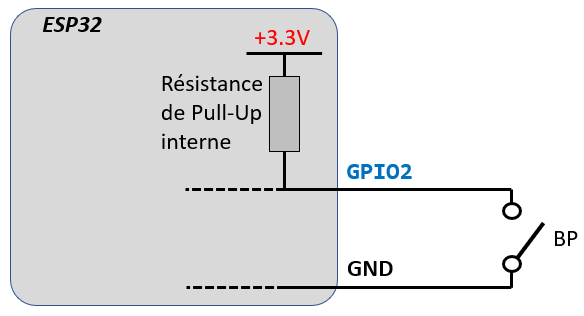
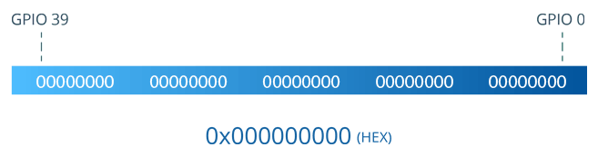
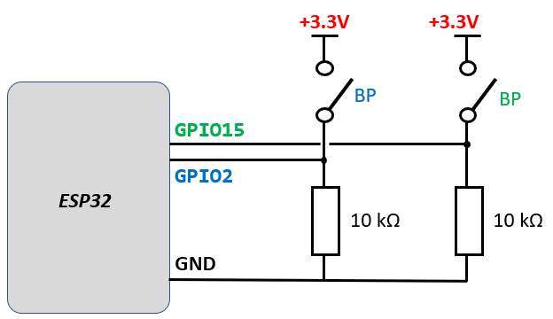

# ESP32 Deep Sleep and Wake Up Sources

> * Auteur : Gwénaël LAURENT
> * Date : 08/10/2022
<!-- I:\temp\esp32oled_deep_sleep -->
<!-- I:\temp\esp32v2-test -->

 [Licence Creative Commons](https://creativecommons.org/licenses/by-nc-sa/3.0/fr/)

- [ESP32 Deep Sleep and Wake Up Sources](#esp32-deep-sleep-and-wake-up-sources)
- [1. Consommation électrique des ESP32](#1-consommation-électrique-des-esp32)
- [2. Mode Deep Sleep](#2-mode-deep-sleep)
  - [2.1 Présentation du Deep Sleep](#21-présentation-du-deep-sleep)
  - [2.2 Comment activer le mode Deep Sleep](#22-comment-activer-le-mode-deep-sleep)
  - [2.3 Sources de réveil du mode Deep Sleep](#23-sources-de-réveil-du-mode-deep-sleep)
  - [2.4 Principes de programmation du mode Deep Sleep](#24-principes-de-programmation-du-mode-deep-sleep)
- [3. Utiliser un timer pour réveiller l'ESP](#3-utiliser-un-timer-pour-réveiller-lesp)
- [4. Utiliser les broches GPIO pour réveiller l'ESP](#4-utiliser-les-broches-gpio-pour-réveiller-lesp)
  - [4.1 Principe](#41-principe)
  - [4.2 Réveil externe ext0 : une seule broche](#42-réveil-externe-ext0--une-seule-broche)
  - [4.3 Réveil externe ext1 : plusieurs broches](#43-réveil-externe-ext1--plusieurs-broches)


# 1. Consommation électrique des ESP32

Le datasheet des ESP32 fournit des tableaux comparatifs des consommations électriques de l'ESP32 (ceci concerne les modules ESP-WROOM-32 et ESP32-WROVER-E)

En fonctionnement normal, la consommation d'un ESP32 dépasse les 100mA et dépend fortement de l'activité WiFi/Bluetooth :





On peut programmer l'ESP32 pour qu'il fonctionne dans des modes d'économie d'energie. Chaque mode désactive des composants internes consommateurs d'énergie. Il faut évidemment choisir le mode qui correspond aux besoins de votre application.

Voici les consommations électriques de l'ESP32 dans les différents mode d'économie d'énergie :



> Attention : ces consommations correspondent aux modules ESP32 seuls, pas aux kits de développement ! Les kits intègrent des composants aditionnels consommateurs d'énergie (tel que le régulateur de tension, les LEDS intégrées et l'adaptateur USB-Série)


**Documentation :**
* Les modes d'économie d'énergie : [lastminuteengineers.com](https://lastminuteengineers.com/esp32-sleep-modes-power-consumption/)
* Datasheet des ESP32 : [RTC and Low­Power Management (p32)](https://www.espressif.com/sites/default/files/documentation/esp32_datasheet_en.pdf)
* Documentation Espressif : [Sleep Modes](https://docs.espressif.com/projects/esp-idf/en/latest/esp32/api-reference/system/sleep_modes.html) *(Documentation  pour le framework ESP-IDF, mais la majorité de ces fonctions sont utilisables avec le framework Arduino. Cette doc est donc utile pour avoir des explications plus précises sur les arguments des fonctions)*


# 2. Mode Deep Sleep
## 2.1 Présentation du Deep Sleep
Le mode d'économie d'énergie **Deep Sleep** permet « d’endormir l’ESP32 ». C’est un peu comme quand on met en veille un ordinateur pour économiser de l’énergie.

Le mode Deep Sleep est utile quand l’ESP32 est alimenté par batterie et que l’ESP32 « travaille » ponctuellement. (Par exemple, lire une valeur d’un capteur et l’envoyer par WiFi toutes les 10 minutes). **C'est grâce au mode Deep Sleep que l'on peut alimenter des objets connectés (IoT) pendant des années avec la même batterie**.



En mode Deep Sleep, le WiFi et le Bluetooth sont désactivés, les 2 CPU de l’ESP32 ne fonctionnent plus et c’est le **processeur ULP (Ultra Low Processor)** qui prend le relais. C’est un processeur qui consomme très peu d’énergie et qui peut exécuter certaines actions. 

La Flash et la RAM ne sont plus alimentées non plus, seule la **mémoire RTC** est encore alimentée et peut être utilisée. Cela implique que lorsque l’ESP32 se réveille du Deep Sleep toutes les variables contenues dans la RAM sont effacées, seules celles qui ont été spécifiquement sauvegardées dans la RAM RTC sont disponibles.

Grâce à cette mémoire RTC on peut toujours accéder aux périphériques, interruptions, timers et capteurs internes.


**Documentation :**
* ESP32 Deep Sleep & Its Wake-up Sources [lastminuteengineers.com](https://lastminuteengineers.com/esp32-deep-sleep-wakeup-sources/)
* ESP32 Deep Sleep with Arduino IDE and Wake Up Sources [randomnerdtutorials.com](https://randomnerdtutorials.com/esp32-deep-sleep-arduino-ide-wake-up-sources/)

* Économiser de l’énergie sur l’ESP32 grâce au Deep Sleep [upesy.fr](https://www.upesy.fr/blogs/tutorials/how-to-use-deep-sleep-on-esp32-to-reduce-power-consumption)
* ESP32 Alimenté par Batterie (choix des batteries)[radioshuttle.de](https://www.radioshuttle.de/fr/medias-fr/informations-techniques/esp32-alimente-par-batterie/)

## 2.2 Comment activer le mode Deep Sleep
Pour passer l'ESP32 en mode Deep Sleep, il suffit d'appeler la fonction :
```cpp
esp_deep_sleep_start();
```
Si aucune source de réveil n'a été programmée auparavant, l'ESP32 restera endormi en permanence. Seul un reset matériel permettra de réveiller l'ESP.

## 2.3 Sources de réveil du mode Deep Sleep
Après avoir mis l’ESP32 en mode Deep Sleep, il y a plusieurs moyens de le réveiller :
* Utiliser un timer interne (chronomètre) pour réveiller l’ESP32 à un moment choisi (réveil interne)
* Utiliser les capteurs capacitifs tactiles
* Utiliser les pins RTC GPIO

## 2.4 Principes de programmation du mode Deep Sleep
Lorsqu’on veut utiliser le mode Deep Sleep, il faut penser à :
1. Configurer les sources de réveil de l’ESP32
2. Eventuellement choisir quels périphériques vous voulez éteindre ou garder pendant le mode Deep Sleep. Par défaut, l’ESP32 éteint tous les périphériques qui ne sont pas nécessaires pour détecter la demande de réveil.
3. Utiliser la fonction ```esp_deep_sleep_start()``` pour rentrer dans le mode Deep Sleep.

> Si aucune source de réveil n'a été programmée auparavant, l'ESP32 restera endormi en permanence. Seul un reset matériel permettra de réveiller l'ESP.

# 3. Utiliser un timer pour réveiller l'ESP

Exemple de code pour réveiller l'ESP toutes les 5 secondes. A chaque réveil on incrémente un compteur et on affiche sa valeur.

La variable de comptage est déclarée avec l'attribut ```RTC_DATA_ATTR```, elle sera donc stocké dans la RAM RTC (sa valeur ne sera pas perdue pendant le Deep Sleep)

```cpp
RTC_DATA_ATTR int bootCount = 0;
```

La source de réveil est un timer initialisé avec une durée de 5s. Le timer est créé avec la fonction ```esp_sleep_enable_timer_wakeup()```. La durée est exprimée en nombre de µs et doit être codée sur 32 bits, ce qui fait une durée maximale de 71 minutes.
```cpp
esp_sleep_enable_timer_wakeup(5 * 1000000);
```

L'ESP passe en mode Deep Sleep dès qu'on appelle la fonction
```cpp
esp_deep_sleep_start();
```

A chaque démarrage de l'ESP, la fonction ```print_wakeup_reason()``` affiche la source de réveil de l’ESP32.

Voilà le code complet de l'exemple :
```cpp
#include <Arduino.h>

#define uS_TO_S_FACTOR 1000000
#define TIME_TO_SLEEP  5

RTC_DATA_ATTR int bootCount = 0; //variable stockée en RTC SRAM (8ko de SRAM)

void print_wakeup_reason(){
   esp_sleep_wakeup_cause_t source_reveil; 

   source_reveil = esp_sleep_get_wakeup_cause();

   switch(source_reveil){
      case ESP_SLEEP_WAKEUP_EXT0 : Serial.println("Réveil causé par un signal externe sur une broche RTC_GPIO (mode ext0)"); break;
      case ESP_SLEEP_WAKEUP_EXT1 : Serial.println("Réveil causé par un signal externe sur une broche RTC_GPIO (mode ext1)"); break;
      case ESP_SLEEP_WAKEUP_TIMER : Serial.println("Réveil causé par un timer"); break;
      case ESP_SLEEP_WAKEUP_TOUCHPAD : Serial.println("Réveil causé par un touchpad"); break;
      default : Serial.printf("Réveil pas causé par le Deep Sleep: %d\n",source_reveil); break;
   }
}

void setup(){
   Serial.begin(115200);

   ++bootCount;
   Serial.println("----------------------");
   Serial.println(String(bootCount)+ "eme Boot ");

   //Affiche la raison du réveil
   print_wakeup_reason();

   //Configuration du timer
   esp_sleep_enable_timer_wakeup((uint32_t)TIME_TO_SLEEP * (uint32_t)uS_TO_S_FACTOR); // durée en µs (codé sur 32 bits => 71min max)
   Serial.println("ESP32 réveillé dans " + String(TIME_TO_SLEEP) + " seconds");

   //Rentre en mode Deep Sleep
   Serial.println("Rentre en mode Deep Sleep");
   Serial.println("----------------------");
   delay(100);
   esp_deep_sleep_start();
   Serial.println("Ceci ne sera jamais affiché");
}

void loop(){
}
```


# 4. Utiliser les broches GPIO pour réveiller l'ESP
## 4.1 Principe
On peut également réveiller l'ESP32 du Deep Sleep grâce à un changement d'état sur une ou plusieurs broches de l'ESP. Ce changement peut, par exemple, venir de l'appui sur un bouton poussoir ou d'un capteur numérique. C'est ce qu'on appelle un **réveil externe**. 

Il existe deux types de déclencheurs externes pour réveiller l'ESP32 du Deep Sleep :
* **ext0** - lorsque vous souhaitez réveiller la puce uniquement par une broche GPIO spécifique.
* **ext1** - lorsque vous souhaitez réveiller la puce à l'aide de plusieurs broches GPIO.

> On ne peut utiliser que les broches de l'ESP qui ont un fonctionnement RTC (RTC GPIO). Ces broches sont : 0, 2,4, 12-15, 25-27, 32-39.

--

## 4.2 Réveil externe ext0 : une seule broche
Cette méthode permet de réveiller l'ESP32 grâce à un changement d'état sur **une** broche.

Pour activer cette source de réveil, il faut utiliser la fonction :
```cpp
esp_sleep_enable_ext0_wakeup(GPIO_PIN, LOGIC_LEVEL);
```
Cette fonction prend deux paramètres :
* GPIO_PIN = le numéro de broche GPIO
* LOGIC_LEVEL = le niveau logique (LOW ou HIGH) avec lequel on veut déclencher le réveil.

Étant donné que ext0 utilise RTC_IO pour réveiller l'ESP32, les périphériques RTC continuent de fonctionner pendant le sommeil profond.

Et puisque le module RTC_IO est activé, vous pouvez profiter des résistances pullup ou pulldown internes de l'ESP. Elles doivent être configurées à l'aide des fonctions ```rtc_gpio_pullup_en()``` et ```rtc_gpio_pulldown_en()``` avant d'appeler esp_deep_sleep_start().

--

**Exemple de réveil grâce un niveau bas sur GPIO2 (mode ext0).**

Un bouton poussoir est branché entre GPIO2 et GND et on active la résistance de pullup interne. A chaque appui sur le bouton, on réveille l'ESP qui incrémente un compteur et on affiche la valeur de ce compteur.



```cpp
#include <Arduino.h>
#include "driver/rtc_io.h" //pour activer les résistances de pullup interne

RTC_DATA_ATTR int bootCount = 0;

void print_wakeup_reason()
{
  esp_sleep_wakeup_cause_t source_reveil;

  source_reveil = esp_sleep_get_wakeup_cause();

  switch (source_reveil)
  {
    case ESP_SLEEP_WAKEUP_EXT0: Serial.println("Réveil causé par un signal externe avec RTC_IO (ext0)"); break;
    case ESP_SLEEP_WAKEUP_EXT1: Serial.println("Réveil causé par un signal externe avec RTC_CNTL (ext1)"); break;
    case ESP_SLEEP_WAKEUP_TIMER: Serial.println("Réveil causé par un timer"); break;
    case ESP_SLEEP_WAKEUP_TOUCHPAD: Serial.println("Réveil causé par un touchpad"); break;
    default: Serial.printf("Réveil pas causé par le Deep Sleep: %d\n", source_reveil); break;
  }
}

void setup()
{
  Serial.begin(115200);

  ++bootCount;
  Serial.println("----------------------");
  Serial.println(String(bootCount) + "eme Boot ");

  // Affiche la source du reveil
  print_wakeup_reason();

  // activer la résistance de pullup interne de GPIO2
  rtc_gpio_pullup_en(GPIO_NUM_2);
  rtc_gpio_pulldown_dis(GPIO_NUM_2);
  // Configure le GPIO2 comme source de réveil quand la tension vaut 0V
  esp_sleep_enable_ext0_wakeup(GPIO_NUM_2, LOW);

  // Rentre en mode Deep Sleep
  Serial.println("Rentre en mode Deep Sleep");
  Serial.println("----------------------");
  esp_deep_sleep_start();
}

void loop() {}
```

**Explication du code**

La variable de comptage est déclarée avec l'attribut ```RTC_DATA_ATTR```, elle sera donc stocké dans la RAM RTC (sa valeur ne sera pas perdue pendant le Deep Sleep)

```cpp
RTC_DATA_ATTR int bootCount = 0;
```

La résistance de pullup interne est activée sur GPIO2 (et la résistance de pulldown est désactivée)
```cpp
rtc_gpio_pullup_en(GPIO_NUM_2);
rtc_gpio_pulldown_dis(GPIO_NUM_2);
```

La source de réveil externe ext0 est configurée pour se réveiller lorsque le niveau logique de GPIO2 est BAS (=GND)
```cpp
esp_sleep_enable_ext0_wakeup(GPIO_NUM_2, LOW);
```

L'ESP passe en mode Deep Sleep dès qu'on appelle la fonction
```cpp
esp_deep_sleep_start();
```

A chaque démarrage de l'ESP, la fonction ```print_wakeup_reason()``` affiche la source de réveil de l’ESP32.

--

## 4.3 Réveil externe ext1 : plusieurs broches
Cette méthode permet de réveiller l'ESP32 grâce à un changement d'état sur **plusieurs broches**.

Pour activer cette source de réveil, il faut utiliser la fonction :
```cpp
esp_sleep_enable_ext1_wakeup(BUTTON_PIN_MASK, LOGIC_LEVEL);
```
Cette fonction prend deux paramètres :
* BUTTON_PIN_MASK = un masque de bits qui indique à l'ESP32 quelles broches nous voulons utiliser
* LOGIC_LEVEL = l'un des deux niveaux logiques suivants
  * ```ESP_EXT1_WAKEUP_ANY_HIGH``` : si l'une des broches sélectionnées est au niveau HAUT
  * ```ESP_EXT1_WAKEUP_ALL_LOW``` : si toutes les broches sélectionnées sont au niveau BAS

Étant donné que la source de réveil ext1 utilise un contrôleur RTC (RTC_CNTL), elle ne nécessite pas la mise sous tension des périphériques RTC (RTC_IO). Dans ce cas, les résistances de pullup et de pulldown internes ne sont pas disponibles.


**Calcul du masque de bits BUTTON_PIN_MASK**

La façon la plus simple de comprendre le masque de bits est de l'écrire au format binaire.



Le bit le moins significatif (LSB) représente le GPIO0 et le bit le plus significatif (MSB) représente le GPIO39 :
* 0 représente les broches masquées
* 1 représente les broches qui seront activées comme source de réveil

Donc, si vous voulez activer un GPIO pour se réveiller, vous devez écrire un 1 à son emplacement correspondant et un 0 à chacune des broches restantes. Et enfin, vous devez le convertir en HEX.

Par exemple, pour utiliser GPIO2 et GPIO15 comme sources de réveil, le masque de bits aura pour valeur : 2^2 + 2^15 = 32772 = 0x8004

--

**Exemple de réveil grâce un niveau HAUT sur GPIO2 ou GPIO15 (mode ext1).**

Un 1er bouton poussoir est branché entre GPIO2 et VCC avec sa résistance de pulldown externe.\
Un 2ème bouton poussoir est branché entre GPIO15 et VCC avec sa résistance de pulldown externe.

A chaque appui sur le bouton, on réveille l'ESP qui incrémente un compteur. On affiche la valeur de ce compteur et le numéro de broche qui a réveillé l'ESP.



```cpp
#include <Arduino.h>

#define BUTTON_PIN_BITMASK 0x8004 // GPIO2 et GPIO15 => 2^2 + 2^15 = 32772 = 0x8004

RTC_DATA_ATTR int bootCount = 0;

void print_wakeup_reason()
{
  esp_sleep_wakeup_cause_t source_reveil;

  source_reveil = esp_sleep_get_wakeup_cause();

  switch (source_reveil)
  {
    case ESP_SLEEP_WAKEUP_EXT0: Serial.println("Réveil causé par un signal externe avec RTC_IO (ext0)"); break;
    case ESP_SLEEP_WAKEUP_EXT1: Serial.println("Réveil causé par un signal externe avec RTC_CNTL (ext1)"); break;
    case ESP_SLEEP_WAKEUP_TIMER: Serial.println("Réveil causé par un timer"); break;
    case ESP_SLEEP_WAKEUP_TOUCHPAD: Serial.println("Réveil causé par un touchpad"); break;
    default: Serial.printf("Réveil pas causé par le Deep Sleep: %d\n", source_reveil); break;
  }
}

void print_GPIO_wake_up(){
  uint64_t GPIO_reason = esp_sleep_get_ext1_wakeup_status();
  Serial.print("GPIO qui a déclenché le réveil : GPIO");
  Serial.println((log(GPIO_reason))/log(2), 0);
}

void setup()
{
  Serial.begin(115200);

  ++bootCount;
  Serial.println("----------------------");
  Serial.println(String(bootCount) + "eme Boot ");

  // Affiche la source du reveil
  print_wakeup_reason();

  // Affiche la broche GPIO utilisée pour le réveil
  print_GPIO_wake_up();

  // Configure le GPIO2 comme source de réveil quand la tension vaut 0V
  esp_sleep_enable_ext1_wakeup(BUTTON_PIN_BITMASK,ESP_EXT1_WAKEUP_ANY_HIGH);

  // Rentre en mode Deep Sleep
  Serial.println("Rentre en mode Deep Sleep");
  Serial.println("----------------------");
  esp_deep_sleep_start();
}

void loop() {}
```

**Explication du code**
On définit un masque de bits pour sélectionner GPIO2 et GPIO15 => 2^2 + 2^15 = 32772 = 0x8004
```cpp
#define BUTTON_PIN_BITMASK 0x8004
```

La variable de comptage est déclarée avec l'attribut ```RTC_DATA_ATTR```, elle sera donc stocké dans la RAM RTC (sa valeur ne sera pas perdue pendant le Deep Sleep)

```cpp
RTC_DATA_ATTR int bootCount = 0;
```

La source de réveil externe ext1 est configurée pour se réveiller dès qu'un niveau HAUT est présent sur GPIO2 ou GPIO15
```cpp
  esp_sleep_enable_ext1_wakeup(BUTTON_PIN_BITMASK,ESP_EXT1_WAKEUP_ANY_HIGH);
```

L'ESP passe en mode Deep Sleep dès qu'on appelle la fonction
```cpp
esp_deep_sleep_start();
```

A chaque démarrage de l'ESP, la fonction ```print_wakeup_reason()``` affiche la source de réveil de l’ESP32.

A chaque démarrage de l'ESP, la fonction ```print_GPIO_wake_up()``` affiche le numéro de broche GPIO qui a réveillé l'ESP.

Pour connaitre la broche qui a réveillé l'ESP, il faut utiliser la fonction :
```cpp
uint64_t GPIO_reason = esp_sleep_get_ext1_wakeup_status();
```
Cette fonction renvoie le masque de bits correspondant à la broche du GPIO. Cela correspond à 2^(num_GPIO). Pour trouver le num_GPIO en décimal, il faut utiliser la formule :
```cpp
num_GPIO = (log(GPIO_reason))/log(2)
```
