# Transistor de commutation MOSFET

> * Auteur : Gwénaël LAURENT
> * Date : 28/04/2023

 [Licence Creative Commons](https://creativecommons.org/licenses/by-nc-sa/3.0/fr/)

- [Transistor de commutation MOSFET](#transistor-de-commutation-mosfet)
- [1. Présentation](#1-présentation)
- [2. Fonctionnement d'un MOSFET Canal N](#2-fonctionnement-dun-mosfet-canal-n)
- [3. Intérêt des MOSFET pour les commandes de puissance](#3-intérêt-des-mosfet-pour-les-commandes-de-puissance)
- [4. Fonctionnement d'un MOSFET Canal P](#4-fonctionnement-dun-mosfet-canal-p)
- [5. Choix d'un transistor MOSFET](#5-choix-dun-transistor-mosfet)
- [6. Quelques exemples de transistors MOSFET](#6-quelques-exemples-de-transistors-mosfet)
  - [BS170](#bs170)
  - [BS250](#bs250)
  - [BS208](#bs208)
  - [IRF520](#irf520)
- [7. Module de pilotage MOSFET IRF520](#7-module-de-pilotage-mosfet-irf520)

# 1. Présentation
Un transistor est un composant électronique.\
Les **transistors de commutation** se comportent comme des interrupteurs dans les circuits à courant continu.

Les transistors **MOSFET** (Metal Oxide Semiconductor Field Effect Transistor) sont commandés grâce à la tension grille-source **VGS**.

Symbole d'un transistor MOSFET **canal N** :

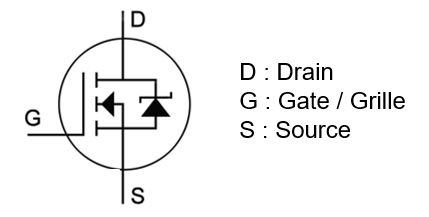

Symbole d'un transistor MOSFET **canal P** :

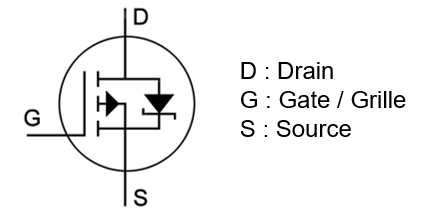

# 2. Fonctionnement d'un MOSFET Canal N
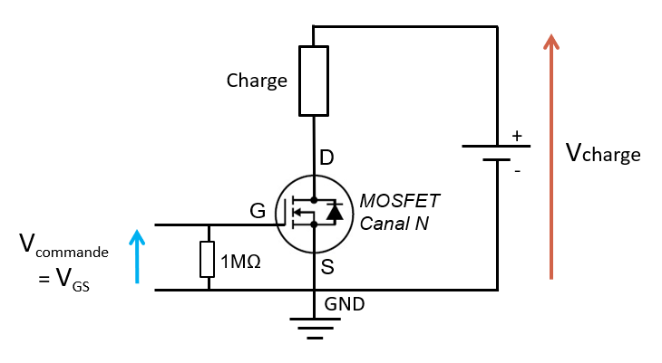

Quand une tension positive est appliquée entre la grille et la source (VGS), le transistor se comporte comme un interrupteur fermé entre le drain et la source. On dit que le transistor est en mode **passant**.

Si la tension  VGS est nulle, le transistor se comporte comme un interrupteur ouvert entre le drain et la source. On dit que le transistor est en mode **bloqué**.

> **La grille du transistor MOSFET se pilote en tension**, elle ne consomme quasiment pas de courant.

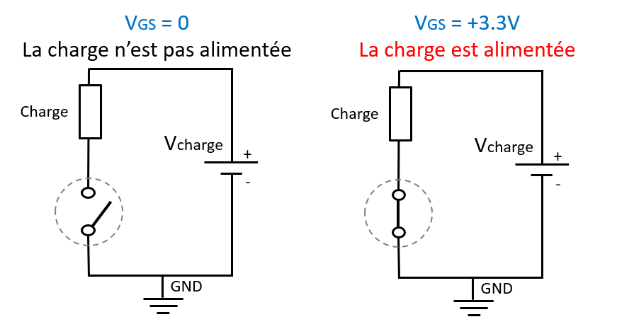

Pour plus d'explications, consulter le site passionelectronique.fr > [Transistor Mosfet : fonctionnement pratique et explication](https://passionelectronique.fr/transistor-mosfet/)

# 3. Intérêt des MOSFET pour les commandes de puissance
Une broche d'un ESP32 ne peut pas délivrer plus de 40mA sous 3,3 V.\
Quand on désire commander des périphériques qui consomment plus de courant, ou qui fonctionnent à des tensions plus élevées, on peut utiliser un transistor de puissance.

*Exemple de périphérique nécessitant l'utilisation d'un transistor : pilotage de moteur, LED de puissance, pompe, valve, etc.*

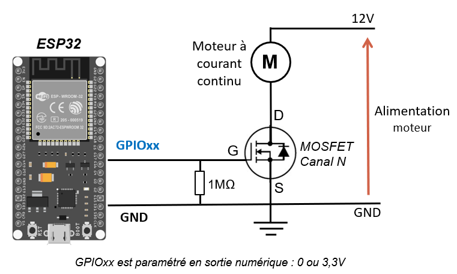

> **Attention : un transistor n'isole pas le circuit de puissance du circuit de commande.** On ne l'utilise que pour des tensions non dangereuses. En pratique, on ne dépasse pas les 50 V.

# 4. Fonctionnement d'un MOSFET Canal P
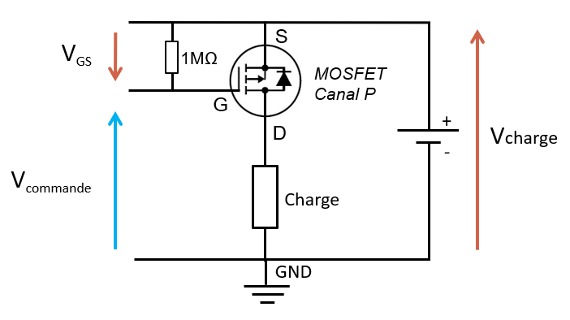

Pour un MOSFET canal P :
* le courant circule de la source vers le drain
* Si VGS est nulle, le transistor est en mode **bloqué**.
* **VGS doit être négative** pour que le transistor soit en mode **passant**.

Avec un canal P, on modifie VGS grâce à la valeur de la tension Vcommande :

 > VGS =  Vcommande -  Vcharge

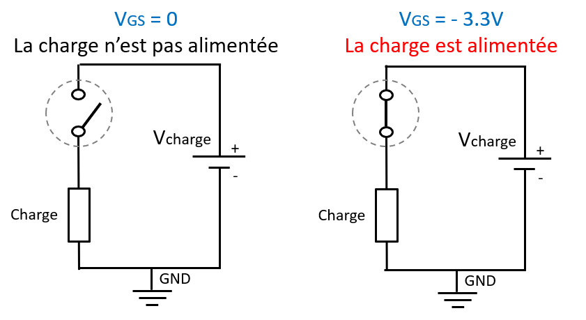

# 5. Choix d'un transistor MOSFET
Le choix d'un transistor MOSFET s'effectue à partir des caractéristiques suivantes :
* **Polarité** : Canal N ou Canal P
* **ID(max)** : courant maximum pouvant circuler dans le drain (dépend de la température)
* **VDS(max)** : tension maximale entre le drain et la source
* **RDS(ON)** : résistance équivalente entre le drain et la source, lorsque que le MOSFET est à l’état passant (on privilégie des RDS(ON) le plus petit possible)
* **VGS(TH)** : tension de seuil (*threshold*) pour passer du mode bloqué au mode passant
* **VGS(max)** : tension maximale sur la grille

# 6. Quelques exemples de transistors MOSFET
## BS170
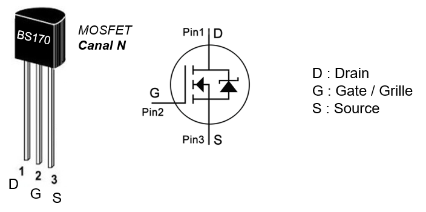

* Polarité : **Canal N**
* ID(max) : 500 mA
* VDS(max) : 60 V
* RDS(ON) : 1.2 Ω (max 5 Ω)
* VGS(TH) : 3 V
* VGS(max) : +/- 20 V
* Boitier : TO-92

Datasheet du MOSFET BS170 : https://www.mouser.fr/datasheet/2/427/70226-1765504.pdf

## BS250
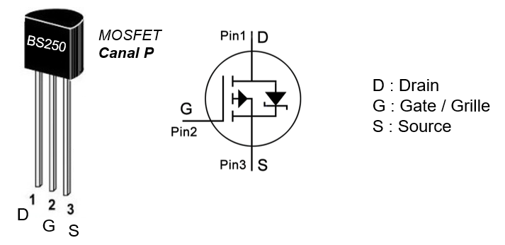

* Polarité : **Canal P**
* ID(max) : -180 mA
* VDS(max) : -45 V
* RDS(ON) : 14 Ω (max 5 Ω)
* VGS(TH) : -3.5 V
* VGS(max) : +/- 25 V
* Boitier : TO-92

Datasheet du MOSFET BS250 : https://www.mouser.fr/datasheet/2/427/70209-1765202.pdf

## BS208
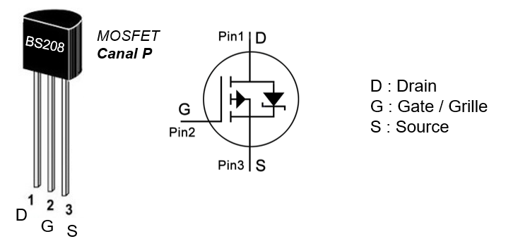

* Polarité : **Canal P**
* ID(max) : -200 mA
* VDS(max) : -200 V
* RDS(ON) : 14 Ω (max 5 Ω)
* VGS(TH) : -2.8 V
* VGS(max) : +/- 20 V
* Boitier : TO-92

Datasheet du MOSFET BS208 : https://z3d9b7u8.stackpathcdn.com/pdf-down/B/S/2/BS208_PhilipsSemiconductors.pdf

## IRF520
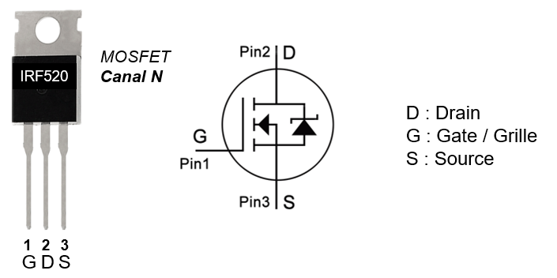

Caractéristiques du MOSFET IRF520 :
* Polarité : **Canal N**
* ID(max) : 9.2 A (avec dissipateur thermique)
* VDS(max) : 100 V (avec dissipateur thermique)
* RDS(ON) : 0.27 Ω
* VGS(TH) : 4 V
* VGS(max) : +/- 20 V
* Boitier : TO-220

Datasheet du MOSFET IRF520 : https://www.mouser.fr/datasheet/2/389/stmicroelectronics_cd00000698-1204495.pdf

# 7. Module de pilotage MOSFET IRF520

Le module comporte :
* un transistor MOSFET IRF520 (0-24V / 5A max)
* une résistance de grille
* une LED pour visualiser l'état du signal de commande
* des borniers à vis

Schéma électrique du module :

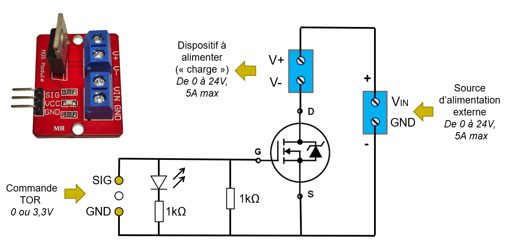

Achat : https://fr.aliexpress.com/item/1005003017827107.html
ou https://www.lextronic.fr/module-de-pilotage-mosfet-5a-51720.html

