# Alimenter l'ESP32 sur batterie

> * Auteur : Gwénaël LAURENT
> * Date : 06/05/2023
<!-- I:\temp\esp32v2_ADC_tension_alim -->

 [Licence Creative Commons](https://creativecommons.org/licenses/by-nc-sa/3.0/fr/)

- [Alimenter l'ESP32 sur batterie](#alimenter-lesp32-sur-batterie)
- [1. Utiliser le module ESP32 seul](#1-utiliser-le-module-esp32-seul)
- [2. Choix du type de batterie](#2-choix-du-type-de-batterie)
  - [2.1 Batterie LiFePO4 (LFP - Lithium Fer Phosphate)](#21-batterie-lifepo4-lfp---lithium-fer-phosphate)
  - [2.2 Batterie Lithium-Ion et Li-Po (Lithium Polymère)](#22-batterie-lithium-ion-et-li-po-lithium-polymère)
- [3. Choix de la capacité de la batterie (mAh)](#3-choix-de-la-capacité-de-la-batterie-mah)
  - [3.1 Fonctionnement DeepSleep - Réveil](#31-fonctionnement-deepsleep---réveil)
  - [3.2 Mesure du courant consommé par le circuit](#32-mesure-du-courant-consommé-par-le-circuit)
  - [3.3 Calcul de la quantité d'électricité consommée par le circuit](#33-calcul-de-la-quantité-délectricité-consommée-par-le-circuit)
- [4. Estimer le niveau de décharge de la batterie](#4-estimer-le-niveau-de-décharge-de-la-batterie)
  - [4.1 Evaluer la quantité d'électricité restante](#41-evaluer-la-quantité-délectricité-restante)
  - [4.2 Utiliser l'ADC pour mesurer la tension de la batterie](#42-utiliser-ladc-pour-mesurer-la-tension-de-la-batterie)
- [5. Electricité consommée par les périphériques](#5-electricité-consommée-par-les-périphériques)
  - [5.1 Mise en évidence du problème](#51-mise-en-évidence-du-problème)
  - [5.2 Connaître la consommation de chaque périphérique](#52-connaître-la-consommation-de-chaque-périphérique)
  - [5.3 Solution 1, deepsleep des périphériques](#53-solution-1-deepsleep-des-périphériques)
  - [5.4 Solution 2, ne pas alimenter les périphériques pendant le deepsleep de l'esp32](#54-solution-2-ne-pas-alimenter-les-périphériques-pendant-le-deepsleep-de-lesp32)
    - [5.4.1 Remarques importantes](#541-remarques-importantes)
    - [5.4.2 Périphérique consommant MOINS DE 40 mA ](#542-périphérique-consommant-moins-de-40-ma)
    - [5.4.3 Périphérique consommant PLUS DE 40mA](#543-périphérique-consommant-plus-de-40ma)
- [Pour aller plus loin](#pour-aller-plus-loin)


# 1. Utiliser le module ESP32 seul
Les kits de développement intègrent une alimentation via le port USB et un régulateur de tension. Quand on veut alimenter l'ESP32 sur batterie, **il faut utiliser le module ESP-WROOM-32 seul** (ou [seulement avec sa carte support](24.carte-support-esp-wroom-32.md)).

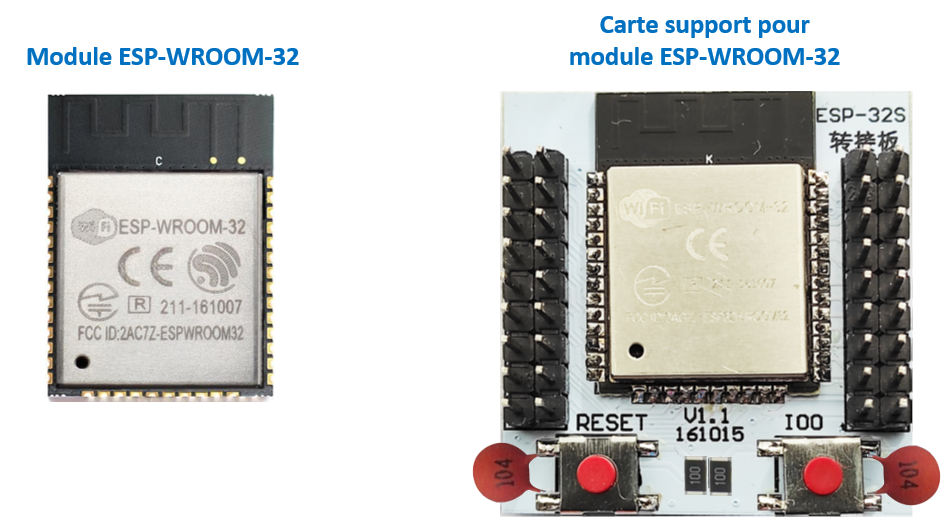

D'après le datasheet du module [ESP32-­WROOM-­32](https://www.espressif.com/sites/default/files/documentation/esp32-wroom-32_datasheet_en.pdf), sa tension d'alimentation doit être comprise entre **3.0V et 3.6V**.

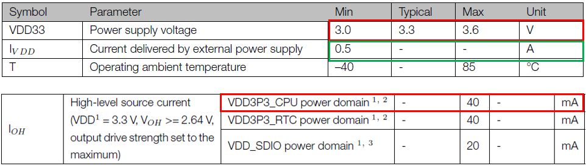

Toujours d'après le datasheet :
* l'alimentation doit pouvoir délivrer **500 mA**,
* chaque broche GPIO ne doit pas fournir plus de 40mA.

# 2. Choix du type de batterie
> Le choix du type de batterie va donc dépendre directement de la tension qu'elle fournit (en Volt) et de sa capacité ( quantité d'électricité qu'elle peut délivrer = charge électrique exprimée en mAh).

Je ne présente ici que les deux types de batteries les plus utilisés pour l'alimentation des ESP32 (parce qu'elles permettent des pics de courant >= 500mA). Pour plus d'informations : [ESP32 Alimentation Autonome](http://fablab37110.ovh/doku.php?id=start:arduino:esp32:alimentation)

## 2.1 Batterie LiFePO4 (LFP - Lithium Fer Phosphate)
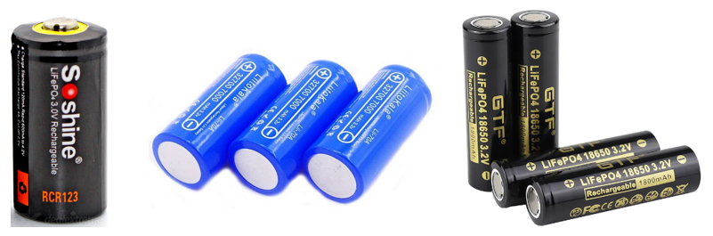

**Caractéristiques générales :**
* Tension de travail : 3,0 V à **3,2 V**
* Tension de charge maximale : 3,65V
* Rechargeable : un chargeur spécial est nécessaire.
* Courbe de décharge très plate
* Température d'utilisation : -20°C à +60°C

**Courbe de décharge :**

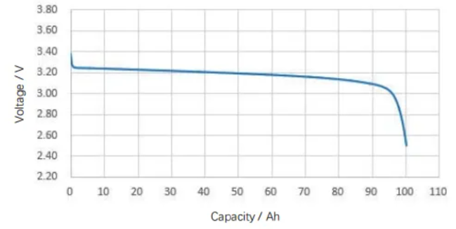

**Avantages :**
* La tension max de la batterie est de 3,65 V (très légèrement supérieure à la tension de fonctionnement maximale de l'ESP32), **vous pouvez connecter ce type de batterie directement sur la broche 3,3 V de l'ESP32**.
* Pas besoin de régulateur de tension
* Utilisation en extérieur (-20°C à +60°C)
* Longue durée de vie

**Inconvénients :**
* Compliqué de charger la batterie pendant son utilisation. La charge doit s'effectuée à une température > 0°C (prévoir une batterie chargée de rechange)
* La mesure de la tension de batterie doit être très précise car elle chute très lentement pendant le processus de décharge.

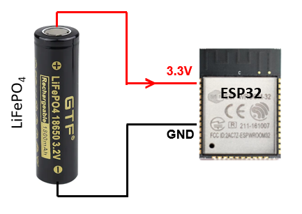

> **Utilisation principale :**
> * Si votre objectif principal est d'alimenter votre circuit pendant un temps maximum (plusieurs mois)


## 2.2 Batterie Lithium-Ion et Li-Po (Lithium Polymère)
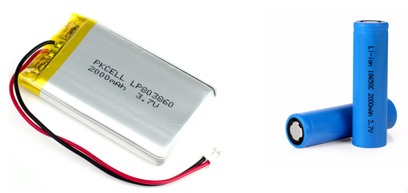

**Caractéristiques générales :**
* Tension de travail : **3,7 V**
* Tension de charge maximale : 4,2V
* Rechargeable
* peuvent prendre feu si elles sont mal utilisées

**Courbe de décharge :**

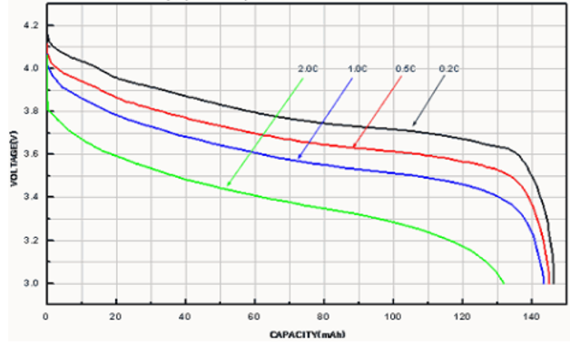

**Avantages :**
* **Rechargeable sur site** (panneaux solaires)
* Plus courantes que les LiFePo4, donc moins chères.


**Inconvénients :**
* La tension max de la batterie est de 4,2 V, il faut donc utiliser un régulateur de tension pour alimenter l'ESP32 (régulateur à faible perte de charge ou LDO (Low Dropout Regulators), comme le MCP1725T-3302E). **Une grande partie de l’énergie est utilisée en permanence pour réduire la tension à 3,3 V**.

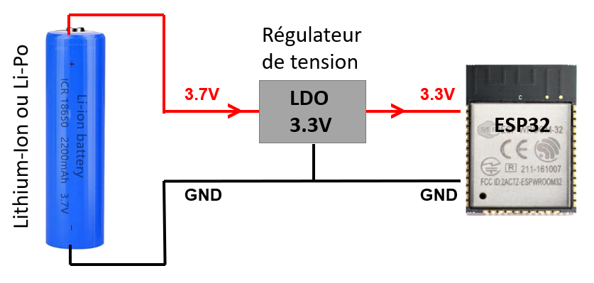

> **Utilisation principale :**
> * Si vous souhaitez charger la batterie pendant que votre circuit est en marche


# 3. Choix de la capacité de la batterie (mAh)
Quelque soit le type de batterie (Li-Ion ou LiFePo4), il faut choisir la quantité d'énergie qu'elle peut fournir. On appelle ça la **capacité de la batterie**, c'est la charge électrique que peut fournir l'accumulateur complètement chargé pendant un cycle complet de décharge. Cette capacité **se mesure en Ah** (ou mAh).

> La charge électrique (la quantité d'électricité emmagasinée par l'accumulateur) est exprimée en Ah (ou mAh : (milli)ampère-heure). Cependant l'unité officielle de charge du Système international d'unités (SI) est le coulomb, équivalent à un As (ampère pendant une seconde) : 1 Ah = 3 600 C (cf [Wikipédia](https://fr.wikipedia.org/wiki/Accumulateur_%C3%A9lectrique))

> Une batterie de 1000 mAh peut fournir un courant continu de 1000 mA pendant une heure, ou un courant continu de 100 mA pendant 10h.\
> *En pratique on se limite souvent à 80% de sa capacité maximale.*

Le choix de la capacité électrique de la batterie se fait en fonction :
* de la consommation d'énergie de votre circuit électronique
* de la durée souhaitée de fonctionnement sur batterie

## 3.1 Fonctionnement DeepSleep - Réveil
Pour être économme en énergie, la majorité des objets IoT fonctionnent sur le principe suivant :
* La grande majorité du temps ils sont "endormis", ils ne font rien : c'est le mode **DeepSleep**
* Ils se réveillent pour accomplir leurs fonctions (mesure des capteurs et envoi des informations) : c'est le mode **réveillé**, puis retourne en mode DeepSleep

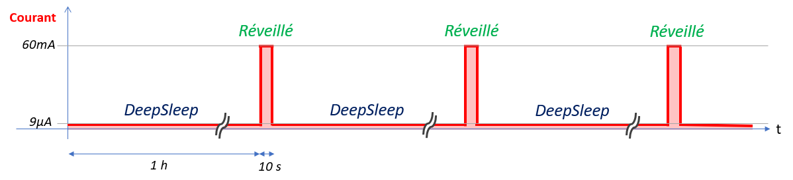

> **Plus la durée en mode DeepSleep est grande, plus vous réduirez la consommation de courant, et plus votre batterie durera longtemps**

Pour programmer le mode DeepSleep, cf [ESP32 Deep Sleep and Wake Up Sources](21.esp32-deep-sleep.md)


## 3.2 Mesure du courant consommé par le circuit
Evidemment, le courant se mesure avec tous les capteurs / actionneurs branchés sur l'ESP32. On va ainsi mesurer le courant total consommé par le circuit electronique.

Il faut relevé les 4 valeurs suivantes :
* Courant consommé en mode DeepSleep
* Durée du mode DeepSleep
* Courant consommé en mode réveillé
* Durée du mode réveillé

> Attention au sens de branchement de l'ampèremètre !!!

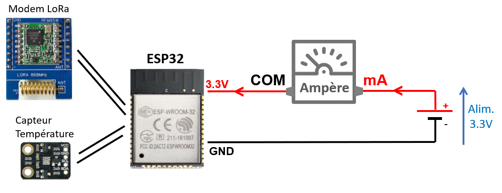

Pour la source d'alimentation 3.3V, vous pouvez utiliser la [carte de programmation des ESP-WROOM-32](24.carte-support-esp-wroom-32.md) :

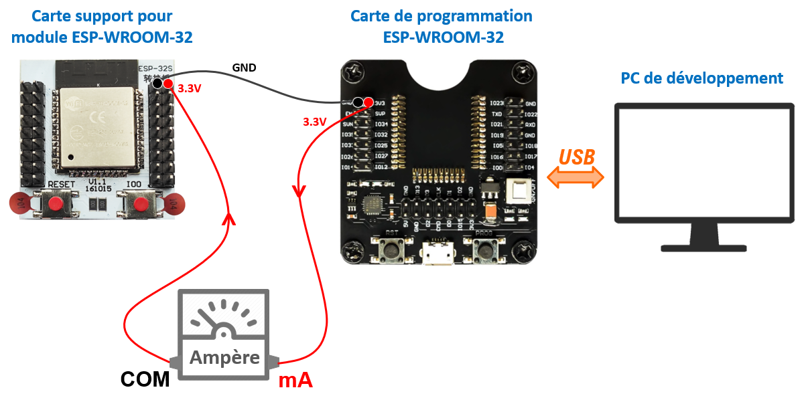

> Si votre ESP32 est alimenté avec une batterie qui nécessite un régulateur de tension, il faut l'inclure dans la mesure du courant !

**Remarque** : pendant le mode réveillé, la consommation peut ne pas être constante. Par exemple, la mesure des capteurs consomme 40mA alors que pendant l'envoi des mesures, la consommation monte à 120mA. Dans ce cas, il faut mesurer le courant et les durées de chaque phase (capteurs + envoi).

## 3.3 Calcul de la quantité d'électricité consommée par le circuit
Formule de calcul de la quantité d'électricité consommée :\
**Quantité élec. (mAh) = Courant (mA) * Temps (h)**

> L'énergie est égale à la quantité d'électricité multiliée par la tension moyenne :\
> **Energie (Wh) = Tension (V) * Courant (A) * Temps (h)**.\
> Comme dans notre cas la tension est constante (=3.3V), la quantité d'électricité consommée est proportionnelle à l'énergie consommée.\
> Dans les calculs de consommation, on utilise parfois abusivement le terme "énergie consommée" à la place du vrai terme "quantité d'électricité consommée".

Exemple de consommation d'un circuit avec ESP32 :


Calcul de l'électricité consommée par ce circuit :
* Electricité consommée pendant 1 cycle = (0.009 mA * 1h) + (60 mA * 10 s /3600) = 0.1756 mAh
* Nombre de cycles par heure = 3600 / 3610
* **Electricité consommée en 1 h** = 0.1756 mAh * 3600 / 3610 = **0.17518 mAh**

Si on alimente ce circuit avec une batterie de capacité 2000 mAh et qu'on se limite à 20% de décharge de la batterie :
* Electricité disponible dans la batterie = 2000 mAh * 80% = 1600 mAh
* **Autonomie sur batterie** = 1600 mAh /  0.17518 = 9133 h = **380 jours**

> Pour estimer la durée de vie de votre batterie, vous pouvez aussi utiliser la calculatrice de Simon Neutert : [Simple calculator for estimating a (LiPo) battery's life](https://www.of-things.de/battery-life-calculator.php)

# 4. Estimer le niveau de décharge de la batterie
## 4.1 Evaluer la quantité d'électricité restante
Puisque les batteries Li-Po et LiFePO4 ont une courbe de décharge plate, on peut se baser sur l'estimation de la durée de vie de la batterie (cf paragraphe précédent).

Attention toutefois à ne pas se baser seulement sur le timer de l'ESP32 pour mesurer les durées. En mode DeepSleep, le timer n'est pas très précis sur de longues durées.

Si l'ESP32 envoie des données régulièrement sur une API, l'estimation de l'énergie restante peut se baser sur l'horloge de l'API.


## 4.2 Utiliser l'ADC pour mesurer la tension de la batterie
> Attention : la mesure de la tension doit être la plus précise possible car les batteries Li-Po et LiFePO4 ont une courbe de décharge plate.

L'ESP32 intègre deux convertisseurs Analogique Numérique (ADC) et une référence de tension interne d'environ 1.1V (V<sub>REF</sub>).

L'entrée GPIO qui sert à la mesure ADC doit comporter un condensateur de 100nF.

Une entrée analogique ne peut mesurer que des tensions de l'ordre de 1 Volt. Pour mesurer la tension de la batterie V<sub>BAT</sub> il faut donc utiliser un diviseur de tension à base de résistances externes.

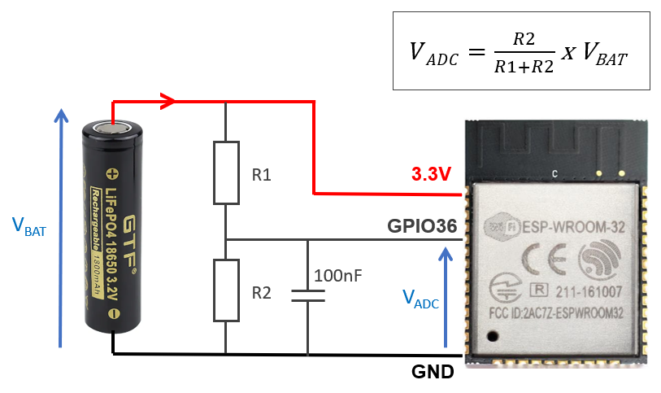

Ou en utilisant un régulateur de tension :

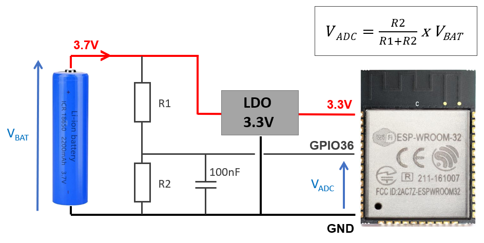

Valeur des résistances :
* R1 = 33 kOhms
* R2 = 10 kOhms

Donc V<sub>ADC</sub> ≅ V<sub>BAT</sub> / 4

Cependant, la valeur d'une résistance n'est pas précise car elle peut varier dans sa gamme de tolérance (20%). De plus, la référence de tension interne de l'ESP (V<sub>REF</sub>) peut varier autour de 1.1V.

Pour ces deux raisons, il faudra étalonner le convertisseur analogique -numérique (ADC). Dans le programme suivant, c'est le rôle des 2 constantes **```REF_VBAT```** et **```REF_VADC```** :
1. Mesurez au voltmètre la valeur de V<sub>BAT</sub>. Modifiez la valeur de la constante REF_VBAT
2. Exécuter le programme et relevez la valeur de V<sub>ADC</sub> affichée par les Serial.print(). Modifiez la valeur de REF_VADC.

> Avec cet étalonnage, la mesure de V<sub>BAT</sub> par l'ADC devrait être précise à 1%.

Le choix de la broche GPIO pour mesurer V<sub>ADC</sub> se fait grace à la constante **```CANAL_ADC```**. Ici j'utilise ADC1_CHANNEL_0 qui correspond à GPIO36, mais on peut choisir les broches suivantes :

```cpp
ADC1_CHANNEL_0,     /*!< ADC1 channel 0 is GPIO36 */
ADC1_CHANNEL_1,     /*!< ADC1 channel 1 is GPIO37 */
ADC1_CHANNEL_2,     /*!< ADC1 channel 2 is GPIO38 */
ADC1_CHANNEL_3,     /*!< ADC1 channel 3 is GPIO39 */
ADC1_CHANNEL_4,     /*!< ADC1 channel 4 is GPIO32 */
ADC1_CHANNEL_5,     /*!< ADC1 channel 5 is GPIO33 */
ADC1_CHANNEL_6,     /*!< ADC1 channel 6 is GPIO34 */
ADC1_CHANNEL_7,     /*!< ADC1 channel 7 is GPIO35 */
```

Programme pour mesurer la tension de la batterie :
```cpp
#include <Arduino.h>
#include <driver/adc.h>

#define CANAL_ADC ADC1_CHANNEL_0 // ADC1_CHANNEL_0 => gpio36
#define REF_VBAT 3343 // Etalonnage tension batterie (mV)
#define REF_VADC 773  // Etalonnage tension mesurée par l'ADC
#define VREF 1100 // tension de référence interne à l'ESP32

long ReadVBat()
{
  adc_power_on();                                       // allumer l'ADC seulement quand on en a besoin
  adc1_config_width(ADC_WIDTH_12Bit);                   // paramétrage ADC1 sur 12 bits
  adc1_config_channel_atten(CANAL_ADC, ADC_ATTEN_DB_0); // choix de la broche GPIO et atténuation 0dB
  Serial.print("ReadVBat = ");
  long vadc = 0; //tension mesurée par l'ADC
  int read_raw;
  int samples_ok = 0;
  long vbat = 0; // tension de la batterie
  long raw = 0;
  // Moyenne sur 50 mesures
  for (int samples = 1; samples <= 50; samples++)
  {
    read_raw = adc1_get_raw(CANAL_ADC);

    if (read_raw != -1)
    {
      samples_ok++;
      raw += read_raw;
      delay(10);
    }
  }
  if (samples_ok > 0)
  {
    vadc = (((double)VREF / 4095) * raw) / samples_ok;
    vbat = vadc * ((float)REF_VBAT / (float)REF_VADC);
    Serial.print("Vadc: ");
    Serial.print(vadc);
    Serial.print(" mV, Vbat: ");
    Serial.print(vbat);
    Serial.println(" mV");
  }
  adc_power_off(); // éteindre l'ADC pour économiser de la batterie
  return vbat;     // tension batterie en mV
}

void setup()
{
  Serial.begin(9600);
}

void loop()
{
  ReadVBat();
  delay(1000);
}
```

Il reste un dernier problème si on veut minimiser au maximum la consommation de la batterie. Le diviseur de tension consomme en permanence du courant (I = 3.3V / 43 kOhms ≅ 77µA).

On ne peut pas augmenter la valeur des résistances sans perturber le fonctionnement de l'ADC !

Il faudra donc utiliser des **[transistors MOSFET](22.mosfet-irf520.md)** pour "déconnecter" le diviseur de tension quand on en n'a pas besoin. Grâce à une broche GPIO utilisée en sortie numérique (ici j'ai choisi GPIO33), on pourra activer le diviseur de tension juste durant la mesure de V<sub>BAT</sub>.

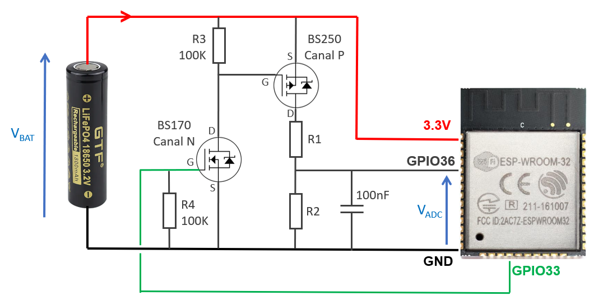

Le diviseur de tension est actif quand GPIO33 est au niveau **HIGH**.


```cpp
[...]
#define DIVISEUR_PIN 33 // GPIO33 permet d'activer le diviseur de tension sur l'entrée ADC
[...]
pinMode(DIVISEUR_PIN, OUTPUT);
[...]
digitalWrite(DIVISEUR_PIN, HIGH); // activer le diviseur de tension sur l'entrée ADC
ReadVBat(); // mesurer la tension de la batterie
digitalWrite(DIVISEUR_PIN, LOW); // désactiver le diviseur de tension sur l'entrée ADC
[...]
```

# 5. Electricité consommée par les périphériques
## 5.1 Mise en évidence du problème
Pour économiser au maximum la batterie il faut tenir compte de la consommation électrique des périphériques (capteurs ou actionneurs). 

Prenons comme exemple un ESP32 sur lequel est connecté un BME280 (capteur de température, pression et hygrométrie) et un RFM95W (modem LoRa), on a :

**i<sub>total</sub> = i<sub>esp</sub> + i<sub>bme</sub> + i<sub>rfm</sub>**

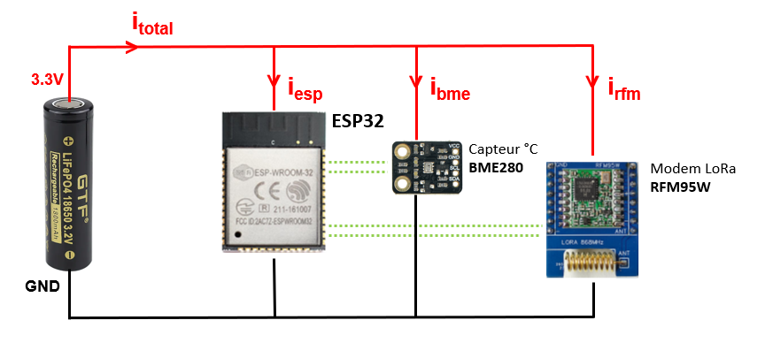


Utiliser le mode deepsleep de l'esp32 est très bien mais ça ne diminue QUE la consommation de l'esp, **les périphériques continuent de consommer du courant même quand l'esp32 est endormi**.

## 5.2 Connaître la consommation de chaque périphérique
Il faut consulter les datasheets de chaque périphérique :
* pour connaître leur consommation de courant maximale
* pour savoir s'ils disposent d'un mode d'économie d'énergie 

Pour notre exemple, voici les informations des datasheets de nos deux périphériques  :

**Consommation du capteur BME280 :**
* Dispose d'un mode d'économie d'énergie à 0.3 µA
* Consommation max : 0.714 mA

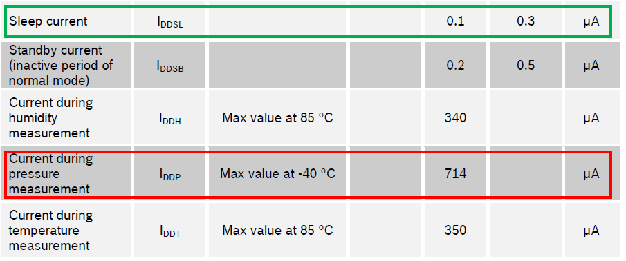

**Consommation du modem RFM95W :**
* Dispose d'un mode d'économie d'énergie à 1 µA
* Consommation max : 120 mA

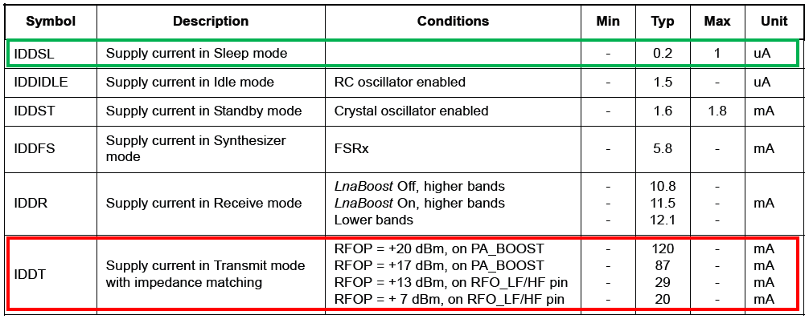

## 5.3 Solution 1, deepsleep des périphériques
On peut mettre les périphériques en mode économie d'énergie avant de mettre l'ESP en deepsleep (et ne pas oublier de les remettre en mode normal quand on veut les utiliser).

Cette solution peut être retenue à condition :
* d'évaluer la quantité d'électricité consommée pour le périphérique
* de disposer d'une bibliothèque logicielle qui le permet.

> Un consommation de courant de 1 µA pendant 1 an correpond à une consommation d'électricité de 8.76 mAh.

## 5.4 Solution 2, ne pas alimenter les périphériques pendant le deepsleep de l'esp32
### 5.4.1 Remarques importantes
> Attention : cela ne concerne évidemment pas les périphériques censés réveiller l'ESP du mode deepsleep.

Pour certaines bibliothèque de gestion de périphérique, il faudra sauvegarder l'état du périphérique avant de l'éteindre (c'est le cas du modem LoRa).

C'est faisable en utilisant la [mémoire non volatile de la flash (**NVS**)](19.esp32-non-volatile-storage.md) ou, pour de petites quantités de données, en stockant la variable dans la RAM  RTC de l'ESP32 (La mémoire RTC garde son contenu durant le deepsleep). 

Pour stocker une variable dans la mémoire RTC il suffit de faire précéder sa déclaration par **RTC_DATA_ATTR** :

```cpp
RTC_DATA_ATTR uint8_t maVariable;
```

### 5.4.2 Périphérique consommant MOINS DE 40 mA 
Chaque broche GPIO d'un ESP32 peut fournir jusqu'à 40 mA.

On peut donc se servir d'une broche GPIO en sortie numérique pour alimenter un périphérique qui consomme moins de 40 mA.

Il suffit de fixer la sortie GPIOxx au niveau HIGH pour fournir une alimentation de 3.3V au périphérique.

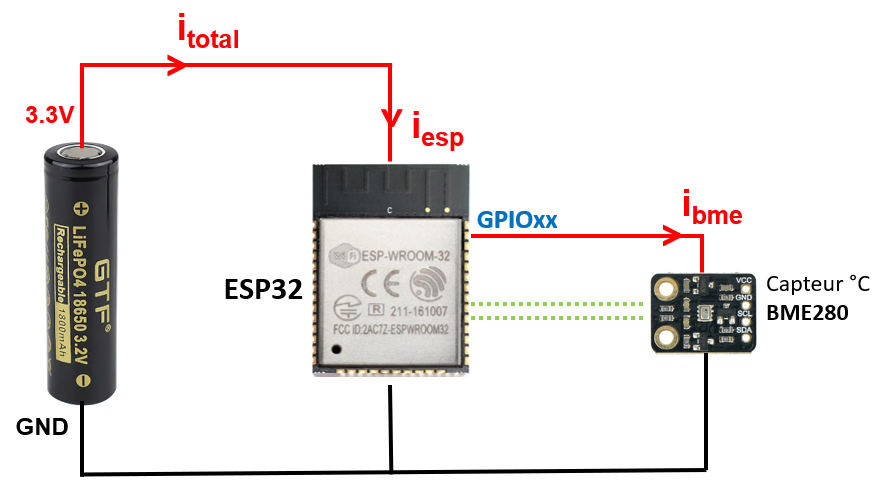

### 5.4.3 Périphérique consommant PLUS DE 40mA
Si le périphérique consomme plus de 40 mA, on ne peut pas se servir directement d'une broche GPIO pour l'alimenter.

On peut cependant se servir d'une broche GPIO pour commander un [transistor MOSFET en commutation](22.transistor_mosfet.md).

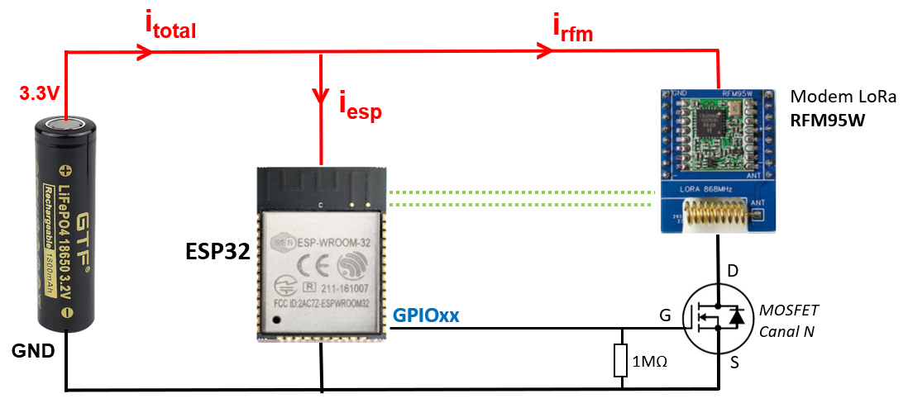

**Si la sortie numérique GPIOxx est au niveau HIGH**, le transistor sera en mode passant et se comportera comme un interrupteur fermé entre D et S (Drain et Source). La masse du périphérique (GND) sera alors reliée à la masse de la batterie, le courant I<sub>rfm</sub> pourra circuler et le périphérique sera alimenté.

**Si la sortie numérique GPIOxx est au niveau LOW**, le transistor sera en mode bloqué et se comportera comme un interrupteur ouvert entre D et S (Drain et Source). Le courant I<sub>rfm</sub> ne peut pas circuler et le périphérique n'est plus alimenté.

# Pour aller plus loin
Consultez les articles :
* [Mesurer la consommation de courant avec le kit NRF-PPK2](25.mesure-courant-avec-ppk2.md)
* [Carte support pour le module ESP-WROOM-32](24.carte-support-esp-wroom-32.md)