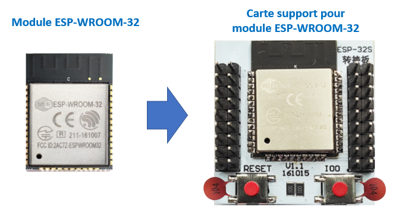
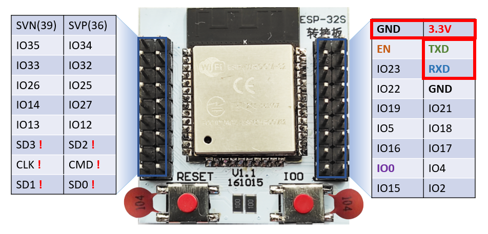
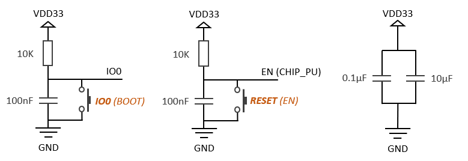
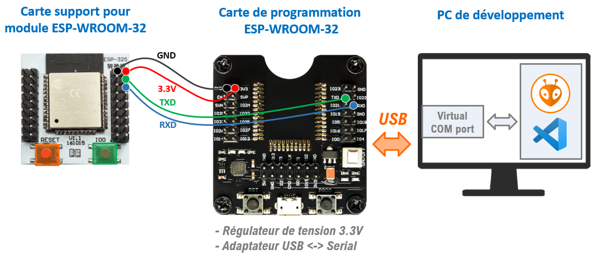
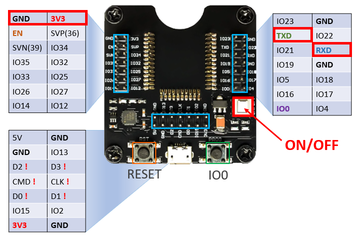
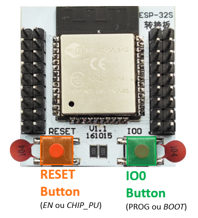
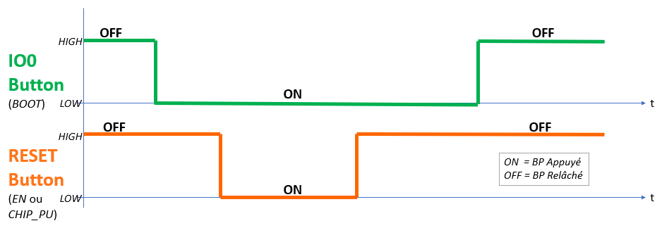
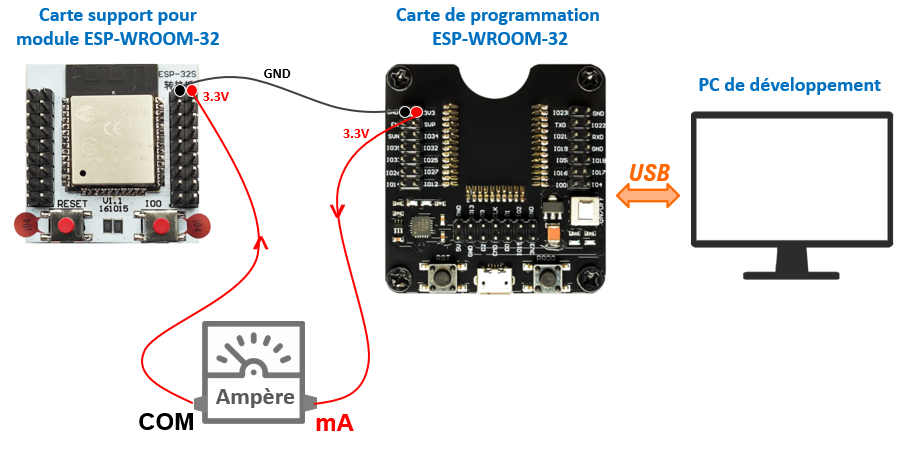

# Carte support pour le module ESP-WROOM-32

> * Auteur : Gwénaël LAURENT
> * Date : 29/04/2023

<!-- I:\temp\esp32v2-test -->

 [Licence Creative Commons](https://creativecommons.org/licenses/by-nc-sa/3.0/fr/)

- [Carte support pour le module ESP-WROOM-32](#carte-support-pour-le-module-esp-wroom-32)
- [1. Présentation de la carte support](#1-présentation-de-la-carte-support)
- [2. Programmation de l'ESP32 sur la carte support](#2-programmation-de-lesp32-sur-la-carte-support)
  - [2.1 Accéder à RXD et TXD](#21-accéder-à-rxd-et-txd)
  - [2.2 Uploader un programme sur l'ESP32](#22-uploader-un-programme-sur-lesp32)
- [3. Mesure du courant consommé par l'ESP32](#3-mesure-du-courant-consommé-par-lesp32)
- [Pour aller plus loin](#pour-aller-plus-loin)

# 1. Présentation de la carte support
La carte support d'ESP32 intègre juste un module ESP-WROOM-32.

Par rapport à un kit de développement, l'intérêt est de  :
* Consommer moins de courant que les kits de développement
* Pouvoir [alimenter l'ESP32 sur batterie](23.alimenter-esp32-sur-batterie.md)
* Créer un prototype dont on peut mesurer la consommation électrique.

La carte support expose directement toutes les broches du module ESP-WROOM-32. **Le choix des broches GPIO est identique à celui du  [kit de développement ESP32-DevKitC V2](01c.presentation-esp32-devkitc-v2.md#5-choix-des-broches-gpio)**

Brochage de la carte support :

Les seuls composants aditionnels permettent facilement de flasher l'ESP32 (2 boutons poussoirs) et d'éliminer les parasites sur l'alimentation.

# 2. Programmation de l'ESP32 sur la carte support
> **La programmation est identique à celle d'un [kit de développement ESP32-DevKitC V2](02c.esp32-devkitc-v2-projet-digital-io.md)**. Les projets créés pour ce type de kit fonctionnent sans modification.

## 2.1 Accéder à RXD et TXD
Le transfert du programme sur l'ESP32 s'effectue sur ses broches RXD et TXD.

Pour y avoir accès depuis l'ordinateur de développement, on a besoin d'un convertisseur USB/UART et d'une alimentation 3.3V

On trouve ces deux composants sur la carte de programmation pour ESP-WROOM-32.

Pour programmer l'ESP32 avec la carte de programmation, il suffit d'utiliser VSCode / PlatformIO comme vous le faites avec un kit de développement ESP32-DevKitC V2. Il faut donc crééer un **projet PlatformIO pour carte "Espressif ESP32 Dev Module"**.

Brochage de la carte de programmation :

> **Attention :** on peut programmer directement un module ESP-WROOM-32 en le clipsant sur la carte de programmation. Dans ce cas, les broches correspondent au module clipsé et les boutons sont reliés au module clipsé.\
> Dans notre cas, puisqu'on utilise la carte support, **seules les 4 broches GND, 3V3, TXD et RXD sont reliées à la carte support**. Les autres broches de la carte de programmation sont inutilisées.

## 2.2 Uploader un programme sur l'ESP32
> Branchez la carte support sur la carte de programmation.\
> N'oubliez pas de mettre en marche la carte de programmation : Bouton ON/OFF.

La carte support d'ESP32 ne possède pas de mode automatique pour télécharger un nouveau programme. Il faut donc passer manuellement en **mode téléchargement de programme** à l'aide des **2 boutons poussoirs** de la carte support :

1. Maintenez appuyé le bouton **IO0**
2. Appuyez une fois sur le bouton **RESET**
3. Relâchez le bouton **IO0**

Quand l'ESP32 est en mode téléchargement de programme, vous pouvez utiliser VSCode / PlatformIO pour **envoyer le programme** sur l'ESP32 comme vous le faites avec un kit de développement ESP32-DevKitC V2 (Upload du programme)

Pour sortir du mode téléchargement de programme et lancer le programme contenu dans l'ESP32 : **Appuyez une fois sur le bouton RESET**

# 3. Mesure du courant consommé par l'ESP32
Evidemment, le courant se mesure avec tous les capteurs / actionneurs branchés sur l'ESP32. On va ainsi mesurer le courant total consommé par le circuit electronique.

> Attention au sens de branchement de l'ampèremètre !!!

# Pour aller plus loin
Consultez les articles :
* [Mesurer la consommation de courant avec le kit NRF-PPK2](25.mesure-courant-avec-ppk2.md)
* [Alimenter l'ESP32 sur batterie](23.alimenter-esp32-sur-batterie.md)
