# Mesurer la consommation de courant avec le kit NRF-PPK2 (Nordic Semiconductor)

> * Auteur : Gwénaël LAURENT
> * Date : 09/04/2024
 
 [Licence Creative Commons](https://creativecommons.org/licenses/by-nc-sa/3.0/fr/)

- [Mesurer la consommation de courant avec le kit NRF-PPK2 (Nordic Semiconductor)](#mesurer-la-consommation-de-courant-avec-le-kit-nrf-ppk2-nordic-semiconductor)
- [1. Présentation du kit PPK2](#1-présentation-du-kit-ppk2)
  - [1.1 Présentation générale](#11-présentation-générale)
  - [1.2 Caractéristiques principales](#12-caractéristiques-principales)
  - [1.3 Connexions](#13-connexions)
- [2. Utilisation en mode SMU (Source Meter Unit)](#2-utilisation-en-mode-smu-source-meter-unit)
- [3. Utilisation en mode AMP (Ampere Meter)](#3-utilisation-en-mode-amp-ampere-meter)
- [4. Logiciel de visualisation Power Profiler](#4-logiciel-de-visualisation-power-profiler)
  - [4.1 Téléchargement et installation](#41-téléchargement-et-installation)
  - [4.2 Utilisation du logiciel Power Profiler](#42-utilisation-du-logiciel-power-profiler)
- [5. Utilisation du port logique](#5-utilisation-du-port-logique)
- [Pour aller plus loin](#pour-aller-plus-loin)


# 1. Présentation du kit PPK2
## 1.1 Présentation générale
Le Power Profiler Kit II (PPK2) est un outil qui **mesure la consommation électrique en temps réel** de vos conceptions IoT.

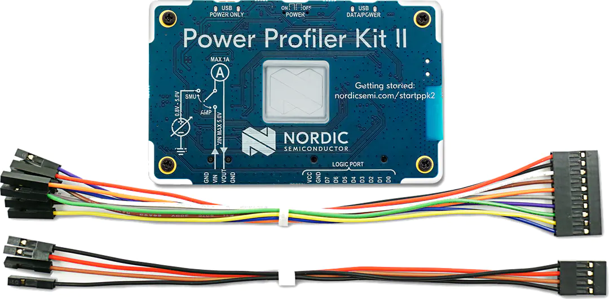

Le PPK2 mesure la consommation électrique :
* soit en fournissant de l'énergie à la carte externe (Mode "Source Meter Unit" : **SMU**), 
* soit en agissant comme un ampèremètre (Mode "Ampere Meter" : **AMP**).

Il mesure le courant de 500nA à 1A et donne le profil temps réel de la consommation de courant.

> Note : Le PPK2 peut mesurer le courant de n'importe quel dispositif à tester (Device Under Test : **DUT**) : tous les kits de développement de la même marque (Nordic), mais aussi n'importe quelle carte personnalisée (à base d'ESP32 par exemple).

Le PPK2 est pris en charge par l'application gratuite **Power Profiler** (inclue dans le logiciel *nRF Connect for Desktop*).

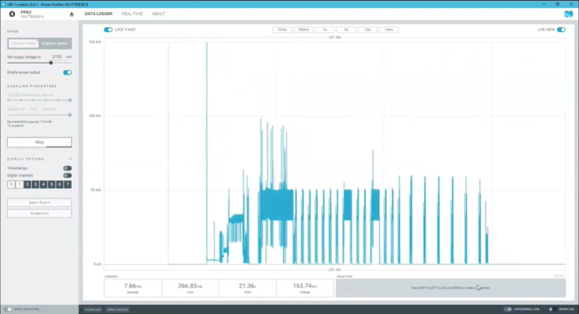


* Fabricant : https://www.nordicsemi.com/Products/Development-hardware/Power-Profiler-Kit-2
* User Guide : https://infocenter.nordicsemi.com/pdf/PPK2_User_Guide_v1.0.1.pdf
* Présentation en français : https://www.mouser.fr/new/nordic-semiconductor/nordic-power-profiler-kit-2/


## 1.2 Caractéristiques principales
* Tension d'alimentation de la carte externe variable de 0,8 V à 5,0 V (configurable dans le logiciel *Power Profiler*)
* Mesure de courant maximale de 1 A
* Mesure précise jusqu'à environ 200 nA
* Résolution jusqu'à 0,2 µA
* Vitesse d'échantillonnage de 100 kS/s
* Port numérique à 8 broches pour le traçage numérique
* Communication USB avec l'application de bureau pour l'analyse des mesures *Power Profiler*
* Affichage de la mesure du courant en temps réel


## 1.3 Connexions

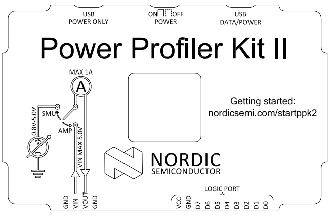

| Connector      | Description                                                                                        |
|----------------|----------------------------------------------------------------------------------------------------|
| GND            | Ground connection to DUT.                                                                          |
| VOUT           | Positive voltage output to DUT.                                                                    |
| VIN            | External power input. Only used for Ampere meter mode.                                             |
| GND            | Ground connection to DUT.                                                                          |
| USB DATA/POWER | USB connection for power and communication with the PPK2.                                          |
| USB POWER ONLY | USB connection for supplying extra power to the PPK2. Only needed in Source Meter mode (> 400 mA). |
| LOGIC PORT     |                                                                                                    |
| VCC            | VCC of DUT                                                                                         |
| GND            | GND of DUT                                                                                         |
| D0–D7          | Digital input pins                                                                                 |


# 2. Utilisation en mode SMU (Source Meter Unit)
En mode SMU, la carte à tester (DUT Device Under Test) est alimentée par le PPK2. Il faut brancher l'alimentation du DUT sur les sorties VOUT et GND du PPK2.

La tension d'alimentation sera ajustée et activée dans le logiciel *Power Profiler*

**ATTENTION** : 
* La tension d'alimentation du DTU doit être comprise entre 0.8 et 5V
* Le DTU ne doit pas consommer plus de 600mA.

Brancher le PPK2 sur l'ordinateur avec un câble micro-USB.

> Si le DUT consomme plus de 400mA, il faut brancher le deuxième câble USB pour diposer d'un courant maximal de 600mA.

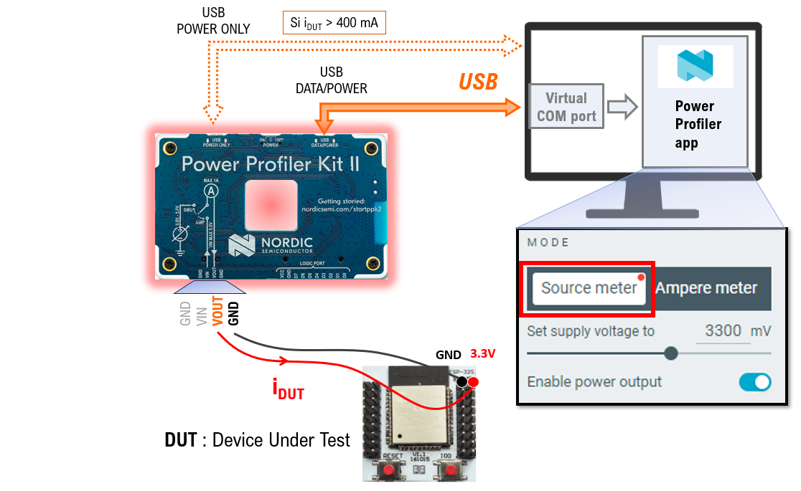


# 3. Utilisation en mode AMP (Ampere Meter)
En mode AMP, le PPK2 agit comme un ampèremètre. Il faut fournir une alimentation externe pour la carte à tester (DUT Device Under Test).

L'alimentation externe se branche sur VIN/GND, l'alimentation du DUT sur les sorties VOUT/GND.

**ATTENTION** : 
* l'alimentation externe doit fournir une tension compatible avec le DUT (3.3V pour un ESP32).
* La tension d'alimentation ne doit en aucun cas dépasser 5V. 
* Le DTU ne doit pas consommer plus de 1A.

Brancher le PPK2 sur l'ordinateur avec un câble micro-USB.

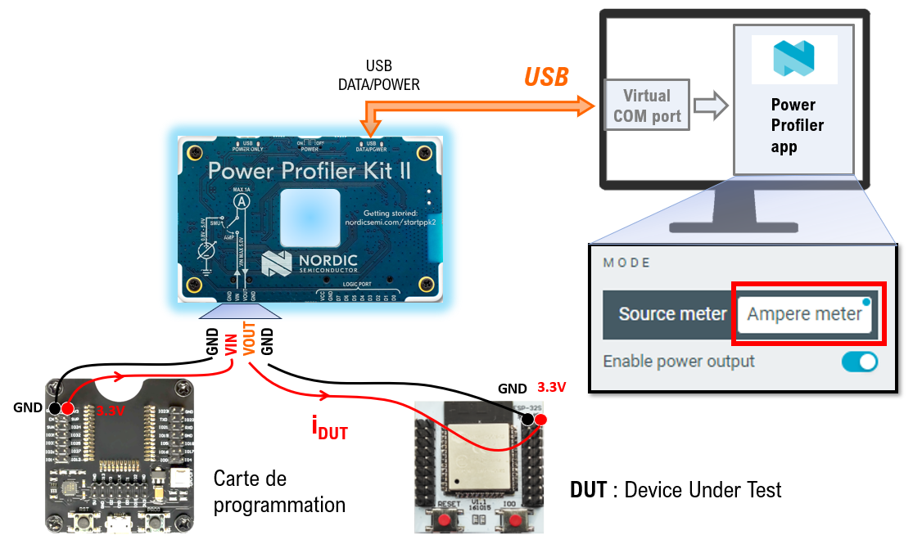


# 4. Logiciel de visualisation Power Profiler
## 4.1 Téléchargement et installation
Il faut télécharger et installer le logiciel **nRF Connect for Desktop**. Il inclu le logiciel *Power Profiler*

Téléchargement sur le site du constructeur : https://www.nordicsemi.com/Products/Development-tools/nRF-Connect-for-Desktop/Download

Lancer l'install avec ```nrfconnect-setup-4.4.1-x64.exe```
* Installer le driver J-Link
* Ne pas détecter les matériels Nordic
* En face de "Power Profiler", cliquer sur "Install"
    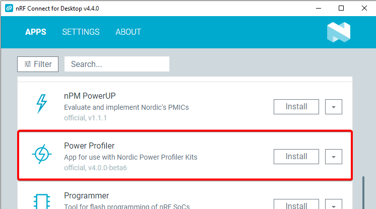


## 4.2 Utilisation du logiciel Power Profiler

1. Lancer **nRF Connect for Desktop**

    

2. Cliquer sur Open en face de "Power Profiler"

    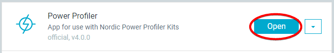

3. Sélectionner le kit de mesure (PPK2) en ciquant sur la flèche à côté de ```SELECT DEVICE```, puis en cliquant sur ```PPK2```

    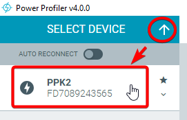

4. Sélectionner le mode d'alimentation du DUT (SMU ou AMP).\
   En mode SMU, il faut ajuster la tension d'alimentation du DTU.\
   Le bouton ```Enable power output``` permet d'activer/désactiver la sortie VOUT pour alimentater le DUT.

    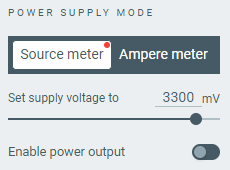
    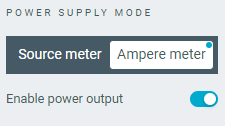

5. Démarrer la mesure du courant en cliquant sur ```Start```

    

    

Consultez la documentation officielle pour plus d'informations concernant l'utilisation et les réglages : [Documentation officielle](https://docs.nordicsemi.com/bundle/nrf-connect-ppk/page/overview.html)

# 5. Utilisation du port logique
Le PPK2 dispose de 8 entrées numériques qui se comportent comme un mini analyseur logique.

Cela peut permettre de mieux comprendre l'évolution du courant en fonction des actions du code source.

Pour utiliser le port logique, il faut relier VCC/GND du port logique à VCC/GND du DUT. Il faut ensuite relier les entrées numériques D0-D7 aux broches du DUT que l'on souhaite mesurer.

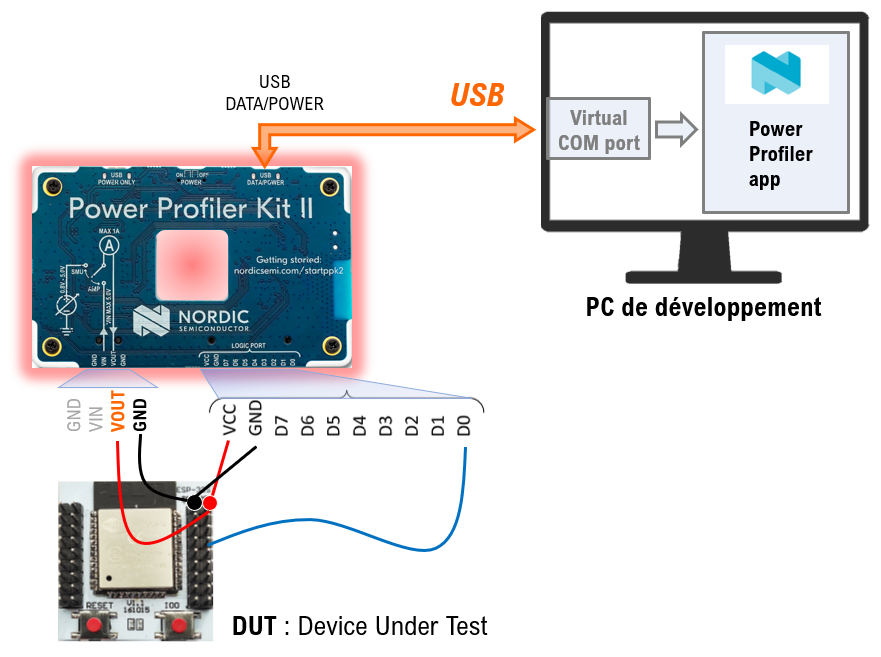

Dans le logiciel *Power Profiler*, il faut activer ```Digital channels``` et sélectionner les entrées à afficher.

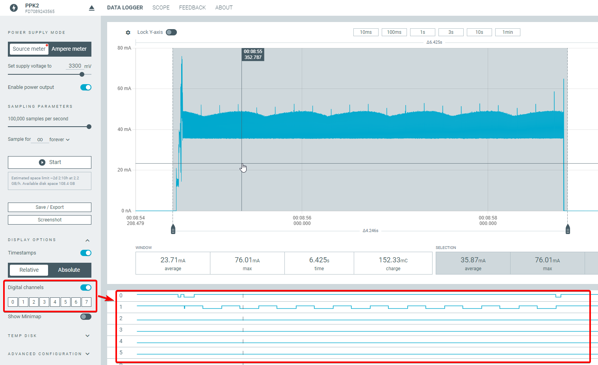


# Pour aller plus loin
Consultez les articles :
* [Alimenter l'ESP32 sur batterie](23.alimenter-esp32-sur-batterie.md)
* [Carte support pour le module ESP-WROOM-32](24.carte-support-esp-wroom-32.md)