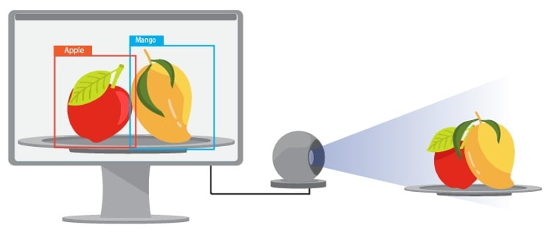
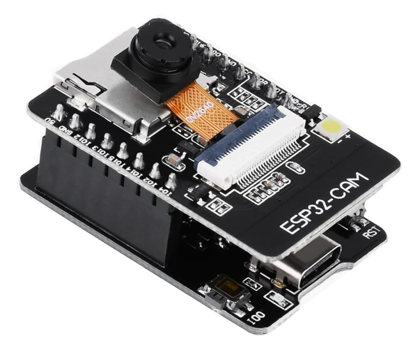
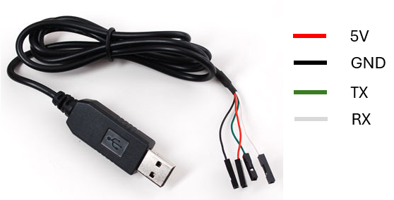
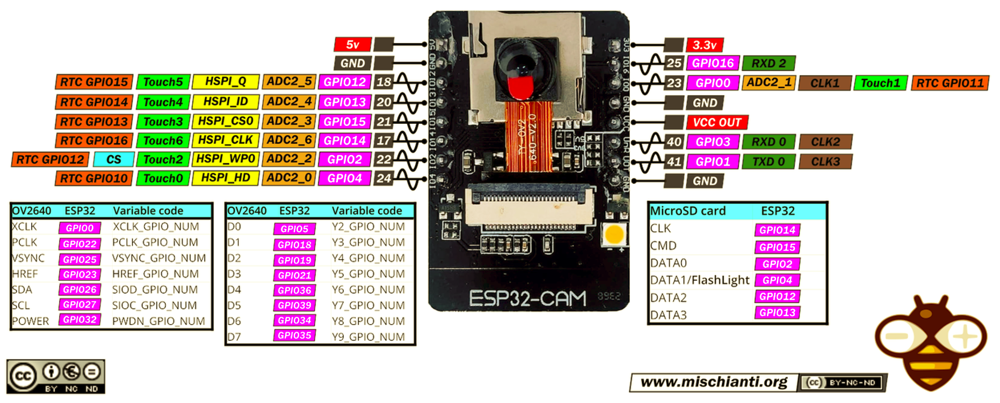
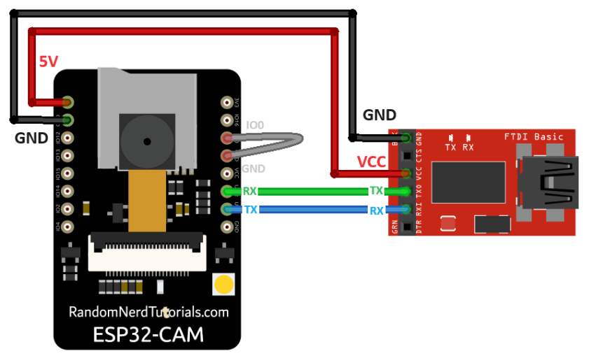
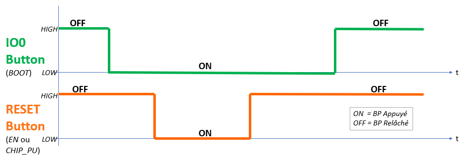
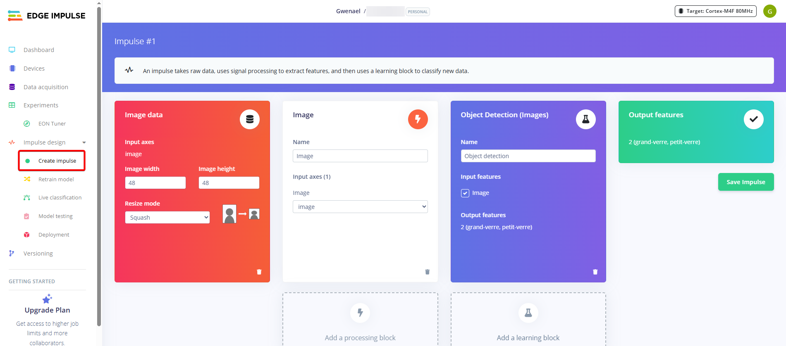
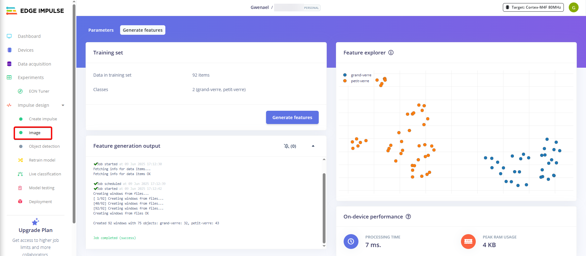
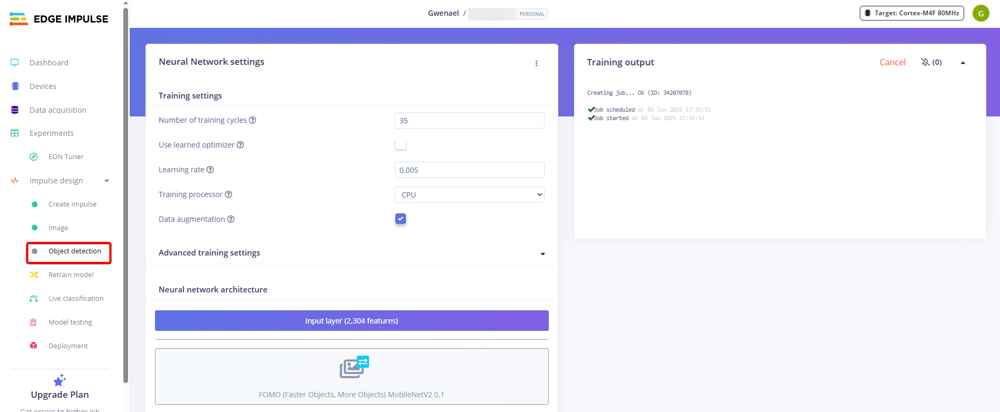
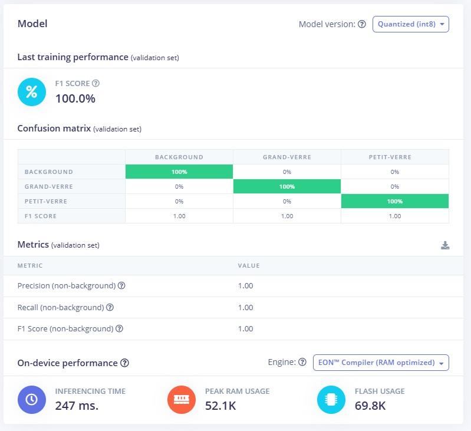

# ESP32-CAM : Détection d'objets avec TinyML

> * Auteur : Gwénaël LAURENT
> * Date : 09/06/2025
 
 [Licence Creative Commons](https://creativecommons.org/licenses/by-nc-sa/3.0/fr/)

- [ESP32-CAM : Détection d'objets avec TinyML](#esp32-cam--détection-dobjets-avec-tinyml)
- [1. C'est quoi l'Edge computing ?](#1-cest-quoi-ledge-computing-)
- [2. C'est quoi la reconnaissance d'objet ?](#2-cest-quoi-la-reconnaissance-dobjet-)
- [3. Collecter des images de la caméra ESP32-CAM](#3-collecter-des-images-de-la-caméra-esp32-cam)
  - [3.1. ESP32-CAM](#31-esp32-cam)
  - [3.2. Brochage du kit ESP32-CAM](#32-brochage-du-kit-esp32-cam)
  - [3.3. Programmation avec PlatformIO](#33-programmation-avec-platformio)
  - [3.4. Programme Camera avec WebServer](#34-programme-camera-avec-webserver)
  - [3.5. Créer des collections de photos pour chaque objet](#35-créer-des-collections-de-photos-pour-chaque-objet)
- [4. Utilisez Edge Impulse pour étiqueter les images](#4-utilisez-edge-impulse-pour-étiqueter-les-images)
- [5. Utiliser Edge Impulse pour entraîner le modèle](#5-utiliser-edge-impulse-pour-entraîner-le-modèle)
- [6. Exporter le modèle vers une bibliothèque Arduino](#6-exporter-le-modèle-vers-une-bibliothèque-arduino)
- [7. Importer le modèle dans un nouveau projet PlatformIO](#7-importer-le-modèle-dans-un-nouveau-projet-platformio)
  - [7.1. Créer un nouveau projet PlatformIO](#71-créer-un-nouveau-projet-platformio)
  - [7.2. Importer le modèle créé par Edge Impulse](#72-importer-le-modèle-créé-par-edge-impulse)
  - [7.3. Importer la bibliothèque Eloquent](#73-importer-la-bibliothèque-eloquent)
  - [7.4. Uploadez le code sur la carte :](#74-uploadez-le-code-sur-la-carte-)
- [8. Liens](#8-liens)


# 1. C'est quoi l'Edge computing ?
L'Edge computing apporte de puissantes capacités de traitement directement là où les données sont générées, rendant les systèmes plus rapides et plus performants.

L'Edge computing permet aux algorithmes d'intelligence artificielle de fonctionner sur des appareils compacts et peu gourmands en énergie, tels que des microcontrôleurs ou des microprocesseurs.

# 2. C'est quoi la reconnaissance d'objet ?
La reconnaissance d'objets est une technologie de vision par ordinateur et d'intelligence artificielle qui consiste à identifier et à étiqueter des objets dans une image ou une vidéo.



Processus nécessaires à un système pour reconnaître des objets dans une image :

1. **Acquisition de données** : le processus commence par l'acquisition de données. Collectez plusieurs images de l'objet que vous souhaitez que le système reconnaisse.
2. **Prétraitement des données acquises** : Les images collectées sont ensuite prétraitées pour faciliter les étapes suivantes. Cela implique généralement la réduction du bruit, l'amélioration du contraste et la mise à l'échelle.
3. **Extraction de caractéristiques** : les caractéristiques clés de l’image, telles que la texture, la forme, la couleur et les bords, sont extraites pour être utilisées dans la formation du système.
4. **Entraînement du modèle** : Les modèles d'apprentissage automatique, comme les réseaux de neurones convolutifs (CNN), sont entraînés sur un vaste ensemble de données d'images étiquetées. Le modèle apprend à associer les caractéristiques extraites à des objets spécifiques.
5. **Test du modèle** : Après l'entraînement, le modèle est prêt à être testé et déployé. Il reconnaît les objets individuellement et les compare aux caractéristiques extraites du jeu de données d'entraînement. Il trace ensuite l'emplacement et nomme les objets détectés. Pour améliorer la précision, entraînez le modèle avec un jeu de données plus important.
6. **Déploiement du modèle** : en fonction des contraintes du système, le format du modèle entraîné est converti et exécuté sur le système. Si la détection n'est pas assez précise, il faudra se concentrer davantage sur l'acquisition de données et l'entraînement du modèle.


# 3. Collecter des images de la caméra ESP32-CAM

## 3.1. ESP32-CAM



L'ESP32-CAM dispose d'un module ESP-32S avec 4MB de PSRAM (Chip is ESP32-D0WDQ6 (revision v1.0)).

L'ESP32-CAM intègre un module caméra OV2640. L'OV2640 présente les spécifications suivantes :
* 2 Megapixel sensor
* Array size UXGA 1622×1200
* Output formats include YUV422, YUV420, RGB565, RGB555 and 8-bit compressed data
* Image transfer rate of 15 to 60 fps

> L'ESP32-CAM ne dispose pas de convertisseur USB/Série. C'est le rôle de la carte électronique associée. Mais elle semble bugguer côté console série... Donc on utilise un adaptateur USB/Série **5V** (il y a un régulateur 3.3V sur la carte ESP32-CAM)



## 3.2. Brochage du kit ESP32-CAM


Connexion à l'ordinateur avec un adaptateur USB/Série 5V



Veillez à bien croiser les liaisons TX et RX !

La connexion IO0-GND n'est utilisée que pendant l'upload d'un nouveau programme.

## 3.3. Programmation avec PlatformIO

Ouvrez une nouvelle fenêtre **VScode** sans aucun projet ouvert.

Dans VScode, lancez **PlatformIO**

Cliquez sur ```New Project``` :
* Name (nom du projet) : esp32-cam-webserver
* Board : [**```AI Thinker ESP32-CAM```**](https://docs.platformio.org/en/latest/boards/espressif32/esp32cam.html)
* Framework : **Arduino**

Note : [paramétrage utilisé par défaut pour cette carte](https://github.com/handledexception/platform-espressif32/blob/esp32-s3-devkitc-1-n16r8v/boards/esp32cam.json)


## 3.4. Programme Camera avec WebServer

Clonez la bibliothèque [eloquentarduino/EloquentEsp32cam](https://github.com/eloquentarduino/EloquentEsp32cam) dans le dossier /lib de votre projet  :
1. Ouvrez un terminal dans votre projet VSCode : Ctrl + ù
2. Déplacez vous dans le dossier /lib : `cd lib`
3. Clonez la bibliothèque : `git clone https://github.com/eloquentarduino/EloquentEsp32cam.git`
4. Copiez le contenu de `\lib\EloquentEsp32cam\examples\Collect_Images_for_EdgeImpulse\Collect_Images_for_EdgeImpulse.ino` dans `main.cpp`
5. Ajouter `#include <Arduino.h>` au début du fichier main.cpp
6. Modifiez les constantes de définition de votre réseau WiFi
```cpp
#define WIFI_SSID "SSID"
#define WIFI_PASS "PASSWORD"
```
7. dans setup(), modifiez la ligne `camera.pinout.wroom_s3();`par `camera.pinout.aithinker();`
8. Dans platformio.ini, activez les logs et la PSRAM et augmenter la taille de la partition principale :
```ini
[env:esp32cam]
platform = espressif32
board = esp32cam
framework = arduino
monitor_speed = 115200
board_build.partitions = huge_app.csv
build_flags = 
    -DCORE_DEBUG_LEVEL=3
    -DBOARD_HAS_PSRAM
    -mfix-esp32-psram-cache-issue
```

Uploadez le code sur la carte :
1. Reliez **IO0** à **GND**
2. Appuyez une fois sur le bouton **RESET**
3. Déconnectez **IO0**
4. Uploadez le programme à partir de VScode/PlatformIO



Pour sortir du mode téléchargement de programme et lancer le programme contenu dans l'ESP32 : **Appuyez une fois sur le bouton RESET**


La caméra est visible à l'adresse : **http://esp32cam.local/**

_Remarque pour allumer la LED de l'ESP32-CAM :_
```cpp
camera.pinout.pins.flashlight = -1;
...
pinMode(4, OUTPUT);
digitalWrite(4, HIGH);
```

## 3.5. Créer des collections de photos pour chaque objet
A partir de la page Web  http://esp32cam.local .

Pour collecter les images, cliquez simplement sur Start collecting. Pour arrêter, cliquez sur Stop.

Veuillez suivre ces étapes EXACTES pour collecter un ensemble de données de bonne qualité (qui garantit que vous n'aurez pas de problèmes plus tard) :

1. Ne mettez rien devant l'objectif (pour l'arrière plan). Collectez 15 à 20 images. Mettez en pause, **téléchargez** et effacez.
2. Placez le premier objet devant la caméra. Prenez 20 à 30 images en déplaçant légèrement la caméra. Essayez de capturer différents angles et positions de l'objet. Mettez en pause, **téléchargez** et effacez.
3. répétez 2. pour chaque objet que vous avez

Une fois terminé, vous aurez un zip d'images pour chaque classe d'objet + un pour « pas d'objet/arrière-plan ».

**Extrayez les zips** et passez à l’étape suivante.


# 4. Utilisez Edge Impulse pour étiqueter les images
Créez un compte gratuit sur https://studio.edgeimpulse.com/

Créez un nouveau projet : Cliquez sur votre avatar > Projects > Create New project

Cliquez sur Data acquisition > Dataset > + Add data > Upload data

1. cliquez `Select files` et sélectionnez toutes les images dans le dossier «arrière-plan » ; cochez `Automatically split between training and testing` et `Infer from filename` ; puis appuyez sur `Upload data`
2. fermez la modale et cliquez `Labelling queue` dans la barre en haut
3. Cliquez toujours `Save labels` sans rien faire pour chaque photo d'arrière plan ! (Puisqu'il n'y a pas d'objet dans ces images, nous les utiliserons pour la modélisation d'arrière-plan)
4. une fois terminé pour toutes les images, revenez à `Dadaset` dans la barre en haut
5. Cliquez sur l'icône upload data (au dessus de la liste d'images). Cliquez `Select files` et sélectionnez toutes les images du dossier d'un objet à la fois ; cochez `Automatically split between training and testing` ; puis appuyez sur `Upload data`.
6. fermez la modale et cliquez `Labelling queue` dans la barre en haut
7. Dans Labelling queue, tracez le cadre autour de l'objet à reconnaître. Donnez un nom au label (correspondant à l'objet à reconnaitre). À droite, assurez-vous que l'option Label suggestions: `Track objects between frames` est sélectionnée.
8. Étiquetez toutes les images. Assurez-vous de fixer le cadre de délimitation à l'objet tout en laissant quelques pixels de marge.
répétez les points 4 à 8 pour chaque objet

# 5. Utiliser Edge Impulse pour entraîner le modèle
1. Cliquez sur  `Impulse design` > `Create Impulse` (fermez la première modale)
2. Dans `Image data` entrez **48** dans `Image width` et `Image height`
3. Dans `Resize mode`, sélectionnez **Squash**
4. Cliquez sur `Add a processing block` > Preprocess and normalize image data, and optionally reduce the color depth. > **Add**
5. Cliquez sur `Add a learning block` > Object Detection (Images) > **Add**
6. Cliquez sur `Save Impulse`



1. Cliquez sur  `Impulse design` > `Image`
2. Dans `Image Color depth`, sélectionnez **Grayscale**
3. Cliquez sur `Save parameters`
4. Cliquez sur `Generate features` (Cela devrait prendre moins d’une minute, en fonction du nombre d’images.)



1. Cliquez sur  `Impulse design` > `Object detection`
2 Modifiez `Number of training cycles` = **35**
3. Modifiez `Learning rate` = **0.005**
4. Cliquez sur `Choose a different model`, juste en dessous du bloc 'FOMO'.
5. Sélectionnez `FOMO (Faster Objects, More Objects) MobileNetV2 0.1` (Il s'agit du plus petit modèle que nous pouvons entrainer et le seul qui s'adapte parfaitement aux cartes de caméra non ESP32S3.)
6. Cliquez sur `Save & Train` (Cela peut prendre 4 à 5 minutes selon le nombre d'images.)





> Pour obtenir des estimations précises du temps d'inférence et de l'utilisation de la mémoire , dans le coin supérieur droit de la page Edge Impulse, sélectionnez `Espressif ESP-EYE` comme carte cible

Si vous êtes satisfait du résultat, passez à l'étape suivante. Sinon, vous devez :

1. Collecter davantage d'images de meilleure qualité. La qualité des données d'entrée et de l'étiquetage est une étape cruciale de l'apprentissage automatique.
2. Augmenter le nombre de cycles d'entraînement (ne pas dépasser 50, c'est presque inutile)
3. Réduire le taux d'apprentissage à 0,001. Cela peut aider, ou non.

# 6. Exporter le modèle vers une bibliothèque Arduino
1. Cliquez sur  `Impulse design` > `Deployment`
2. Cliquez sur `Search deployment options`
3. Choisissez `Arduino library`
4. Dans `Model optimizations`, sélectionnez `Quantized (int_)`
5. Cliquez sur `Build` (Un zip contenant la bibliothèque de modèles sera téléchargé)


# 7. Importer le modèle dans un nouveau projet PlatformIO
## 7.1. Créer un nouveau projet PlatformIO

Ouvrez une nouvelle fenêtre **VScode** sans aucun projet ouvert.

Dans VScode, lancez **PlatformIO**

Cliquez sur ```New Project``` :
* Name (nom du projet) : esp32-cam-detection
* Board : [**```AI Thinker ESP32-CAM```**](https://docs.platformio.org/en/latest/boards/espressif32/esp32cam.html)
* Framework : **Arduino**

Note : [paramétrage utilisé par défaut pour cette carte](https://github.com/handledexception/platform-espressif32/blob/esp32-s3-devkitc-1-n16r8v/boards/esp32cam.json)

## 7.2. Importer le modèle créé par Edge Impulse
1. Dézippez le fichier téléchargé depuis Edge Impulse dans le dossier /lib

## 7.3. Importer la bibliothèque Eloquent

Clonez la bibliothèque [eloquentarduino/EloquentEsp32cam](https://github.com/eloquentarduino/EloquentEsp32cam) dans le dossier /lib de votre projet  :
1. Ouvrez un terminal dans votre projet VSCode : Ctrl + ù
2. Déplacez vous dans le dossier /lib : `cd lib`
3. Clonez la bibliothèque : `git clone https://github.com/eloquentarduino/EloquentEsp32cam.git`
4. Copiez le contenu de `\lib\EloquentEsp32cam\examples\EdgeImpulse_FOMO_NO_PSRAM\EdgeImpulse_FOMO_NO_PSRAM.ino` dans `main.cpp`
5. Ajouter `#include <Arduino.h>` au début du fichier main.cpp
6. Modifiez le nom de la bibliothèque Edge Impulse pour correspondre à votre modèle `#include <your-fomo-project_inferencing.h>`
7. dans setup(), assurez vous d'avoir `camera.pinout.aithinker();`
8. Dans platformio.ini, activez les logs et la PSRAM et augmenter la taille de la partition principale :
```ini
[env:esp32cam]
platform = espressif32
board = esp32cam
framework = arduino
monitor_speed = 115200
board_build.partitions = huge_app.csv
build_flags = 
    -DCORE_DEBUG_LEVEL=3
    -DBOARD_HAS_PSRAM
    -mfix-esp32-psram-cache-issue
```
9. Pour allumer la LED de l'ESP32-CAM :
```cpp
camera.pinout.pins.flashlight = -1;
...
pinMode(4, OUTPUT);
digitalWrite(4, HIGH);
```

## 7.4. Uploadez le code sur la carte :
1. Reliez **IO0** à **GND**
2. Appuyez une fois sur le bouton **RESET**
3. Déconnectez **IO0**
4. Uploadez le programme à partir de VScode/PlatformIO (la compilation est assez longue ...)


Pour sortir du mode téléchargement de programme et lancer le programme contenu dans l'ESP32 : **Appuyez une fois sur le bouton RESET**

Le moniteur série doit afficher la détection des objets


# 8. Liens
* Eloquent Arduino :
  * [ESP32 cam Object Detection](https://eloquentarduino.com/posts/esp32-cam-object-detection)
  * [Github Eloquent examples](https://github.com/eloquentarduino/EloquentEsp32cam/tree/main/examples)
* DroneBot Workshop : 
  * [ESP32-CAM Object Detection with Edge Impulse](https://dronebotworkshop.com/esp32-object-detect/)
  * [Youtube : Simple ESP32-CAM Object Detection](https://www.youtube.com/watch?v=HDRvZ_BYd08&ab_channel=DroneBotWorkshop)
* Circuit Digest :
  * [Object Detection using ESP32-CAM and Edge Impulse](https://circuitdigest.com/microcontroller-projects/object-recognition-using-esp32-cam-and-edge-impulse)
  * [Github esp32 Cam With OLED](https://github.com/Circuit-Digest/Object-Detection-Using-ESP32-CAM-Edge-Impulse-along-with-the-I2C-OLED-Display/blob/main/esp32%20Cam%20With%20OLED)
* [Edge Impulse](https://edgeimpulse.com/)

[ESP32 cam Quickstart](https://eloquentarduino.com/posts/esp32-cam-quickstart)

Programme de base : CameraWebServer (cf [ici](https://zhuanlan.zhihu.com/p/643603980))

[ESP32-CAM Troubleshooting Guide](https://randomnerdtutorials.com/esp32-cam-troubleshooting-guide/)