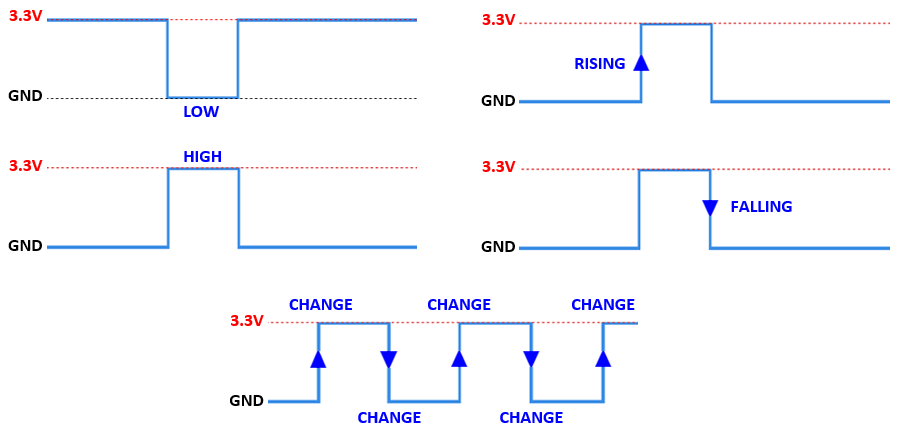
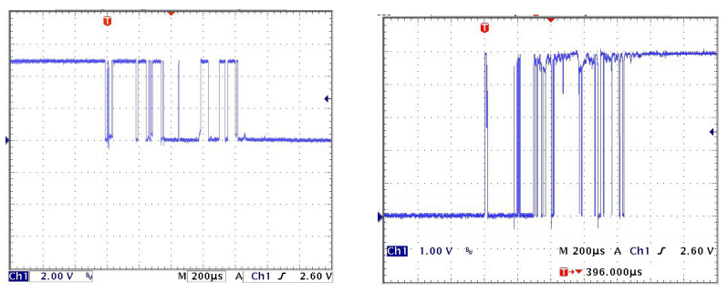
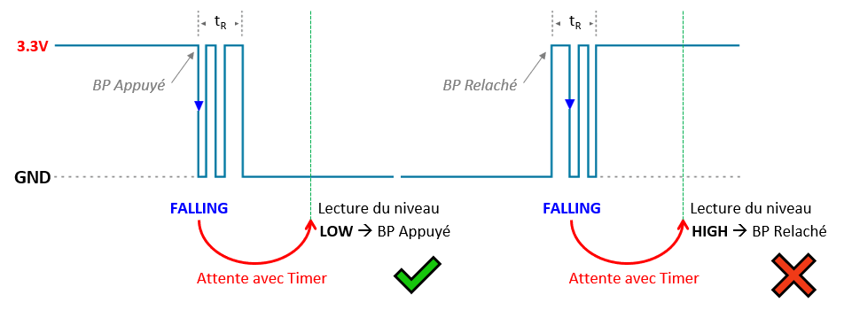

# Gestion des interruptions sur ESP32

> * Auteur : Gwénaël LAURENT
> * Sources : [uPesy](https://www.upesy.fr/blogs/tutorials/what-are-interrupts-in-esp32-with-examples-for-arduino-code), [circuitdigest.com](https://circuitdigest.com/microcontroller-projects/esp32-interrupt), [lastminuteengineers.com](https://lastminuteengineers.com/handling-esp32-gpio-interrupts-tutorial/)
> * Date : 04/01/2026
 
 [Licence Creative Commons](https://creativecommons.org/licenses/by-nc-sa/3.0/fr/)

- [Gestion des interruptions sur ESP32](#gestion-des-interruptions-sur-esp32)
- [1. Définition](#1-définition)
- [2. Les modes de détection](#2-les-modes-de-détection)
- [3. Quelle broche utiliser sur l'ESP32 ?](#3-quelle-broche-utiliser-sur-lesp32-)
- [4. Le principe de la programmation des interruptions](#4-le-principe-de-la-programmation-des-interruptions)
  - [4.1. Créer le gestionnaire d'interruption](#41-créer-le-gestionnaire-dinterruption)
  - [4.2. Interactions entre l'ISR et le programme principal](#42-interactions-entre-lisr-et-le-programme-principal)
    - [4.2.1. Principe](#421-principe)
    - [4.2.2. Variables `volatile`](#422-variables-volatile)
    - [4.2.3. Sections critiques](#423-sections-critiques)
  - [4.3. Programme complet pour la gestion de l'interruption](#43-programme-complet-pour-la-gestion-de-linterruption)
- [5. Déconnexion d'une interruption](#5-déconnexion-dune-interruption)
- [6. Gestion des rebonds des commutateurs mécaniques](#6-gestion-des-rebonds-des-commutateurs-mécaniques)
  - [6.1. Problème physique des rebonds](#61-problème-physique-des-rebonds)
  - [6.2. Principe de l'anti-rebond logiciel](#62-principe-de-lanti-rebond-logiciel)
  - [6.3. Codage du Timer d'anti-rebond](#63-codage-du-timer-danti-rebond)


# 1. Définition

📌 Une interruption est un signal qui invite le processeur à interrompre temporairement l’exécution du code en cours et à exécuter une tâche spécifique.\
Quand cette tâche est terminée, on retourne à l’exécution du programme à l’endroit exact où il avait été arrêté.

✔ Le signal vient généralement de la détection d'un changement de niveau sur une broche de l'ESP (_interruption matérielle_). Le signal peut aussi être envoyé par une instruction spéciale du processeur (_interuption logicielle_).

✔ La tâche spécifique est une fonction exécutée quand le signal se produit. Cette fonction est appelée "gestionnaire d'interruption" ou "ISR" (Interrupt Service Routine).

✔️ **A quoi ça sert ?** Les interruptions permettent de déclencher une action sans avoir besoin de lire en permanence l'état du déclencheur => **ça sert à ne pas bloquer la fonction `loop()` quand on attend un changement d'état sur une broche GPIO** (par exemple, l'appui sur un bouton).

> **Fonctionnement :**\
> Détection d’un évènement → Interruption du programme principal → Exécution du code de l’interruption → Le processeur reprend là où il s’est arrêté.

# 2. Les modes de détection
On peut choisir le mode de détection de l’interruption :

* **LOW** : Déclenche l’interruption dès que le signal est à 0V
* **HIGH** : Déclenche l’interruption dès que le signal est à 3.3V
* **RISING** : Déclenche l’interruption dès que le signal passe de LOW à HIGH (0 à 3.3V)
* **FALLING** : Déclenche l’interruption dès que le signal passe de HIGH à LOW (3.3V à 0)
* **CHANGE** : Déclenche l’interruption dès que le signal passe de LOW à HIGH ou de HIGH à LOW .

> si vous utilisez les modes LOW et HIGH , l’interruption se déclenchera en boucle tant que le signal ne change pas d’état.




# 3. Quelle broche utiliser sur l'ESP32 ?
Toutes les broches de l'ESP32 prennent en charge les interruptions matérielles.

L'ESP32 offre jusqu'à 32 emplacements d'interruption par cœur.

# 4. Le principe de la programmation des interruptions
## 4.1. Créer le gestionnaire d'interruption
> **ISR** (Interrupt Service Routine, _routine de service d'interruption_) : c'est le gestionnaire de l'interruption. C'est une **fonction spéciale qui s'exécutera lorque l'évènement d'interruption se produira**.


<!-- On ne peut pas utiliser la fonction delay() ni Serial.println() avec une interruption. On peut néanmoins afficher des messages dans le moniteur série en remplaçant Serial.println() par ets_printf() qui est compatible avec les interruptions. -->

Pour activer les interruptions sur des broches spécifiques (et associer ces broches à une fonction ISR), on peut utiliser une des 2 fonctions de l'ESP32 :
* la fonction `attachInterrupt()` (vous trouverez un exemple [ici](10.pio-esp32-RC522.md#6-lecture-des-tags-avec-interruption))
* ou la fonction `attachInterruptArg()` (celle utilisée dans ce document).

💡 L'avantage de la fonction `attachInterruptArg` est qu'elle permet d'utiliser plusieurs broches comme source d'interruption, tout en utilisant qu'une seule fonction ISR. Le numéro de la broche déclenchante sera récupéré dans le paramètre de la fonction ISR (ce qui est très pratique).\
_Il faut pour cela appleler `attachInterruptArg` pour chaque broche déclenchant une interruption, en passant en argument le n° de la broche et la même fonction ISR_.


**Au début du code**, en dehors de toute fonction, il faut déclarer la broche qui servira d'interruption
  ```cpp
  const int btnPin = 18;
  ```

**Avant** la fonction `setup()`, il faut **déclarer la fonction ISR**. Par exemple :
```cpp
void IRAM_ATTR isr_falling(void *arg)
{
  // Récupérer la broche qui a déclenché l'interruption
  int numPinBtn = (int)arg;
  if (numPinBtn == btnPin)
  {
    // code du gestionnaire d'interruption
  }
}
```

⚠️ Une fonction ISR doit être aussi courte et rapide que possible

📝 Il faut ajouter le mot-clé `IRAM_ATTR` avant chaque nom de fonction ISR pour garantir que la fonction soit stockée dans la mémoire IRAM interne rapide (Instruction RAM) plutôt que dans la mémoire flash externe.


**Dans `setup()`**, il faut **configurer la source d'interruption** :
1. Configurer la broche GPIO servant d'interruption en INPUT. Par exemple :
    ```cpp
    pinMode(btnPin, INPUT_PULLUP);
    ```
2. Activer la source d'interruption en l'associant à une fonction ISR qui sera exécutée lorsque l’interruption sera déclenchée. Par exemple :
    ```cpp
    attachInterruptArg(digitalPinToInterrupt(btnPin), isr_falling, (void *)btnPin, FALLING);
    ```
    * <ins>1er argument</ins> : le numéro de la broche qui doit déclencher l'interruption
    * 2ème argument : le nom de la fonction ISR (sans parenthèses !)
    * 3ème argument : une donnée qui sera récupérée quand l'ISR s'exécutera. Ici on passe le numéro de la broche déclenchante.
    * 4ème argument : le mode de déclenchement LOW, HIGH, CHANGE, FALLING, RISING

## 4.2. Interactions entre l'ISR et le programme principal
### 4.2.1. Principe
📌 **Une fonction ISR doit être aussi courte et rapide que possible**. C'est donc le programme principal qui réalise les actions "longues" suite au déclenchement de l'interruption.

Pour indiquer au programme principal qu'une interruption vient de se produire, l'ISR se contente généralement de modifier la valeur d'une variable partagée (`volatile`) entre l'ISR et le programme principal. Le programme principal lit en permanence la valeur de cette variable et, si elle change, réalise l'action souhaitée.

### 4.2.2. Variables `volatile`
⚠️ **Les variables partagées entre l'ISR et le programme principal doivent être déclarées comme `volatile`.**

> Toute variable modifiée à l'intérieur d'une routine d'interruption (ISR) et accessible en dehors de celle-ci (ou inversement) doit être déclarée avec le mot-clé `volatile`. Cela indique au compilateur que cette variable peut changer de manière inattendue à tout moment en raison d'une interruption.

**Au début du code**, en dehors de toute fonction, il faut déclarer la variable partagée comme `volatile`. Par exemple :
```cpp
volatile bool btnPressed = false;
```

### 4.2.3. Sections critiques
⚠️ **L'accès aux variables `volatile` (lecture ou écriture) doit être protégé par une "section critique".**\
Ceci permettra de s'assurer qu'aucune autre interruption ne vienne changer la valeur de la variable volatile pendant qu'on est en train de la lire.

Pour cela, il faut définir un objet de type `portMUX_TYPE`

**Au début du code**, en dehors de toute fonction, il faut déclarer un objet `portMUX_TYPE`. Par exemple :
```cpp
portMUX_TYPE btnMux = portMUX_INITIALIZER_UNLOCKED; //type de Spinlock (Verrouillage)
```

**Dans la fonction ISR**, on encadre les portions de code critique avec les fonctions `portENTER_CRITICAL_ISR()` et `portEXIT_CRITICAL_ISR()`. Par exemple :

```cpp
void IRAM_ATTR isr_falling(void *arg)
{
  // Récupérer la broche qui a déclenché l'interruption
  int numPinBtn = (int)arg;
  if (numPinBtn == btnPin)
  {
    // code du gestionnaire d'interruption
    portENTER_CRITICAL_ISR(&btnMux); // désactive les autres interruptions
    btnPressed = true;               // accès à la variable volatile
    portEXIT_CRITICAL_ISR(&btnMux);  // réactive les autres interruptions
  }
}
```
**Dans la fonction loop()**, ou dans les autres fonctions, on encadre les portions de code critique avec les fonctions `portENTER_CRITICAL()` et `portEXIT_CRITICAL()`. Par exemple :

```cpp
void loop()
{
  bool demandeTraitementBtn = false;

  portENTER_CRITICAL(&btnMux); // désactive les autres interruptions
  if (btnPressed == true)
  {
    demandeTraitementBtn = true;
    btnPressed = false; // pour les prochaines interruptions
  }
  portEXIT_CRITICAL(&btnMux); // réactive les autres interruptions

  if (demandeTraitementBtn == true)
  {
    demandeTraitementBtn = false;
    // Traitement associé à l'appui sur le bouton
    Serial.println("Bouton appuyé");
  }
  delay(1);
}
```
📝 Les sections critiques doivent être aussi courtes que possible. C'est pour cela qu'on utilise une autre variable (demandeTraitementBtn) dans la fonction loop().

<!-- Note : en fait, pour ESP32 et ajourd'hui,  les fonctions portENTER_CRITICAL_ISR et portENTER_CRITICAL sont identiques
Note : ces fonctions sont dérivés de FreeRTOS pour être compatible avec ESP-IDF et son Symmetric Multiprocessing (SMP).  -->

cf doc officiel sur les sections critiques : https://docs.espressif.com/projects/esp-idf/en/latest/esp32/api-reference/system/freertos_idf.html#critical-sections

## 4.3. Programme complet pour la gestion de l'interruption
Ce programme détecte un appui sur un bouton poussoir branché entre GPIO18 et la Masse. Il utilise une interruption sur le front descendant de GPIO18.

⚠️ Pour être vraiment complet, ce programme devrait intégrer une gestion anti-rebond (debounce). Voir plus bas.


```cpp
#include <Arduino.h>

const int btnPin = 18; // BP connecté entre GPIO18 et GND

// Variables déclarées comme volatiles car mises à jour
// par le programme principal ET/OU l'interruption
volatile bool btnPressed = false;

// Gestion des sections critiques (MUTEX)
portMUX_TYPE btnMux = portMUX_INITIALIZER_UNLOCKED;

/****** Gestionnaire d'interruption ******/
void IRAM_ATTR isr_falling(void *arg)
{
  // Récupérer la broche qui a déclenché l'interruption
  int numPinBtn = (int)arg;
  if (numPinBtn == btnPin)
  {
    // code du gestionnaire d'interruption
    portENTER_CRITICAL_ISR(&btnMux); // désactive les autres interruptions
    btnPressed = true;               // accès à la variable volatile
    portEXIT_CRITICAL_ISR(&btnMux);  // réactive les autres interruptions
  }
}

/****** setup ******/
void setup()
{
  Serial.begin(115200);
  pinMode(btnPin, INPUT_PULLUP); // Configurer la broche en entrée avec pull-up
  attachInterruptArg(digitalPinToInterrupt(btnPin), isr_falling, (void *)btnPin, FALLING);
}

/****** loop ******/
void loop()
{
  bool demandeTraitementBtn = false;

  portENTER_CRITICAL(&btnMux); // désactive les autres interruptions
  if (btnPressed == true)
  {
    demandeTraitementBtn = true;
    btnPressed = false; // pour les prochaines interruptions
  }
  portEXIT_CRITICAL(&btnMux); // réactive les autres interruptions

  if (demandeTraitementBtn == true)
  {
    demandeTraitementBtn = false;
    // Traitement associé à l'appui sur le bouton
    Serial.println("Bouton appuyé");
  }
  delay(1);
}
```

# 5. Déconnexion d'une interruption
Si vous ne souhaitez plus que l'ESP32 surveille les interruptions d'une broche particulière, vous pouvez utiliser la fonction `detachInterrupt()`. Sa syntaxe est simple :
```cpp
detachInterrupt(btnPin);
```


# 6. Gestion des rebonds des commutateurs mécaniques
## 6.1. Problème physique des rebonds
Le comportement réel des boutons et interrupteurs mécaniques n'est pas idéal. Quand un interrupteur ou un bouton commute, après la fermeture initiale du contact se produit une **succession de « rebonds » mécaniques** conduisant à une série de microruptures des contacts. Cette phase peut durer quelques millisecondes. Ce phénomène de rebonds s’observe souvent aussi bien à la fermeture qu’à l’ouverture du circuit. Des exemples de rebonds d'interrupteur sont visualisés à l'oscilloscope sur les figures ci-dessous.

\
Crédit : [laboratory-manual-arduino.developpez.com](https://laboratory-manual-arduino.developpez.com/tutoriels/manuel-laboratoire-controleurs-embarques/?page=les-entrees-numeriques)

Le problème est que le microcontrôleur peut lire l'état de la broche d'entrée en une fraction de milliseconde, ainsi, chaque rebond peut être interprété comme une fermeture/ouverture très rapide de l'interrupteur.

## 6.2. Principe de l'anti-rebond logiciel
La clé pour un anti-rebond logiciel consiste à étendre la durée d'observation de l'état du bouton. En d'autres termes, on veut observer l'état sur une durée suffisamment longue, le temps de laisser passer les rebonds.




## 6.3. Codage du Timer d'anti-rebond

**Au début du code**, en dehors de toute fonction, il faut :
1. déclarer un objet timer et son temps d'attente 
    ```cpp
    #include "esp_timer.h"
    #define DEBOUNCE_TIMER_DELAY 1000 * 10 // en µs (10ms)
    esp_timer_handle_t debounce_timer_handle; // Timer handle
    ```
2. déclarer une variable `volatile` qui permettra de ne prendre en compte l'interruption que lors du premier front descendant. Cette variable vaudra `true` pendant toute l'attente du Timer d'anti-rebond.
    ```cpp
    volatile bool awaitingDebounce = false;
    ```

**Avant la fonction `isr_falling()`**, il faut déclarer la fonction qui sera exécutée à la fin du temps d'attente du Timer. C'est elle qui met à jour la volatile `btnPressed`

```cpp
void IRAM_ATTR timer_debounce_callback(void *arg)
{
  // si état LOW --> front descendant confirmé
  if (digitalRead(btnPin) == LOW)
  {
    portENTER_CRITICAL_ISR(&btnMux); // désactive les autres interruptions

    // Détection d'appui sur le BP
    btnPressed = true;

    portEXIT_CRITICAL_ISR(&btnMux); // réactive les autres interruptions

    // supprimer le timer quand il a fini
    esp_timer_delete(debounce_timer_handle);
  }
  // Fin d'attente de l'anti-rebond
  awaitingDebounce = false;
}
```

**Dans la fonction `isr_falling()`**, il faut modifier le code pour démarrer le Timer d'anti-rebond dès qu'un front descendant est détecté sur le GPIO.

```cpp
void IRAM_ATTR isr_falling(void *arg)
{
  portENTER_CRITICAL_ISR(&btnMux); // désactive les autres interruptions

  // on ne prend en compte que le 1er FALLING des rebonds
  if (awaitingDebounce == false)
  {
    // Configurer un timer
    const esp_timer_create_args_t debounce_timer_args = {
        .callback = &timer_debounce_callback,
        .arg = (void *)arg,
        .dispatch_method = ESP_TIMER_TASK,
        .name = "DebounceTimer"};
    esp_timer_create(&debounce_timer_args, &debounce_timer_handle);

    // Démarrer le timer
    esp_timer_start_once(debounce_timer_handle, DEBOUNCE_TIMER_DELAY);
    
    // Activer l'attente de l'anti-rebond
    awaitingDebounce = true;
  }
  portEXIT_CRITICAL_ISR(&btnMux); // réactive les autres interruptions
}
```
