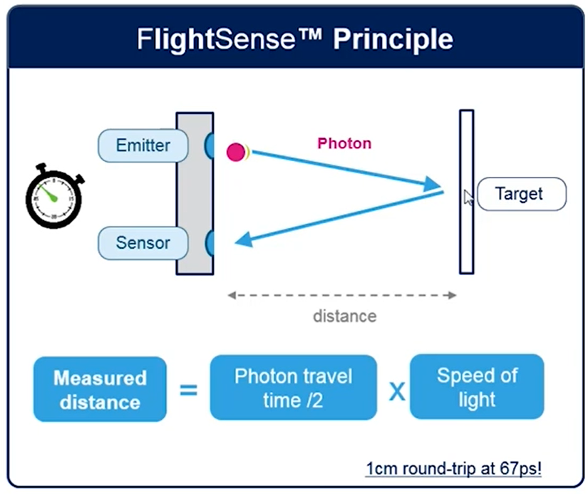
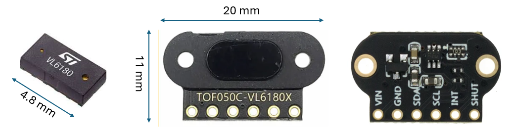

# Télémètre de proximité ToF VL6180X

> * Auteur : Gwénaël LAURENT
> * Date : 15/07/2025
 
 [Licence Creative Commons](https://creativecommons.org/licenses/by-nc-sa/3.0/fr/)

- [Télémètre de proximité ToF VL6180X](#télémètre-de-proximité-tof-vl6180x)
- [1. Présentation](#1-présentation)
- [2. Branchement](#2-branchement)
- [3. Connexion en I2C](#3-connexion-en-i2c)
- [4. Création du projet PlatformIO](#4-création-du-projet-platformio)
- [5. Programme minimaliste de lecture de distance](#5-programme-minimaliste-de-lecture-de-distance)
- [6. Programme avancé de lecture de distance en continu](#6-programme-avancé-de-lecture-de-distance-en-continu)
- [7. Lecture de distance en continu avec utilisation d'un timer](#7-lecture-de-distance-en-continu-avec-utilisation-dun-timer)
- [8. Autres bibliothèques](#8-autres-bibliothèques)


# 1. Présentation
The VL6180X precisely measures the time the light takes to travel to the nearest object and reflect back to the sensor (Time-of-Flight)
* Measures absolute range from 0 to above 10 cm
* Independent of object reflectance
* Ambient Light Sensor
* Interface I2C






Applications : Boutons sans contact (_type robinet automatique sans contact_)
* Tap/Double-Tap detection
* Level control
* Swipe detection
* Directional swipe detection

Documentation :
* [Adafruit VL6180X Time of Flight Micro-LIDAR Distance Sensor Breakout](https://learn.adafruit.com/adafruit-vl6180x-time-of-flight-micro-lidar-distance-sensor-breakout/overview)
* [Pololu VL6180X Time-of-Flight Distance Sensor Carrier with Voltage Regulator, 60cm max](https://www.pololu.com/product/2489)
* [Datasheet](https://www.st.com/resource/en/datasheet/vl6180.pdf)

# 2. Branchement
* **Vin** - this is the power pin. Since the chip uses 2.8 VDC, we have included a voltage regulator on board that will take 3-5VDC and safely convert it down. To power the board, give it the same power as the logic level of your microcontroller
* **GND** - common ground for power and logic

* **SDA** - I2C data pin, connect to your microcontrollers I2C data line.
* **SCL** - I2C clock pin, connect to your microcontrollers I2C clock line.

* **INT** - this is a pin that is used by the sensor to indicate that data is ready. It's useful for when doing continuous sensing. Note there is no level shifting on this pin, you may not be able to read the 2.8V-logic-level voltage on a 5V microcontroller. Our library doesn't make use of this pin
* **SHUT** - the shutdown pin for the sensor. By default it's pulled high. There's a level-shifting diode so you can use 3-5V logic on this pin. When the pin is pulled low, the sensor goes into shutdown mode


# 3. Connexion en I2C

| VL6180 | ESP32  |
|--------|--------|
| Vin    | 3.3V   |
| GND    | GND    |
| SDA    | GPIO21 |
| SCL    | GPIO22 |

> The VL6180X has a default **I2C address of 0x29**!

# 4. Création du projet PlatformIO
Créer un nouveau projet PlatformIO
* Board : [**```Espressif ESP-WROVER-KIT```**](https://docs.platformio.org/en/latest/boards/espressif32/esp-wrover-kit.html)
* Framework : **Arduino**

Installer la lib ```VL6180X by Pololu``` (Menu PlatformIO > Library). [Dépôt Github](https://github.com/pololu/vl6180x-arduino?utm_source=platformio&utm_medium=piohome)

# 5. Programme minimaliste de lecture de distance
Inspirez vous de l'exemple fourni avec la bibliothèque : `\.pio\libdeps\esp-wrover-kit\VL6180X\examples\RangeSingleShot\RangeSingleShot.ino`

```cpp
#include <Arduino.h>
#include <Wire.h>
#include <VL6180X.h>

VL6180X sensor;

void setup() 
{
  Serial.begin(115200);
  Wire.begin(21, 22); // sda, scl
  
  sensor.init();
  sensor.configureDefault();
  sensor.setTimeout(500);
}

void loop() 
{ 
  Serial.print(sensor.readRangeSingleMillimeters());
  if (sensor.timeoutOccurred()) { Serial.print(" TIMEOUT"); }
  
  Serial.println();
}
```

# 6. Programme avancé de lecture de distance en continu
Pour une mesure de distance rapide (2ms environ) :
- utiliser le mode continuous du datasheet
- avant de demander une nouvelle mesure il faut attendre au moins la période passée en argument à startRangeContinuous(40)
- minimum  entre chaque mesure : 40ms
- donc soit delay(50) dans loop(), soit déclencher une mesure quand temps_attente >=50, soit avec un timer.

Attention si le timeout se déclenche, le capteur peut rester bloqué en timeout > il faut donc le réinitialiser : c'est le rôle de la fonction `init_vl6180_rangecontinuous(`)

La fonction `get_vl6180_error_message(u_int8_t status)` permet d'afficher les types d'erreurs lors de la mesure de distance

```cpp
#include <Arduino.h>

#include <Wire.h>
#include <VL6180X.h>

VL6180X sensor;

void init_vl6180_rangecontinuous()
{
  sensor.init();
  sensor.configureDefault();
  sensor.setTimeout(500);
  // stop continuous mode if already active
  sensor.stopContinuous();
  // in case stopContinuous() triggered a single-shot
  // measurement, wait for it to complete
  delay(300);
  // Lancer la mesure continue (minimum=40ms)
  // la mesure n'est disponible que toutes les 40ms
  sensor.startRangeContinuous(40);
}

String get_vl6180_error_message(u_int8_t status)
{
  String message = "";
  if ((status >= VL6180X_ERROR_SYSERR_1) && (status <= VL6180X_ERROR_SYSERR_5))
  {
    message = "System error";
  }
  else if (status == VL6180X_ERROR_ECEFAIL)
  {
    message = "ECE failure";
  }
  else if (status == VL6180X_ERROR_NOCONVERGE)
  {
    message = "No convergence";
  }
  else if (status == VL6180X_ERROR_RANGEIGNORE)
  {
    message = "Ignoring range";
  }
  else if (status == VL6180X_ERROR_SNR)
  {
    message = "Signal/Noise error";
  }
  else if (status == VL6180X_ERROR_RAWUFLOW)
  {
    message = "Raw reading underflow";
  }
  else if (status == VL6180X_ERROR_RAWOFLOW)
  {
    message = "Raw reading overflow";
  }
  else if (status == VL6180X_ERROR_RANGEUFLOW)
  {
    message = "Range reading underflow";
  }
  else if (status == VL6180X_ERROR_RANGEOFLOW)
  {
    message = "Range reading overflow";
  }
  return message;
}

void setup()
{
  Serial.begin(115200);
  // bool begin(int sda, int scl, uint32_t frequency=0);
  Wire.begin(21, 22);

  init_vl6180_rangecontinuous();
}

void loop()
{
  u_int16_t distance;
  uint8_t range_status;
  unsigned long start_time;
  unsigned long end_time;
  unsigned long elapsed_time;

  start_time = millis();
  distance = sensor.readRangeContinuous();
  range_status = sensor.readRangeStatus();
  end_time = millis();
  elapsed_time = end_time - start_time;

  // Serial.print(sensor.readRangeSingleMillimeters());
  if (sensor.timeoutOccurred())
  {
    Serial.print("TIMEOUT - " + String(elapsed_time) + "ms");
    init_vl6180_rangecontinuous();
  }
  else if (range_status == VL6180X_ERROR_NONE)
  {
    Serial.print("dist = " + String(distance) + "mm - " + String(elapsed_time) + "ms");
  }
  else
  {
    Serial.print(get_vl6180_error_message(range_status));
  }

  Serial.println();

  delay(50);
}
```

# 7. Lecture de distance en continu avec utilisation d'un timer

Le timer est configuré pour se déclencher toutes les 100ms

Le programme affiche un message si la distance mesurée est inférieure à 20 mm.

```cpp
#include <Arduino.h>

#include <Wire.h>
#include <VL6180X.h>
#include "esp_timer.h" // Pour utiliser les timers

VL6180X sensor;
u_int16_t distance;
uint8_t range_status;
unsigned long start_time;
unsigned long end_time;
unsigned long elapsed_time;

esp_timer_handle_t mon_timer_handle; // Handle pour le timer
bool flag_fin_du_timer = false;

void IRAM_ATTR mon_timer_callback(void *arg)
{
  // Attention : le temps d'exécution de cette fonction doit être inférieure à la périodicité du timer
  flag_fin_du_timer = true;
}

void init_vl6180_rangecontinuous()
{
  sensor.init();
  sensor.configureDefault();
  sensor.setTimeout(500);
  // stop continuous mode if already active
  sensor.stopContinuous();
  // in case stopContinuous() triggered a single-shot
  // measurement, wait for it to complete
  delay(300);
  // Lancer la mesure continue (minimum=40ms)
  // la mesure n'est disponible que toutes les 40ms
  sensor.startRangeContinuous(40);
}

String get_vl6180_error_message(u_int8_t status)
{
  String message = "";
  if ((status >= VL6180X_ERROR_SYSERR_1) && (status <= VL6180X_ERROR_SYSERR_5))
  {
    message = "System error";
  }
  else if (status == VL6180X_ERROR_ECEFAIL)
  {
    message = "ECE failure";
  }
  else if (status == VL6180X_ERROR_NOCONVERGE)
  {
    message = "No convergence";
  }
  else if (status == VL6180X_ERROR_RANGEIGNORE)
  {
    message = "Ignoring range";
  }
  else if (status == VL6180X_ERROR_SNR)
  {
    message = "Signal/Noise error";
  }
  else if (status == VL6180X_ERROR_RAWUFLOW)
  {
    message = "Raw reading underflow";
  }
  else if (status == VL6180X_ERROR_RAWOFLOW)
  {
    message = "Raw reading overflow";
  }
  else if (status == VL6180X_ERROR_RANGEUFLOW)
  {
    message = "Range reading underflow";
  }
  else if (status == VL6180X_ERROR_RANGEOFLOW)
  {
    message = "Range reading overflow";
  }
  return message;
}

void setup()
{
  Serial.begin(115200);
  // bool begin(int sda, int scl, uint32_t frequency=0);
  Wire.begin(21, 22);

  init_vl6180_rangecontinuous();

  // Configuration du timer périodique
  // - se déclenche toutes les 100 ms
  // - déclenche l'exécution de la fonction mon_timer_callback()
  const esp_timer_create_args_t mon_timer_args = {
      .callback = &mon_timer_callback,
      .name = "mon_timer"};
  esp_timer_create(&mon_timer_args, &mon_timer_handle);
  esp_timer_start_periodic(mon_timer_handle, 100000); // en microsecondes
}

void loop()
{
  if (flag_fin_du_timer == true)
  {
    // actions à effectuer à chaque période du timer
    start_time = millis();
    distance = sensor.readRangeContinuous();
    range_status = sensor.readRangeStatus();
    end_time = millis();
    elapsed_time = end_time - start_time;

    // Serial.print(sensor.readRangeSingleMillimeters());
    if (sensor.timeoutOccurred())
    {
      Serial.println("TIMEOUT - " + String(elapsed_time) + "ms");
      init_vl6180_rangecontinuous();
    }
    else if ((range_status == VL6180X_ERROR_NONE && distance <= 20) || range_status == VL6180X_ERROR_RANGEUFLOW)
    {
      Serial.println("distance inférieure à 20 mm : " + String(distance) + "mm - " + String(elapsed_time) + "ms");
    }
    else
    {
      Serial.println("distance > 20 mm : " + get_vl6180_error_message(range_status) + " - " + String(elapsed_time) + "ms");
    }

    // réinitialiser le flag de fin de timer
    flag_fin_du_timer = false;
  }

}

```

# 8. Autres bibliothèques
* **```Adafruit VL6180X Library```** [Dépôt Github](https://github.com/adafruit/Adafruit_VL6180X) : 
  * distance et luminosité en single shot 
  * affichage des erreurs
* **```SparkFun VL6180 Sensor```** [Dépôt Github](https://github.com/sparkfun/SparkFun_ToF_Range_Finder-VL6180_Arduino_Library?utm_source=platformio&utm_medium=piohome) : 
  * distance et luminosité en single shot
  * affichage de l'identification du module
* **```VL6180X by Pololu```** [Dépôt Github](https://github.com/pololu/vl6180x-arduino?utm_source=platformio&utm_medium=piohome) : 
  * gestion timeout : setTimeout
  * readRangeSingle + readAmbientSingle
  * startRangeContinuous
  * startInterleavedContinuous + readRangeContinuousMillimeters + readAmbientContinuous
* **```DFRobot_VL6180X```** [Dépôt GitHub](https://github.com/DFRobot/DFRobot_VL6180X) : 
  * gestion du mode continu avec interruptions


