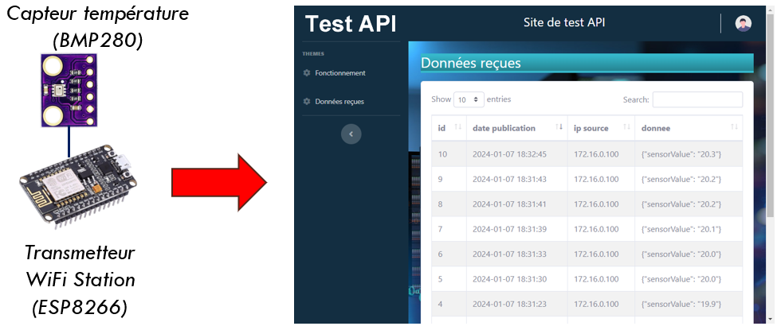
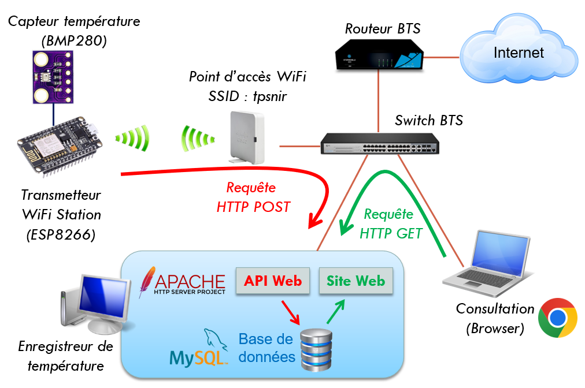
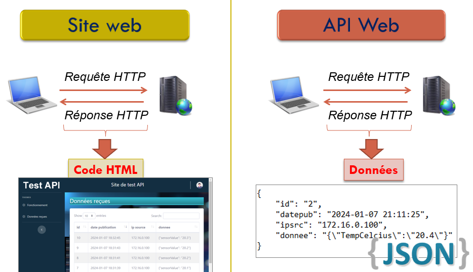
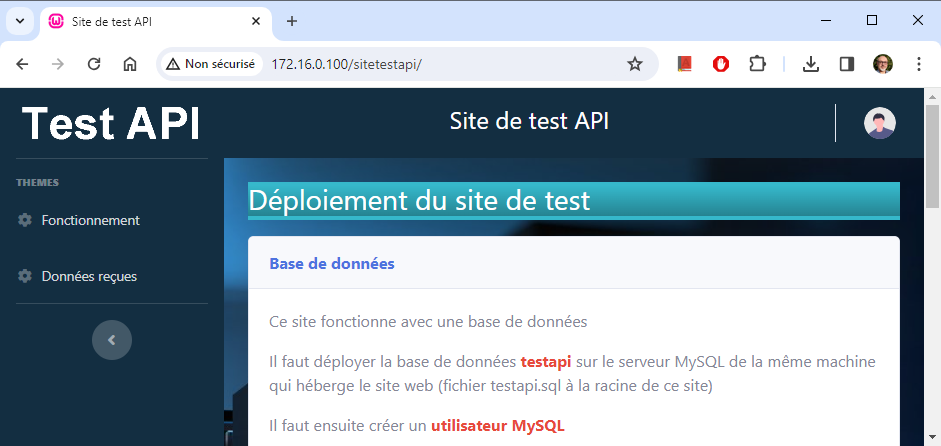
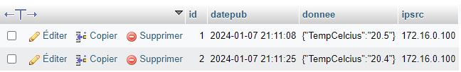
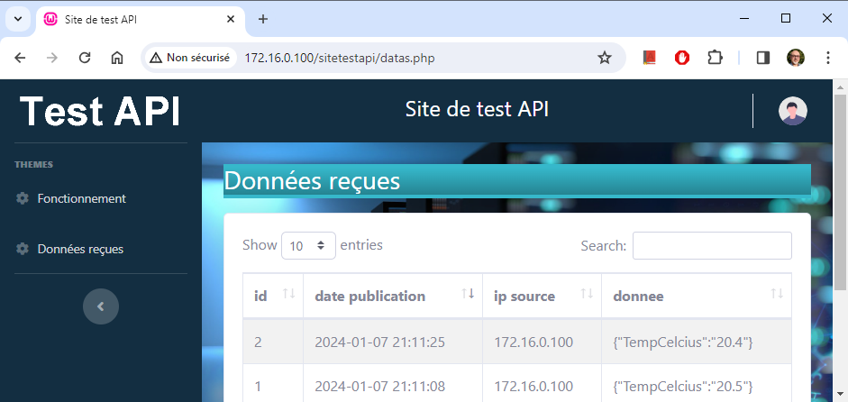
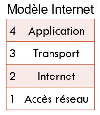
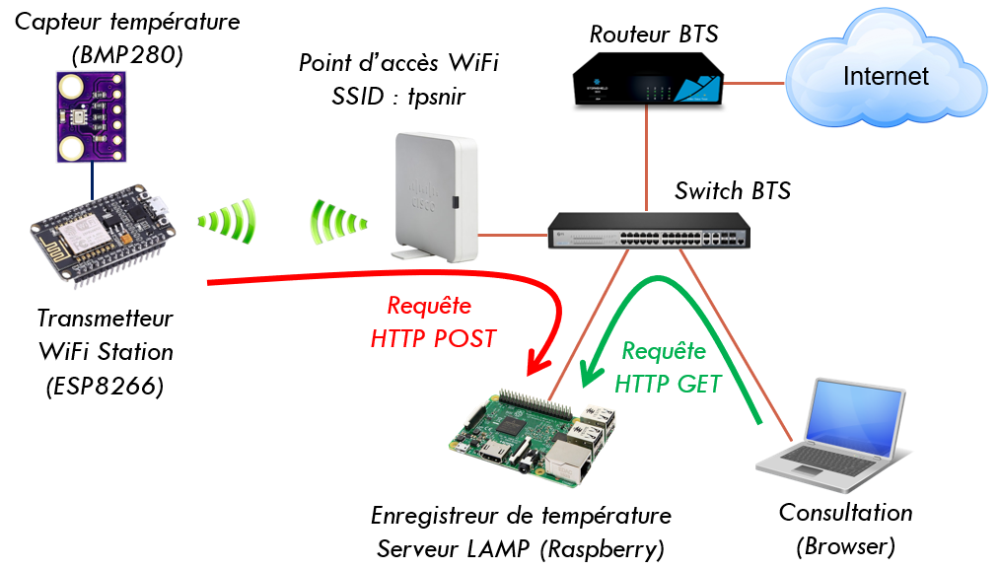

# Projet : Enregistreur de températures avec consultation web (ESP8266 et Wampserver)

> * Auteur : Gwénaël LAURENT
> * Date : 07/01/2024

- [Projet : Enregistreur de températures avec consultation web (ESP8266 et Wampserver)](#projet--enregistreur-de-températures-avec-consultation-web-esp8266-et-wampserver)
- [1. Présentation du projet final](#1-présentation-du-projet-final)
- [2. Travail a réaliser](#2-travail-a-réaliser)
  - [2.1 Capteur de température et ESP8266](#21-capteur-de-température-et-esp8266)
  - [2.2 Communication HTTP client avec l'ESP8266](#22-communication-http-client-avec-lesp8266)
  - [2.3 Déploiement du site web et de l'API sur Wampserver](#23-déploiement-du-site-web-et-de-lapi-sur-wampserver)
  - [2.4 Importation de la base de données dans MySQL](#24-importation-de-la-base-de-données-dans-mysql)
  - [2.5 Création d'un utilisateur MySQL pour les accès venant du site web](#25-création-dun-utilisateur-mysql-pour-les-accès-venant-du-site-web)
  - [2.6 Intégration finale et tests](#26-intégration-finale-et-tests)
  - [2.7 Analyse des trames HTTP](#27-analyse-des-trames-http)
  - [2.8 Déploiement sur un Raspberry](#28-déploiement-sur-un-raspberry)

**```Objectifs pédagogiques```** :
* Serveur Web (alias) : déploiement d'un site Web
* Serveur de Base de données : déploiement d'une BDD
* Notion d'API Web
* Notion de communication réseau : WiFi + HTTP
* Notion de trames HTTP

# 1. Présentation du projet final



L'ESP8266 doit mesurer la température et l'envoyer à intervales réguliers à l'enregistreur de température. 
La consultation des températures enregistrées se fera à l'aide d'un navigateur web.

**Schéma détaillé des applications et des communications :**




La transmission des températures doit s'effectuer en utilisant le protocole HTTP sur le réseau WiFi. 

L'enregistreur de température est composé d'une applicatione web (HTML + PHP + API Web + Base de données MySQL). Cette application sera hébergée sur votre PC grâce à WampServer. Les fichiers sont fournis, il n'y a pas de programmation à faire pour l'application web.

La communication  entre le navigateur web de consultation et l'enregistreur doit s'effectuer en utilisant le protocole HTTP sur le réseau Ethernet.

<div class="page"/>

**Différence entre un site web et une API Web**



# 2. Travail a réaliser
Vous allez gérer le travail comme on le fait pour un projet plus vaste. Vous testerez séparément les différentes parties du projet (Tests unitaires de chaque fonctionnalité) avant de les intégrer et les faire communiquer ensemble.

* Respectez l'ordre du travail demandé.
* Chaque étape doit être terminée avant de passer à la suivante.
* Faites valider chaque partie par un enseignant.

## 2.1 Capteur de température et ESP8266
Réalisez un programme de test pour ESP8266 qui effectue toutes les 5 secondes :
1. lecture de la température à l'aide du capteur **```BMP280```**
2. Affichage de la température en degrés Celcius dans le moniteur série de PlatformIO

Utilisez la documentation :
* PlatformIO > [06- Capteur de température / pression BMP280 sur ESP32](https://gitlab.com/gwenael.laurent/public/-/blob/master/platformio/06.pio-esp32-bmp280.md)

> **ATTENTION :**, la documentation est faite pour un ESP32 avec afficheur OLED ! **Pour un ESP8266** sans afficheur, la programmation du capteur BMP280 est identique mais il faut évidemment changer les numéros de broches du bus I2C. \
> Vous pouvez par exemple utiliser pour les lignes SDA/SCL = GPIO4(D2)/GPIO5(D1) ou GPIO12(D6)/GPIO14(D5).


## 2.2 Communication HTTP client avec l'ESP8266
Réalisez un **nouveau programme** de test pour ESP8266 qui envoie une trame HTTP POST vers l'API Web de test Dweet.io :
1. Configuration de l'ESP en "WiFi Station"
2. Connexion au réseau WiFi de la section : SSID = tpsnir (mot de passe donné par l'enseignant)
3. Affichage de l'adresse IP de l'ESP dans la console de PlatformIO
4. Envoi d'une trame **```HTTP POST```** vers Dweet.io toutes les 5 secondes. 
   1. Choisissez un nom d'objet {thing} unique sur Dweet.io, par exemple "captTempAxx" (*remplacez xx par votre numéro de login de TP*)
   2. La données à transmettre est du texte au format JSON : ```{"TempCelcius":"20.5"}```
5. Affichez la donnée envoyée dans le moniteur série de PlatformIO
6. Affichez la donnée reçue sur le site web https://dweet.io/play/ > GET /get/latest/dweet/for/{thing}

Utilisez la documentation :
* PlatformIO > [15a- Client WiFi et client HTTP sur ESP8266 et ESP32](https://gitlab.com/gwenael.laurent/public/-/blob/master/platformio/15a.pio-esp-wifi-http.md?ref_type=heads)

## 2.3 Déploiement du site web et de l'API sur Wampserver 
> Le paquet de logiciels **WampServer** (WAMP = Windows Apache MySQL PHP) est installé sur les PC de TP. Démarrez WampServer et vous l'utiliserez pour déployer le site web et importer la base de données. Wampserver s'administre à partir de l'icône à droite de la barre des tâches : Clic gauche ou Clic droit sur l'icône verte.

Les fichiers du site web et de l'API sont disponibles dans le fichier [**SiteTestAPI.zip**](https://gitlab.com/gwenael.laurent/public/-/blob/master/platformio/Enregistreur_de_temperatures/site-test-api-http/SiteTestAPI.zip?ref_type=heads).

1. Dézippez le fichier et copier son contenu dans **```D:\tempA\SiteTestAPI\```**
2. Dans le serveur web Apache de Wampserver, créez un alias **```sitetestapi```** qui pointe vers le dossier du site ```D:\tempA\SiteTestAPI\```
3. Sur votre PC, la page d'accueil du site web doit s'afficher à l'adresse http://localhost/sitetestapi/
4. Configurer l'alias pour qu'il soit accessible à distance (à partir de n'importe quelle adresse IP).
5. Sur un autre PC, la page d'accueil du site web doit s'afficher à l'adresse http://172.17.xxx.yyy/sitetestapi/ (*modifiez 172.17.xxx.yyy par l'adresse IP de votre PC*)

    

Utilisez la documentation :
* WampServeur : Alias et VirtualHost > [2. Création d'un alias dans Apache](https://gitlab.com/gwenael.laurent/public/-/blob/master/wampserver/wamp-alias-et-virtualhost.md?ref_type=heads#2-cr%C3%A9ation-dun-alias-dans-apache)

## 2.4 Importation de la base de données dans MySQL
> Vous utiliserez le serveur de base de données MySQL intégré à Wampserver. L'administration de MySQL se fera à l'aide du site web prévu à cet effet **```PhpMyAdmin```**

1. Lancez la page d'accueil de PhpMyAdmin : clic gauche sur l'icône wampserver > PhpMyAdmin > PhpMyAdmin 5.2.0
2. Connectez-vous en tant qu'administrateur de MySQL : 
     * Utilisateur = root
     * Mot de passe = (laissez vide)
     * Choix du serveur = MySQL
3. Dans le menu horizontal du haut, cliquez sur **```Importer```**
    * Sélectionnez le fichier [**testapi.sql**](https://gitlab.com/gwenael.laurent/public/-/blob/master/platformio/Enregistreur_de_temperatures/site-test-api-http/testapi.sql?ref_type=heads)
    * Cliquez sur Importer
4. La base de données **testapi** doit être visible dans la colonne de gauche. Elle contient une table **data** qui contient seulement 2 lignes.



<div class="page"/>

## 2.5 Création d'un utilisateur MySQL pour les accès venant du site web
Le site web et l'API web sont codés en langage PHP. Ils doivent avoir accès à la base de données (BDD) **testapi** pour afficher les températures et pour insérer les nouvelles températures venant de l'ESP.

Chaque accès à une base de données nécessite une authentification auprès de MySQL. Les fichiers du site web contiennent déjà cette authentification (*La liaison PHP - MySQL se fait dans le fichier /bdd/bddconfig.php*).

Il faut maintenant créer l'utilisateur correspondant dans MySQL.

1. A partir de la page d'accueil de PhpMyAdmin, dans le menu horizontal du haut, cliquez sur **```Comptes utilisateurs```**
2. Cliquez sur "Ajouter un compte d'utilisateur"
   * Nom d'utilisateur MySQL : **user_testapi**
   * Nom d'hôte : **localhost** (car PHP et MySQL sont installés sur la même machine)
   * Mot de passe MySQL : **pass_testapi**
   * Privilèges globaux : **AUCUN** (l'utilisateur ne doit seulement avoir accès qu'à la BDD testapi !)
   * Cliquez sur "Exécuter"
3. Cliquez sur le bouton "Base de données" pour donner des **droits spécifiques à la BDD testapi**
   * Ajouter des privilèges sur la base de données : cliquez sur "testapi"
   * Cliquez sur "Exécuter"
   * Privilèges spécifiques à la BDD testapi : cochez seulement **SELECT, INSERT, UPDATE, DELETE**
   * Cliquez sur "Exécuter"
4. La page du site web pour les données reçues  doit s'afficher à l'adresse http://172.17.xxx.yyy/sitetestapi/datas.php (*modifiez 172.17.xxx.yyy par l'adresse IP de votre PC*)

    

<div class="page"/>

## 2.6 Intégration finale et tests

Il faut maintenant intégrer les deux programmes ESP.

Modifiez votre programme ESP pour la "Communication HTTP client" :
1. Insérer le code nécessaire à la lecture de la température du capteur BMP280
2. Intégrez la température du capteur dans la trame HTTP POST
3. Envoyez toutes les 5 secondes une trame vers Dweet.io
4. Vérifiez que la température est bien reçue sur le site web https://dweet.io/play/
5. Modifiez l'adresse de l'API web pour envoyer les requêtes HTTP POST vers l'adresse : **```http://172.17.xxx.yyy/sitetestapi/api/insert.php```** (*modifiez 172.17.xxx.yyy par l'adresse IP de votre PC*)
6. Vérifiez que les nouvelles températures sont affichées sur le site web http://172.17.xxx.yyy/sitetestapi/datas.php


## 2.7 Analyse des trames HTTP
Vous utiliserez **Wireshark** pour capturer les trames réseaux de votre PC (où est hébergée votre application web et votre base de données).

Pour filtrer les trames venant de l'ESP8266, utilisez un **filtre après capture** paramétré avec l'adresse IP de l'ESP :
```
ip.addr=172.17.www.zzz
```



Repérez une trame d'envoi de température (HTTP POST). A l'intérieur de cette trame situez dans les couches du modèle internet (appelé aussi le modèle TCP/IP) :
* Les protocoles réseaux : Ethernet, IP, TCP et HTTP
* Les adresses : MAC et IP
* Les numéro de port TCP
* La donnée de température

<div class="page"/>

## 2.8 Déploiement sur un Raspberry
L'application web et la base de données seront maintenant hébergées sur un Raspberry.



Installer le serveur LAMP :
1. Installez l'OS Rasbian sur Raspberry
2. Installez le serveur LAMP
3. Déployez le site web et l'API sur le raspberry
4. Importez la base de données et créez l'utilisateur MariaDB
5. Modifiez l'adresse de l'API web dans le programme de l'ESP
6. Testez l'accès au site depuis une machine du réseau

Utilisez la documentation :
* RASP0-Présentation Raspberry Pi3B (élèves).pdf
* RASP1-Install Raspberry Pi3B (élèves).pdf
* Linux > [4.Installation de LAMP sur Linux](https://gitlab.com/gwenael.laurent/public/-/blob/master/linux/4.installer-LAMP.md?ref_type=heads)
