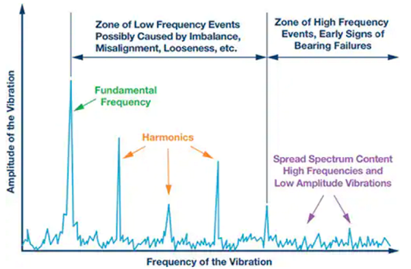
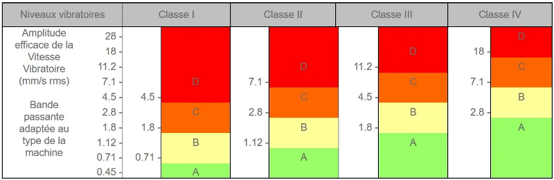
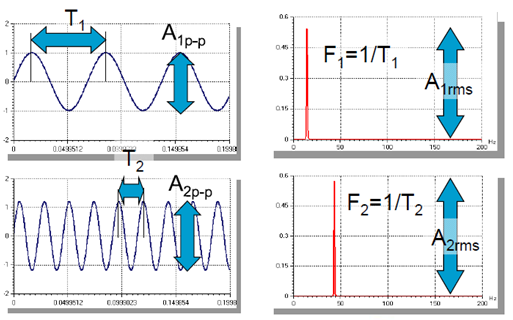

# Maintenance prédictive et analyse vibratoire

> * Auteur : Gwénaël LAURENT
> * Date : 14/03/2021
> * OS : Windows 10 (version 20H2)
> * VScode : version 1.52.1 (system setup)
> * Node.js : version 12.16.2
> * PlatformIO : Core 5.1.0 Home 3.3.4

 [Licence Creative Commons](https://creativecommons.org/licenses/by-nc-sa/3.0/fr/)

- [Maintenance prédictive et analyse vibratoire](#maintenance-prédictive-et-analyse-vibratoire)
- [1. Maintenance prédictive](#1-maintenance-prédictive)
- [2. Pourquoi utiliser les vibrations pour la maintenance prédictive](#2-pourquoi-utiliser-les-vibrations-pour-la-maintenance-prédictive)
- [3. Normes pour mesurer les vibrations](#3-normes-pour-mesurer-les-vibrations)
  - [3.1 ISO 20816-1 (2016)](#31-iso-20816-1-2016)
  - [3.2 ISO 13373 (2002)](#32-iso-13373-2002)
  - [3.2 ISO 10816-1 (1995)](#32-iso-10816-1-1995)
  - [3.3 ISO 2372 (1974)](#33-iso-2372-1974)
- [4. Les grandeurs utilisées pour mesurer la vibration](#4-les-grandeurs-utilisées-pour-mesurer-la-vibration)
- [5. Analyse spectrale pour identifier l'origine des défauts](#5-analyse-spectrale-pour-identifier-lorigine-des-défauts)

# 1. Maintenance prédictive
La **```maintenance prédictive```** (ou maintenance prévisionnelle) permet de détecter les anomalies sur des machines avant qu'elles ne deviennent trop graves. La force de la maintenance prédictive est donc d'**```anticiper les pannes```**. Ce qui évite tout arrêt - coûteux - de la chaîne de production. Il est possible de programmer une intervention au moment le plus approprié : ni trop tôt (pour réduire les coûts), ni trop tard (pour éviter les pannes).

Tout élément manifeste des signes, visibles ou non, de dégradation qui annoncent une défaillance. Des **```capteurs communicants```** permettent de mesurer cette dégradation (variation de température, de vibration, de pression, etc.). Les données historiques et en temps réel recueillies sur la machine permettent de prendre des décisions de maintenance plus éclairées.

# 2. Pourquoi utiliser les vibrations pour la maintenance prédictive
Les vibrations sont un indicateur utilisé depuis longtemps dans la surveillance d'état, le diagnostic et la maintenance prédictive des machines industrielles. 

Par exemple, un capteur approprié avec un traitement adapté peut être utilisé pour détecter des problèmes tels que le déséquilibre de charge, le désalignement, la défaillance des roulements à billes, et diverses amplitudes et fréquences de vibrations qui pourraient indiquer qu'un autre type de mode de défaillance est en train de se développer. (Source : [digikey.fr](https://www.digikey.fr/fr/articles/rapidly-deploy-sensors-iiot-based-predictive-maintenance-mems-accelerometers))


> Source de l'image : Analog Devices


# 3. Normes pour mesurer les vibrations
## 3.1 ISO 20816-1 (2016)
"Vibrations mécaniques — Mesurage et évaluation des vibrations de machines"

## 3.2 ISO 13373 (2002)
"Surveillance et diagnostic d'état des machines - Surveillance des vibrations"
Notamment ISO 13373-2 (2016) "Partie 2: Traitement, analyse et présentation des données vibratoires"

## 3.2 ISO 10816-1 (1995)
"Vibrations mécaniques — Évaluation des vibrations des machines par mesurages sur les parties non tournantes" - révisée par ISO 20816-1:2016 - [Explications](http://www.vibraconseil.fr/normes/norme%20ISO%2010816-1.htm)



**Classe I** : Parties individuelles de moteurs et de machines, liées intégralement à la machine complète en état de fonctionnement normal. (Les moteurs de production électrique **jusqu'à 15 kW** sont des exemples typiques des machines de cette catégorie)

* **```Zone A```** : Les vibrations des machines nouvellement mises en service se placent normalement dans cette zone.

* **```Zone B```** : Les machines dont les vibrations se situent dans cette zone sont normalement considérées comme acceptables pour un service de longue durée sans la moindre restriction.

* **```Zone C```** : Les machines dont les vibrations se situent dans cette zone sont normalement considérées comme ne convenant pas pour un service de longue durée en continu. En général, la machine peut fonctionner dans ces conditions pendant une durée limitée, jusqu'à ce que l'occasion se présente pour prendre les mesures correctives qui s'imposent.

* **```Zone D```** : Les valeurs de vibrations constatées dans cette zone sont normalement considérées comme suffisamment importantes pour endommager la machine.

## 3.3 ISO 2372 (1974)
"Vibrations mécaniques des machines ayant une vitesse de fonctionnement comprise entre 10 et 200 tr/s — Base pour l'élaboration des normes d'évaluation"


# 4. Les grandeurs utilisées pour mesurer la vibration
Comme  tout  mouvement,  une  vibration  peut  être  étudiée  selon  trois grandeurs :
* Le Déplacement (µm ou mm)
* La Vitesse (mm/s)
* L’Accélération (mm/s<sup>2</sup> ou g : 9,81m/s<sup>2</sup>)

Ces grandeurs physiques sont liées entre elles par des relations mathématiques.

Les normes de mesure des vibrations en basses fréquences (10 à 1000 Hz) se basent sur la **```vitesse exprimée en mm/s```** (variation de la position par unité de temps).


# 5. Analyse spectrale pour identifier l'origine des défauts
Sources : [Eduscol / BTS Maintenance des Systèmes](https://eduscol.education.fr/sti/sites/eduscol.education.fr.sti/files/ressources/pedagogiques/9606/9606-lanalyse-vibratoire-en-bts-ms-document-apprenant.doc)

Toute anomalie est traduite par une fréquence correspondante à celle du phénomène qui la provoque d’où analyse de spectre, ce qui permet le diagnostic.

La Transformée de Fourier Rapide **```FFT (Fast Fourier Transform)```** réalise la transposition du  signal de l’espace temporel vers l’espace fréquentiel.


> Lib : [arduinoFFT by Enrique Condes](https://github.com/kosme/arduinoFFT) - [doc/exemple](https://classes.engineering.wustl.edu/ese205/core/index.php?title=Fast_Fourier_Transform_Library_%26_Arduino)

La mesure de l’amplitude de certaines raies du spectre (correspondantes au défaut recherché) permettra le suivi
de ce défaut.

> Dans le tableau suivant, f est la fréquence de rotation du moteur exprimée en Hertz (tour/seconde).


| Origine du défaut	 | Fréquence dominante	 | Direction de la vibration	 | Remarques |
|:-----------------:|:-----------------:|:-----------------:|:-----------------:|
| Déséquilibre (balourd) | 1 x f | Radiale | Défaut courant |
| Lignage | 2 x f | Radiale et axiale | Défaut courant |
| Fixation | 1,2,3,4 x f |   | |
| Excitation électrique | 1 ou 2 x fréquence du courant | Radiale et axiale | Disparaît à la coupure de l’alimentation |
| Jeux paliers lisses | 1/3 ou 1/2xf | Essentiellement radiale | |
| Engrenages | Z x f |  | Z : nombre de dents du pignon |
| Roulements | Hautes fréquences | Suivant type roulement | 20 à 60 kHz |
| Tourbillon d’huile | 0.42 à 0.48 f | Essentiellement radiale | Cas des paliers hydrodynamiques à grande vitesse |

* Autre document intéressant : [Comprendre la vibration de moteur par l'analyse FFT](http://sti-monge.fr/maintenancesystemes/wp-content/uploads/2014/11/VIB_Booklet_F.pdf)