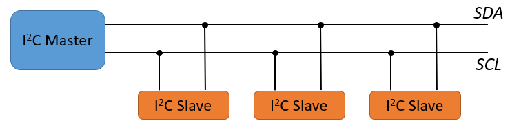
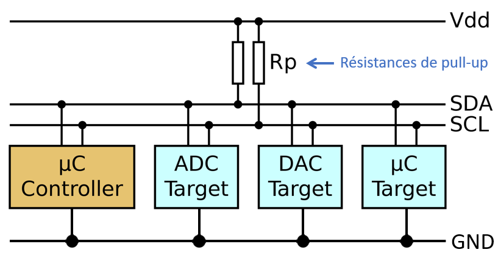
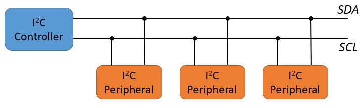

# Le Bus I2C (Inter-Integrated Circuit)

> * Auteur : Gwénaël LAURENT
> * Date : 02/04/2023

# 1. Généralités sur le bus I2C
Le bus I2C est un bus de communication électronique. Il permet, par exemple, de relier un micro-processeur avec différents capteurs/actionneurs.



Quelques caractéristiques d'un bus I2C :
* Fonctionne sur de courtes distances (<1m)
* Vitesse de communication >= 100kHz
* **Bus série synchrone bidirectionnel half-duplex**
* **Protocole maître / esclave** : les échanges ont toujours lieu entre un seul maître et un (ou tous les) esclave(s), toujours à l'initiative du maître. 
* **Chaque esclave est identifié par une adresse** (nombre codé sur 7 bits)

Le bus I2C utilise 2 fils pour communiquer :
* **SDA** (Serial DAta Line) : ligne de données
* **SCL** (Serial CLock Line) : ligne d'horloge de synchro
* masse commune aux équipements
* lignes à VDD à travers des résistances de pull-up

> Ce bus porte parfois le nom de TWI (**Two Wire** Interface) ou TWSI (Two Wire Serial Interface) chez certains constructeurs. C'est le cas pour la plateforme Arduino utilisée pour programmer les ESP (bibliothèque **Wire.h**)



[*Crédit Schéma*](https://fr.wikipedia.org/wiki/I2C)

# 2. Nouvelle terminologie
Depuis quelques temps, les termes maitre/esclave sont remplacés progressivement par **Controller/Peripheral** ou **Controller/Target** ou **Leader/Follower** ou autre suivant la fantaisie des fabricants. [Plus d'infos ici](https://en.wikipedia.org/wiki/Master/slave_(technology)#Terminology_concerns)

Pour le Bus I2C, le nom des lignes SDA et SCL reste cependant inchangé.



# 3. Plus d'informations sur le bus I2C
* [Wikipédia](https://fr.wikipedia.org/wiki/I2C)
* [Sparkfun : learn I2C](https://learn.sparkfun.com/tutorials/i2c)
*[ ESP32 I2C Communication: Set Pins, Multiple Bus Interfaces and Peripherals (Arduino IDE)](https://randomnerdtutorials.com/esp32-i2c-communication-arduino-ide/)


# 4. Programmation ESP32 avec le framework Arduino

## Caractéristique de l'ESP32-D0WD-V3
L'ESP32 intègre 2 contrôleurs de bus I2C. Ils supportent :
* le mode standard à 100 Kbit/s
* le mode rapide à 400 Kbit/s
* les modes d'adressages 7 ou 10 bits

Ces 2 bus I2C peuvent être configurés en Master ou en Slave. 

Grâce au système de "multiplexage des entrées / sorties" de l'ESP32 (IO_MUX), vous pouvez choisir les broches de l'ESP32 qui seront reliées à ces contrôleurs I2C.

## Framework Arduino
Le framework arduino met à disposition une classe C++ pour accéder aux bus I2C de l'ESP32 : **TwoWire**

Pour l'utiliser il faut inclure l'interface Wire.h

```cpp
#include <Wire.h>
```

Pour la compatitibilité avec la programmation arduino, le fichier Wire.h déclare deux objets de la classe TwoWire :

```cpp
extern TwoWire Wire;
extern TwoWire Wire1;
```

> Par défaut, les objets I2C (Wire et Wire1) fonctionnent en mode Master.

Les objets I2C (Wire et Wire1) sont déclarés en "extern", ce qui veut dire :
* Que les objets I2C sont créés autre part
* Que les objets I2C seront accessibles directement dans main.cpp (on peut les utiliser directement avec ```Wire.begin();```)

La création des objets I2C est effectuée à la fin du fichier Wire.cpp :

```cpp
TwoWire Wire = TwoWire(0);
TwoWire Wire1 = TwoWire(1);
```

## Broches associées aux bus I2C
Les broches associées aux contrôleur I2C sont définies par défaut dans le fichier ```pins_arduino.h``` (inclus à la fin de arduino.h)

```cpp
static const uint8_t SDA = 21;
static const uint8_t SCL = 22;
```

Ces numéros de broches ne sont valables que pour un seul des deux bus I2C. On peut choisir d'autres broches en configurant l'objet I2C avant d'appeler la méthode begin() sans paramètre:
```cpp
Wire.setPins(SDA1_PIN, SCL1_PIN);
Wire.begin();
```

Ou simplement en appelant begin() avec tous ses paramètres :
```cpp
Wire.begin(SLAVE_ADDR, SDA_PIN, SCL_PIN, 100000UL);
```