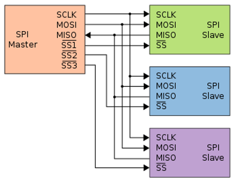
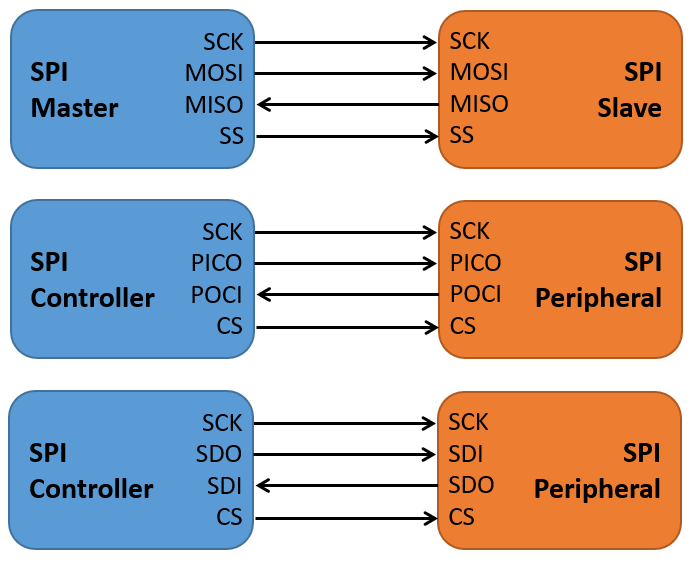

# Le Bus SPI (Serial Peripheral Interface)

> * Auteur : Gwénaël LAURENT
> * Date : 02/04/2023

- [Le Bus SPI (Serial Peripheral Interface)](#le-bus-spi-serial-peripheral-interface)
- [1. Généralités sur le bus SPI](#1-généralités-sur-le-bus-spi)
- [2. Nouvelle terminologie](#2-nouvelle-terminologie)
- [3. Plus d'informations sur le bus SPI](#3-plus-dinformations-sur-le-bus-spi)
- [4. Programmation ESP32 avec le framework Arduino](#4-programmation-esp32-avec-le-framework-arduino)
  - [Caractéristique de l'ESP32-D0WD-V3](#caractéristique-de-lesp32-d0wd-v3)
  - [Framework Arduino](#framework-arduino)
  - [Broches associées au bus VSPI](#broches-associées-au-bus-vspi)
  - [Pour utiliser le bus HSPI](#pour-utiliser-le-bus-hspi)


# 1. Généralités sur le bus SPI
Le bus SPI est un bus de communication électronique. Il permet, par exemple, de relier un micro-processeur avec différents capteurs/actionneurs.



Quelques caractéristiques d'un bus SPI :
* Fonctionne sur de courtes distances (<1m)
* Vitesse de communication >= 10MHz
* **Bus série synchrone bidirectionnel full-duplex**
* **Protocole maître / esclave** : les échanges ont toujours lieu entre un seul maître et un (ou tous les) esclave(s), toujours à l'initiative du maître. 
* **Chaque esclave est sélectionné par une ligne dédiée SS** (Slave Select)

Le bus SPI utilise au moins 4 lignes pour communiquer :
* **MOSI** (Master Output, Slave Input) : Données générées par le maître
* **MISO** (Master Input, Slave Output) :  Données générées par l'esclave)
* **SCK** ou SCL (Serial CLock) : Horloge (généré par le maître)
* **SS** (Slave Select) ou CS (Chip Select) ou CE (Chip Enable) : Sélection de l’esclave. Actif à l'état bas (généré par le maître)
* masse commune aux équipements

# 2. Nouvelle terminologie

Depuis quelques temps, les termes maitre/esclave sont remplacés progressivement par **Controller/Peripheral** ou **Controller/Target** ou **Leader/Follower** ou autre suivant la fantaisie des fabricants. [Plus d'infos ici](https://en.wikipedia.org/wiki/Master/slave_(technology)#Terminology_concerns), [ou la](https://www.sparkfun.com/spi_signal_names), [ou encore ici](https://www.oshwa.org/a-resolution-to-redefine-spi-signal-names)

Le nom des lignes est également modifié :
| Noms dépréciés | Nouveaux noms | Signification                    |
|----------------|---------------|----------------------------------|
| MOSI           | PICO          | peripheral in / controller out   |
| MISO           | POCI          | peripheral out / controller in   |
| SCK            | SCK           | Serial Clock (pas de changement) |
| SS             | CS            | Chip Select.                     |

Il existe aussi d'autres dénominations utilisées par certains fabricants :
* **SDI**, DI, SI : Serial Data IN
* **SDO**, SDA, DO, SO : Serial Data OUT

Dans le cas de la convention de nommage SDI/SDO, le SDO du maître doit-être relié au SDI de l'esclave et vice versa.

Pour résumé un peu, les schémas de connexion suivants sont équivalents :




# 3. Plus d'informations sur le bus SPI
* [Wikipédia](https://fr.wikipedia.org/wiki/Serial_Peripheral_Interface)
* [Sparkfun : learn SPI](https://learn.sparkfun.com/tutorials/serial-peripheral-interface-spi)

# 4. Programmation ESP32 avec le framework Arduino

## Caractéristique de l'ESP32-D0WD-V3
L'ESP32 intègre plusieurs contrôleurs de bus SPI. Deux sont utilisables pour vos applications : **HSPI** et **VSPI**.

Ces 2 bus SPI peuvent fonctionner jusqu'à 80MHz et être configurés en Master ou en Slave. En mode master, chaque contrôleur peut commander jusqu'à 3 escalves via 3 lignes CS.

Grâce au système de "multiplexage des entrées / sorties" de l'ESP32 (IO_MUX), vous pouvez choisir les broches de l'ESP32 qui seront reliées à ces contrôleurs SPI.

## Framework Arduino
Le framework arduino met à disposition une classe C++ pour accéder aux bus SPI de l'ESP32 : **SPIClass**

Pour l'utiliser il faut inclure l'interface SPI.h

```cpp
#include <SPI.h>
```

Pour la compatitibilité avec la programmation arduino, le fichier SPI.h déclare un objet de la classe SPIClass :

```cpp
extern SPIClass SPI;
```

> Par défaut, l'objet SPI fonctionne en mode Master.

L'objet SPI est déclaré en "extern", ce qui veut dire :
* Que l'objet SPI est créé autre part
* Que l'objet SPI sera accessible directement dans main.cpp (on peut l'utiliser directement en commençant par ```SPI.begin();```)

La création de l'objet SPI est effectuée à la fin du fichier SPI.cpp :

```cpp
SPIClass SPI(VSPI);
```

**L'objet SPI utilise donc le bus VSPI** de l'ESP32.

## Broches associées au bus VSPI
Les broches associées au contrôleur VSPI sont définies par défaut dans le fichier ```pins_arduino.h``` (inclus à la fin de arduino.h)

```cpp
static const uint8_t SS    = 5;
static const uint8_t MOSI  = 23;
static const uint8_t MISO  = 19;
static const uint8_t SCK   = 18;
```

On peut choisir d'autres broches en reconfigurant l'objet SPI :
```cpp
SPI.end();
SPI.begin(SCK_PIN, MISO_PIN, MOSI_PIN, CS_PIN);
```

## Pour utiliser le bus HSPI
L'objet SPIClass créé dans SPI.h utilise le bus VSPI. Pour utiliser le bus **HSPI**, il faut créer un autre objet :

```cpp
#include <SPI.h>
//----
SPIClass SPI2(HSPI);
SPI.begin(SCK_PIN, MISO_PIN, MOSI_PIN, CS_PIN);
```
