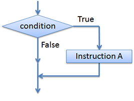
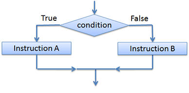

(_Cours Python : [retour sommaire](readme.md#les-bases-du-langage-python)_)
# Chap. 4 : Tests (Instructions conditionnelles)

> * Auteur : David Cassagne - https://courspython.com/
> * Adaptation : Gwénaël LAURENT
> * Date : 27/08/2024

 [Licence Creative Commons](https://creativecommons.org/licenses/by-nc-sa/3.0/fr/)

- [Chap. 4 : Tests (Instructions conditionnelles)](#chap-4--tests-instructions-conditionnelles)
- [1. Bloc d’instructions - Indentation](#1-bloc-dinstructions---indentation)
- [2. Instruction `if`](#2-instruction-if)
- [3. Instruction `if` … `else`](#3-instruction-if--else)
- [4. Instruction `if` … `elif`](#4-instruction-if--elif)
- [5. Instructions imbriquées](#5-instructions-imbriquées)
- [6. Opérateurs logiques](#6-opérateurs-logiques)
  - [6.1. Opérateur logique `and`](#61-opérateur-logique-and)
  - [6.2. Opérateur logique `or`](#62-opérateur-logique-or)
  - [6.3. Opérateur logique `not`](#63-opérateur-logique-not)
  - [6.4. Opérateur logique `^` (OU exclusif)](#64-opérateur-logique--ou-exclusif)


L’instruction `if` est la structure de test la plus simple. Sa syntaxe en Python fait intervenir la notion de bloc. Nous allons d’abord étudier cette notion plus en détail.

# 1. Bloc d’instructions - Indentation 

Un bloc est défini par une **indentation** obtenue en décalant le début des instructions vers la droite grâce à des _espaces en début de ligne_ (habituellement 4 espaces). Toutes les instructions d’un même bloc doivent être indentées exactement au même niveau (c’est-à-dire décalées à droite d’un même nombre d’espaces).

Un bloc peut contenir une ou plusieurs instructions, et notamment des instructions composées (tests, boucles, etc.).

# 2. Instruction `if`

**Syntaxe phyton**
```py
if condition:
    Instruction A
```
**Algorithme**
```
SI (condition) 
	# Actions à exécuter si la condition est vraie
	...
FIN SI	
```



`condition` est une expression booléenne, c’est-à-dire une expression qui prend pour valeur `True` (Vrai) ou `False` (Faux).

L'_instruction A_ n’est exécutée que **si** la `condition` est vérifiée (c’est-à-dire si elle prend pour valeur `True`).

L’instruction `if` est une instruction composée. Le `:` (deux-points) à la fin de la ligne introduit le bloc d’instructions qui sera exécuté **si** la `condition` est vérifiée.

**Exemple 1 avec condition vraie :**

```py
x = 15
if x > 10:
    print(x, "est plus grand que 10")
print("Fin")
```

Affichage après exécution :
```
15 est plus grand que 10
Fin
```
[Exécuter dans Python Tutor](http://www.pythontutor.com/visualize.html#code=x+%3D+15%0Aif+x+%3E+10%3A%0A++++print(x,+%22est+plus+grand+que+10%22)%0Aprint(%22Fin%22)&mode=display&cumulative=false&heapPrimitives=false&drawParentPointers=false&textReferences=false&showOnlyOutputs=false&py=3&curInstr=0)

**Exemple 1 avec condition fausse :**

```py
x = 3
if x > 10:
    print(x, "est plus grand que 10")
print("Fin")
```

Affichage après exécution :
```
Fin
```
**Exemple 2 avec condition vraie :**

```py
x = 5
if x > 0:
    print(x, "est plus grand que 0")
    print("il est strictement positif")
print("Fin")
```

Dans cet exemple, le bloc après le `if` contient deux instructions. L’instruction `print("Fin")` ne fait pas partie du bloc car elle n’est pas indentée.

Affichage après exécution :
```
5 est plus grand que 0
il est strictement positif
Fin
```
**Exemple 2 avec condition fausse :**

```py
x = -2
if x > 0:
    print(x, "est plus grand que 0")
    print("il est strictement positif")
print("Fin")
```

Affichage après exécution :
```
Fin
```
# 3. Instruction `if` … `else`

**Syntaxe python**
```py
if condition:
    Instruction A
else:
    Instruction B
```
**Algorithme**
```
SI (condition) 
	# Actions à exécuter si la condition est vraie
	...
SINON
	# Actions à exécuter si la condition est fausse
	...
FIN SI	
```


**Exemple où la condition est vraie :**

```py
x = 5
if x > 0:
    print(x, "est positif")
else:
    print(x, "est négatif ou nul")
print("Fin")
```

Affichage après exécution :
```
5 est strictement positif
Fin
```

[Exécuter dans Python Tutor](http://www.pythontutor.com/visualize.html#code=x+%3D+5%0Aif+x+%3E+0%3A%0A++++print(x,+%22est+strictement+positif%22)%0Aelse%3A%0A++++print(x,+%22est+n%C3%A9gatif+ou+nul%22)%0Aprint(%22Fin%22)&mode=display&cumulative=false&heapPrimitives=false&drawParentPointers=false&textReferences=false&showOnlyOutputs=false&py=3&curInstr=0)

**Exemple où la condition est fausse :**

```py
x = -2
if x > 0:
    print(x, "est positif")
else:
    print(x, "est négatif ou nul")
print("Fin")
```

Affichage après exécution :
```
-2 est négatif ou nul
Fin
```
Une expression booléenne peut contenir les **opérateurs de comparaison** suivants :

 
| Opérateur | Signification |
| --- | --- |
| x == y | x est égal à y |
| x != y | x est différent de y |
| x > y | x est plus grand que y |
| x < y | x est plus petit que y |
| x >= y | x est plus grand ou égal à y |
| x <= y | x est plus petit ou égal à y |

**Exemple**

```py
>>> 3 < 4
True
>>> 3 > 4
False
```

# 4. Instruction `if` … `elif`
L'instruction `elif` permet de chainer plusieurs comparaisons.

**Syntaxe python**
```py
if condition1:
    Instruction A
elif condition2:
    Instruction B
else:
    Instruction C
```
**Algorithme**
```
SI (condition1) 
	# Actions à exécuter si la condition1 est vraie
	...
SINON SI (condition2) 
	# Actions à exécuter si la condition2 est vraie
	...
SINON
	# Actions à exécuter si les 2 conditions sont fausses
	...
FIN SI	
```

**Exemple :**
```py
temp = 22
if (temp == 20):
    print("Température idéale de ",temp, " degrés")
elif (temp > 20):
    print("Il fait chaud")
else:
    print("Il fait froid")
print("Fin")
```

Affichage après exécution :
```
Il fait chaud
Fin
```
[Exécuter dans Python Tutor](https://pythontutor.com/render.html#code=temp%20%3D%2022%0Aif%20%28temp%20%3D%3D%2020%29%3A%0A%20%20%20%20print%28%22Temp%C3%A9rature%20id%C3%A9ale%20de%20%22,temp,%20%22%20degr%C3%A9s%22%29%0Aelif%20%28temp%20%3E%2020%29%3A%0A%20%20%20%20print%28%22Il%20fait%20chaud%22%29%0Aelse%3A%0A%20%20%20%20print%28%22Il%20fait%20froid%22%29%0Aprint%28%22Fin%22%29&cumulative=false&curInstr=5&heapPrimitives=false&mode=display&origin=opt-frontend.js&py=3&rawInputLstJSON=%5B%5D&textReferences=false)

# 5. Instructions imbriquées
Il est parfaitement possible d’imbriquer les unes dans les autres plusieurs instructions composées, de
manière à réaliser des structures de décision complexes.

Exemple :
```py
if embranchement == "vertébrés":                    # 1
    if classe == "mammifères":                      # 2
        if ordre == "carnivores":                   # 3
            if famille == "félins":                 # 4
                print("c’est peut-être un chat")    # 5
        print("c’est en tous cas un mammifère")     # 6
    elif classe == "oiseaux":                       # 7
        print("c’est peut-être un canari")          # 8
print("la classification des animaux est complexe") # 9
```

# 6. Opérateurs logiques
Les opérateurs travaillant sur des conditions sont des opérateurs logiques (**opérateurs booléens**).
Le résultat d’un opérateur logique est un booléen.


## 6.1. Opérateur logique `and`
Résultat Vrai si les deux conditions sont vraies

| *cond1* | *cond2* | *cond1* and *cond2* |
|-------|-------|----------------|
| false | false | false          |
| false | true  | false          |
| true  | false | false          |
| true  | true  | **true**           |

```py
>>> (2 < 3) and (3 < 4)
True
>>> (2 < 3) and (3 > 4)
False
```
L'opérateur logique `and` peut aussi s'écrire avec le symbole`&`

```py
>>> (2 < 3) & (3 < 4)  
True
>>> (2 < 3) & (3 > 4) 
False
```

## 6.2. Opérateur logique `or`
Résultat Vrai si l’une des deux conditions est vraie (ou les deux)

| *cond1* | *cond2* | *cond1* or *cond2* |
|-------|-------|----------------|
| false | false | false          |
| false | true  | **true**           |
| true  | false | **true**           |
| true  | true  | **true**           |

```py
>>> (2 < 3) or (3 < 4)
True
>>> (2 < 3) or (3 > 4)
True
```
L'opérateur logique `or` peut aussi s'écrire avec le symbole`|` (AltGr + 6)

```py
>>> (2 < 3) | (3 < 4)  
True
>>> (2 < 3) | (3 > 4) 
True
```

## 6.3. Opérateur logique `not`
L'opérateur `not` est l'opérateur de **négation logique**. Il inverse la valeur booléenne.

| *cond1* | not *cond1* |
|-------|---------|
| false | **true**    |
| true  | false   |

```py
>>> not(3 < 4)
False
>>> not(True)  
False
>>> not(False) 
True
```

## 6.4. Opérateur logique `^` (OU exclusif)
Appliqué à deux opérandes booléens, l'opérateur `^` retourne le **OU Exclusif (XOR)** de ces opérandes.

Résultat Vrai si l’une des deux conditions est vraie MAIS PAS les deux.

| *cond1* | *cond2* | *cond1* ^ *cond2* |
|-------|-------|----------------|
| false | false | false          |
| false | true  | **true**           |
| true  | false | **true**           |
| true  | true  | false          |

```py
>>> (2 < 3) or (3 < 4)
True
>>> (2 < 3) ^ (3 < 4)  
False
```

Voir aussi : [Apprendre à programmer avec Python 3](https://python.developpez.com/cours/apprendre-python3/?page=page_5#L5-B)