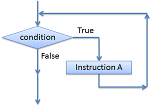

(_Cours Python : [retour sommaire](readme.md#les-bases-du-langage-python)_)
# Chap. 5 : Boucles

> * Auteur : David Cassagne - https://courspython.com/
> * Adaptation : Gwénaël LAURENT
> * Date : 27/08/2024

 [Licence Creative Commons](https://creativecommons.org/licenses/by-nc-sa/3.0/fr/)

- [Chap. 5 : Boucles](#chap-5--boucles)
- [1. Boucles bornées et non bornées](#1-boucles-bornées-et-non-bornées)
- [2. Boucle `for`](#2-boucle-for)
- [3. Boucle `while`](#3-boucle-while)
- [4. Comment choisir entre boucle `for` et boucle `while`](#4-comment-choisir-entre-boucle-for-et-boucle-while)
  - [4.1. Transformation d’une boucle `for` en un boucle `while`](#41-transformation-dune-boucle-for-en-un-boucle-while)
- [5. Les instructions `break` et `continue`, et la clause `else` dans les boucles](#5-les-instructions-break-et-continue-et-la-clause-else-dans-les-boucles)
  - [5.1. L’instruction `break`](#51-linstruction-break)
  - [5.2. Remarque : équivalent du **do…while** (**faire…tant que**)](#52-remarque--équivalent-du-dowhile-fairetant-que)
  - [5.3. L’instruction `continue`](#53-linstruction-continue)
  - [5.4. La clause `else` dans une boucle](#54-la-clause-else-dans-une-boucle)


Les boucles s’utilisent pour **répéter plusieurs fois** l’exécution d’une partie du programme.

# 1. Boucles bornées et non bornées 

**Boucle bornée**

Quand on sait combien de fois doit avoir lieu la répétition, on utilise généralement une boucle `for`.

**Boucle non bornée**

Si on ne connait pas à l’avance le nombre de répétitions, on choisit une boucle `while`.

# 2. Boucle `for`

**Exemple d’utilisation :**

```py
for i in [0, 1, 2, 3]:
    print("i a pour valeur", i)
```

**Algorithme**
```
POUR i allant de 0 à 3 AU PAS de 1
    # Instructions à répéter 4 fois
FIN POUR
```

[Exécuter dans Python Tutor](http://www.pythontutor.com/visualize.html#code=for%20i%20in%20%5B0,%201,%202,%203%5D%3A%0A%20%20%20%20print%28%22i%20a%20pour%20valeur%22,%20i%29&cumulative=false&curInstr=0&heapPrimitives=false&mode=display&origin=opt-frontend.js&py=3&rawInputLstJSON=%5B%5D&textReferences=false)

Affichage après exécution :
``` 
i a pour valeur 0
i a pour valeur 1
i a pour valeur 2
i a pour valeur 3
```
L’instruction `for` est une instruction composée, c’est-à-dire une instruction dont l’en-tête se termine par deux-points `:`, suivie d’un bloc indenté qui constitue le **corps de la boucle**.

> On dit que l’on réalise une **itération** de la boucle à chaque fois que le corps de la boucle est exécuté.

Dans l’en-tête de la boucle, on précise après le mot-clé `for` le nom d’une variable (`i` dans l’exemple ci-dessus) qui prendra successivement toutes les valeurs qui sont données après le mot-clé `in`. Cette variable (ici `i`) est un **variable d'itération**.

> La boucle for est utilisée pour parcourir tous les éléments d'une donnée itérable (List, Tuple, String, Dictionary... )

Il est possible d’obtenir le même résultat sans donner la liste des valeurs, mais en utilisant la fonction `range()` (cf l'article "[Listes et range en Python](./07_listes.md)").

```py
for i in range(4):
    print("i a pour valeur", i)
```

Pour **parcourir les indices d’une liste**, il est possible de combiner `range()` et `len()` comme ci-dessous :

```py
c = ["Marc", "est", "dans", "le", "jardin"]
for i in range(len(c)):
    print("i vaut", i, "et c[i] vaut", c[i])
```

[Exécuter dans Python Tutor](http://www.pythontutor.com/visualize.html#code=c+%3D+%5B%22Marc%22,+%22est%22,+%22dans%22,+%22le%22,+%22jardin%22%5D%0Afor+i+in+range(len(c))%3A%0A++++print(%22i+vaut%22,+i,+%22et+c%5Bi%5D+vaut%22,+c%5Bi%5D)&mode=display&cumulative=false&heapPrimitives=false&drawParentPointers=false&textReferences=false&showOnlyOutputs=false&py=3&curInstr=0)

Affichage après exécution :
```
i vaut 0 et c[i] vaut Marc
i vaut 1 et c[i] vaut est
i vaut 2 et c[i] vaut dans
i vaut 3 et c[i] vaut le
i vaut 4 et c[i] vaut jardin
```
**Rappel :** La fonction `len()` renvoie le nombre d’éléments :
```py
>>> c = ["Marc", "est", "dans", "le", "jardin"]
>>> len(c)
5
```
Dans l’exemple suivant, nous allons illustrer que la variable indiquée après `for` parcourt toutes les valeurs de la liste donnée après `in` :

```py
c = ["Marc", "est", "dans", "le", "jardin"]
for i in c:
    print("i vaut", i)
```

Affichage après exécution :
```
i vaut Marc
i vaut est
i vaut dans
i vaut le
i vaut jardin
```


# 3. Boucle `while`

**Syntaxe python**
```py
while condition:
    Instruction A
```

**Algorithme**
```
TANT QUE (condition vraie)
	# Action(s) à exécuter tant que la condition est vraie
	…
FIN TANT QUE

```



> La condition est évaluée avant d’entrer dans la boucle. La boucle « TANT QUE » est une boucle à précondition.


**Exemple de programme :**

```py
x = 1
while x < 10:
    print("x a pour valeur", x)
    x = x * 2
print("Fin")
```

[Exécuter dans Python Tutor](http://www.pythontutor.com/visualize.html#code=x+%3D+1%0Awhile+x+%3C+10%3A%0A++++print(%22x+a+pour+valeur%22,+x)%0A++++x+%3D+x+*+2%0Aprint(%22Fin%22)&mode=display&cumulative=false&heapPrimitives=false&drawParentPointers=false&textReferences=false&showOnlyOutputs=false&py=3&curInstr=0)

Affichage après exécution :
```
x a pour valeur 1
x a pour valeur 2
x a pour valeur 4
x a pour valeur 8
Fin
```
Le mot-clé `while` signifie **tant que** en anglais. Le corps de la boucle (c’est-à-dire le bloc d’instructions indentées) sera répété tant que la `condition` est vraie.

Dans l’exemple ci-dessus, `x` sera multiplié par 2 tant que sa valeur reste inférieure à 10.

**Remarque :** Si la condition est fausse au départ, le corps de la boucle n’est jamais exécuté.

> **IMPORTANT :** Il faut que votre code permette de sortir de la boucle, sinon le programme ne s’arrêtera jamais.
Dans ce cas, on parle de **boucle infinie** et c’est absolument à éviter !\
> Pour éviter les boucles infinies, **il faut que les variables utilisées dans la condition du « Tant Que » évoluent dans le corps de la boucle** (qu’elles changent de valeur) et il faut tester son algorithme.\
> En cas de boucle infinie, le seul moyen d’arrêter le programme console est de taper au clavier « Ctrl + C ».


# 4. Comment choisir entre boucle `for` et boucle `while` 

En général, si on connaît avant de démarrer la boucle le nombre d’itérations à exécuter, on choisit une boucle `for`. Au contraire, si la décision d’arrêter la boucle ne peut se faire que par un test, on choisit une boucle `while`.

Note : Il est toujours possible de remplacer une boucle [`for`](#for) par une boucle [`while`](#while).

## 4.1. Transformation d’une boucle [`for`](#for) en un boucle [`while`](#while) 

```py
for i in range(4):
    print("i a pour valeur", i)
```

Le programme ci-dessus est équivalent à:
```py
i = 0
while i < 4:
    print("i a pour valeur", i)
    i = i + 1
```
Voir aussi : [https://python.developpez.com/cours/apprendre-python3/?page=page\_6#L6-B](https://python.developpez.com/cours/apprendre-python3/?page=page_6#L6-B)

# 5. Les instructions `break` et `continue`, et la clause `else` dans les boucles 

> **Remarque importante sur la qualité de votre code :** L'utilisation de ces instructions est **à proscrire au maximum**. Le code est plus difficilement compréhensible donc source de bug !\
> On peut toujours se passer de ces instructions. Par exemple, si vous pensez avoir besoin de break, modifiez votre boucle en while et incorporez votre sortie de boucle dans la condition du while.

## 5.1. L’instruction [`break`](#break) 

L’instruction `break` permet de « casser » l’exécution d’une boucle (`while` ou `for`). Elle fait sortir de la boucle et passer à l’instruction suivante.

**Exemple**
```py
for i in range(10):
    print("debut iteration", i)
    print("bonjour")
    if i == 2:
        break
    print("fin iteration", i)
print("apres la boucle")
```
[Exécuter dans Python Tutor](https://pythontutor.com/visualize.html#code=for%20i%20in%20range%2810%29%3A%0A%20%20%20%20print%28%22debut%20iteration%22,%20i%29%0A%20%20%20%20print%28%22bonjour%22%29%0A%20%20%20%20if%20i%20%3D%3D%202%3A%0A%20%20%20%20%20%20%20%20break%0A%20%20%20%20print%28%22fin%20iteration%22,%20i%29%0Aprint%28%22apres%20la%20boucle%22%29&cumulative=false&curInstr=16&heapPrimitives=false&mode=display&origin=opt-frontend.js&py=3&rawInputLstJSON=%5B%5D&textReferences=)

Affichage après exécution :
```
debut iteration 0
bonjour
fin iteration 0
debut iteration 1
bonjour
fin iteration 1
debut iteration 2
bonjour
apres la boucle
```

Dans le cas de boucles imbriquées, l’instruction `break` ne fait sortir que de la boucle la plus interne.


## 5.2. Remarque : équivalent du **do…while** (**faire…tant que**) 

Dans de nombreux langages, il existe une instruction **do…while** qui permet de créer une boucle pour laquelle on ne connaît pas à l’avance le nombre de répétition, mais qui doit s’exécuter au moins une fois. Cette instruction n’existe pas en Python, mais on peut facilement reproduire son fonctionnement de la façon suivante :

```py
while True:
    n = int(input("donnez un entier > 0 : "))
    print("vous avez fourni", n)
    if n > 0:
        break
print("reponse correcte")
```
[Exécuter dans Python Tutor](https://pythontutor.com/visualize.html#code=while%20True%3A%0A%20%20%20%20n%20%3D%20int%28input%28%22donnez%20un%20entier%20%3E%200%20%3A%20%22%29%29%0A%20%20%20%20print%28%22vous%20avez%20fourni%22,%20n%29%0A%20%20%20%20if%20n%20%3E%200%3A%0A%20%20%20%20%20%20%20%20break%0Aprint%28%22reponse%20correcte%22%29&cumulative=false&curInstr=6&heapPrimitives=false&mode=display&origin=opt-frontend.js&py=3&rawInputLstJSON=%5B%2212%22%5D&textReferences=)

## 5.3. L’instruction `continue`

L’instruction `continue` permet de passer prématurément au tour de boucle suivant. Elle fait continuer sur la prochaine itération de la boucle.

**Exemple**
```py
for i in range(4):
    print("debut iteration", i)
    print("bonjour")
    if i < 2:
        continue
    print("fin iteration", i)
print("apres la boucle")
```
[Exécuter dans Python Tutor](https://pythontutor.com/visualize.html#code=for%20i%20in%20range%284%29%3A%0A%20%20%20%20print%28%22debut%20iteration%22,%20i%29%0A%20%20%20%20print%28%22bonjour%22%29%0A%20%20%20%20if%20i%20%3C%202%3A%0A%20%20%20%20%20%20%20%20continue%0A%20%20%20%20print%28%22fin%20iteration%22,%20i%29%0Aprint%28%22apres%20la%20boucle%22%29&cumulative=false&curInstr=0&heapPrimitives=false&mode=display&origin=opt-frontend.js&py=3&rawInputLstJSON=%5B%5D&textReferences=)

Affichage après exécution :
```
debut iteration 0
bonjour
debut iteration 1
bonjour
debut iteration 2
bonjour
fin iteration 2
debut iteration 3
bonjour
fin iteration 3
apres la boucle
```
## 5.4. La clause `else` dans une boucle 

La clause `else` dans un boucle permet de définir un bloc d’instructions qui sera exécuté à la fin, **seulement si la boucle s’est déroulée complétement sans être interrompue par un `break`**.

Contrairement aux instructions présentes après la boucle, qui s’exécutent dans tous les cas (avec ou sans interruption par un `break`), le bloc d’instructions défini dans la clause `else` ne s’exécutera pas lors de l’interruption par un `break`. Après l’interruption, on passera directement aux instructions après la boucle.

Autrement dit, le bloc de la clause `else` est exécuté lorsque la boucle se termine par épuisement de la liste (avec `for`) ou quand la condition devient fausse (avec `while`), mais pas quand la boucle est interrompue par un `break`. Ceci est illustré dans la boucle suivante, qui recherche des nombres premiers :

```py
for n in range(2, 8):
    for x in range(2, n):
        if n % x == 0:
            print(n, "egale", x, "*", n/x)
            break
    else:
        print(n, "est un nombre premier")
```
[Exécuter dans Pthon Tutor](https://pythontutor.com/visualize.html#code=for%20n%20in%20range%282,%208%29%3A%0A%20%20%20%20for%20x%20in%20range%282,%20n%29%3A%0A%20%20%20%20%20%20%20%20if%20n%20%25%20x%20%3D%3D%200%3A%0A%20%20%20%20%20%20%20%20%20%20%20%20print%28n,%20%22egale%22,%20x,%20%22*%22,%20n/x%29%0A%20%20%20%20%20%20%20%20%20%20%20%20break%0A%20%20%20%20else%3A%0A%20%20%20%20%20%20%20%20print%28n,%20%22est%20un%20nombre%20premier%22%29&cumulative=false&curInstr=41&heapPrimitives=false&mode=display&origin=opt-frontend.js&py=3&rawInputLstJSON=%5B%5D&textReferences=)

Affichage après exécution :
```
2 est un nombre premier
3 est un nombre premier
4 egale 2 * 2.0
5 est un nombre premier
6 egale 2 * 3.0
7 est un nombre premier
```
