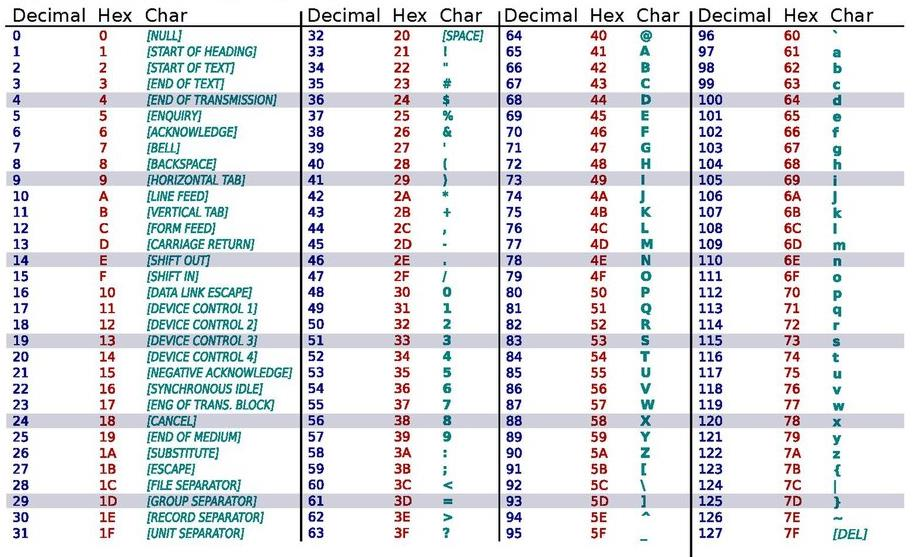

(_Cours Python : [retour sommaire](readme.md#les-bases-du-langage-python)_)
# Chap. 6 : Chaines de caractères en Python
> * Auteur : https://python.sdv.u-paris.fr/11_plus_sur_les_chaines_de_caracteres/
> * Adaptation : Gwénaël LAURENT
> * Date : 17/09/2024

 [Licence Creative Commons](https://creativecommons.org/licenses/by-nc-sa/3.0/fr/)

- [Chap. 6 : Chaines de caractères en Python](#chap-6--chaines-de-caractères-en-python)
- [1. Chaînes de caractères et listes](#1-chaînes-de-caractères-et-listes)
- [2. Parcourir les caractères d'une chaîne](#2-parcourir-les-caractères-dune-chaîne)
- [3. Concaténer des chaînes de caractères](#3-concaténer-des-chaînes-de-caractères)
- [4. Vérifier si un phrase est présent dans une chaîne](#4-vérifier-si-un-phrase-est-présent-dans-une-chaîne)
- [5. Caractères spéciaux](#5-caractères-spéciaux)
- [6. Méthodes associées aux chaînes de caractères](#6-méthodes-associées-aux-chaînes-de-caractères)
- [7. Encodage des caractères](#7-encodage-des-caractères)
  - [7.1. Le format ASCII](#71-le-format-ascii)
  - [7.2. Le format UTF-8](#72-le-format-utf-8)
  - [7.3. Conversion caractère \<-\> code Unicode](#73-conversion-caractère---code-unicode)
  - [7.4. Afficher les emojis en python](#74-afficher-les-emojis-en-python)
- [8. Documentation](#8-documentation)


# 1. Chaînes de caractères et listes
Les chaînes de caractères peuvent être considérées comme des listes (de caractères) un peu particulières

On peut accéder à chaque caractère d'une chaine avec [index] mais en lecture seule.

```py
>>> animaux = "girafe tigre"
>>> animaux
'girafe tigre'
>>> len(animaux)
12
>>> animaux[3]
'a'
```

Nous pouvons donc utiliser certaines propriétés des listes comme les tranches (slices):

```py
>>> animaux = "girafe tigre"
>>> animaux[0:4]
'gira'
>>> animaux[9:]
'gre'
>>> animaux[:-2]
'girafe tig'
>>> animaux[1:-2:2]
'iaetg'
```

Mais à contrario des listes, **les chaînes de caractères** présentent toutefois une différence notable, ce **sont des listes non modifiables**. Une fois une chaîne de caractères définie, vous ne pouvez plus modifier un de ses éléments.

```py
>>> animaux = "girafe tigre"
>>> animaux[4]
'f'
>>> animaux[4] = "F"
Traceback (most recent call last):
  File "<stdin>", line 1, in <module>
TypeError: 'str' object does not support item assignment
```
Par conséquent, si vous voulez modifier une chaîne de caractères, vous devez en construire une nouvelle.

> **Note :** cependant, il peut sembler que les méthodes associées aux chaînes de caractères (par ex. replace()) permettent de les modifier. Il n'en ait rien car en fait ces méthodes créent une *nouvelle* chaine.

# 2. Parcourir les caractères d'une chaîne
Comme on peut utiliser la notation indexée sur des chaînes, on peut parcourir les caractères d'une chaîne, avec une boucle `for`

```py
for x in "banana":
    print(x)
```

# 3. Concaténer des chaînes de caractères

**concaténer** = mettre bout à bout deux chaînes de caractères de manière à en former une troisième

En python, on utilise l'opérateur `+` pour concaténer deux chaînes.

```py
>>> a = "Bonjour " + "tout le monde"
>>> print(a)
Bonjour tout le monde
```

# 4. Vérifier si un phrase est présent dans une chaîne
Pour vérifier si une certaine phrase ou un certain caractère est présent dans une chaîne, vous pouvez utiliser le mot-clé `in`

```py
txt = "The best things in life are free!"
if "free" in txt:
    print("Yes, 'free' is present.")
```

Note : Pour vérifier si une certaine phrase ou un certain caractère n'est PAS présent dans une chaîne, vous pouvez utiliser le mot-clé `not in`

# 5. Caractères spéciaux
Une chaîne de caractères peut contenir des caractères spéciaux pour afficher des sauts de ligne, des tabulations, ... Ces caractères spéciaux s'écrivent en commençant par un backslash `\` (qu'on appelle le `caractère d'échappement`)

`\n` pour le retour à la ligne
`\t` produit une tabulation
`\'` pour afficher un apostrophe
`\"` pour afficher un guillemet double
`\\` pour afficher un backslash

```py
>>> print("Un backslash n\npuis un backslash t\t puis un guillemet\"")
Un backslash n
puis un backslash t     puis un guillemet"
>>> print('J\'affiche un guillemet simple')
J'affiche un guillemet simple
```
> Attention, les caractères spéciaux n'apparaissent intérprétés que lorsqu'ils sont affichés avec la fonction print(). 

Si une chaine de caractères doit inclure des backslash sans les interpéter comme des caractères d'échappement, on peut utiliser une `raw string` (chaine brute). Dans ce cas, il faut ajouter un  **`r`** avant la déclaration de chaîne.

Exemple :
```py
>>> ch = r"C:\Windows\System32"
>>> print(ch)
C:\Windows\System32
```

# 6. Méthodes associées aux chaînes de caractères
Voici quelques méthodes spécifiques aux objets de type `str` :

* `ch.lower()` : convertit une chaîne en minuscules :
* `ch.upper()` : convertit une chaîne en majuscules
* `ch.title()` : convertit en majuscule l’initiale de chaque mot (suivant l’usage des titres anglais)
* `ch.capitalize()` : convertit en majuscule seulement la première lettre de la chaîne
* `ch.swapcase()` : convertit toutes les majuscules en minuscules, et vice-versa
* `ch.strip()` : enlève les espaces éventuels au début et à la fin de la chaîne
* `ch.replace(c1,c2)` : remplace tous les caractères c1 par des caractères c2 dans la chaîne
* `ch.index(car)` : retrouve l’indice (index) de la première occurrence du caractère car dans la chaîne
* `ch.split(",")` : convertit une chaîne ch en une liste de sous-chaînes en utilisant "," comme séparateur de mots
* `"_".join(list_ch)` : rassemble une liste de chaînes list_ch en une seule avec "_" comme séparateur
* `ch1.find(ch2)` : cherche la position d’une sous-chaîne ch2 dans la chaîne ch1
* `ch1.count(ch2)` : compte le nombre de sous-chaînes ch2 dans la chaîne ch1

# 7. Encodage des caractères
Python 3 utilise l'encodage de caractères **`UTF-8`** par défaut pour le texte des chaînes de caractères.

## 7.1. Le format ASCII
L'**ASCII** (American Standard Code for Information Interchange) est un vieux système d'encodage de caractères qui permet de représenter 128 caractères différents codés sur **7 bits** (A-Z, a-z, 0-9, ponctuation, caractères de contrôle tab, return ...). Cet encodage est souvent limité à l'anglais, car il ne dispose pas des codes pour les caractères accentués.

Table de correspondance caractère <-> Code ASCII  (Source : [Wikipédia](https://fr.wikipedia.org/wiki/Fichier:ASCII-Table-wide.pdf)):



## 7.2. Le format UTF-8
L'**UTF-8** (Unicode Transformation Format - 8 bits) est un format de codage de caractères qui permet de représenter n'importe quel caractère du standard Unicode.\
L'**Unicode** est une norme qui associe un code unique à chaque caractère utilisé dans les écritures humaines, ainsi qu'à des symboles et à des icônes techniques.

Caractéristiques principales de l'UTF-8 :
* **encodage à longueur variable** : L'UTF-8 utilise entre **1 et 4 octets** (ou bytes) pour représenter un caractère Unicode. Les caractères les plus courants (ceux de l'ASCII, comme les lettres latines et les chiffres) sont codés avec un seul octet, tandis que les caractères moins courants, comme les idéogrammes chinois ou  les emoji, peuvent nécessiter 2, 3 ou 4 octets.
* **Compatibilité avec l'ASCII** : Les 128 premiers caractères de l'ASCII, codés en un seul octet (valeurs de 0 à 127), sont identiques en UTF-8. Cela signifie que tout texte ASCII valide est aussi valide en UTF-8.


## 7.3. Conversion caractère <-> code Unicode
> *Ces conversions sont souvent utilés lors du travail avec des fichiers binaires ou dans certains algorithmes de chiffrement simples.*

En Python, les fonctions `chr()` et `ord()` permettent de convertir des caractères en codes Unicode et vice-versa :

**Code Unicode -> caractère** :
```py
chr(65)  # Renvoie 'A'
chr(8364)  # Renvoie '€'
```

**Caractère -> code Unicode** :
```py
ord('A')  # Renvoie 65
ord('€')  # Renvoie 8364
```

## 7.4. Afficher les emojis en python
Vous pouvez directement mettre l'emoji dans une chaîne, comme n'importe quel autre caractère (ne pas oublier les double-quotes !). Utilisez (Win + ;) pour choisir l'emoji.

```py
print("👍")
```
Les emojis ont également des noms, par exemple :pushpin: 📌, :check_mark: ✔️, :cross_mark: ❌(cf. [emoji-cheat-sheet](https://github.com/ikatyang/emoji-cheat-sheet/blob/master/README.md) ).\
Pour insérer un emoji dans VScode :
* Installez l'extension `Insert Unicode` de `brunnerh`
* F1 > Insert Unicode: Insert Emoji > pushpin 📌

Les emojis ont des **points de code Unicode**, que vous pouvez utiliser dans une chaîne avec la notation Unicode en Python.

* `\U` : pour les emojis avec des codes sur 8 chiffres hexa.
* `\u` : pour les codes sur 4 chiffres hexa.

Par exemple, pour afficher un emoji smiley 😃 (dont le code Unicode est U+1F603) :
```py
print("\U0001F603")
```

Vous pouvez aussi utiliser la fonction `chr()` pour convertir un code Unicode en caractère.
```py
print(chr(0x1F603))  # 😃
```


# 8. Documentation
* [python.org > Type Séquence de Texte](https://docs.python.org/fr/3.12/library/stdtypes.html#text-sequence-type-str)
* [w3schools.com > Python Strings](https://www.w3schools.com/python/python_strings.asp)
* [w3schools.com > Python String Methods](https://www.w3schools.com/python/python_ref_string.asp)