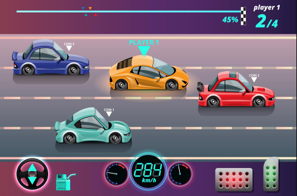
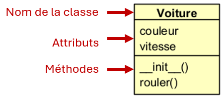
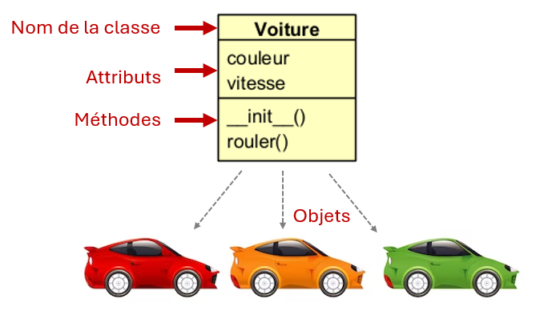

(_Cours Python : [retour sommaire](readme.md#les-bases-du-langage-python)_)
# Chap. 11a - POO : Classes et objets

> * Auteur :  Gwénaël LAURENT
> * Date : 30-03-2025

 [Licence Creative Commons](https://creativecommons.org/licenses/by-nc-sa/3.0/fr/)

- [Chap. 11a - POO : Classes et objets](#chap-11a---poo--classes-et-objets)
- [1. Programmation Orientée Objet (POO)](#1-programmation-orientée-objet-poo)
  - [1.1. C'est quoi ?](#11-cest-quoi-)
  - [1.2. A quoi ça sert ?](#12-a-quoi-ça-sert-)
  - [1.3. Modélisation UML](#13-modélisation-uml)
- [2. C'est quoi une `classe` ?](#2-cest-quoi-une-classe-)
- [3. C'est quoi un `objet` (ou instance) ?](#3-cest-quoi-un-objet-ou-instance-)

# 1. Programmation Orientée Objet (POO)
## 1.1. C'est quoi ?
Python est un langage qui permet la **Programmation Orientée Objet** (POO).

La programmation orientée objet (POO) est un *paradigme de programmation informatique* : une façon d'organiser son programme en utilisant des briques logicielles appelées **objets**. En Python, ces objets sont construits à partir de **classes**.

## 1.2. A quoi ça sert ?

* pour **structurer un programme** logiciel en le divisant en modules indépendants.

* pour produire un **code réutilisable**

* pour le **développement collaboratif**, où les projets sont divisés en groupes

* pour **faciliter la maintenance et la mise à jour** des programmes

## 1.3. Modélisation UML

> La modélisation permet de mieux décrire le fonctionnement d'un programme, donc de mieux le comprendre

La programmation par objet peut être élaborée en utilisant des méthodologies de "développement logiciel objet". La plus connue est exprimée à l'aide du **langage de modélisation UML** (Unified Modeling Language).

UML utilise plusieurs types de diagramme pour modéliser le fonctionnement d'un programme ou d'un système complet. **Le diagramme de classes** permet de représenter la constitution des classes et les interactions entre les classes.

# 2. C'est quoi une `classe` ? 
> La notion de **classe** va nous permettre de généraliser la notion de « type de données » afin de créer de **nouvelles structures de données**.

Une **classe** est un modèle permettant de créer des objets.\
Une classe définit des **attributs** (variables internes) et des **méthodes** (fonctions internes).

\
(*Design by [www.freepik.com](http://www.freepik.com/)*)

Par exemple, imaginons une classe `Voiture` qui servira à créer des objets qui sont des voitures. Cette classe va pouvoir définir un attribut `couleur`, un attribut `vitesse`, etc. Ces attributs correspondent à des propriétés qui peuvent exister pour une voiture.

La classe `Voiture` pourra également définir une méthode `rouler()`. Une méthode correspond en quelque sorte à une action, ici l’action de rouler peut être réalisée pour une voiture.

Si on imagine une classe `Avion`, elle pourra définir une méthode `voler()`. Elle pourra aussi définir une méthode `rouler()`. Par contre, la classe `Voiture` n’aura pas de méthode `voler()` car une voiture ne peut pas voler. De même, la classe `Avion` pourra avoir un attribut `altitude` mais ce ne sera pas le cas pour la classe `Voiture`.

# 3. C'est quoi un `objet` (ou instance) ?
On dit qu’**un objet est une instance de classe**.

Si on revient à la classe `Voiture`, nous pourrons avoir plusieurs voitures qui seront chacune des instances bien distinctes. Par exemple, la voiture de Jonathan, qui est de couleur rouge avec une vitesse de 30 km/h, est une instance de la classe `Voiture`, c’est un **objet**. De même, la voiture de Denis, qui est de couleur grise avec une vitesse de 50 km/h, est un autre objet.

Nous pouvons donc avoir plusieurs objets pour une même classe, en particulier ici deux objets (autrement dit : deux instances de la même classe). **Chacun des objets a des valeurs qui lui sont propres pour les attributs**.