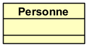
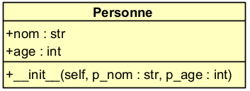
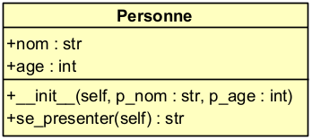

(_Cours Python : [retour sommaire](readme.md#les-bases-du-langage-python)_)
# Chap. 11b - POO : Introduction aux classes et objets

> * Auteur :  Gwénaël LAURENT
> * Date : 30-03-2025

 [Licence Creative Commons](https://creativecommons.org/licenses/by-nc-sa/3.0/fr/)

- [Chap. 11b - POO : Introduction aux classes et objets](#chap-11b---poo--introduction-aux-classes-et-objets)
- [1. Qu'est-ce qu'une classe ?](#1-quest-ce-quune-classe-)
- [2. Définition et instanciation d'une classe](#2-définition-et-instanciation-dune-classe)
- [3. Constructeur et attributs d'instance](#3-constructeur-et-attributs-dinstance)
- [4. Méthodes d'instance](#4-méthodes-dinstance)
- [5. Modification de la valeur des attributs](#5-modification-de-la-valeur-des-attributs)


# 1. Qu'est-ce qu'une classe ?
Une **classe** est un modèle permettant de créer des objets.

Un **objet** est une instance d’une classe qui regroupe des données (**attributs**) et des fonctionnalités (**méthodes**).  

* 📌 Instanciation = création d’un objet à partir d’une classe
* 📌 Objet = instance de classe

# 2. Définition et instanciation d'une classe
📌 Une classe se définit avec le mot-clé `class` suivi du nom de la classe : `class Exemple`

📌 On créé un objet en utilisant le nom de la classe suivi de parenthèses : `objE = Exemple()`



```python
class Personne:
    """ Une classe vide pour l'instant """
    pass  # ne fait rien

# Création d'une instance (objet) de la classe
p1 = Personne()
print(type(p1))  # Affiche : <class '__main__.Personne'>
```

> Remarque : Le nom d'une classe commence toujours par une majuscule. Les classes sont nommées en utilisant le style `CapitalizedWords` (ou CapWords, ou CamelCase)

# 3. Constructeur et attributs d'instance
📌 Le **constructeur** est une méthode d'instance spéciale `__init__(self)` qui initialise un objet.

📌 Si le constructeur possède des paramètres, il faut passer des arguments lors de la création de l'objet (le paramètre `self` n’est pas utilisé lors de l'appel) :\
_Ex. constructeur_ `__init__(self, param1:str)`\
_Ex. création objet_ `objE = Exemple("toto")`

📌 Un **attribut d'instance** est une variable dont la portée est au niveau objet, c'est à dire qu'elle est accessible directement par toutes les méthodes de la classe.

📌 Dans la définition de la classe, les attributs d'instance doivent toujours être préfixés par `self` (c'est une référence à l'objet courant) : `self.nom_attribut`

📌 Pour accéder à un attribut d'instance on utilise le nom de l'objet, suivi d'un point et du nom de la l'attribut : `objE.nom_attribut`




```python
class Personne:
    """ Une classe avec constructeur et 2 attributs """
    def __init__(self, p_nom: str, p_age: int) -> None:
        self.nom: str = p_nom  # Attribut d'instance
        self.age: int = p_age  # Attribut d'instance

# Création d'objets
p1 = Personne("Alice", 25)
p2 = Personne("Bob", 30)

print(p1.nom, p1.age)  # Alice 25
print(p2.nom, p2.age)  # Bob 30
```

<div class="page"/>

# 4. Méthodes d'instance
📌 Une **méthode d'instance** est une fonction définie dans une classe et prenant `self` comme premier paramètre : définition `ma_methode(self, param1)`

📌 Le premier paramètre d’une méthode d'instance doit toujours être `self` (c'est une référence à l'objet courant). **Lors de l’appel de la méthode, le paramètre `self` n’est pas utilisé** : appel `ma_methode(param1)`



```python
class Personne:
    """ Une classe avec constructeur et 2 attributs """
    def __init__(self, p_nom: str, p_age: int) -> None:
        self.nom: str = p_nom  # Attribut d'instance
        self.age: int = p_age  # Attribut d'instance

    def se_presenter(self) -> str:
        """ Affiche un message """
        return f"Je m'appelle {self.nom} et j'ai {self.age} ans."

# Création et utilisation d'un objet
p1 = Personne("Alice", 25)
print(p1.se_presenter())  # "Je m'appelle Alice et j'ai 25 ans."
```

> **A noter :** Pour appeler une méthode d'instance, il faut toujours utiliser le nom d'un objet, un point puis le nom de la méthode.

# 5. Modification de la valeur des attributs
Les attributs peuvent être modifiés après l'instanciation :  

```python
p1.age = 26  # Modification de l'âge
print(p1.se_presenter())  # "Je m'appelle Alice et j'ai 26 ans."
```
