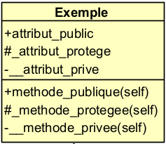
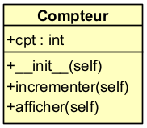
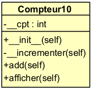
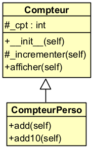
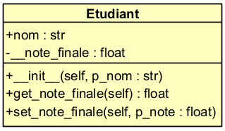
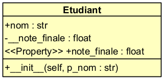
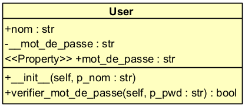

(_Cours Python : [retour sommaire](readme.md#les-bases-du-langage-python)_)
# Chap. 11c - POO : Encapsulation

> * Auteur :  Gwénaël LAURENT
> * Date : 30-03-2025

 [Licence Creative Commons](https://creativecommons.org/licenses/by-nc-sa/3.0/fr/)

- [Chap. 11c - POO : Encapsulation](#chap-11c---poo--encapsulation)
- [1. C'est quoi l'encapsulation](#1-cest-quoi-lencapsulation)
- [2. Accès public](#2-accès-public)
- [3. Accès privé (private)](#3-accès-privé-private)
- [4. Accès protégé (private)](#4-accès-protégé-private)
- [5. Accès aux attributs privés](#5-accès-aux-attributs-privés)
  - [5.1. Pourquoi utiliser des attributs privés](#51-pourquoi-utiliser-des-attributs-privés)
  - [5.2. Accès avec getter et setter](#52-accès-avec-getter-et-setter)
  - [5.3. Accès avec @property](#53-accès-avec-property)


# 1. C'est quoi l'encapsulation

L'encapsulation permet de définir des **niveaux de visibilité** des membres de la classe (attributs et méthodes).

Ces niveaux de visibilité définissent les **droits d'accès aux données** selon que l'on y accède par une méthode de la classe elle-même, d'une classe héritière, ou bien d'une classe quelconque.

Il existe trois niveaux de visibilité : **public**, **protégé** et **privé**.

Pour restreindre l'accès, on utilise une **convention de nommage** en préfixant le nom des membres par 1 ou 2 underscores :

| Type    | Nom des attributs | Nom des méthodes | Accessible depuis                          |
|---------|-------------------|------------------|--------------------------------------------|
| **Public**  | `attribut`          | `methode()`        | Partout                                    |
| **Protégé** | `_attribut`         | `_methode()`       | la classe elle-même<br/>les classes filles |
| **Privé**   | `__attribut`        | `__methode()`      | la classe elle-même                        |

> **A noter :** le constructuer **`__init__()`** est une exception, il est toujours **public**

> **Remarque :** Python n'impose pas d'encapsulation stricte comme C++, mais adopte une approche guidée par convention.

Les niveaux d'accès public, protégé, privé sont indiqués sur le **diagramme de classe UML** en utilisant respectivement **`+`**, **`#`**, **`-`** :




# 2. Accès public
📌 En Python, les attributs et les méthodes sont par défaut en accès **public**, accessibles depuis l'extérieur de la classe.

Accessible **partout** :
* ✔️ Accessible dans la classe elle-même
* ✔️ Accessible depuis une autre classe
* ✔️ Accessible depuis le programme principal



```python
class Compteur:
    def __init__(self) -> None:
        self.cpt: int = 0  # attribut public

    def incrementer(self) -> None:
        """methode publique"""
        self.cpt += 1

    def afficher(self) -> None:
        """methode publique"""
        print(f"Le compteur vaut {self.cpt}")

c = Compteur()
c.afficher()  #  Accessible
c.incrementer()  #  Accessible
c.afficher()  #  Accessible
print(c.cpt)  #  Accessible
```


# 3. Accès privé (private)
📌 Un membre privé est destinée à un usage **interne à la classe**. Il est inaccessible depuis l'extérieur.

* ✔️ Accessible dans la classe elle-même
* ❌ Ne doit pas être accédé depuis une autre classe
* ❌ Ne doit pas être accédé depuis le programme principal

> **Remarque :** En python, un membre privé (`__attribut` ou `__methode()`) est exclusivement destiné à un **usage interne**. Python applique le **"name mangling"**  (il renomme l'attribut en `_NomClasse__attribut` ou la méthode en `_NomClasse__methode`).

**Exemple d'une classe qui compte de 0 à 9 :**



```python
class Compteur10:
    def __init__(self) -> None:
        self.__cpt: int = 0  # attribut privé

    def __incrementer(self) -> None:
        """methode privée"""
        self.__cpt += 1

    def add(self) -> None:
        """methode publique"""
        self.__incrementer()
        if self.__cpt >= 10:
            self.__cpt = 0

    def afficher(self) -> None:
        """methode publique"""
        print(f"Le compteur vaut {self.__cpt}")


c = Compteur10()
c.afficher()  #  Accessible
c.add()
c.afficher()  #  Accessible
print(c.__cpt)  #  ERREUR
c.__incrementer()  #  ERREUR
```

> En utilisant le `name mangling`, `c._Compteur10__cpt` fonctionne, mais il ne faut pas l'utiliser pour respecter le caractère "privé" de ce membre


# 4. Accès protégé (private)
📌 Un membre protégé est destinée **aux classes filles** (classe dérivée d'une classe parent. cf. L'héritage)

* ✔️ Accessible dans la classe elle-même
* ✔️ Accessible dans les classes dérivées (classes filles)
* ❌ Ne doit pas être accédé depuis une classe non dérivée
* ❌ Ne doit pas être accédé depuis le programme principal

> **Remarque :** En python, un membre protégé (`_attribut` ou `_methode()`) est destiné à un **usage interne**. Néanmoins, Python ne bloque pas l'accès à ce membre (contrairement au C++). C'est au développeur de respecter le caractère "protégé" de ce membre.



```python
class Compteur:
    def __init__(self) -> None:
        self._cpt: int = 0  # attribut protégé

    def _incrementer(self) -> None:
        """méthode protégée"""
        self._cpt += 1

    def afficher(self) -> None:
        """méthode publique"""
        print(f"Le compteur vaut {self._cpt}")


class CompteurPerso(Compteur):

    def add(self) -> None:
        """méthode publique"""
        self._incrementer()  #  Accessible

    def add10(self) -> None:
        """méthode publique"""
        self._cpt += 10  #  Accessible


c = CompteurPerso()
c.afficher()  #  Le compteur vaut 0
c.add()
c.afficher()  #  Le compteur vaut 1
c.add10()
print(c._cpt)  #  NE PAS UTILISER
c._incrementer()  #  NE PAS UTILISER
```

# 5. Accès aux attributs privés
## 5.1. Pourquoi utiliser des attributs privés
Rappel : Un attribut privé est destinée à un usage **interne à la classe**. Il est inaccessible depuis l'extérieur.

En POO, **il est d'usage de garder les attributs privés**. Il y a plusieurs intérêts à cela :
* Le contrôle des valeurs lors de l’accès ou de la modification
* La protection des données sensibles
* La possibilité d'ajouter facilement des fonctionnalités plus tard sans casser le code existant

Les attributs privés sont **accessibles uniquement via des méthodes** qui permettent de contrôler l'accès à la valeur de l'attribut.

## 5.2. Accès avec getter et setter

Les getters et les setters sont des méthodes utilisées en POO pour accéder et modifier les attributs d'une classe.
* 📌 **Getters (Méthodes de lecture)** : permettent d'obtenir la valeur d'un attribut privé
* 📌 **Setters (Méthodes de modification)** : permettent de modifier la valeur d'un attribut privé

**Exemple :** Étudiant et gestion de la note finale
* Le setter vérifie que la note est comprise entre 0 et 20.
* Le getter renvoie la note



```py
class Etudiant:
    def __init__(self, p_nom: str):
        self.nom: str = p_nom
        self.__note_finale: float = 0.0

    def get_note_finale(self) -> float:
        return self.__note_finale

    def set_note_finale(self, p_note: float) -> None:
        if 0 <= p_note <= 20:
            self.__note_finale = p_note
        else:
            raise ValueError("La note doit être entre 0 et 20.")


etudiant = Etudiant("Alice")
etudiant.set_note_finale(17.5)

print(f"Note : {etudiant.get_note_finale()} / 20")
```


## 5.3. Accès avec @property
📌 Vu de l'extérieur de la classe, **une "propriété" se comporte comme un attribut public**. Mais il s'agit en fait d'un couple de **fonctions getter et setter**. Elle évite d’appeler `objet.methode()` et permet `objet.propriété` directement

> Les **propriétés** permettent de **contrôler l’accès aux attributs privés** d’un objet. 

✔️ Le "_décorateur_" `@property` juste avant une méthode permet de transformer la méthode en propriété **en lecture seule**.
* le nom de la méthode doit correspondre au nom de la propriété publique
* fonctionnement identique à un **getter**.

✔️ Le "_décorateur_" `@propriété.setter` juste avant une méthode permet de transformer la méthode en propriété **en modification**.
* le nom de la méthode doit correspondre au nom de la propriété publique
* fonctionnement identique à un **setter**.


**Exemple :** Étudiant et gestion de la note finale
* `@property` renvoie la note
* `@note_finale.setter` vérifie que la note est comprise entre 0 et 20.




```python
class Etudiant:
    def __init__(self, p_nom: str):
        self.nom: str = p_nom
        self.__note_finale: float = 0.0

    @property
    def note_finale(self) -> float:
        return self.__note_finale

    @note_finale.setter
    def note_finale(self, p_note: float) -> None:
        if 0 <= p_note <= 20:
            self.__note_finale = p_note
        else:
            raise ValueError("La note doit être entre 0 et 20.")


etudiant = Etudiant("Alice")
etudiant.note_finale = 17.5

print(f"Note : {etudiant.note_finale} / 20")
```

**Exemple en modification seule (pas de lecture) :**

Utilisateur avec mot de passe sécurisé :
* le mot de passe est automatiquement hashé par le setter
* il est impossible de lire le mot de passe (déclenche une exception)



```python
import hashlib

class User:
    def __init__(self, p_nom: str):
        self.nom: str = p_nom
        self.__mot_de_passe: str = ""

    @property
    def mot_de_passe(self) -> None | str:
        raise AttributeError("Lecture du mot de passe interdite.")

    @mot_de_passe.setter
    def mot_de_passe(self, p_pwd: str) -> None:
        self.__mot_de_passe = hashlib.sha256(p_pwd.encode()).hexdigest()

    def verifier_mot_de_passe(self, p_pwd: str) -> bool:
        return self.__mot_de_passe == hashlib.sha256(p_pwd.encode()).hexdigest()


user1 = User("toto")
user1.mot_de_passe = "AQsz45fgRT98!12"
# __mot_de_passe = '2768c134cd465dd857fbcaa6d7617eb4c6beb8e8429c051a92418c5d57afdcd5'
print(user1.verifier_mot_de_passe("AQsz45fgRT98!12"))  # True
print(user1.verifier_mot_de_passe("AQsz45fgRT98!"))  # False

print(user1.mot_de_passe) # ERREUR : AttributeError: Lecture du mot de passe interdite.

```