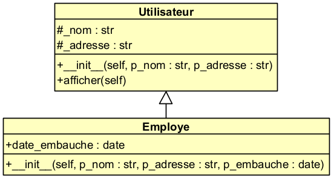
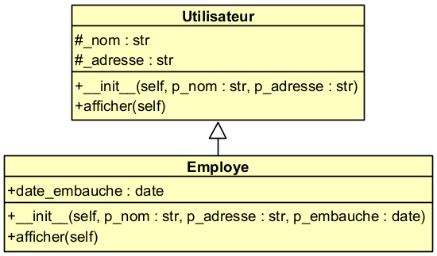

(_Cours Python : [retour sommaire](readme.md#les-bases-du-langage-python)_)
# Chap. 11d - POO : Héritage

> * Auteur :  Gwénaël LAURENT
> * Date : 30-03-2025

 [Licence Creative Commons](https://creativecommons.org/licenses/by-nc-sa/3.0/fr/)

- [Chap. 11d - POO : Héritage](#chap-11d---poo--héritage)
- [1. Héritage](#1-héritage)
- [2. Redéfinition de méthode](#2-redéfinition-de-méthode)


# 1. Héritage
L'héritage permet de créer une nouvelle **classe Enfant** à partir d’une **classe Parent** existante.

📌 La classe Enfant **hérite des membres publics et protégés de la classe Parent** et peut possèder des membres supplémentaires qui lui sont propre.

> La relation d'héritage entre 2 classes signifie "_**est un**_", "_**est une sorte de**_"

* ✔️ La **généralisation** consiste à regrouper les caractéristiques communes de plusieurs classes en une classe plus générale (ou parent). 

* ✔️ La **spécialisation** consiste à créer une classe dérivée (ou enfant) à partir d'une classe plus générale en y ajoutant des caractéristiques spécifiques.


Pour coder l'héritage en python :
* La classe Enfant doit déclarer l'héritage en même temps que sa définition : `class Enfant(Parent):`
* Un objet Enfant peut accéder directement aux membres publics de la classe Parent
* Un objet Enfant peut accéder directement aux membres protégés de la classe Parent
* La classe Enfant peut passer des arguments au constructeur de la classe Parent en appelant `super().__init__(arguments)`

<div class="page"/>

**Exemple :**
* entre une classe Parent `Utilisateur` avec 2 attributs protégés `_nom` et `_adresse`
* et une classe Enfant `Employe` qui hérite de `Utilisateur` et ajoute un attribut `date_embauche`.



```python
from datetime import date

class Utilisateur:
    def __init__(self, p_nom: str, p_adresse: str) -> None:
        self._nom: str = p_nom  # Attribut protégé
        self._adresse: str = p_adresse  # Attribut protégé

    def afficher(self) -> None:
        print(f"{self._nom} - {self._adresse}")


class Employe(Utilisateur):
    def __init__(self, p_nom: str, p_adresse: str, p_embauche: date) -> None:
        super().__init__(p_nom, p_adresse)  # appel du constructeur parent
        self.date_embauche: date = p_embauche  # Attribut de la classe enfant


e = Employe("Toto", "Paris", date(2025,3,29))
e.afficher()  # Toto - Paris
```

<div class="page"/>

# 2. Redéfinition de méthode
📌 En Python, une classe enfant peut **redéfinir une fonction héritée de la classe parent** (_method overriding_).

Lorsqu'une méthode est redéfinie dans la classe enfant, elle remplace la version héritée de la classe parent.

**Exemple :**
On ajoute une méthode `afficher()` dans la classe enfant `Employe`.\
Comme c'est la même signature (même nom, même paramètres et même valeur de retour) que la méthode de la classe parent, il s'agit d'une redéfinition de la méthode.



```python
from datetime import date

class Utilisateur:
    def __init__(self, p_nom: str, p_adresse: str) -> None:
        self._nom: str = p_nom  # Attribut protégé
        self._adresse: str = p_adresse  # Attribut protégé

    def afficher(self) -> None:
        print(f"{self._nom} - {self._adresse}")


class Employe(Utilisateur):
    def __init__(self, p_nom: str, p_adresse: str, p_embauche: date) -> None:
        super().__init__(p_nom, p_adresse)  # appel du constructeur parent
        self.date_embauche: date = p_embauche  # Attribut de la classe enfant

    def afficher(self) -> None:
        print(f"{self._nom} - {self.date_embauche}")

e = Employe("Toto", "Paris", date(2025,3,29))
e.afficher()  # Toto - 2025-03-29
```

<div class="page"/>

Dans la classe enfant, on peut toujours appeler la méthode `afficher()` du parent en utilisant `super().afficher()`.

```python
class Employe(Utilisateur):
    def __init__(self, p_nom: str, p_adresse: str, p_embauche: date) -> None:
        super().__init__(p_nom, p_adresse)  # appel du constructeur parent
        self.date_embauche: date = p_embauche  # Attribut de la classe enfant

    def afficher(self) -> None:
        super().afficher()
        print(f"Embauche : {self.date_embauche}")

e = Employe("Toto", "Paris", date(2025,3,29))
e.afficher()  # Toto - Paris \ Embauche : 2025-03-29
```

**Remarque :** la notion de **redéfinition** (en anglais, overriding) est proche mais différente de la notion de **surcharge** (en anglais, overloading). Une métode surcharge une autre méthode lorsque la nouvelle méthode possède le même nom que la méthode existante mais avec une signature différente (nombre ou types des paramètres différents).