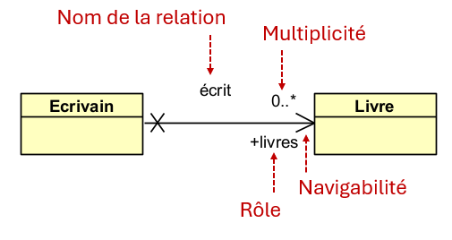
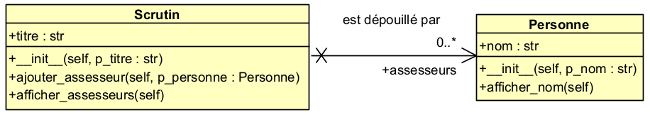
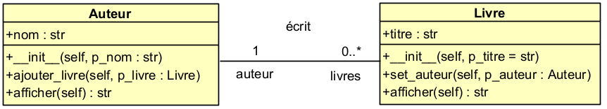
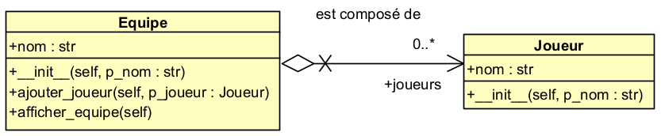
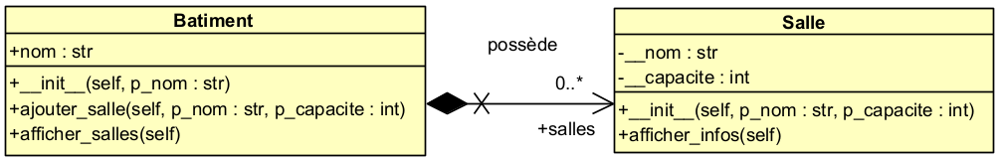

(_Cours Python : [retour sommaire](readme.md#les-bases-du-langage-python)_)
# Chap. 11e - POO : Association, agrégation et composition

> * Auteur :  Gwénaël LAURENT
> * Date : 08-04-2025

 [Licence Creative Commons](https://creativecommons.org/licenses/by-nc-sa/3.0/fr/)

- [Chap. 11e - POO : Association, agrégation et composition](#chap-11e---poo--association-agrégation-et-composition)
- [1. Relations entre les classes](#1-relations-entre-les-classes)
- [2. Association](#2-association)
- [3. Agrégation](#3-agrégation)
- [4. Composition (Agrégation forte)](#4-composition-agrégation-forte)
- [5. Dépendances circulaires avec les annotations de type.](#5-dépendances-circulaires-avec-les-annotations-de-type)


# 1. Relations entre les classes
Un diagramme de classe UML permet d'indiquer les relations qui existent entre les classes.

Ces relations sont de 4 types :
* héritage (cf. chapitre précédent)
* association
* agrégation
* composition

Les 3 dernières expriment la **relation entre les instances** des classes.

Représentations UML des relations :



📌 **Nom de la relation** = exprime la relation avec un verbe conjugué :\
"Un Ecrivain _écrit_ des Livres"

📌 **Navigabilité** = indique une relation unidirectionnelle (avec une flèche) ou bidirectionnelle (trait simple sans flèche).\
"Seul l'écrivain connaît ses livres, mais le livre n'a pas de lien direct vers l'écrivain."

📌 **Multiplicité (cardinalité)** = contrainte sur le nombre d’objets associés (Valeur min .. Valeur Max).\
La multiplicité est placée de l’autre côté de la classe utilisée comme sujet :\
"Un Ecrivain écrit _zéro ou plusieurs_ Livres"

📌 **Nom de rôle** = **nom de l'attribut** qui contiendra les références vers les objets de la relation (plus la visibilité).\
Le rôle est placée de l’autre côté de la classe qui contient l'attribut :\
"La classe Ecrivain possède un attribut public `self.livres` de type `list[Livre]`" (pour contenir plusieurs objets Livre)


# 2. Association
Une association est une relation entre les objets de deux classes. C'est le type général des relations.

📌 Une association _**correspond à une action (un verbe)**_ qui relie des objets.

Dans une association :
* ✔️ les objets sont créés à l'extérieur des classes associées.
* ✔️ Les objets ont des durées de vie indépendantes (La suppression d'un objet n’entraîne pas celle de l’autre)
* ✔️ une référence vers les objets associés est enregistrée dans les attributs

---

**Exemple 1 : Des Personnes _dépouillent_ un Scrutin.** 

On a choisi une association _**unidirectionnelle**_ : seul le scrutin connaît ses assesseurs, mais la personne n'a pas de lien direct vers le scrutin qu'elle dépouille. 



* La classe `Scrutin` aura un attribut `self.assesseurs:list[Personne]` (multiplicité 0..*)


```python
class Personne:
    def __init__(self, p_nom: str) -> None:
        self.nom: str = p_nom

    def afficher_nom(self) -> str:
        return f"Personne: {self.nom}"


class Scrutin:
    def __init__(self, p_titre: str) -> None:
        self.titre: str = p_titre
        self.assesseurs: list[Personne] = []  # Liste des assesseurs connus par le scrutin

    def ajouter_assesseur(self, p_personne: Personne) -> None:
        if p_personne not in self.assesseurs:
            self.assesseurs.append(p_personne)

    def afficher_assesseurs(self) -> str:
        assesseurs_noms = ", ".join([p.nom for p in self.assesseurs])
        return f"Scrutin: {self.titre}, Assesseurs: {assesseurs_noms}"


# Exemple d'utilisation
p1 = Personne("Alice")
p2 = Personne("Bob")
p3 = Personne("Charlie")
scrutin1 = Scrutin("Élections présidentielles")

print(
    scrutin1.afficher_assesseurs()
)  # Affiche les assesseurs du scrutin (aucun au départ)
# Scrutin: Élections présidentielles, Assesseurs:

scrutin1.ajouter_assesseur(p1)
scrutin1.ajouter_assesseur(p2)
scrutin1.ajouter_assesseur(p3)

print(
    scrutin1.afficher_assesseurs()
)  # Affiche la mise à jour avec les nouveaux assesseurs
# Scrutin: Élections présidentielles, Assesseurs: Alice, Bob, Charlie
```

---

**Exemple 2 : Un Auteur _écrit_ des Livres** 

C'est un association _**bidirectionnelle**_ :
* Un auteur peut écrire plusieurs livres
* Chaque livre est écrit par un seul auteur



* La classe `Auteur` aura un attribut `self.livres:list[Livre]` (multiplicité 0..*)
* La classe `Livre` aura un attribut `self.auteur:Auteur` (multiplicité 1)

```python
from __future__ import annotations

class Auteur:
    def __init__(self, p_nom: str) -> None:
        self.nom: str = p_nom
        self.livres: list[Livre] = []

    def ajouter_livre(self, p_livre: Livre) -> None:
        if p_livre not in self.livres:
            self.livres.append(p_livre)
            # Assure la bidirectionnalité
            p_livre.set_auteur(self)

    def afficher(self) -> str:
        return f"Auteur : {self.nom}"


class Livre:
    def __init__(self, p_titre: str) -> None:
        self.titre: str = p_titre
        self.auteur: Auteur | None = None

    def set_auteur(self, p_auteur: Auteur) -> None:
        if self.auteur != p_auteur:
            self.auteur = p_auteur
            if self not in p_auteur.livres:
                # Assure la bidirectionnalité
                p_auteur.ajouter_livre(self)

    def afficher(self) -> str:
        return f"Livre : '{self.titre}', \
            Auteur : {self.auteur.nom if self.auteur else 'Aucun'}"


# Exemple d'utilisation
a1 = Auteur("Victor Hugo")
l1 = Livre("Les Misérables")
l2 = Livre("Notre-Dame de Paris")

a1.ajouter_livre(l1)
l2.set_auteur(a1)

# Affichage
print(a1.afficher())
for livre in a1.livres:
    print(f" - {livre.afficher()}")

print("\nVérification depuis les livres :")
print(l1.afficher())
print(l2.afficher())
```

# 3. Agrégation
Une agrégation est un cas particuler d'association exprimant une **relation de contenance**.

📌 L'agrégation signifie "_**est composé de**_", "_**contient**_".


Dans une agrégation :
* ✔️ Un objet est composé de un ou plusieurs autres

Et comme pour les associations :
* ✔️ les objets sont créés à l'extérieur des classes associées.
* ✔️ Les objets ont des durées de vie indépendantes (La suppression de l’ensemble n’entraîne pas celle de l’élément)
* ✔️ une référence vers les objets associés est enregistrée dans les attributs


> **Remarque :** On peut avoir le même code Python pour l'association ou l'agrégation. Seule la relation de contenance change.

---

**Exemple d'agrégation : Une équipe _est composée_ de joueurs.**
* Une équipe possède des joueurs, mais les joueurs peuvent exister sans l'équipe.
* Un joueur peut être créé avant et ajouté à une équipe. Si l'équipe est supprimée, les joueurs restent (Durée de vie indépendante)



* La classe `Equipe` aura un attribut `self.joueurs: list[Joueur]` (multiplicité 0..*)

```python
class Joueur:
    """Classe représentant un joueur de foot"""

    def __init__(self, p_nom: str) -> None:
        self.nom: str = p_nom


class Equipe:
    """Classe représentant une équipe"""

    def __init__(self, p_nom: str) -> None:
        self.nom: str = p_nom
        self.joueurs: list[Joueur] = []  # Agrégation (on ajoute des joueurs existants)

    def ajouter_joueur(self, p_joueur: Joueur) -> None:
        """Ajoute un joueur à l'équipe (le joueur existe déjà)"""
        self.joueurs.append(p_joueur)

    def afficher_equipe(self) -> None:
        print(f"Équipe {self.nom} : {[joueur.nom for joueur in self.joueurs]}")


# --- Test ---
joueur1 = Joueur("Mbappé")
joueur2 = Joueur("Messi")

equipe = Equipe("PSG")
equipe.ajouter_joueur(joueur1)
equipe.ajouter_joueur(joueur2)

equipe.afficher_equipe()  #  Équipe PSG : ['Mbappé', 'Messi']

del equipe  # L'équipe est supprimée, mais les joueurs existent toujours
print(joueur1.nom)  # "Mbappé" toujours accessible
```


# 4. Composition (Agrégation forte)
La composition est une relation plus forte que l’agrégation. Les éléments de l’ensemble « **appartiennent exclusivement** » à l’ensemble.

📌 La composition signifie "_**fait partie de**_", "_**possède**_".

📌 La composition est une agrégation forte qui **lie les cycles de vie**. 

Dans une composition :
* ✔️ Un objet possède un ou plusieurs autres objets en tant qu'attribut
* ✔️ les objets sont **créés à l'intérieur de la classe agrégat**.
* ✔️ Les durées de vie des objets sont liées (l'objet contenu meurt avec l'objet conteneur)

---

**Exemple de composition : un bâtiment _possède_ des salles.**
* Une Salle ne peut exister sans un Batiment.
* Un Batiment possède plusieurs Salles.
* Si un Batiment est détruit, ses Salles le sont aussi.

La méthode `ajouter_salle()` crée des objets Salle qui sont intrinsèquement liés au Batiment.



* La classe `Batiment` aura un attribut `self.salles:list[Salle]` (multiplicité 0..*)

```python
class Salle:
    def __init__(self, p_nom:str, p_capacite:int)->None:
        self.__nom:str = p_nom
        self.__capacite:int = p_capacite

    def afficher_infos(self)->None:
        print(f"Salle: {self.__nom}, Capacité: {self.__capacite} personnes")


class Batiment:
    def __init__(self, p_nom:str)->None:
        self.nom:str = p_nom
        self.salles:list[Salle] = []  # Liste de salles appartenant au bâtiment

    def ajouter_salle(self, p_nom:str, p_capacite:int)->None:
        salle = Salle(p_nom, p_capacite)  # Création d'un objet Salle
        self.salles.append(salle)  # Ajout de la salle à la liste (Composition)

    def afficher_salles(self)->None:
        print(f"Bâtiment: {self.nom}")
        for salle in self.salles:
            salle.afficher_infos()


# Exemple d'utilisation
batiment = Batiment("P2")
batiment.ajouter_salle("P201", 22)
batiment.ajouter_salle("P203", 36)

batiment.afficher_salles()
# Bâtiment: P2
# Salle: P201, Capacité: 22 personnes
# Salle: P203, Capacité: 36 personnes
```

# 5. Dépendances circulaires avec les annotations de type.

**Exemple :** La classe Prof référence des objets de type Matiere, et la classe Matière référence un objet de type Prof.
Si on implémente d'abord la classe Prof puis la classe Matiere, l'interpréteur python déclenche une erreur `NameError: name 'Matiere' is not defined`

**Pourquoi ?** Python lit les classes de haut en bas, donc au moment où il lit Prof, il ne connaît pas encore Matiere

**Solution :** activer l’évaluation différée automatique des annotations en ajoutant en haut du script : `from __future__ import annotations`.

**Remarque :** cette importation sera activée par défaut dans Python 3.12+