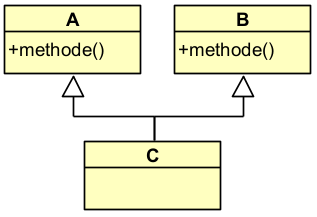
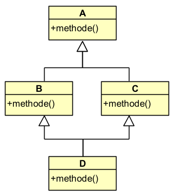
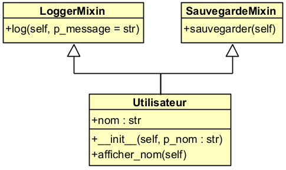

(_Cours Python : [retour sommaire](readme.md#les-bases-du-langage-python)_)
# Chap. 11f - POO : Héritage multiple et Mixins

> * Auteur :  Gwénaël LAURENT
> * Date : 12-04-2025

 [Licence Creative Commons](https://creativecommons.org/licenses/by-nc-sa/3.0/fr/)

- [Chap. 11f - POO : Héritage multiple et Mixins](#chap-11f---poo--héritage-multiple-et-mixins)
- [1. Héritage Multiple](#1-héritage-multiple)
  - [1.1. Recommandations](#11-recommandations)
  - [1.2. Principe](#12-principe)
  - [1.3. MRO (Method Resolution Order)](#13-mro-method-resolution-order)
- [2. Les Mixins : Une alternative plus propre](#2-les-mixins--une-alternative-plus-propre)


# 1. Héritage Multiple
## 1.1. Recommandations
L’emploi de **l’héritage multiple est souvent peu justifié** et d’autres solutions de conception sont souvent préférables (cf. mixins).

Certains langages POO n'autorisent pas l'héritage multiple (le Java par exemple).


## 1.2. Principe
📌 L’héritage multiple permet à une classe d’**hériter de plusieurs classes en même temps**.

**Exemple de base**



```python
class A:
    def methode(self):
        print("Méthode de A")

class B:
    def methode(self):
        print("Méthode de B")

class C(A, B):  # Hérite de A et B
    pass

c = C()
c.methode()  # Méthode de A (priorité à A)
```

**Pourquoi "Méthode de A" ?**  
- ✔️ Python suit **l’ordre des classes** dans la déclaration (`C(A, B)`).  
- ✔️ Il applique la règle **MRO (Method Resolution Order)** → d’abord `A`, puis `B`.  

On peut vérifier la MRO avec `C.mro()` :

```python
print(C.mro())  
# [<class '__main__.C'>, <class '__main__.A'>, <class '__main__.B'>, <class 'object'>]
```


## 1.3. MRO (Method Resolution Order)
Si plusieurs classes parentes ont la même méthode, Python suit la **MRO** (ordre de résolution des méthodes).  

**Exemple avec `super()`**



```python
class A:
    def methode(self):
        print("Méthode de A")

class B(A):
    def methode(self):
        print("Méthode de B")
        super().methode()  # Appelle A.methode()

class C(A):
    def methode(self):
        print("Méthode de C")
        super().methode()  # Appelle A.methode()

class D(B, C):  # Hérite de B et C
    def methode(self):
        print("Méthode de D")
        super().methode()  # Appelle selon la MRO

d = D()
d.methode()
```

**Sortie :**
```
Méthode de D
Méthode de B
Méthode de C
Méthode de A
```

**Python suit la MRO :** `D → B → C → A`  
- ✔️ `super().methode()` n’appelle pas toujours directement la méthode du parent immédiat, mais suit la **MRO globale**.  


# 2. Les Mixins : Une alternative plus propre

📌 Un Mixin ou une **classe mixin** est une classe destinée à être composée par héritage multiple avec une autre classe pour lui **apporter des fonctionnalités**.

📌 Un Mixin est une classe qui **n’est pas censée être instanciée seule**.

**Pourquoi utiliser des mixins ?**  
- Éviter les conflits dans l’héritage multiple
- Rendre le code plus modulaire
- Ajouter des fonctionnalités optionnelles sans complexifier l’héritage.

> **Remarque :** Les classes Mixins sont toujours utilisées pour l'héritage mais ce n'est pas une généralisation ou une spécialisation, il s'agit seulement d'ajout de fonctionnalités.

**Exemple : Ajout de fonctionnalités avec des mixins**



Les mixins `LoggerMixin` et `SauvegardeMixin` ajoutent des fonctionnalités à `Utilisateur` sans être de véritables parents.

```python
class LoggerMixin:
    def log(self, message):
        print(f"[LOG] {message}")

class SauvegardeMixin:
    def sauvegarder(self):
        print("Données sauvegardées.")

class Utilisateur(LoggerMixin, SauvegardeMixin):  # Ajout de fonctionnalités
    def __init__(self, nom):
        self.nom = nom

    def afficher_nom(self):
        self.log(f"Affichage du nom : {self.nom}")
        print(self.nom)

# Utilisation
u = Utilisateur("Alice")
u.afficher_nom()
u.sauvegarder()
```
**Sortie :**
```sh
[LOG] Affichage du nom : Alice
Alice
Données sauvegardées.
```

