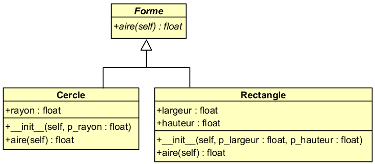

(_Cours Python : [retour sommaire](readme.md#les-bases-du-langage-python)_)
# Chap. 11g - POO : Classes abstraites et polymorphisme
> * Auteur :  Gwénaël LAURENT
> * Date : 12-04-2025

 [Licence Creative Commons](https://creativecommons.org/licenses/by-nc-sa/3.0/fr/)

- [Chap. 11g - POO : Classes abstraites et polymorphisme](#chap-11g---poo--classes-abstraites-et-polymorphisme)
- [1. Classes Abstraites (`ABC` - Abstract Base Class)](#1-classes-abstraites-abc---abstract-base-class)
- [2. Polymorphisme grâce à l'héritage](#2-polymorphisme-grâce-à-lhéritage)


# 1. Classes Abstraites (`ABC` - Abstract Base Class)

📌 Les classes abstraites définissent des **méthodes sans code (méthodes abstraites)** que les classes dérivées doivent implémenter.

📌 Une classe abstraite est une classe qui **ne peut pas être instanciée directement**.  

**Intérêts :**
- Obliger les sous-classes à implémenter certaines méthodes.  
- Définir une interface commune.  

> En UML, les classes et méthodes abstraites sont représentées en _italique_

**Exemple avec une classe `Forme`**



```python
from abc import ABC, abstractmethod

class Forme(ABC):  # Classe abstraite
    @abstractmethod
    def aire(self) -> float:
        """Méthode obligatoire à implémenter 
        dans les sous-classes."""

class Rectangle(Forme):
    def __init__(self, p_largeur: float, p_hauteur: float):
        self.largeur: float = p_largeur
        self.hauteur: float = p_hauteur

    def aire(self) -> float:
        return self.largeur * self.hauteur

class Cercle(Forme):
    def __init__(self, p_rayon: float):
        self.rayon: float = p_rayon

    def aire(self) -> float:
        return 3.14 * self.rayon**2

# Utilisation
formes = [Rectangle(4, 5), Cercle(3)]
for forme in formes:
    print(forme.aire())  # 20 et 28.26
```

**Remarque :** les classes abstraites peuvent également avoir des attributs et des méthodes concrètes (avec implémentation), les classes dérivées en hériteront.


# 2. Polymorphisme grâce à l'héritage

> Le mot polymorphie vient du grec et signifie "qui peut prendre plusieurs formes". En POO, des méthodes de mêmes noms peuvent avoir des comportements différents.

**L'héritage à partir d'une classe abstraite permet le polymorphisme**.

Dans l'exemple précédent, **la redéfinition de la méthode `aire()`** pour l'adapter au type de forme `Rectangle` et `Cercle` est un exemple typique de polymorphisme.

Chaque objet héritant de la classe abstraite `Forme` disposera de la méthode `aire()` mais avec un code différent.

On pourrait donc avoir une fonction polymorphe qui affiche l'aire d'une forme quelconque de type `Forme` (le paramètre est typé avec la classe abstraite) :

```python
# Méthode polymorphe
def afficher_aire(p_forme:Forme):
    print(f"Aire = {p_forme.aire()}")

# liste d'objets héritant de Forme
formes:list[Forme] = []
formes.append(Cercle(4))
formes.append(Rectangle(3, 2))
formes.append(Cercle(5))
for forme in formes:
    # Utilisation de la fct polymorphe
    afficher_aire(forme)
```

**Explication :** `afficher_aire()` appelle `aire()` sans savoir si c’est un `Rectangle` ou un `Cercle` → Python exécute la bonne méthode.

**Remarque :** la variable `formes` est aussi polymorphe. Elle est typée en `list[Forme]` mais on lui ajoute soit des objets `Rectangle`, soit des objets `Cercle`