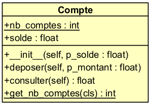

(_Cours Python : [retour sommaire](readme.md#les-bases-du-langage-python)_)
# Chap. 11i - POO : Membres de classe (ou membres statiques)

> * Auteur :  Gwénaël LAURENT
> * Date : 13-04-2025

 [Licence Creative Commons](https://creativecommons.org/licenses/by-nc-sa/3.0/fr/)

- [Chap. 11i - POO : Membres de classe (ou membres statiques)](#chap-11i---poo--membres-de-classe-ou-membres-statiques)
- [Définition](#définition)
- [Programmation python](#programmation-python)
- [Exemple](#exemple)


# Définition
📌 Une classe peut avoir des **membres de classe** (ou membres statiques). Ce sont des attributs ou méthodes qui **appartiennent à la classe elle-même et non à une instance particulière**.

Caractéristiques :
* Ils sont partagés par tous les objets de la même classe.
* Ils existent même lorsqu'aucun objet de cette classe n'a été créé.

# Programmation python
En Python
* Un attribut de classe est défini directement dans le corps de la classe.
    ```python
    class MaClasse:
        compteur = 0  # attribut de classe
    ```
* Une méthode de classe est définie avec le décorateur `@classmethod` et son premier paramètre est `cls` (_`cls` est un alias pour la classe à laquelle la méthode appartient_).
    ```python
    @classmethod
    def afficher_compteur(cls):
        print(cls.compteur)
    ```
* Les membres de classe sont accessibles via `NomDeClasse.nom_du_membre` ou `cls.nom_du_membre` dans une méthode de classe.

**Remarque 1 :** `cls` est seulement disponible dans une méthode de classe, c'est-à-dire une méthode décorée avec `@classmethod`. Dans toutes les méthodes d'instances (constructeur y compris), il faut utiliser `NomDeClasse.nom_du_membre` pour accéder à un membre de classe.


**Remarque 2 :** Une méthode de classe ne peut utiliser que des attributs et des méthodes de classe. Elle ne peut pas accéder aux membres d'instance.


# Exemple



> En UML, les membres de classe (ou statiques) sont indiqués soulignés.

```python
class Compte:
    nb_comptes:int = 0  # Attribut de classe

    def __init__(self, p_solde:float):
        self.solde:float = p_solde  # Attribut d'instance
        Compte.nb_comptes += 1  # Modification de l'attribut de classe

    def deposer(self, p_montant: float)->None: # Méthode d'instance
        if p_montant>0 :
            self.solde += p_montant

    def consulter(self)->float:
        return self.solde

    @classmethod
    def get_nb_comptes(cls)->int:  # Méthode de classe
        return cls.nb_comptes

cpt_courant = Compte(100)
print(cpt_courant.get_nb_comptes())  # 1
cpt_epargne = Compte(500)
print(cpt_courant.get_nb_comptes())  # 2
```