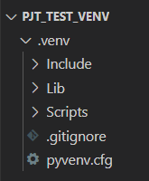
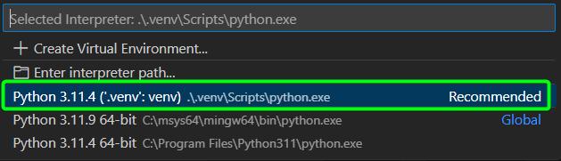
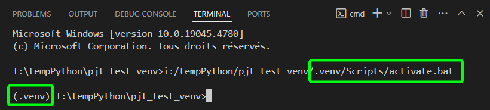
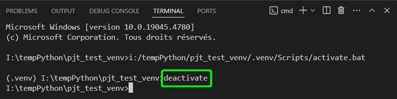
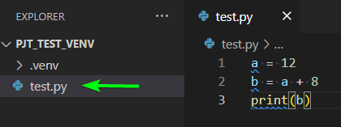
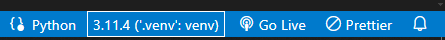
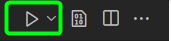
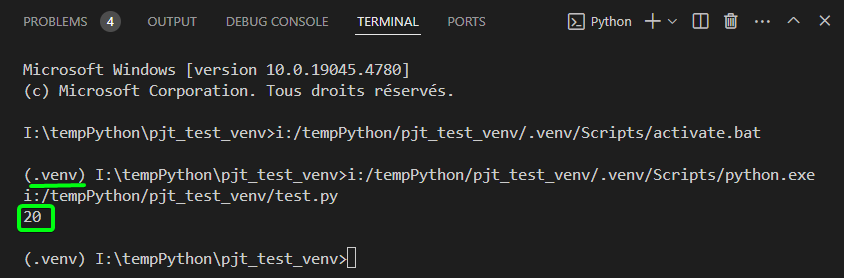
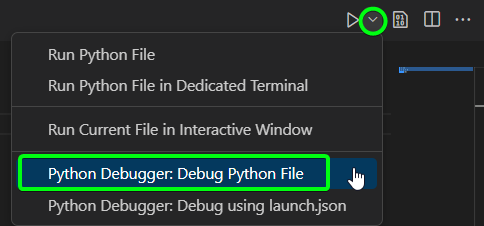
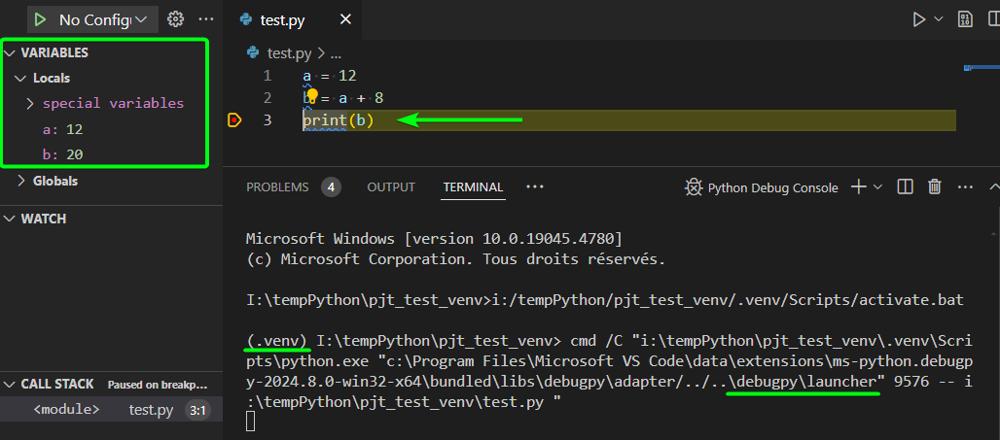

(_Cours Python : [retour sommaire](readme.md#pour-aller-plus-loin)_)
# Chap. 13 : Les environnements virtuels Python

> * Auteur : Gwénaël LAURENT
> * Date : 27/08/2024
> * OS : Windows 10

 [Licence Creative Commons](https://creativecommons.org/licenses/by-nc-sa/3.0/fr/)

- [Chap. 13 : Les environnements virtuels Python](#chap-13--les-environnements-virtuels-python)
- [1. Présentation et intérêts](#1-présentation-et-intérêts)
  - [1.1. Pourquoi utiliser des environnements virtuels ?](#11-pourquoi-utiliser-des-environnements-virtuels-)
  - [1.2. Environnements virtuels (venv)](#12-environnements-virtuels-venv)
- [2. Création d'un environnement virtuel dans VS Code](#2-création-dun-environnement-virtuel-dans-vs-code)
  - [2.1. Sélectionner l'interpréteur de l'environnement virtuel](#21-sélectionner-linterpréteur-de-lenvironnement-virtuel)
  - [2.2. Activer un environnement virtuel](#22-activer-un-environnement-virtuel)
  - [2.3. Désactiver un environnement virtuel](#23-désactiver-un-environnement-virtuel)
- [3. Exécuter un script dans l'environnement virtuel](#3-exécuter-un-script-dans-lenvironnement-virtuel)
  - [3.1. Créer un script python](#31-créer-un-script-python)
  - [3.2. Exécuter le script](#32-exécuter-le-script)
  - [3.3. Débuguer le script](#33-débuguer-le-script)
- [4. Installer des bibliothèques dans l'environnement virtuel](#4-installer-des-bibliothèques-dans-lenvironnement-virtuel)
- [5. Sauvegarder un projet python avec environnement virtuel](#5-sauvegarder-un-projet-python-avec-environnement-virtuel)
  - [5.1. Créer un fichier `requirements.txt`](#51-créer-un-fichier-requirementstxt)
  - [5.2. Sauvegarder sans le sous-dossier `.venv`](#52-sauvegarder-sans-le-sous-dossier-venv)
- [6. Réactiver un projet avec environnement virtuel](#6-réactiver-un-projet-avec-environnement-virtuel)
  - [6.1. Recréer l'environnement vituel](#61-recréer-lenvironnement-vituel)
  - [6.2. Activer l'environnement virtuel](#62-activer-lenvironnement-virtuel)
  - [6.3. Installer les bibliothèques depuis `requirements.txt`](#63-installer-les-bibliothèques-depuis-requirementstxt)

# 1. Présentation et intérêts
Par défaut, tout interpréteur Python installé s'exécute dans son propre **environnement global**. 
Tous les paquets que vous installez ou désinstallez affectent l'environnement global et tous les programmes que vous exécutez dans celui-ci.

En Python, il est recommandé de créer un environnement spécifique pour chaque projet, on parle d'**environnement local**. Ces environnements locaux vous permettent d'installer des packages sans affecter les autres environnements, en isolant les installations de packages de votre espace de travail.

Il existe deux types d'environnements locaux que vous pouvez créer pour votre espace de travail : *virtuel* et *conda* . Nous utiliserons seulement les **environnements virtuels (venv)**

## 1.1. Pourquoi utiliser des environnements virtuels ?
* **Isolation des projets** : Chaque projet a ses propres exigences en termes de bibliothèques.
* **Éviter les conflits de versions** : Plusieurs versions d'une même bibliothèque peuvent coexister sans problème.
* **Facilité de partage** : Un environnement virtuel peut être facilement partagé et reproduit.

Source : [Python environments in VS Code](https://code.visualstudio.com/docs/python/environments)


## 1.2. Environnements virtuels (venv)
Un "environnement virtuel" crée un dossier qui contient une copie (ou un lien symbolique) vers un interpréteur spécifique. Lorsque vous installez des paquets dans un environnement virtuel, ils se retrouveront dans ce nouveau dossier, et seront ainsi isolés des autres paquets utilisés par d'autres espaces de travail.

Outils utilisés pour les environnements virtuels
* **```pip```** : Le gestionnaire de paquets Python qui installe et met à jour les paquets. Il est installé par défaut avec Python 3.9+.
* **```venv```** : Vous permet de gérer des installations de packages distinctes pour différents projets et est installé avec Python 3 par défaut

# 2. Création d'un environnement virtuel dans VS Code
> Ceci permettra d'initialiser le dossier de votre projet pour qu'il puisse utiliser un environnement virtuel

1. Dans l'explorateur de fichier, créez d'abord un dossier pour votre projet
2. Ouvrez ce dossier dans VScode
3. Ouvrir le Palette de commandes: Ctrl+Shift+P (ou F1).
4. Taper "**Python: Create Environment...**".
5. Sélectionner le type d'environnement: **Venv** (Pour créer un environnement virtuel standard Python)
6. Sélectionner l'interpréteur python qui servira de base à cet environnement (le plus récent installé dans c:\Program Files\...)

Après quelques secondes, votre dossier de projet contiendra un sous-dossier **```.venv```**



> Remarque : A la place de VScode, on peut choisir de créer manuellement un environnement virtuel avec la commande ```python -m venv .venv```

> Sous linux : il faut d'abord avoir installé les 2 paquets
> ```sudo apt install python3-venv python3-pip```
> puis on utilise la commande ```python3 -m venv .venv```
> (cf [doc](https://packaging.python.org/en/latest/tutorials/installing-packages/#ensure-pip-setuptools-and-wheel-are-up-to-date))


## 2.1. Sélectionner l'interpréteur de l'environnement virtuel

1. Ouvrir le Palette de commandes: Ctrl+Shift+P (ou F1).
2. Taper "**Python: Select Interpreter**".
3. Sélectionner l'interpréteur de l'environnement virtuel localisé dans le sous-dossier ```.\.venv\Scripts\python.exe```




## 2.2. Activer un environnement virtuel
Dans VScode, ouvrez le terminal intégré (CTRL+ù).\
Si vous avez bien sélectionné l'interpréteur de l'environnement virtuel (cf plus haut), l'environnement virtuel s'activera automatiquement :



> Remarque : on peut activer l'environnement virtuel dans un terminal on appelant ```.\.venv\Scripts\activate```

> Sous linux : ```source ./bin/activate```

Si vous tappez la commande ```pip list``` dans l'environnement virtuel activé, vous verrez que vous n'avez accès seulement qu'aux packages de cet environnement. Il faudra donc y installer les packages dont vous avez besoin dans votre projet (cf plus loin)

## 2.3. Désactiver un environnement virtuel
Dans VScode, dans le terminal intégré où vous avez activé l'environnement virtuel, appelez la commande ```deactivate```




# 3. Exécuter un script dans l'environnement virtuel
## 3.1. Créer un script python
Créer un fichier python directement sous la racine de votre projet (par exemple test.py)



La barre de status de VScode affiche l'interpréteur sélectionné pour ce script python



## 3.2. Exécuter le script
Vous pouvez lancer en exécution le script grâce à la flèche en haut à droite "Run python file"



L'environnement virtuel est automatiquement activé et le script lancé en exécution :



## 3.3. Débuguer le script
Vous pouvez lancer le script en debug grâce à la flèche en haut à droite "Debug python file"






# 4. Installer des bibliothèques dans l'environnement virtuel
Dans le terminal de l'environnement virtuel activé, vous pouvez utiliser la commande **`pip`**

Pour lister les bibliothèques installées (et donc disponibles) dans votre projet :

```python-venv
(.venv) >pip list
Package    Version
---------- -------
pip        24.2
setuptools 65.5.0
```

Pour installer une bibliothèque (ici, on prend l'exemple de matplotlib) :

```python-venv
(.venv) I:\tempPython\0>pip install matplotlib
```

La commande pip install va télécharger la bibliothèque demandée et toutes ses dépendances puis les installer dans l'environnement virtuel :

```python-venv
(.venv) I:\tempPython\0>pip list
Package         Version
--------------- -----------
contourpy       1.3.0
cycler          0.12.1
fonttools       4.53.1
kiwisolver      1.4.5
matplotlib      3.9.2
numpy           2.1.0
packaging       24.1
pillow          10.4.0
pip             24.2
pyparsing       3.1.4
python-dateutil 2.9.0.post0
setuptools      65.5.0
six             1.16.0
```


# 5. Sauvegarder un projet python avec environnement virtuel
Les projets python avec environnement virtuel sont volumineux. Le sous dossier `.venv` contient :
* une copie de l'interpréteur python 
* et toutes les bibliothèques tierces que vous avez installées.

Le dossier .venv ne doit pas être sauvegardé car on peut restructurer automatiquement son contenu.

> **ATTENTION :** il faut au préalable établir la liste des bibliothèques utilisées en créant un fichier `requirements.txt`

## 5.1. Créer un fichier `requirements.txt` 
Le fichier requirements.txt contient la liste des bibliothèques Python que vous souhaitez installer dans votre environnement virtuel.

Vous pouvez créer ce fichier à partir d'un projet existant avec la commande suivante :

```python-venv
pip freeze > requirements.txt
```

Le fichier requirements.txt aura une structure comme celle-ci :

```txt
contourpy==1.3.0
cycler==0.12.1
fonttools==4.53.1
kiwisolver==1.4.5
matplotlib==3.9.2
numpy==2.1.0
packaging==24.1
pillow==10.4.0
pyparsing==3.1.4
python-dateutil==2.9.0.post0
six==1.16.0
```


## 5.2. Sauvegarder sans le sous-dossier `.venv`
Vous pouvez maintenant supprimer le dossier `.venv` et tout son contenu.

Le dossier du projet (avec les script .py et le fichier requirements.txt) peut maintenant être copié pour le sauvegarder.


# 6. Réactiver un projet avec environnement virtuel
## 6.1. Recréer l'environnement vituel
Ouvrez le dossier du projet dans VScode et dans la palette de commande tapez "**Python: Create Environment...**"

> Remarque : A la place de VScode, on peut choisir de créer manuellement un environnement virtuel avec la commande ```python -m venv .venv```

## 6.2. Activer l'environnement virtuel
Dans VScode, ouvrez le terminal intégré (CTRL+ù).

> Remarque : on peut activer l'environnement virtuel dans un terminal on appelant ```.\.venv\Scripts\activate```

## 6.3. Installer les bibliothèques depuis `requirements.txt`
Dans l'environnement virtuel recréé, pour installer toutes les bibliothèques listées dans `requirements.txt`, utilisez la commande suivante :

```cmd
pip install -r requirements.txt
```

Cette commande lira le fichier requirements.txt et installera automatiquement toutes les bibliothèques spécifiées dans l'environnement virtuel.

Une fois l'installation terminée, vous pouvez vérifier que les bibliothèques sont bien installées en exécutant :

```cmd
pip list
```

Cela affichera une liste de toutes les bibliothèques installées dans l'environnement virtuel.