(_Cours Python : [retour sommaire](readme.md#pour-aller-plus-loin)_)
# Chap. 20 : Créer des graphiques avec `matplotlib`
> * Auteur : Gwénaël LAURENT
> * Date : 23/09/2025

 [Licence Creative Commons](https://creativecommons.org/licenses/by-nc-sa/3.0/fr/)


- [Chap. 20 : Créer des graphiques avec `matplotlib`](#chap-20--créer-des-graphiques-avec-matplotlib)
- [1. Présentation de matplotlib](#1-présentation-de-matplotlib)
- [2. Installation de matplotlib](#2-installation-de-matplotlib)
- [3. Utilisation de pyplot](#3-utilisation-de-pyplot)
  - [3.1. Importer le module pyplot](#31-importer-le-module-pyplot)
  - [3.2. Premier graphique avec `plot()`](#32-premier-graphique-avec-plot)
  - [3.3. Avec une seule liste de nombres](#33-avec-une-seule-liste-de-nombres)
  - [3.4. Plusieurs courbes et apparence des courbes](#34-plusieurs-courbes-et-apparence-des-courbes)
  - [3.5. Gérer les graduations des `axis`](#35-gérer-les-graduations-des-axis)
  - [3.6. Plusieurs graphiques sur la même figure](#36-plusieurs-graphiques-sur-la-même-figure)
  - [3.7. Nuage de points avec la fonction `plot()`](#37-nuage-de-points-avec-la-fonction-plot)
  - [3.8. Nuage de points avec la fonction `scatter()`](#38-nuage-de-points-avec-la-fonction-scatter)
  - [3.9. Afficher du texte dans la zone de traçage avec la fonction `text()` et `bbox`](#39-afficher-du-texte-dans-la-zone-de-traçage-avec-la-fonction-text-et-bbox)
  - [3.10. Afficher du texte dans la figure avec la fonction `figtext()`](#310-afficher-du-texte-dans-la-figure-avec-la-fonction-figtext)
  - [3.11. Affichage des formules mathématiques avec LaTeX](#311-affichage-des-formules-mathématiques-avec-latex)
  - [3.12. Tracer des droites horizontales ou verticales](#312-tracer-des-droites-horizontales-ou-verticales)
  - [3.13. Tracer un histogramme avec `hist()`](#313-tracer-un-histogramme-avec-hist)
  - [3.14. Tracer des polygones en couleur avec `fill()`](#314-tracer-des-polygones-en-couleur-avec-fill)
  - [3.15. Colorier la zone entre deux courbes avec `fill_between()`](#315-colorier-la-zone-entre-deux-courbes-avec-fill_between)
- [4. Pyplot en mode interactif (non bloquant)](#4-pyplot-en-mode-interactif-non-bloquant)
  - [4.1. Fonctionnement](#41-fonctionnement)
  - [4.2. Exemple d'affichage pyplot en mode interactif](#42-exemple-daffichage-pyplot-en-mode-interactif)
  - [4.3. autoscale](#43-autoscale)


# 1. Présentation de matplotlib
**matplotlib** est une bibliothèque complète permettant de créer des graphiques à partir de listes de coordonnées.

**matplotlib.pyplot** permet d'accéder aux fonctions et objets de la bibliothèque pour créer des interfaces graphiques et tracer des courbes.

Pour utiliser matplotlib, il est utile de connaitre les termes utilisés :
- créer une interface graphique : _**figure**_,
- créer une zone de traçage dans une figure : _**Axes**_,
- tracer des lignes dans une zone de traçage : _**Line plot**_,
- décorer le tracé avec des étiquettes : _**text**_, 
- etc.


*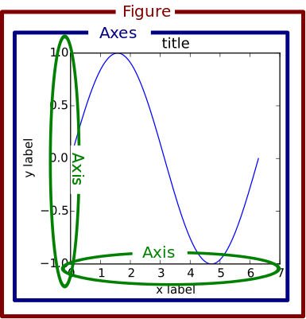\
Crédit [realpython.com](https://realpython.com/python-matplotlib-guide/)*

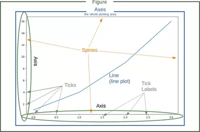\
*Crédit : [python-course.eu](https://python-course.eu/)*


Documentation :
* https://matplotlib.org/stable/
* https://matplotlib.org/stable/tutorials/pyplot.html

Matplotlib Object Hierarchy : 
* https://realpython.com/python-matplotlib-guide/
* https://python-course.eu/numerical-programming/matplotlib-object-hierarchy.php


# 2. Installation de matplotlib
Si la bibliothèque matplotlib n'est pas disponible sur votre ordinateur, il faut l'installer :

```bash
pip install matplotlib
```


# 3. Utilisation de pyplot
## 3.1. Importer le module pyplot
Il faut importer le module **pyplot** au début de vos scripts :

```py
import matplotlib.pyplot as plt
```

## 3.2. Premier graphique avec `plot()`
La fonction `plot()` trace des lignes et des marqueurs si on lui fournit 2 arguments :
* 1er argument : **liste des abscisses X**
* 2ème argument : **liste des ordonnées Y**

cf. https://matplotlib.org/stable/api/_as_gen/matplotlib.pyplot.plot.html

> Remarque : La fonction `plot()` peut être utilisée pour tracer des nuages ​​de points (avec des *markers* identiques en taille et en couleur).

**ATTENTION :**
- l'ordre des instructions est important
- On commence par préparer les données à afficher, puis on affiche avec la fonction `show()`

> La fonction `show()` est une fonction bloquante.


```py
# créer une figure = créer une fenêtre (on peut lui donner un nom)
plt.figure("Mon beau graphique")
# Ajouter une liste de coordonnées [X],[Y]
plt.plot([1, 2, 3, 4], [1, 4, 9, 16])
# Donner un nom à l'axe X
plt.xlabel('Les abscisses')
# Donner un nom à l'axe Y
plt.ylabel('Les ordonnées')
# Titre de la zone de traçage
plt.title('Graphe 1')

# afficher la figure
plt.show()
```

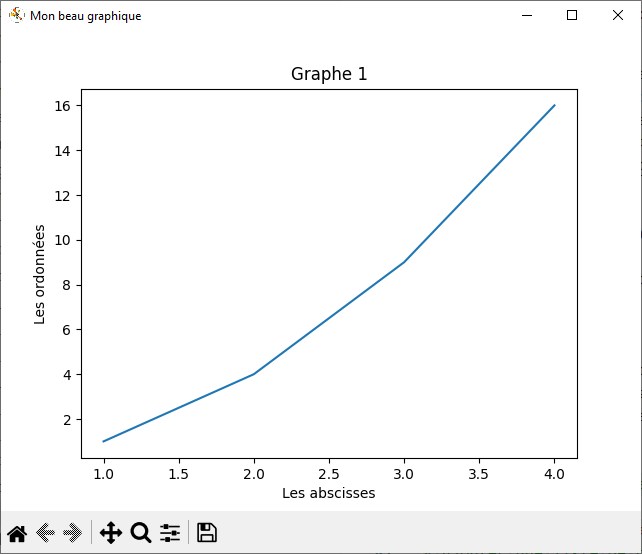

## 3.3. Avec une seule liste de nombres
Si on fournit une seule liste de valeurs, pyplot les affecte aux ordonnées et **génère automatiquement les abscisses** [0, 1, 2, 3]

```py
# créer une figure
plt.figure()
# Ajouter une liste de valeurs
plt.plot([1, 3, 2, 4])
# Donner un nom à l'axe Y
plt.ylabel('Quelques nombres')
# afficher la figure
plt.show()
```

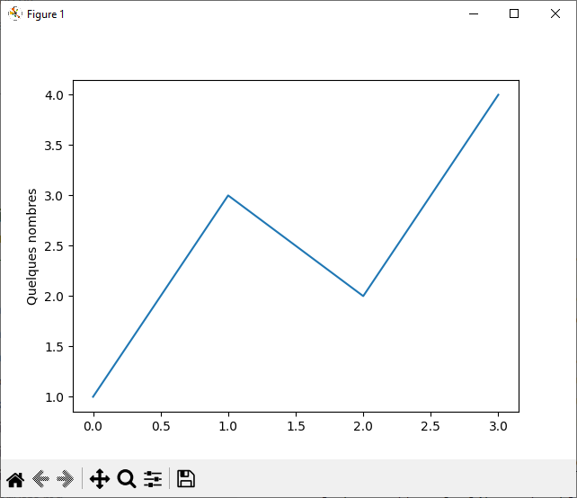

## 3.4. Plusieurs courbes et apparence des courbes
On peut tracer plusieurs courbes sur la même zone de traçage (_Axes_) en appelant plusieurs fois la fonction `plot()`.

Pour différencier les courbes on peut changer leur apparence. Il faut ajouter des arguments à la fonction `plot()` :
* 3ème argument : le style de la courbe sous la forme **[_color_][_marker_][_line_]**
  * _color_ = `b,g,r,k` &nbsp;&nbsp;&nbsp;&nbsp;&nbsp;-> blue, green, red, black....
  * _marker_ = `.,o,v,s` &nbsp;&nbsp;-> point, circle,triangle,square...
  * _line_ = `-,--,:` &nbsp;&nbsp;&nbsp;&nbsp;&nbsp;&nbsp;&nbsp;&nbsp;&nbsp;&nbsp;-> solid, dashed,dotted (si rien = nuage de points)
* Nième argument **en nommant le paramètre** :
  * `label='...'` &nbsp;&nbsp;&nbsp;&nbsp;-> label qui servira dans la légende
  * `linewidth=X`  &nbsp;&nbsp;&nbsp;  -> épaisseur de la ligne
  * `markersize=X`  &nbsp; -> grosseur des markers

Documentation :
* https://matplotlib.org/stable/api/_as_gen/matplotlib.pyplot.plot.html > Notes
* https://matplotlib.org/stable/api/_as_gen/matplotlib.pyplot.legend.html

```py
# créer une figure
plt.figure()
# Ajouter une 1ère liste de coordonnées [X],[Y]
plt.plot([1, 2, 3, 4], [1, 4, 9, 16], 'ro-', label='courbe 1', linewidth=3) 
# Ajouter une 2ème liste de coordonnées [X],[Y]
plt.plot([1, 2, 3, 4], [20, 10, 5, 2.5], 'bs--', label='courbe 2', markersize=12)
# Donner un nom à l'axe X
plt.xlabel('Les abscisses')
# Donner un nom à l'axe Y
plt.ylabel('Les ordonnées')
# afficher la légende (positionnement automatique)
#plt.legend()
# afficher la légende en choisissant la position parmis :
# 'upper left', 'upper right', 'lower left', 'lower right'
# 'upper center', 'lower center', 'center left', 'center right'
plt.legend(loc='upper center')

# afficher la figure
plt.show()
```

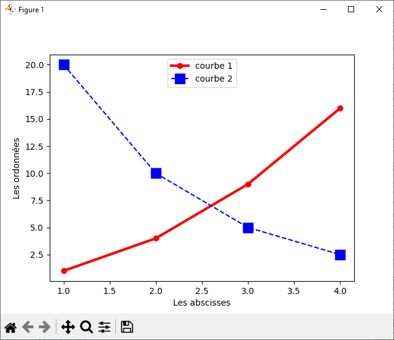


## 3.5. Gérer les graduations des `axis`
**Fixer les graduations :**

Il faut utiliser la fonction : `plt.axis([xmin, xmax, ymin, ymax])`

cf. https://matplotlib.org/stable/api/_as_gen/matplotlib.pyplot.axis.html

```py
# créer une figure
plt.figure()
# Ajouter une liste de coordonnées [X],[Y]
plt.plot([1, 2, 3, 4], [1, 4, 9, 16], 'ro-')
# Ajouter une liste de coordonnées [X],[Y]
plt.plot([1, 2, 3, 4], [20, 10, 5, 2.5], 'bs--')
# Gérer la graduation des axis
plt.axis([0, 7, 0, 20]) #xmin, xmax, ymin, ymax
# Donner un nom à l'axe X
plt.xlabel('Les abscisses')
# Donner un nom à l'axe Y
plt.ylabel('Les ordonnées')
# afficher la figure
plt.show()
```

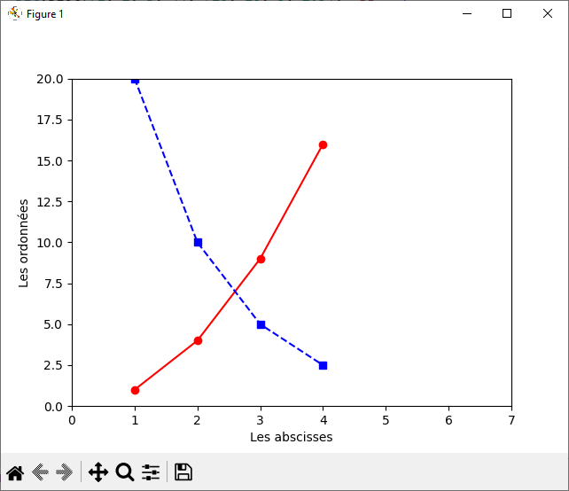

**Remarque :** A la place de `plt.axis([xmin, xmax, ymin, ymax])`, on peut aussi utiliser les fonctions `plt.xlim(min,max)` et `plt.ylim(min,max)`

```py
plt.xlim(0, 7)
plt.ylim(0, 20)
```

**Repère orthonormé :**
Pour avoir la même unité sur les 2 axes et les axes à angle droit, il faut utiliser :
```py
plt.axis("equal")
```

## 3.6. Plusieurs graphiques sur la même figure
Dans pyplot, on crée par défaut une seule _figure_ avec une seule zone de traçage XY (_Axes_).

Mais on peut avoir plusieurs Axes sur une figure en utilisant la fonction `subplot()`.

\
*Crédit : [python-course.eu](https://python-course.eu/)*


La fonction subplot() prend en paramètre _**numrows**_, _**numcols**_, _**plot_number**_
- `numrows` : nombre de ligne dans la figure
- `numcols` : nombre de colonnes dans la figure
- `plot_number` : numéro de case dans le découpage ligne/colonnes (1 à numrows*numcols)

Les instructions de traçage doivent se situer après l'appel de la fonction subplot correspondante.

```py
# créer une figure
plt.figure()

# Créer une zone de traçage dans la 1ère case du découpage 2lignes/1colonne : 
plt.subplot(211)
plt.plot([1, 2, 3, 4], [1, 4, 9, 16], 'ro-')
plt.xlabel('abscisses du graphe 1')
plt.ylabel('ordonnées du graphe 1')
plt.title('Graphe 1') 

# Créer une zone de traçage dans la 2ème case du découpage 2lignes/1colonne : 
plt.subplot(212)
plt.plot([1, 2, 3, 4], [20, 10, 5, 2.5], 'bs--')
plt.xlabel('abscisses du graphe 2')
plt.ylabel('ordonnées du graphe 2')
plt.title('Graphe 2')

# Gérer l'espace vertical entre les subplots
# https://matplotlib.org/stable/api/_as_gen/matplotlib.pyplot.subplots_adjust.html
plt.subplots_adjust(hspace=0.7)

# afficher la figure
plt.show()
```


## 3.7. Nuage de points avec la fonction `plot()`
Il faut juste choisir le bon paramétrage du 3ème argument de la fonction `plot()` : **On veut des markers mais pas de line**.

Pour rappel, le 3ème argument concerne le style de la courbe sous la forme **[_color_][_marker_][_line_]** :
  * _color_ = `b,g,r,k` &nbsp;&nbsp;&nbsp;&nbsp;&nbsp;-> blue, green, red, black....
  * _marker_ = `.,o,v,s` &nbsp;&nbsp;-> point, circle,triangle,square...
  * _line_ = `-,--,:` &nbsp;&nbsp;&nbsp;&nbsp;&nbsp;&nbsp;&nbsp;&nbsp;&nbsp;&nbsp;-> solid, dashed,dotted **(si rien = nuage de points)**


```py
# créer une figure
plt.figure()
# Ajouter une liste de coordonnées [X],[Y]
plt.plot([1, 2, 3, 4], [1, 4, 9, 16], 'bo')
# Donner un nom à l'axe X
plt.xlabel('Les abscisses')
# Donner un nom à l'axe Y
plt.ylabel('Les ordonnées')

# afficher la figure
plt.show()
```

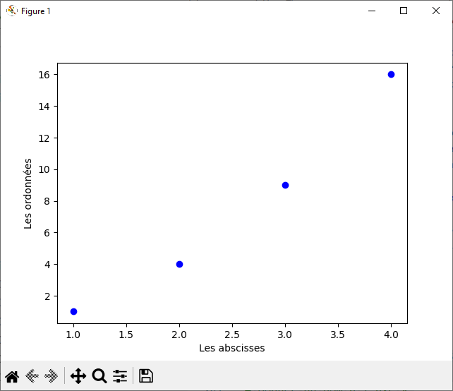

## 3.8. Nuage de points avec la fonction `scatter()` 
La fonction `scatter()` peut être utilisée pour afficher des nuages de points XY avec des marqueurs de différentes tailles et/ou couleurs.

> Remarque : **La fonction` plot()` sera plus rapide** pour les nuages ​​de points où les marqueurs ne varient pas en taille ou en couleur.

Utilisation de la fonction :
`scatter([X], [Y], marker_size, marker_colors, marker_style)`

cf. https://matplotlib.org/stable/api/_as_gen/matplotlib.pyplot.scatter.html

cf. https://matplotlib.org/stable/api/markers_api.html

```py
# créer une figure
plt.figure()
# Ajouter une liste de coordonnées [X],[Y]
plt.scatter ([1, 2, 3, 4], [1, 4, 9, 16], s=100, c=['#1f77b4', '#ff7f0e', '#2ca02c', '#d62728'], marker='^')
plt.scatter ([1, 1.5, 2, 2.5, 3, 3.5, 4], [20, 15, 10, 7, 5, 3.5, 2.5], s=150, c='#e377c2', marker='s')
plt.scatter ([1, 1.5, 2, 2.5, 3, 3.5, 4], [3,4,5,6,7,8,9], 50, '#ff0000', 'o')
# Donner un nom à l'axe X
plt.xlabel('Les abscisses')
# Donner un nom à l'axe Y
plt.ylabel('Les ordonnées')
# afficher la figure
plt.show()
```

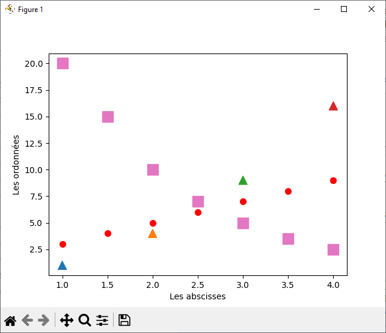


## 3.9. Afficher du texte dans la zone de traçage avec la fonction `text()` et `bbox`
La fonction `text()` prend 3 ou plus arguments :
* 1er argument  : **position du texte** sur l'axe des **X**
* 2ème argument : **position du texte** sur l'axe des **Y**
* 3ème argument : **le texte**
* Nième argument en nommant le paramètre :
  * `fontsize=` &nbsp;&nbsp;&nbsp;&nbsp;&nbsp;&nbsp; -> Taille de la police : float ou 'small', 'medium', 'large', 'x-large', 'xx-large'
  * `fontweight=` &nbsp;&nbsp; -> Epaisseur de la police : 'light', 'normal', 'bold', 'heavy', ...
  * `fontstyle=` &nbsp;&nbsp;&nbsp;&nbsp; -> 'normal', 'italic', 'oblique'
  * `verticalalignment=` &nbsp;&nbsp;&nbsp; -> 'bottom', 'baseline', 'center', 'center_baseline', 'top'
  * `horizontalalignment=` -> 'left', 'center', 'right'
  * `multialignment=` &nbsp;&nbsp;&nbsp;&nbsp;&nbsp;&nbsp;&nbsp;&nbsp;&nbsp; -> 'left', 'right', 'center'

cf. https://matplotlib.org/stable/api/_as_gen/matplotlib.pyplot.text.html

```py
plt.figure()
plt.plot([1, 2, 3, 4], [1, 4, 9, 16], 'gv:')
plt.text(3, 9, 'Mon point\nremarquable', verticalalignment='top', fontsize=12, fontweight="bold")
plt.show()
```

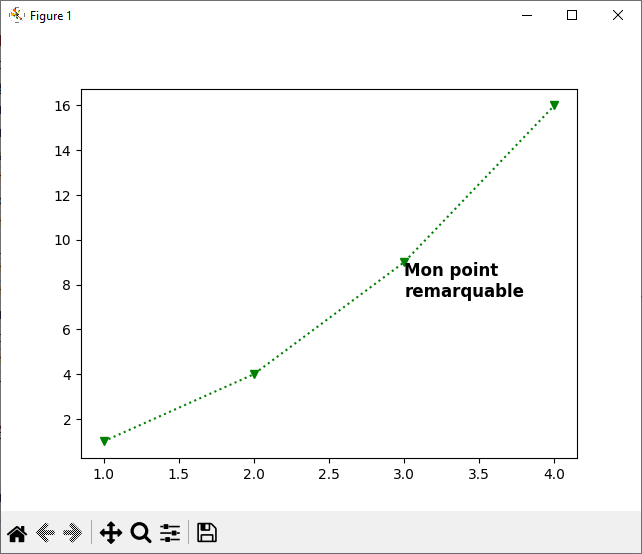


On peut aussi encadrer le texte en ajoutant un argument `bbox` à la fonction `plt.text()`

```py
plt.figure()
plt.plot([1, 2, 3, 4], [1, 4, 9, 16], "gv:")
plt.text(
    3,
    9,
    "Mon point\nremarquable",
    verticalalignment="top",
    fontsize=12,
    fontweight="bold",
    bbox=dict(facecolor="lime", alpha=0.5, boxstyle="round")
)
plt.show()
```

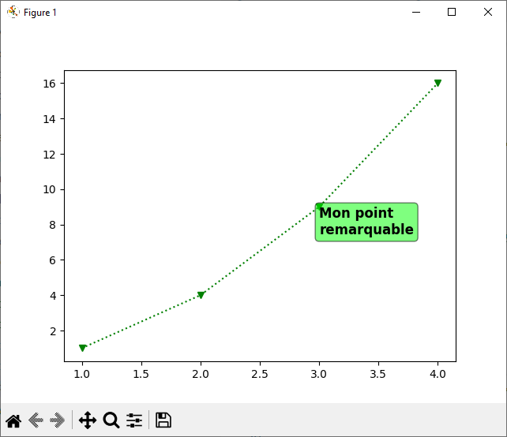

cf https://matplotlib.org/stable/api/_as_gen/matplotlib.patches.FancyBboxPatch.html#matplotlib.patches.FancyBboxPatch

## 3.10. Afficher du texte dans la figure avec la fonction `figtext()`
> Le texte peut être affiché sur la zone de traçage (Axes) ou à l'extérieur.

La fonction `figtext()` prend 3 ou plus arguments :
* 1er argument  : **position horizontale** (X) du texte dans la figure (float entre 0 et 1)
* 2ème argument : **position verticale** (Y) du texte dans la figure (float entre 0 et 1)
* 3ème argument : **le texte**
* Nème argument en nommant le paramètre :
  * `fontsize=` &nbsp;&nbsp;&nbsp;&nbsp;&nbsp;-> Taille de la police : float ou 'small', 'medium', 'large', 'x-large', 'xx-large'
  * `fontweight=` &nbsp;-> Epaisseur de la police : 'light', 'normal', 'bold', 'heavy', ...
  * `fontstyle=` &nbsp;&nbsp;&nbsp;-> 'normal', 'italic', 'oblique'
  * `verticalalignment=` &nbsp;&nbsp;&nbsp;&nbsp;-> 'bottom', 'baseline', 'center', 'center_baseline', 'top'
  * `horizontalalignment=` -> 'left', 'center', 'right'
  * `multialignment=` &nbsp;&nbsp;&nbsp;&nbsp;&nbsp;&nbsp;&nbsp;&nbsp;&nbsp;&nbsp;-> 'left', 'right', 'center'

cf. https://matplotlib.org/stable/api/_as_gen/matplotlib.pyplot.figtext.html

```py
plt.figure("Mon beau graphique")
plt.plot([1, 2, 3, 4], [1, 4, 9, 16], 'gv:')
# affichage du texte centré (horizontalement) en bas (verticalement)
plt.figtext(0.5, 0, 'Auteur : GL', horizontalalignment='center', verticalalignment='bottom')
plt.show()
```

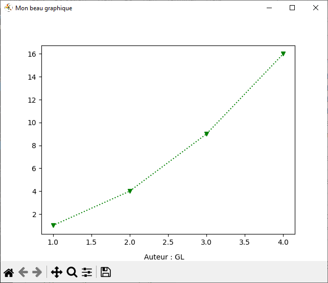

## 3.11. Affichage des formules mathématiques avec LaTeX
Les formules mathématiques et autres sont prises en charge grâce à l'utilisation du balisage LaTeX.

**En LaTeX**, les formules sont encadrées par `$....$`

Exemple :

```
$V_{sphere} =\dfrac{4}{3} \times \pi \times r^3$
```
$V_{sphere} =\dfrac{4}{3} \times \pi \times r^3$

Pour la syntaxe LaTeX, consultez [WIKIBOOKS : LaTeX/Mathematics](https://en.wikibooks.org/wiki/LaTeX/Mathematics)

**En python**, les formules LaTeX doivent être écrite dans une string en mode RAW (brut). Pour celà, on préfixe la chaine avec un `r` :
```py
formule = r"$V_{sphere} =\dfrac{4}{3} \times \pi \times r^3$"
```
**Utilisation dans pyplot** :

> Avec Matplotlib, quand on encadre du texte avec `$...$`, il utilise son moteur interne de rendu mathématique (MathText). Ce moteur utilise par défaut une police de caractères (DejaVu Math) approchée de celle de LaTeX mais elle ne donne pas entièrement satisfaction.\
> Sans avoir besoin d'installer/configurer LaTeX, on peut **changer le style de la police** utilisée par MathText et utiliser la police `"cm"` (Computer Modern).


```py
import matplotlib.pyplot as plt

plt.figure()
plt.plot([1, 2, 3, 4], [-0.5, -2, -4.5, -8], 'go:')

plt.rcParams.update({
    "mathtext.fontset": "cm",   # Computer Modern, proche de LaTeX
    "font.family": "serif"
})

formule = r"$f(x) = -\dfrac{1}{2} \times x^2$"
texte = f"Mon point\n{formule}"

plt.text(3, -4.5, texte, verticalalignment='bottom', fontsize=12, fontweight="bold")
plt.show()
```

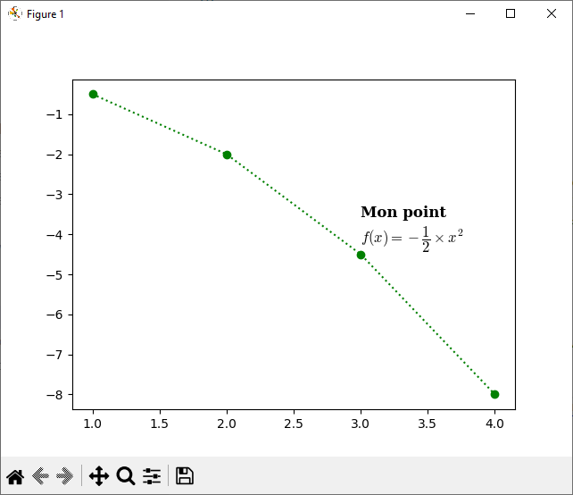


## 3.12. Tracer des droites horizontales ou verticales
Les fonctions `axhline()` et `axvline()` permettent de tracer des droites horizontales ou verticales :

```py
plt.axhline(4.5, color="blue")
plt.axvline(15, color="red")
plt.xlim(0, 20)
plt.ylim(0, 8)
plt.show()
```

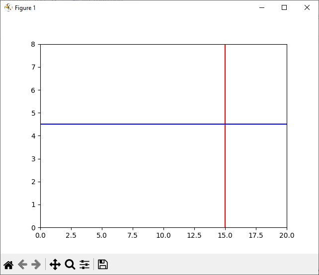


## 3.13. Tracer un histogramme avec `hist()`
> Un histogramme est un graphique qui affiche la forme d’une distribution. Un histogramme ressemble à un graphique à barres, mais il regroupe les valeurs en plages, ou classes.

La fonction `hist()` permet de tracer un graphique regroupant le nombre d'occurences de chaque valeur d'une liste.

* 1er argument : une liste de nombres, ou une liste de listes
* 2ème argument : (int) il définit le nombre de barres de largeur égales dans la plage

cf https://matplotlib.org/stable/api/_as_gen/matplotlib.pyplot.hist.html

Exemple avec une seule liste de valeurs :
```py
plt.figure("Mon histogramme")
plt.hist([1, 2, 3, 4, 1, 2, 2], 10,  label="x")
plt.legend()
plt.show()
```

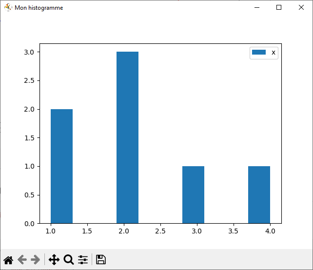

Exemple avec 2 listes :
```py
import matplotlib.pyplot as plt


plt.figure("Mon histogramme")
plt.hist([[1, 2, 3, 4, 1, 2, 2], [2, 3, 4, 3, 2, 1]], 10, label=("x", "y"))
plt.legend()
plt.show()
```

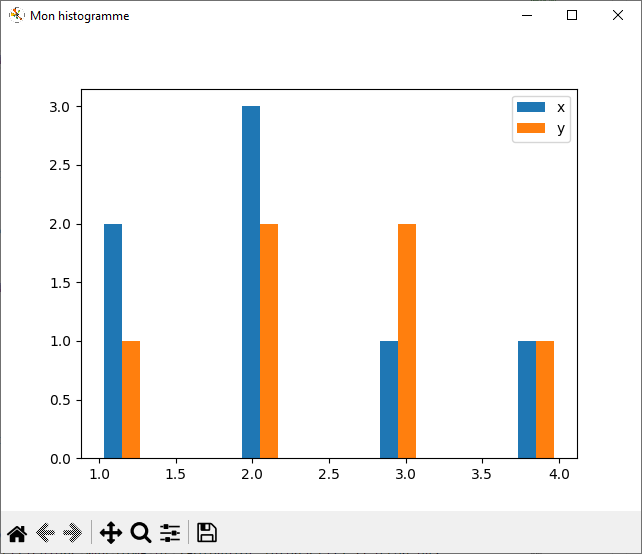


## 3.14. Tracer des polygones en couleur avec `fill()`
La fonction `fill()` permet de tracer des polygones et de les remplir avec une couleur.

```py
plt.axis([0, 5, 0, 10])
plt.fill([2,3,3,2],  [6,6,8,8], "y")
plt.show()
```

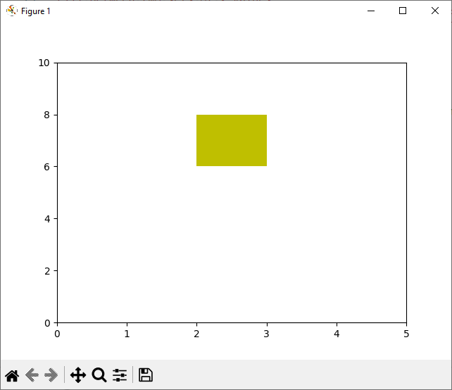

Documentation :
* Plot filled polygons (This is the pyplot wrapper for axes.Axes.fill) 
https://matplotlib.org/stable/api/_as_gen/matplotlib.pyplot.fill.html
* Color formats 
https://matplotlib.org/stable/users/explain/colors/colors.html#sphx-glr-users-explain-colors-colors-py


## 3.15. Colorier la zone entre deux courbes avec `fill_between()`
Exemple pour colorier la zone entre y = x² et l'axe de abscisses (y2 = 0)

```py
def f(x):
    return x**2

x = []
y = []

for i in range(100):
    x.append(i / 100)
    y.append(f(i / 100))

plt.plot(x, y, "b")
plt.fill_between(x, y, 0, color="orange", alpha=0.5)
plt.show()
```

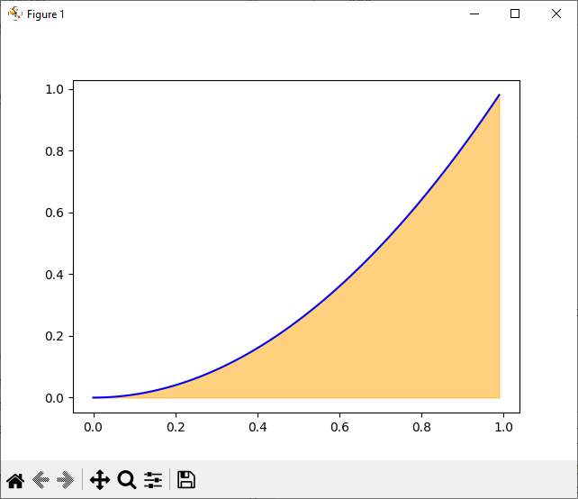

Exemple pour colorier la zone entre y1 = x<sup>2</sup> et y2 = x<sup>3</sup>

```py
def f(x):
    return x**2

def g(x):
    return x**3

x, y1, y2 = [], [], []

for i in range(100):
    x.append(i / 100)
    y1.append(f(i / 100))
    y2.append(g(i / 100))

plt.plot(x, y1, "b")
plt.plot(x, y2, "r")
plt.fill_between(x, y1, y2, color="yellow", alpha=0.5)
plt.show()
```

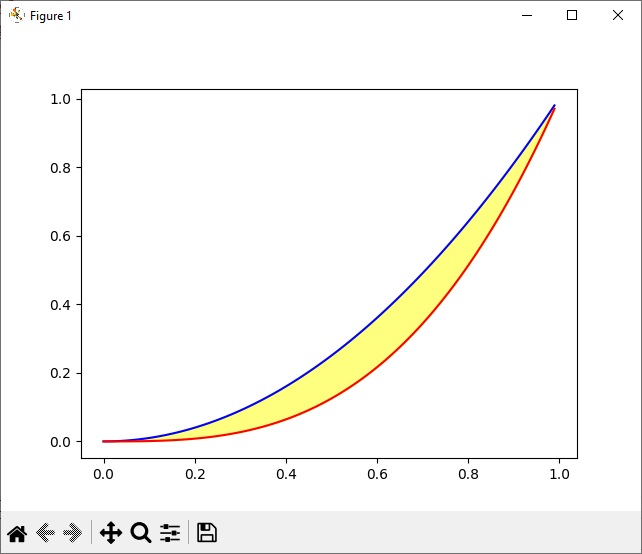

Documentation : https://matplotlib.org/stable/api/_as_gen/matplotlib.pyplot.fill_between.html

# 4. Pyplot en mode interactif (non bloquant)
## 4.1. Fonctionnement
Jusqu'à maintenant, tous les exemples présentés utilisaient l'affichage pyplot en mode bloquant : on commence par préparer tout ce qui doit être affiché et on appelle show() qui affiche les courbes et bloque l'exécution des autres instructions du script python.

**En mode interactif**, le script python n'est pas bloqué pendant l'affichage de la figure pyplot. On peut afficher la figure et ensuite la mettre à jour à partir du programme.

Pour utiliser pyplot en mode interactif, il faut suivre ces étapes :

1. **Activer le mode interactif**
    ```py
    plt.ion()
    ```
    *cf https://matplotlib.org/stable/api/_as_gen/matplotlib.pyplot.ion.html*
2. Préparer la figure et **récupérer une référence vers les objets graphiques** (figure, Axes, Line, ...).
    ```py
    my_fig = plt.figure()
    my_axes = plt.subplot() # renvoie l'Axes par défaut
    my_axes.axis([0, 10, 0, 100])  # fixe les graduations
    ```
3. **Créer une courbe vide** et récupérer une référence vers la courbe
    ```py
    my_line = plt.plot([], [])[0]
    ```
    La fonction `plot()` renvoie une liste d'objets de type `Line2D` Le premier élément de cette liste (`[0]`) correspond à la référence vers la courbe.
4. **Déclencher l'affichage de la figure sans donnée**
    ```py
    plt.pause(0.1)
    ```
    La fonction `pause()` fait 2 choses :
    * elle affiche les nouveautés comme un `show()` mais en non bloquant
    * elle attend pendant un certains temps (ici 0.1 s) pour que l'interface graphique (GUI) puisse prendre en compte les évènements utilisateur (souris, clavier). Pendant ce temps, le programme est bloqué comme avec un time.sleep().

    *cf https://matplotlib.org/stable/api/_as_gen/matplotlib.pyplot.pause.html*
5. **Affecter de nouvelles valeurs** à la courbe en se servant de la référence vers l'objet graphique Line2D.
    ```py
    my_line.set_data(x,y)
    ```
    La fonction `set_data()` des objets de type `matplotlib.lines.Line2D` permet de modifier toutes les données de la courbe.\
    *cf https://matplotlib.org/stable/api/_as_gen/matplotlib.lines.Line2D.html*
6. **Déclencher l'affichage des nouvelles données**
    ```py
    plt.pause(0.1)
    ```
    La durée de la pause est exprimée en seconde. Veillez à ne pas descendre plus bas que 0.0001s pour avoir un comportement normal de la fenêtre.
7. (Eventuellement) Désactiver le mode interactif
    ```py
    plt.ioff()
    ```
8. Garder la figure ouverte
    ```py
    plt.show()
    ```
    On garde souvent la figure ouverte pour laisser les courbes affichées en fin de programme.


## 4.2. Exemple d'affichage pyplot en mode interactif
Affichage de x² pour x de 0 à 10. Affichage d'un point toutes les 0.5 seconde

```py
import matplotlib.pyplot as plt

# Activer le mode interactif
plt.ion()

# Préparer la figure et récupérer une référence vers les 
# objets graphiques (figure, Axes, Line, ...)
my_fig = plt.figure()
my_axes = plt.subplot()  # renvoie l'Axes par défaut
my_axes.axis([0, 10, 0, 100])  # fixe les graduations en X et Y

# Créer une courbe vide et récupérer une référence
my_line = plt.plot([], [])[0]

# Déclencher l'affichage de la figure sans donnée
plt.pause(0.1)

# Affichage progressif des données
x = []
y = []
for val in range(11):
    x.append(val)
    y.append(val**2)
    # Affecter de nouvelles valeurs à la courbe
    my_line.set_data(x,y)
    # Déclencher l'affichage des nouvelles données
    plt.pause(0.5)

# Désactiver le mode interactif
plt.ioff()

# Garder la figure ouverte pour laisser les courbes affichées
plt.show()
```

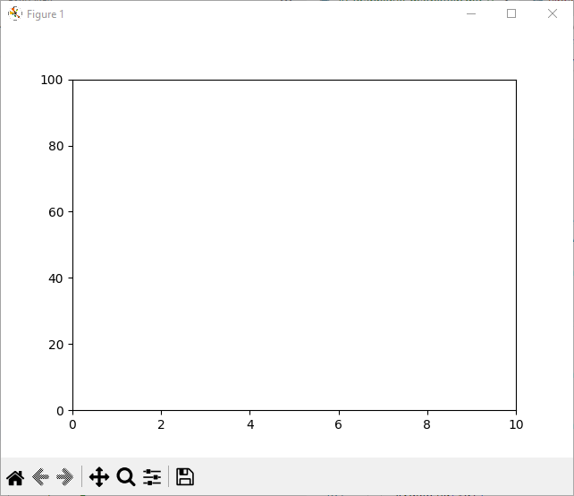

## 4.3. autoscale
En mode interactif, si vous avez besoin d'une mise à jour automatique des échelles des axis, il faut l'appeler explicitement :
```py
my_axes.relim()
my_axes.autoscale()
```