# Réseau Sigfox - SNOC breakout BRKWS01

> * Auteur : Gwénaël LAURENT
> * Date : 22/03/2023

 [Licence Creative Commons](https://creativecommons.org/licenses/by-nc-sa/3.0/fr/)

- [Réseau Sigfox - SNOC breakout BRKWS01](#réseau-sigfox---snoc-breakout-brkws01)
- [1. Présentation du réseau Sigfox](#1-présentation-du-réseau-sigfox)
- [2. Kit de prototypage Sigfox : BRKWS01](#2-kit-de-prototypage-sigfox--brkws01)
  - [2.1 Présentation](#21-présentation)
  - [2.2 Documentation du kit BRKWS01](#22-documentation-du-kit-brkws01)
- [3. Acheter un abonnement Sigfox (crédits de communication)](#3-acheter-un-abonnement-sigfox-crédits-de-communication)
  - [3.1 Prix des abonnements Sigfox](#31-prix-des-abonnements-sigfox)
  - [3.2 Procédure d'achat](#32-procédure-dachat)
- [4. Enregistrer le modem sur le backend sigfox](#4-enregistrer-le-modem-sur-le-backend-sigfox)
  - [4.1 Identifiants du modem](#41-identifiants-du-modem)
  - [4.2 Connexion au backend Sigfox](#42-connexion-au-backend-sigfox)
  - [4.3 Délégation d'administration pour les étudiants](#43-délégation-dadministration-pour-les-étudiants)
  - [4.3 Créer un groupe de devices DEVICE TYPE et associer le contrat](#43-créer-un-groupe-de-devices-device-type-et-associer-le-contrat)
  - [4.4 Créer un nouveau DEVICE dans le groupe DEVICE TYPE](#44-créer-un-nouveau-device-dans-le-groupe-device-type)
- [5. Premier programme ESP](#5-premier-programme-esp)
  - [5.1 Brancher le kit pour le premier test](#51-brancher-le-kit-pour-le-premier-test)
  - [5.2 Test du dialogue avec le kit BRKWS01](#52-test-du-dialogue-avec-le-kit-brkws01)
  - [5.3 Résumé des commanes AT](#53-résumé-des-commanes-at)
  - [5.4 Envoi du premier message Sigfox](#54-envoi-du-premier-message-sigfox)
  - [5.5 Visualisation du message sur le site de Sigfox](#55-visualisation-du-message-sur-le-site-de-sigfox)
- [6. Création d'un Callback](#6-création-dun-callback)
  - [6.1 Présentation des callbacks](#61-présentation-des-callbacks)
  - [6.2 Configuration d'un callback](#62-configuration-dun-callback)
  - [6.3 Tester le callback avec Dweet.io](#63-tester-le-callback-avec-dweetio)
- [7. Exemples d'utilisation en programmant un ESP8266](#7-exemples-dutilisation-en-programmant-un-esp8266)

# 1. Présentation du réseau Sigfox
*Sources : [Wikipedia](https://fr.wikipedia.org/wiki/Sigfox) et [Journal Du Net](https://www.journaldunet.fr/web-tech/dictionnaire-de-l-iot/1195953-sigfox-abonnement-couverture-concurrents-20211025/)*

Sigfox est un opérateur télécom français (près de Toulouse). Il est **spécialisé dans l'IoT** grâce à un réseau bas débit dit "0G".

Il contribue à l'Internet des objets en permettant l'interconnexion entre les objets (end-devices) et internet via une passerelle (**backend Sigfox**).

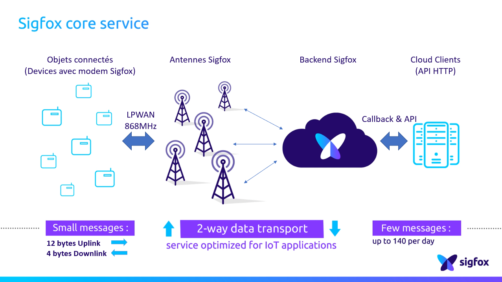

Sa technologie sans fil UNB (« Ultra narrow band ») lui permet de bâtir un réseau cellulaire bas-débit, économe en énergie et sur une grand portée (distance objet / antenne > 10km) . Cette technologie réseau fait partie de la catégorie des **LPWAN** (Low Power Wide Area Network).


 Ce type de réseau est déployé dans les bandes de **fréquences ISM** (Industrielle, Scientifique et Médicale, ), disponibles mondialement sans licence. En Europe, la bande de fréquence ISM utilisée est celle de **868 MHz** (902 MHz aux États-Unis).

Température, vibrations, localisation… les objets connectés munis de transmetteur Sigfox peuvent faire transiter sur ce réseau de **petits paquets d'informations** (le plafond est de 12 octets) **140 fois par jour** au maximum, à faible coût.

Les appareils reliés au réseau de Sigfox sont la quasi-totalité du temps en veille, ce qui leur permet de ne consommer qu'une faible quantité d'énergie. Pas besoin d'être branchés sur secteur, leur durée de vie peut atteindre une dizaine d'années avec une petite batterie.

Plus de 2 000 antennes ont été déployées par Sigfox en France. Le réseau IoT du groupe **couvre 94% de la population française**, et 71 autres pays ([Couverture en temps réel sur le site de Sigfox](https://www.sigfox.com/en/coverage)).

Présentations en vidéo par Sigfox :
* SIGFOX TECHNOLOGY: Sigfox Core Service [lien youtube](https://youtu.be/6ZBGDtmDGRU)
* SIGFOX TECHNOLOGY: Two Way Communication Of Messages [lien youtube](https://www.youtube.com/watch?v=gkSAmrLaD8g)
* What Kind Of Data A Sigfox Message Can Carry? [lien youtube](https://www.youtube.com/watch?v=JijOpH75xG8)
* SIGFOX TECHNOLOGY: Sigfox Cloud Interfaces [lien youtube](https://www.youtube.com/watch?v=7gTwFbiiJwE)
* SIGFOX TECHNOLOGY: Security of the Sigfox Network [lien youtube](https://www.youtube.com/watch?v=zUUmOVlr1pQ)


# 2. Kit de prototypage Sigfox : BRKWS01
## 2.1 Présentation
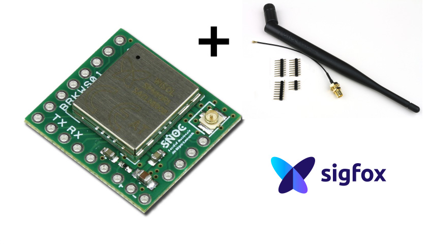

Le kit présenté ici est le "Kit Carte **Breakout Sigfox BRKWS01** + Antenne". C'est une carte de prototypage SigFox ultra petite, basée sur le module radio **Wisol SFM10R1** (Région EMEA - 868MHz). Cette carte permet d'intégrer et d'utiliser le réseau SigFox LPWAN dans la conception de projet IOT, offrant une fonctionnalité de transmission de données très simple.

Fabricant : [SNOC - Société Nationale des Objets Connectés](https://snoc.fr/lancement-de-la-carte-brkws01-sigfox/)
* Fournisseur officiel : [YADOM](https://yadom.fr/carte-breakout-sfm10r1.html) 23.88€
* Autre fournisseur : [RS Components](https://fr.rs-online.com/web/p/kits-de-developpement-pour-radio-frequence/1365801/) 32.59€

Une fois activés (abonnement + enregistrement chez Sigfox, cf ci-dessous), les kits peuvent s'utiliser comme des modems connectés aux microcontrôleurs ESP8266 ou ESP32 :
* Connexion physique : **série Rx/Tx**
* Communication par chaine de caractères : **commandes AT**

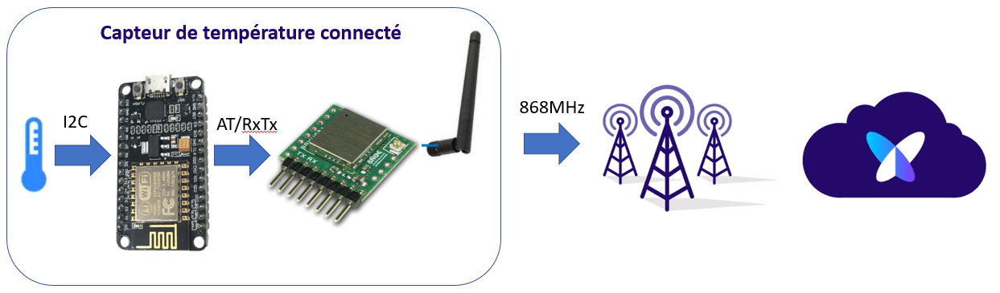

## 2.2 Documentation du kit BRKWS01
La documentation accompagnant le kit de prototypage Sigfox BRKWS01 est disponible sur le site du fournisseur officiel : [YADOM](https://yadom.fr/carte-breakout-sfm10r1.html) > Documentation


# 3. Acheter un abonnement Sigfox (crédits de communication)
## 3.1 Prix des abonnements Sigfox
> Suite au rachat de SigFox par Unabiz, le programme de connectivité DevKit gratuit est terminé, ne permettant plus d’obtenir un abonnement développeur d’un an gratuitement avec votre DevKit.\
> Les DevKits utilisent désormais des abonnements payants comment tout device Sigfox.


Jusqu'à 1000 devices (= modems sigfox), le plan **Discovery** permet d'acheter un an de communication **par device**. Voici les prix TTC des abonnements (mars 2023) :
* 7.20€ pour 2 messages par jour par device (durée 1 an)
* 9.60€ pour 70 messages par jour par device (durée 1 an)
* 12.00€ pour 140 messages par jour par device (durée 1 an)

## 3.2 Procédure d'achat
Les abonnements Sigfox s'achète en ligne sur le site [https://buy.sigfox.com/buy](https://buy.sigfox.com/buy)

> Si vous avez déjà un compte sigfox, logguez vous tout de suite avec votre compte backend sigfox. Dans le cas contraire, la création du compte se fera pendant la première procédure d'achat.\
> **Attention : les crédits de communication seront associés à ce compte !**

* Select the country of domiciliation of your company : **France** > Buy connectivity
* Choose a plan that suits your needs : **Discovery** (6€/device) > Show me the discovery plan
* How many devices would you like to connect? : **3** (*par exemple*)
* Number of messages per day per device : **140**
* Activate Atlas Native : **No Atlas**
* Purchase summary : **Buy**
* Create account (si vous avez déjà un compte sigfox, sélectionner "I already have a Sigfox account").
* **Paiement en ligne par CB**
* *Congratulations : Your purchase has been successfully processed and your credit card has been charged. You will soon receive an e-mail to activate your devices in the backend.*

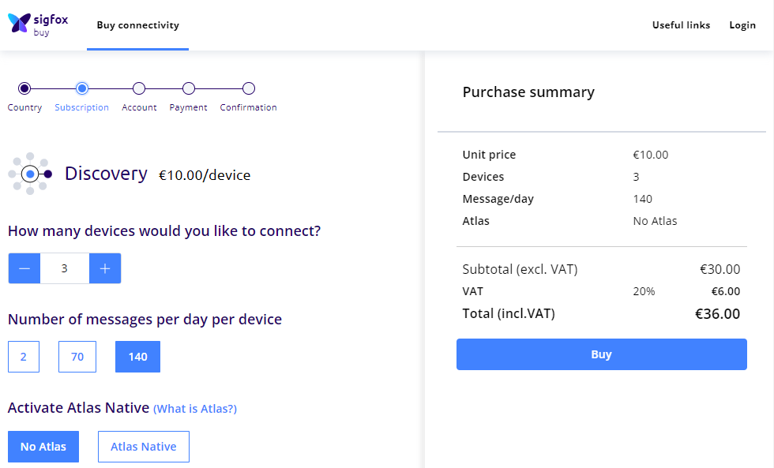

Regardez vos mails (le mail utilisé pour la création du compte backend sigfox) :
```
Thank you for purchasing on our website, your order has been successfully handled and the invoice has been generated.
Purchase: 63xxxxxxxxxx25b
Invoice: BFRxxxxxx
Contract: From BUY for 3 devices
The Sigfox team
```

Dans le **backend sigfox**, les abonnements achetés (contrat "From BUY for 3 devices") sont automatiquement ajoutés au compte et sont visibles à partir du menu : **GROUP> CONTRACTS**

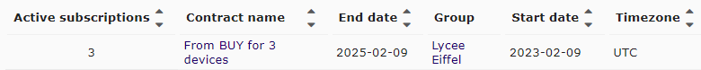

# 4. Enregistrer le modem sur le backend sigfox

## 4.1 Identifiants du modem
Pour enregistrer un modem Sigfox, il vous faut les identifiants uniques de la puce Sigfox (**Device ID + PAC Number**) inscrits sur la pochette du kit BRKWS01.

Si vous avez perdu ces identifiants, vous pouvez les retrouver en communicant avec le kit avec les commandes AT (cf § Premier programme ESP)

```cmd
AT$I=10	Retourne le "Device ID"
AT$I=11	Retourne le "PAC Number"
```

## 4.2 Connexion au backend Sigfox
Logguez vous avec vos identifiants SIGFOX sur le backend Sigfox [https://backend.sigfox.com](https://backend.sigfox.com)

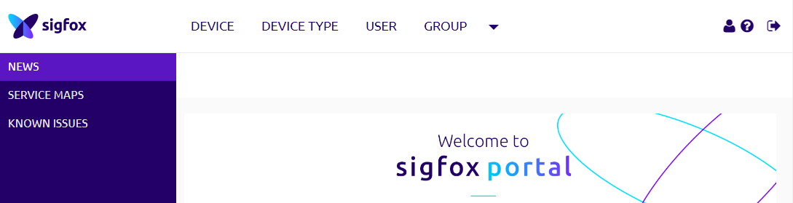


## 4.3 Délégation d'administration pour les étudiants
> L'objectif est de créer un compte dans le backend SIGFOX pour que les étudiants puissent administrer leurs modules SIGFOX (messages, callback). Dans le même temps, les modules restent la propriété de l'administrateur principal.

Sur le backend Sigfox :

**Créer un sous groupe :**
* Cliquez sur **GROUP** (dans la barre du haut)
* cliquer sur New (à droite en dessous du login)
* Cliquer sur le groupe principal
* Donner un nom au sous groupe (**BTS_SNIR**) et une description > OK

**Créer un utilisateur :**
* Cliquez sur **USER** (dans la barre du haut)
* cliquez sur New (à droite en dessous du login)
* Saisissez le nom (**etudiant snir**) et l'email du compte étudiant
* Profiles > Group :  sélectionnez le **sous groupe BTS_SNIR**
* Sélectionner le profiles (les droits d'administration) > **LIMITED_ADMIN**
* OK

Vérifier les mails du compte étudiant : Création d'un mot de passe et acceptation de l'invitation à faire partie du sous groupe.


## 4.3 Créer un groupe de devices DEVICE TYPE et associer le contrat

> Les DEVICE TYPE permettent de regrouper les devices appartenant au même projet. Tous les messages émis par les devices d'un même projet pourront ainsi être transférés vers votre API HTTP (grâce à la configuration du callback, cf plus bas)

**Créer un device type :** (groupe de devices avec la même adresse de callback vers votre API HTTP)
* Cliquez sur **DEVICE TYPE** (dans la barre du haut)
* cliquez sur New (à droite en dessous du login)
* sélectionnez le sous groupe BTS_SNIR
* Donner un nom (**Hydrants2023**) et une description obligatoire ("Projet Hydrants")
* Sélectionner un ou plusieurs contrats "From BUY for 3 devices"
* Downlink data > Downlink mode : **CALLBACK**
* Payload display :  Regular (**raw payload**)
* OK

## 4.4 Créer un nouveau DEVICE dans le groupe DEVICE TYPE
* Cliquez sur **DEVICE** (dans la barre du haut)
* cliquez sur New
* sélectionnez le sous groupe BTS_SNIR
* Identifier (hex!) : **Device ID** du modem
* Name : SNOC7 (*par exemple*)
* PAC : **PAC number** du modem
* End product certificate : **P_0028_9789_01** (pour Wisol SigFox Module RCZ1 (SFM10R1))
* Type : sélectionner un groupe DEVICE TYPE, par ex. **Hydrants2023**
* Lat : 50.68891031769687
* Long : 2.8718588695398766
* Subscription automatic renewal : ne pas cocher
* Activable : cocher


# 5. Premier programme ESP
## 5.1 Brancher le kit pour le premier test
Schéma de la carte BRKWS01 :

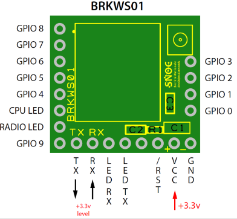

> **Attention, le kit doit être alimenté en ```3.3V```. La plupart des câbles USB-Série fournissent une alimentation de 5V, même si le signal des broches RX et TX est en 3.3V !**

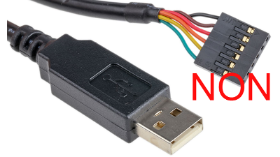

Plusieurs possibilités pour effectuer le premier test d'émission :
* **1ère possibilité** : utiliser un ESP comme passerelle série entre votre ordi et la carte BRKWS01. Codage très facile de l'ESP en vous inspirant de la doc [PlatformIO : ESP Serial et SoftwareSerial](../platformio/13.pio-esp-serial.md)
* **2ème possibilité** : utiliser un Raspberry (sans codage, en utilisant le logiciel Minicom) : [Utiliser Minicom sur Raspberry pour activer les cartes SIGFOX SNOC BRKWS01](sigfox_minicom_raspi.md)

En utilisant un ESP8266 comme passerelle, on a le schéma de branchement suivant (vous pouvez choisir d'autres broches pour la communication série logicielle avec le kit BRKWS01):

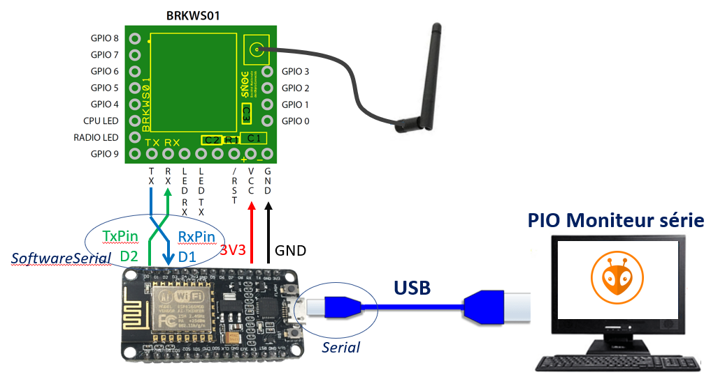

> ATTENTION à bien **"croiser" les RX et TX** entre l'ESP et le kit BRKWS01 : 
> * il faut relier Rx de l'ESP avec Tx du kit BRKWS01
> * et relier Tx de l'ESP avec Rx du kit BRKWS01

> **Echo local dans le moniteur série de PlatformIO** : pour que le moniteur affiche les caractères que vous tapez au clavier, il faut le paramétrer dans ```platformio.ini```
> ```ini
> monitor_echo = yes
> ```

Le programme de l'ESP se contente de recopier tout ce qu'il reçoit du port série matériel au port série logiciel, et vice-versa. 

La communication série est paramétrée des 2 côtés en **9600 bauds, 8 bits, 1 bit d'arrêt, sans parité** (configuration par défaut du kit BRKWS01).

Putty doit être configuré pour ne pas ajouter de retour à la ligne :

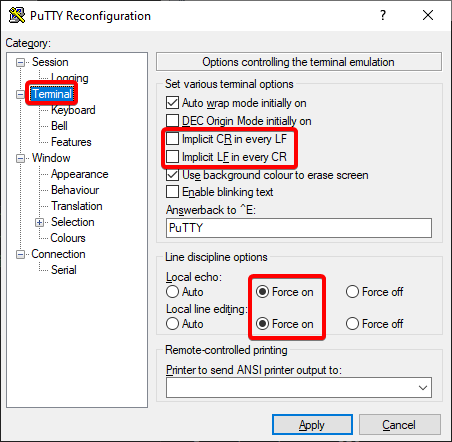

```cpp
#include <Arduino.h>
#include <SoftwareSerial.h>

//Numéro des broches utilisées pour le port série logiciel
#define txPin 4 //sérigraphie D2
#define rxPin 5 //sérigraphie D1

//caractère (ou byte) reçu
char incomingChar;

//création d'un objet SoftwareSerial
SoftwareSerial swSer1(rxPin, txPin);

void setup()
{
  //initialisation de la communication série physique
  Serial.begin(9600);
  //initialisation de la communication série logicielle
  swSer1.begin(9600, SWSERIAL_8N1);
  Serial.println((String) "Recopie le moniteur série de PlatformIO sur Rx=" + rxPin + " et Tx=" + txPin);
}

void loop()
{
  //**** réception moniteur série ou Putty ****//
  if (Serial.available())
  {
    // lecture de l'octet reçu
    incomingChar = (char)Serial.read();
    // recopie de l'octet vers le kit BRKWS01
    // les commandes AT sont suivies d'un '\r' (caractère de la touche Entrée sous Linux)
    // mais surtout pas du '\r\n' de Windows
    if (incomingChar != '\n')
      swSer1.print(incomingChar);
  }

  //**** réception softwareserial RX et TX ****//
  if (swSer1.available())
  {
    // lecture du caractère reçu
    incomingChar = (char)swSer1.read();
    // recopie de l'octet vers le moniteur série
    Serial.print(incomingChar);
    //  après un '\r' on ajoute le caractère '\n' pour être conforme au retour à la ligne de Windows
    if (incomingChar == '\r')
      Serial.print('\n');
  }
}
```

## 5.2 Test du dialogue avec le kit BRKWS01
Dans le moniteur série de platformio, saisissez la **commande "AT"** (en majuscule) suivie de Entrée. Le kit BRKWS01 doit vous renvoyer "OK"
```cmd
AT
OK

```

Saisissez la **commande "AT$I=10"** pour obtenir le "Device ID" du module Sigfox Wisol SFM10R1
```cmd
AT$I=10
00C5XXXX

```

Saisissez la **commande "AT$I=11"** pour obtenir le "PAC Number" du module Sigfox Wisol SFM10R1
```cmd
AT$I=11
XXXXXXXXXXXXXXXX

```

## 5.3 Résumé des commanes AT
> **Commandes AT** : langage de commandes en "mode texte" adapté pour contrôler les modems.

La carte BRKWS01 est controllée grâce à des commandes AT envoyées sur les broches Rx/Tx.

Commandes communes :

| AT command | Description                                                                                              |
|------------|----------------------------------------------------------------------------------------------------------|
| AT         | Test de communication. Retourne juste "OK"                                                               |
| AT$I=0     | Retourne le nom et la version du firmware                                                                |
| AT$I=10    | Retourne le "Device ID"                                                                                  |
| AT$I=11    | Retourne le "PAC Number"                                                                                 |
| AT$SF=XX   | Envoi le message Sigfox XX (Valeur hexadécimale)                                                         |
| AT$SF=XX,1 | Envoi le message Sigfox XX avec trame de reception (Valeur hexadécimale)                                 |
| AT$T?      | Mesure et retourne la température du module (en 1/10 de °C)                                              |
| AT$V?      | Retourne la tension d'alimentation du module et la tension mesurée pendant la dernière transmission (mV) |
| AT$P=0     | Power Mode : Software Reset                                                                              |
| AT$P=1     | Power Mode : Sleep (send a break to wake up)                                                             |
| AT$P=2     | Power Mode : Deep Sleep (toggle GPIO9 or RESET_N pin to wake up)                                         |

La liste complète des commandes AT est disponible sur le site de Yadom ou [ici](WISOL_CommandAT_SFM10R.pdf)


## 5.4 Envoi du premier message Sigfox
> Vous pouvez envoyer des trames Sigfox comportant de **1 à 12 octets de charge utile (payload)** à raison de 140 messages /jour.

La commande AT qui qui permet d'envoyer un message Sigfox est de la forme : 
```
AT$SF=XXXXXXXXXXXX (Hexadecimal value)
```
Les octets du message doivent être fournis dans leur **représentation hexadécimale** sur 2 caractères.

Exemples :
* Pour envoyer le nombre 127 il faut saisir :  ```AT$SF=7F```
* Pour envoyer les caractères 'ABCabc' il faut saisir leur code ASCII en hexa :  ```AT$SF=414243616263```

Le modem répond ```OK``` si le message a bien été envoyé :
```
AT$SF=414243616263
OK
```

## 5.5 Visualisation du message sur le site de Sigfox
Logguez vous avec vos identifiants SIGFOX sur le backend Sigfox [https://backend.sigfox.com](https://backend.sigfox.com)

Les données envoyées par vos modules sont visibles dans le menu **DEVICE** :


Cliquer sur l'**ID** du module :

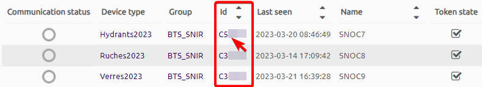

Cliquez sur le sous menu **Messages** (colonne de gauche)

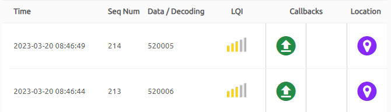

Si vous cliquez sur l'icône violette **Location**, la locatisation du module est affichée sur une carte. Il s'agit de la localisation que vous avez renseignée pendant la création du device sur le backend Sigfox.

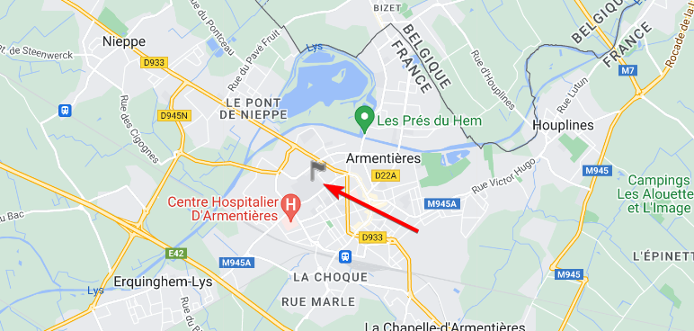


# 6. Création d'un Callback
## 6.1 Présentation des callbacks
Les Callbacks permettent de transférer les données reçues des Devices Sigfox vers votre API HTTP. La configuration des Callbacks s'effectue sur le backend Sigfox.

> Le paramétrage du Callback est associé à un DEVICE TYPE. Les DEVICE TYPE peuvent regrouper plusieurs DEVICE, donc cela permet de paramétrer le même callback pour tous les objets d'un même projet IoT.

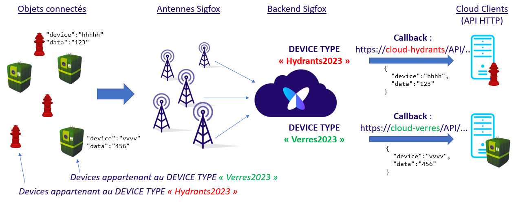

## 6.2 Configuration d'un callback
Logguez vous avec vos identifiants SIGFOX sur le backend Sigfox [https://backend.sigfox.com](https://backend.sigfox.com)

Le paramétrage du Callback se configure à partir du menu **DEVICE TYPE** :


Cliquez sur le **nom** du DEVICE TYPE dont vous voulez paramétrer le callback :

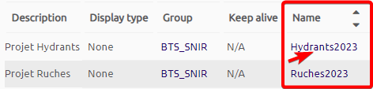

Cliquez sur le sous menu **CALLBACKS** (colonne de gauche)

Pour configurer le callback vers une API REST (Tous les messages Sigfox des objets seront retransmis automatiquement à votre API REST) :

* Cliquez sur "**New**" (à droite en dessous du login)
* **Custom callback**
* Type : DATA + UPLINK
* Channel : URL
* Url pattern : http://my_server_address/path (*cf plus bas pour une URL de test avec Dweet.io*)
* Use HTTP Methode : **POST** (vous avez le choix entre GET POST et PUT)
* Send SNI : Yes
* Headers : en fonction de vos besoins supplémentaires
* Content type : **application/x-www-form-urlencoded**
* Body : 
    ```
    device={device}&data={data}
    ```

Si vous voulez envoyer les données au **format JSON**, il faut modifier l'en-tête Content-Type et Body :
* Content type : **application/json**
* Body : 
    ```
    {
        "device":"{device}",
        "data":"{data}"
    }
    ```

Pour plus de documentation sur la création des callbacks :
* How to create a device type & a callback [lien youtube](https://youtu.be/dDNY-xAxECE)
* Documentation on callbacks [Sigfox Resources Center](https://support.sigfox.com/docs/custom-callback-creation)

## 6.3 Tester le callback avec Dweet.io
> Dweet.io est un cloud gratuit qui permet de tester les API Web.\
> **Attention : Dweet.io est un site public ! tout le monde peut voir vos données transmises** 

Dweet.io est utile pour :
* Tester le bon fonctionnement du callback créé sur le backend Sigfox
* Vérifier le format des données transmises par le callback Sigfox

1. Choisissez une chaine de caractères qui permet d'identifier vos messages dans Dweet.io. Par exemple, ici nous utilisons "*Hydrants2023*"

2. Configurez le callback dans le backend Sigfox :
    * Url pattern : https://dweet.io:443/dweet/quietly/for/Hydrants2023

3. Consultez les messages transmis par le callback en vous connectant sur https://dweet.io/ > Play
   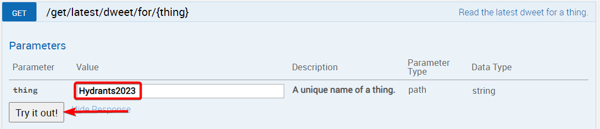

# 7. Exemples d'utilisation en programmant un ESP8266
* [Message with NODEMCU (ESP8266) and BRKWS01 (Sigfox Wisol SFM10R1) to your python Flask backend](https://github.com/romaintribout/Sigfox-NODEMCU-BRKWS01-Wisol-SFM10R1)
* [IoThings Arduino Library for Wisol WSSFM10 Module](https://github.com/adrien3d/IO_WSSFM10-Arduino)

