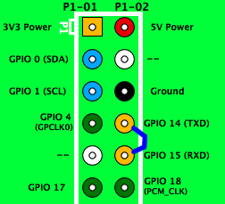
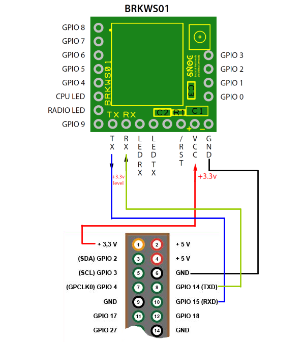

# Utiliser Minicom sur Raspberry pour communiquer avec les cartes SIGFOX SNOC BRKWS01

* Auteur : Gwénaël LAURENT
* Date : 7/3/2020
* Raspian Buster du 7/3/2020

 [Licence Creative Commons](https://creativecommons.org/licenses/by-nc-sa/3.0/fr/)

> Tuto adapté aux breakout BRKWS01 de chez SNOC
> Ces kits intègrent un module Wisol SFM10R1

*Merci à François MOCQ. Tuto inspiré de 
[https://www.framboise314.fr/le-port-serie-du-raspberry-pi-3-pas-simple/](https://www.framboise314.fr/le-port-serie-du-raspberry-pi-3-pas-simple/)*

- [Utiliser Minicom sur Raspberry pour communiquer avec les cartes SIGFOX SNOC BRKWS01](#utiliser-minicom-sur-raspberry-pour-communiquer-avec-les-cartes-sigfox-snoc-brkws01)
  - [1. Activation du port série](#1-activation-du-port-s%c3%a9rie)
  - [2. Cablage pour tester le port série](#2-cablage-pour-tester-le-port-s%c3%a9rie)
  - [3. Tests avec le logiciel Minicom](#3-tests-avec-le-logiciel-minicom)
  - [4. Branchement de la carte BRKWS01](#4-branchement-de-la-carte-brkws01)

## 1. Activation du port série
> Sur le Raspberry Pi 3, un port série est utilisé par le Bluetooth et le deuxième port série n'est pas activé ... donc nous allons activer le port série sur /dev/ttyS0 pour pouvoir communiquer.

**Avant de brancher la carte BRKWS01** sur le Raspberry, connectez-vous en **SSH sur le Raspi**.

La liste des ports série est affichée avec la commande :
```shell
#ls -l /dev | grep serial
lrwxrwxrwx  1 root root           7 Mar  8 17:53 serial1 -> ttyAMA0
```
Il faut activer la communication sur le port série :
```shell
#sudo raspi-config
```
> Aide : Utiliser les touches TAB et Entrée pour naviguer des les écrans de configuration.

* 5 Interfacing Options
* P6 Serial
* Would uou like a login shell to be accessible over Serial ? **No**
* Would you like the serial port hardware to be enabled ? **Yes**
* OK
* Finish
* Would you like to reboot now ? **No**

Editez **/boot/config.txt**
```shell
#sudo nano /boot/config.txt
```
Ajouter les lignes suivantes :
```shell
enable_uart=1
dtoverlay = pi3-disable-bt
```
Enregistrez les modifs avec Ctrl+O, Entrée puis Ctrl+X.

**Redémarrez** le Raspberry :
```shell
#sudo reboot
```
Normalement, la liste des ports série doit avoir changée :
```shell
#ls -l /dev | grep serial
lrwxrwxrwx  1 root root           5 Mar  8 21:02 serial0 -> ttyS0
lrwxrwxrwx  1 root root           7 Mar  8 21:02 serial1 -> ttyAMA0
```
## 2. Cablage pour tester le port série
Relier les broches Rx(broche 10) et Tx(broche 8) (le mieux serait d'utiliser une résistance de 500 ohms pour la protection).

> Tout ce que vous enverez sur le port série (Tx) sera reçu (Rx) par le même port série.



## 3. Tests avec le logiciel Minicom
Installer un terminal série CLI : **minicom**
```shell
#sudo apt-get install minicom
```
Lancer l'application minicom
```shell
#minicom
```
Accéder aux commandes de minicom :
```
Ctrl+A > Z
```
Configurer le port série /dev/ttyS0 en 9600bits/s, 8 bits de données, pas de parité, 1 bit de stop :
```
O (Configure Minicom)
Serial port setup
A (Serial Device) = /dev/ttyS0 > Entrée
E (Bps/Par/Bits) > C (9600), V (8bits), L (None), W (1 stop)
    La première ligne doit afficher Current : 9600 8N1
    > Entrée
F (Hardware Flow Control) = No
G (Software Flow Control) = No
Entrée
Save setup as dfl > Entrée
Exit > Entrée
```

Quitter minicom et relancez le :
```shell
Ctrl+A > Q > Yes > Entrée
#minicom
```
Tout ce que vous tappez dans Minicom doit être envoyé sur la broche Tx, reçu sur la broche Rx et affiché à l'écran. 

**Activer**/Désactiver **l'echo local**
```
Ctrl+A > Z > E
```
> L'echo local permet d'afficher les caractères que vous tappez ET les caractères reçus
> 
Si vous tappez "Bonjour" dans Minicom, vous devriez voir :
* Sans echo local
  ```
  Bonjour
  ```
* Avec echo local
  ```
  BBoonnjjoouurr
  ```
**Laissez l'echo local actif**

## 4. Branchement de la carte BRKWS01


> N'oubliez pas de "croiser" les Rx/Tx entre le Raspberry et la carte (comme indiqué sur le schéma)

Dans minicom, si vous tappez la commande ```AT``` (en majuscule), la carte BRKWS01 doit répondre par ```OK```
```
AT
OK
```
Autre commande pour connaitre la température du boitier (en 1/10 de degré Celsius) :
```
AT$T?
241
```
Pour connaitre le Device ID du modem SIGFOX (*attention, le pavé numérique n'est pas pris en charge dans minicom*):
```
AT$I=10
xxxxxxxx
```
Pour connaitre le numéro PAC du modem SIGFOX :
```
AT$I=11
xxxxxxxxxxxxxxxx
```