# Rejoindre un espace de travail Slack

> * Auteur : Gwénaël LAURENT
> * Date : 27/03/2020
> * OS : Windows 10 (version 1903)

 [Licence Creative Commons](https://creativecommons.org/licenses/by-nc-sa/3.0/fr/)

- [Rejoindre un espace de travail Slack](#rejoindre-un-espace-de-travail-slack)
  - [1. Slack, qu’est-ce que c’est ?](#1-slack-quest-ce-que-cest)
  - [2. A quoi ça va nous servir ?](#2-a-quoi-%c3%a7a-va-nous-servir)
  - [3. Vous avez reçu une invitation par mail ...](#3-vous-avez-re%c3%a7u-une-invitation-par-mail)
  - [4. Téléchargement et installation du logiciel Slack](#4-t%c3%a9l%c3%a9chargement-et-installation-du-logiciel-slack)
  - [5. Utilisation de Slack pour les messages et les fils de discussion](#5-utilisation-de-slack-pour-les-messages-et-les-fils-de-discussion)
    - [5.1 Message dans un canal](#51-message-dans-un-canal)
    - [5.2 Fil de discussion](#52-fil-de-discussion)
    - [5.3 Message direct](#53-message-direct)
  - [6. Installation du logiciel de visioconférence Zoom](#6-installation-du-logiciel-de-visioconf%c3%a9rence-zoom)
  - [7. Configuration initiale de Slack pour les visioconférences](#7-configuration-initiale-de-slack-pour-les-visioconf%c3%a9rences)
  - [8. Créer une visioconférence](#8-cr%c3%a9er-une-visioconf%c3%a9rence)
  - [9. Accepter une invitation à une visioconférence](#9-accepter-une-invitation-%c3%a0-une-visioconf%c3%a9rence)
  - [10. Règles de bonne conduite dans notre espace SNIR-Eiffel](#10-r%c3%a8gles-de-bonne-conduite-dans-notre-espace-snir-eiffel)
  - [11. Aide en ligne (en français)](#11-aide-en-ligne-en-fran%c3%a7ais)

## 1. Slack, qu’est-ce que c’est ?


[Selon les éditeurs de Slack](https://slack.com/intl/fr-fr/help/articles/115004071768-Qu%E2%80%99est-ce-que-Slack-) : 
Slack est une plateforme collaborative qui permet de remplacer les e-mails et de faciliter les échanges entre les membres de votre équipe. Elle a été conçue pour favoriser la manière naturelle qu’ont les gens de travailler ensemble et rendre la collaboration en ligne aussi facile et efficace que si elle avait lieu en tête-à-tête.

[Selon Wikipedia](https://fr.wikipedia.org/wiki/Slack_(plateforme)) : 
Slack est une plateforme de communication collaborative. 
Slack fonctionne à la manière d'un chat IRC organisé en **```canaux```** et **```fils de discussion```**. 

La plateforme permet également de :
* conserver une trace de tous les échanges (« Slack » est l'acronyme de « Searchable Log of All Conversation and Knowledge »), 
* permet le partage de fichiers au sein des conversations et 
* intègre des services externes comme la visioconférence avec Zoom pour centraliser le suivi et la gestion d'un projet.

Ce qui ne gâche rien, c'est une pateforme très utilisée par les informatitiens professionnels. Donc **```c'est une bonne compétence pour vous```** (et en plus ce n'est pas compliqué).

## 2. A quoi ça va nous servir ?
* Garder un lien de "continuité pédagogique"
* Centraliser notre communication
* Etre réactif pour répondre à vos questions
* Enregistrer les réponses pertinentes pour qu'elles servent à tout le monde
* Faire des revues de projet en live (surtout pour les 2ème année)

**Attention** : nous continuerons en même temps à utiliser GitLab et les Google Drive.

> Pour que tout se passe aux mieux, et que cet outil nous soit utile, il va naturellement être nécessaire de respecter quelques **règles de bonne conduite**. Nous verrons ça plus loin.

## 3. Vous avez reçu une invitation par mail ...
Objet du mail : "Gwénaël LAURENT vous a invité à rejoindre un espace de travail Slack"

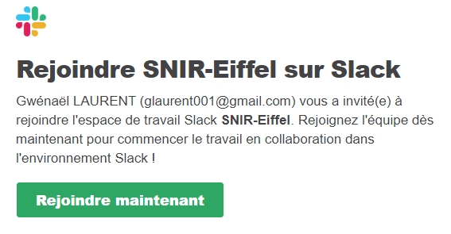

A partir de là :
* vous allez rejoindre l'**```espace de travail```** de la section SNIR
* configurer votre logiciel de visioconférence

> Un **espace de travail** Slack se compose de canaux (autrefois appelés « chaînes ») sur lesquels les membres d’une équipe peuvent communiquer et collaborer.

Affichez le mail reçu > Cliquez sur le bouton vert "```Rejoindre maintenant```"

Une page web se lance ```Rejoindre l'espace de travail Slack SNIR-Eiffel``` :

Saisissez :
* Nom complet : NOM prénom (ça devrait être pré-rempli)
* Mot de passe : Saisissez un BON mot de passe et notez le !
* Pouvons-nous vous envoyer un e-mail avec des conseils... : comme vous voulez
* Cliquez sur ```Créer un compte```

Vous êtes redirigés sur la page web **SNIR-Eiffel** : C'est notre ```espace de travail```. Il est également accessible à l'adresse : [http://snir-eiffel.slack.com/](http://snir-eiffel.slack.com/)

Pour le moment, il n'y pas grand chose. Explorez le volet de gauche :

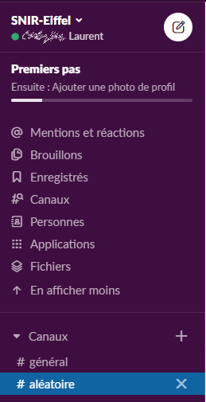

* Cliquez sur votre nom en haut, vous pourrez modifier :
  * votre image de profil (pour que les autres personnes sachent qu’elles correspondent avec la bonne personne),
  * vos préférences de notifications, 
  * votre statut (actif, ne pas déranger ...), 
  * etc.
* Cliquez sur le canal ```#aléatoire``` et dites "Bonjour"

> Pour le moment, vous n'avez accès qu'à deux canaux de discussion (```#aléatoire``` et ```#général```). Ca va changer dès que l'administrateur vous aura invité dans les canaux privés de votre classe et/ou de votre projet.

> **N'oubliez pas** : Tous vos profs d'informatique ont accès à tous les canaux et reçoivent une notification pour chacun de vos messages.

## 4. Téléchargement et installation du logiciel Slack
Il est beaucoup plus pratique d'utiliser Slack à partir de l'application dédiée. Elle existe pour Windows et aussi pour vos smartphones (disponible dans les playstores).

Téléchargez la version pour Windows à cette adresse : [https://slack.com/intl/fr-fr/downloads](https://slack.com/intl/fr-fr/downloads)

* Cliquez sur ```TÉLÉCHARGER (64 BITS)```
* Quand le téléchargement est terminé, exécutez le fichier SlackSetup.exe (68 Mo)

Quand le logiciel démarre, vous devez vous identifier :

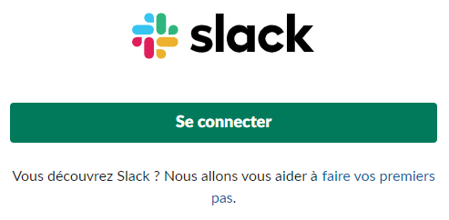

Cliquez sur le bouton ```Se connecter```. Vous êtes redirigé dans votre navigateur web sur une page web "Connectez-vous à votre espace de travail".

Ne saisissez pas un nouvel espace de travail ! Cliquez plus bas sur : ```SNIR-Eiffel```

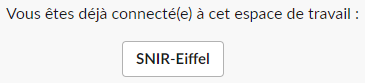

Une fenêtre d'alerte s'ouvre :

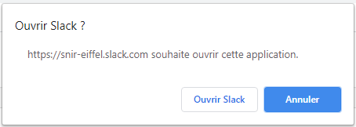

Cliquez sur ```Ouvrir Slack```. Après quelques secondes, vous êtes automatiquement authentifié dans l'application Slack.

**L'installation de Slack est terminée**

> La configuration par défaut de Slack fait que le logiciel est toujours actif, même quand vous fermez la fenêtre. Vous pouvez réouvrir / paramètrer Slick à partir de l'icônes de la barre des tâches de Windows (Clic gauche ou droit sur l'icône de Slack)
> 
> 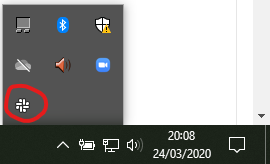


## 5. Utilisation de Slack pour les messages et les fils de discussion
Il y a trois types de message dans Slack :
* Message standard dans un canal (public ou privé).
* Fil de discussion.
* Message direct.

### 5.1 Message dans un canal
Les ```messages écrits dans un canal``` sont visibles par tous les membres du canal. Dans notre espace de travail ```SNIR-Eiffel```, la gestion des membres est faite par l'administrateur. Qui fait partie des canaux ?

* ```#aléatoire``` : tous les SNIR1 + les SNIR2
* ```#général``` : tous les SNIR1 + les SNIR2
* ```#snir1-xxxx``` : tous les SNIR1
* ```#snir2-xxxx``` : tous les SNIR2
* ```#projet-xxxx``` : les membres du groupe de projet

> Tous vos profs d'informatique ont accès à tous les canaux et peuvent répondre à vos messages.

**Comment faire :** 

* Cliquez sur un canal, 
* écrivez dans la zone de message, 
* appuyez sur Entrée

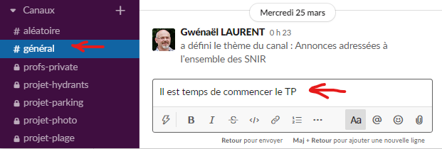

### 5.2 Fil de discussion
A partir de n'importe quel message posté dans un canal, il est possible de répondre dans un ```fil de discussion``` pour ne pas perturber la discussion principale du canal.

Pourquoi utiliser des fils de discussion ? 
* Dans notre cas, ça peut permettre de résoudre un problème qui nécessite plusieurs échanges.
* Organisez les conversations et conservez tout le contexte utile
* Aussi pour associer clairement vos idées ou commentaires au message

**Comment faire :** 

* Maintenez le curseur de votre souris au-dessus du message auquel vous souhaitez répondre
* Cliquez sur l’icône "Démarrer un fil de discussion"

  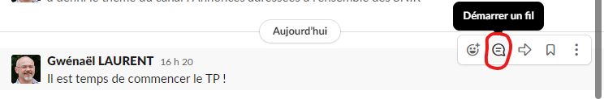
* Rédigez votre message dans la zone de droite à l'écran

  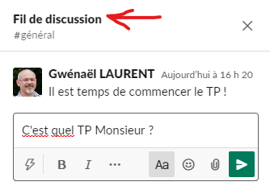
* Appuyez sur Entrée

Dans la conversation principale du canal, les fils de discussion apparaissent comme ça :

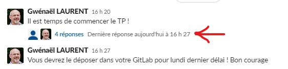

Il suffit de cliquer sur le fil de discussion pour afficher tous les échanges :

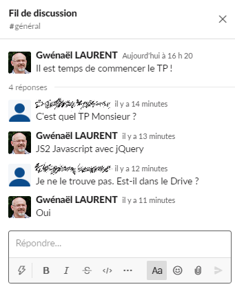

### 5.3 Message direct
Si la plupart des discussions dans Slack ont lieu dans des canaux, les messages directs sont parfaits pour des conversations ponctuelles qui ne nécessitent pas la participation de tous les membres d’un canal. Les ```messages directs (DM)``` sont des discussions à plus petite échelle se déroulant en dehors des canaux, entre vous et jusqu’à huit autres personnes. 

**Comment faire :** 

* Cliquez sur le bouton de rédaction, en haut à gauche

  

* Sélectionnez le ou les utilisateurs destinataires (comme pour un mail standard)

  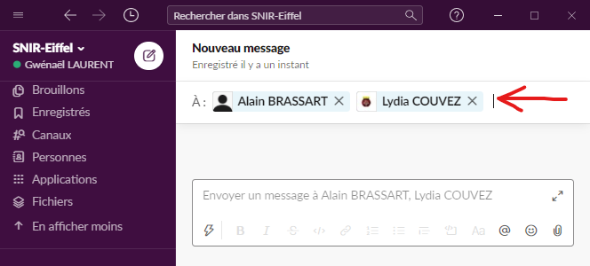

* écrivez dans la zone de message, 
* appuyez sur Entrée


## 6. Installation du logiciel de visioconférence Zoom
Notre espace de travail est configuré pour utilisé ```Zoom``` comme appli de visioconférence. Les visio seront lancées **à partir de Slack**.

> L'avantage d'intégrer Zoom dans Slack est de pouvoir automatiquement inviter les membres de l'espace de travail SNIR-Eiffel (et en partie d'éviter les Trolls)

Il vous faut maintenant installer Zoom sur votre ordinateur. Cela fait l'objet d'un tuto à part que vous trouverez [en cliquant ici](https://gitlab.com/gwenael.laurent/public/-/blob/master/zoom/readme.md). Une fois que vous aurez installé Zoom, continuez le paramétrage de Slack.

> *L'installation de Zoom que je vous propose vous permet de l'utiliser en dehors de Slack pour vos visio familiales, etc ...*
> 
> *Si vous avez déjà installé Zoom pour d'autres utilisations, c'est parfait pour Slack aussi.*
> 
> *La seule chose que je vous demande c'est d'afficher vos nom et prénom pour l'utilisation professionnelle avec Slack, et pas un pseudo.*

## 7. Configuration initiale de Slack pour les visioconférences
Pour lancer une visioconférence avec zoom, il faut d'abord choisir la liste des participants et écrire un message qui va lancer Zoom.

La liste des participants invités à la visio, sera ```la liste des membres du canal``` dans lequel vous écrirez ce message d'invitation.

Bien sûr, à la place d'un canal, ```on peut aussi sélectionner un message direct```. Dans ce cas, les personnes invitées sont celles destinataires du message direct.

Pour les tests de Zoom, vous allez choisir un message direct vers l'utilisateur ```Slackbot```.

> **Slackbot est votre robot personnel** pour vous guider dans l'utilisation de Slack. Tout ce qu'il vous dit, et tout ce que vous lui dites, reste entre vous. Personne d'autre ne le verra. Vous le trouverez dans la barre latérale gauche, dans la partie "Messages directs" (sous les canaux).
> 
> 

Pour lancer une visioconférence avec zoom, il faut saisir un message commençant par ```/zoom``` puis appuyez sur la touche Entrée (2 fois). Pour les tests, faites le avec ```Slackbot```

La première fois, vous verrez apparaitre un message demandant l'autorisation d'accéder au logiciel Zoom :

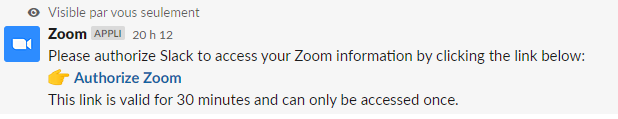

Cliquez sur ```Authorize Zoom```

Une page web https://zoom.us/... s'ouvre vous demandant vos identifiants Zoom. Saisissez les et cliquez sur ```Connexion```.

Sur la page suivante "Slack demande un accès à votre compte Zoom" :


* Cliquez sur le bouton ```Approbation au péalable```
* Puis cliquez sur le bouton ```Autoriser```

Sur la page suivante "Your integration is ready to go! ...", cochez :
* Don’t show recording links for my completed meetings
* Use an encrypted password for meetings I create

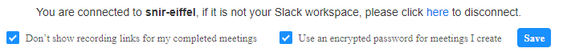

Et cliquez sur ```Save```. Quand la notification ```saved``` s'affiche, vous pouvez fermer le navigateur web.

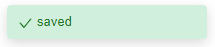


## 8. Créer une visioconférence
> Comme expliqué précédemment, pour démarrer une visioconférence, il faut ```sélectionner un canal ou un message direct```. Tous les membres de ce canal seront invités automatiquement à rejoindre la visioconférence.

Dans Slack, sélectionnez vos destinataires (ici,pour les tests, vous utiliserez ```Slackbot```), saisissez à nouveau un message commençant par ```/zoom``` puis appuyez sur la touche Entrée (2 fois).

Vous verrez apparaitre un message :

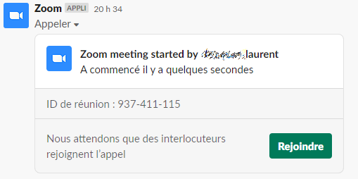

Cliquez sur ```Rejoindre```

Une page web https://....zoom.us/... s'ouvre avec une alerte :

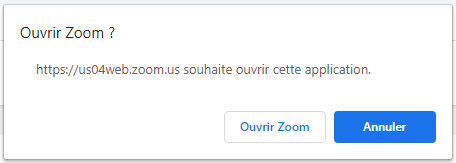

Cliquez sur ```Ouvrir Zoom``` > Le logiciel Zoom se lance sur une fenêtre "Rejoindre l'audio" :

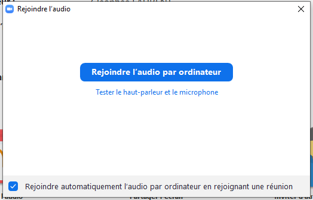

* Cochez la case du bas "Rejoindre automatiquement l'audio par ordinateur en rejoignant une réunion"
* Cliquez ensuite sur le bouton ```Rejoindre l'audio par ordinateur```

> A mon avis ce message est une traduction française un peu bizarre ... Il s'agit tout simplement de dire à Zoom qu'il faut utiliser le microphone de l'ordinateur.

La visioconférence démarre dans une nouvelle fenêtre du logiciel Zoom.

La barre du bas indique que le micro est actif mais que la caméra est désactivée.

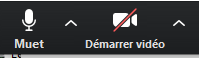

Cliquez sur l'icône de la caméra pour l'activer :

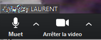

La visioconférence est démarrée. Il n'y a plus qu'à attendre les autres participants.

Pour quitter la visioconférence. Il suffit de cliquer sur ```Finir réunion```


Si c'est vous qui avez programmé cette visioconférence vous aurez le choix de "Quitter la visio" ou de "```mettre fin pour tous les utilisateurs```".


## 9. Accepter une invitation à une visioconférence
Slack affiche les invitations à une visioconférence Zoom comme ceci :

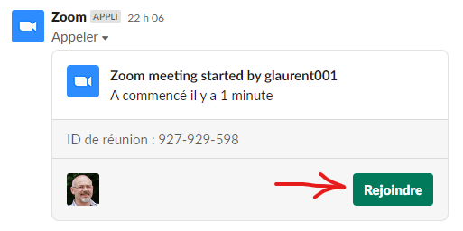

Pour accepter l'invitation, il suffit de cliquer sur "```Rejoindre```". Vous allez être redirigé vers une page web, acceptez d'ouvrir l'application Zoom et vous arriverez dans la ```salle d'attente``` de la visioconférence (si elle  été activée par l'animateur de la visio).

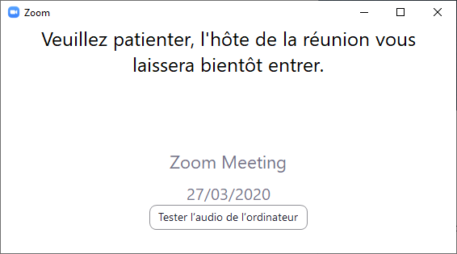

Quand l'animateur vous acceptera dans la visioconférence, vous serez ```en ligne``` avec tous les participants : *Pensez à dire bonjour !*

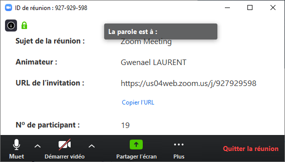

La barre du bas indique que le micro est actif mais que la caméra est désactivée.


Cliquez sur l'icône de la caméra pour l'activer :


Tous les participants à la visioconférence peuvent maintenant vous voir.

Pour quitter la visioconférence. Il suffit de cliquer sur ```Finir réunion```


## 10. Règles de bonne conduite dans notre espace SNIR-Eiffel
> **L'espace SNIR-Eiffel est créée pour le travail !** *Vous avez d'autres moyens de publier des bêtises ... donc n'en publier pas de trop !*

* Montrez toujours votre **```Savoir-vivre```** = politesse, respect, suivi des règles établies
* Identifiez vous avec votre **```nom et prénom```** (slack ET Zoom), pas de pseudo (vous n'êtes pas en train de jouer)
* Utilisez **```LE BON CANAL```** : pour un problème de TP, utilisez le canal de TP pas le canal de la classe ou pire #général
* Utilisez les **```fils de discussion```** pour répondre / réagir à un message
* Vous **ne devez pas** envoyer des demande de visioconférence dans les canaux publics ou privés (c'est réservé aux profs)
* Vous pouvez utiliser la visioconférence avec un utilisateur choisi (messages directs)
* Vous **ne devez pas** commencer un message par @tous (car l’ensemble des utilisateurs le recevront, qu’ils soient abonnés ou non à ce canal).

## 11. Aide en ligne (en français)
* [Qu’est-ce que Slack ?](https://slack.com/intl/fr-fr/help/articles/115004071768-Qu%E2%80%99est-ce-que-Slack-)
* [Premiers pas pour les nouveaux membres](https://slack.com/intl/fr-fr/help/articles/218080037-Premiers-pas-pour-les-nouveaux-membres)
* [Qu’est-ce qu’un canal ?](https://slack.com/intl/fr-fr/help/articles/360017938993-Qu%E2%80%99est-ce-qu%E2%80%99un-canal)
* [Envoyer et lire des messages](https://slack.com/intl/fr-fr/help/articles/201457107-Envoyer-et-lire-des-messages)
* [Organiser les conversations grâce aux fils de discussion](https://slack.com/intl/fr-fr/help/articles/115000769927-Organiser-les-conversations-gr%C3%A2ce-aux-fils-de-discussion-)
* [Qu’est-ce qu’un message direct ?](https://slack.com/intl/fr-fr/help/articles/212281468-Qu%E2%80%99est-ce-qu%E2%80%99un-message-direct)
* [Présentation de Slackbot](https://slack.com/intl/fr-fr/help/articles/202026038-Pr%C3%A9sentation-de-Slackbot)