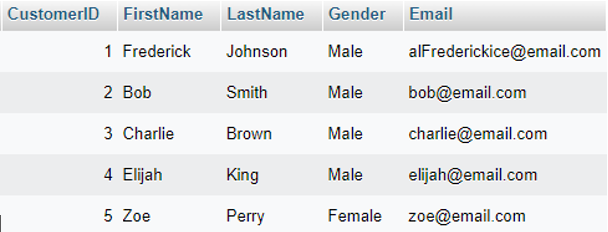
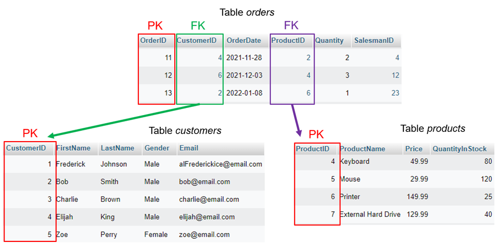
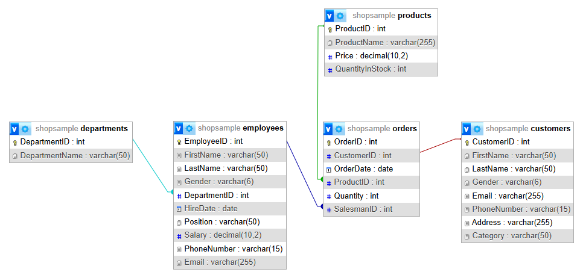

# Les bases de données relationnelles

> * Auteur :  Gwénaël LAURENT
> * Date : 22-11-2025

 [Licence Creative Commons](https://creativecommons.org/licenses/by-nc-sa/3.0/fr/)

Sommaire :
- [Les bases de données relationnelles](#les-bases-de-données-relationnelles)
- [1. Base de données](#1-base-de-données)
- [2. Systèmes de Gestion de Base de Données](#2-systèmes-de-gestion-de-base-de-données)
  - [2.1. SGBD relationnels (SGBDR)](#21-sgbd-relationnels-sgbdr)
  - [2.2. SGBD non relationnels (NoSQL)](#22-sgbd-non-relationnels-nosql)
- [3. Bases de données relationnelles](#3-bases-de-données-relationnelles)
  - [3.1. Les tables](#31-les-tables)
  - [3.2. Les associations entre les tables](#32-les-associations-entre-les-tables)
- [4. Schéma de la base de données](#4-schéma-de-la-base-de-données)

# 1. Base de données
Base de données (BDD), en anglais _Database_ (DB) = ensemble d’informations se rapportant un thème.

Les bases de données informatiques sont omniprésentes :
- Les entreprises stockent les données de leurs clients, fournisseurs ….
- Les articles vendus sur un site de e-commerce
- Les enregistrements de données issus de capteurs
- …

# 2. Systèmes de Gestion de Base de Données
Les Systèmes de Gestion de Base de Données (**SGBD**), en anglais : _DataBase Management System (DBMS)_, sont des logiciels spécialisés dans le traitement des BDD :
- Stockage des informations
- Accès local ou à distance
- Moyen de rechercher l’information pertinente (extraction de données)
- Ajout, mise à jour ou suppression de données

Suivant la façon dont les données sont stockées et organisées, on peut distinguer 2 grands types de SGBD : les SGBD relationnels et les SGBD non relationnels.

## 2.1. SGBD relationnels (SGBDR)
Les bases de données relationnelles (**SGBDR**) sont composées d’un **ensemble de tables** qui contiennent les données dans des lignes et colonnes.

Les bases de données relationnelles sont conçues pour comprendre **langage SQL** (_Structured Query Language_, langage de requêtes structurées), un langage de programmation standardisé qui est utilisé pour stocker, manipuler et récupérer des données.

> Exemples de SGBD relationnels : IBM DB2, Oracle Database, MySQL, PostgreSQL et Microsoft SQL Server …

## 2.2. SGBD non relationnels (NoSQL)
Les bases de données non relationnelles (Bases de données **NoSQL**) ne stockent pas de données de manière tabulaire. Elles les stockent sous la forme de fichiers individuels non connectés et peuvent être utilisées pour les **types de données complexes et non structurés**.

> Exemple de SGBD NoSQL : MongoDB, HBase, Neo4j, ScyllaDB, Cassandra, …

# 3. Bases de données relationnelles
## 3.1. Les tables
Elles permettent de **regrouper les informations relatives à un même sujet**, une même « entité »

Exemple : les coordonnées d’un client (table customers)

* **Les colonnes** (_column_) = attributs (_member_) = champs (_field_)\
  Les colonnes contiennent les attributs des entités (le nom d’une personne, son prénom …)\
  Chaque colonne est associée à un type de donnée qu’elle contient : entier (int), chaine de caractères (varchar), date …

* **Les lignes** (_row_) = enregistrement (_record_)\
  Une ligne contient toutes les informations d’une entité (toutes les coordonnées d’une personne)

* **Une case** = une valeur = une donnée

## 3.2. Les associations entre les tables
Les associations permettent de **relier les enregistrements contenus dans deux tables**.
Les associations sont réalisées via les clés primaires et étrangères de 2 tables

* **Clé primaire** (_Primary Key, PK_) = **Identifiant** unique (ID)\
C’est une colonne qui contient des valeurs uniques pour chaque ligne. (Dans la table _customers_, c’est la colonne CustomerID qui est la clé primaire)\
Les valeurs de clé primaire permettent d’**identifier de manière unique une ligne de la table**.

* **Clé étrangère** (_Foreign Key, FK_) = référence vers une clé primaire\
Une clé étrangère est une colonne d'une table qui est lié à la clé primaire d'une autre table.

Exemple : les commandes (_orders_) sont mises en relations avec un client (_customer_) et un article (_product_)\
La commande n°13 (PK OrderID=13) correspond à  Bob Smith qui a acheté une imprimante le 08/01/2022.

# 4. Schéma de la base de données
Le schéma ou **modèle de données**, est la description de l'organisation des données.
L’objectif est de décrire les champs de chaque table et les associations entre elles avec l’identification des clés primaires et étrangères.
Il existe plusieurs types de modèles de données. 

Exemple : Modèle Physique des Données (MPD)

