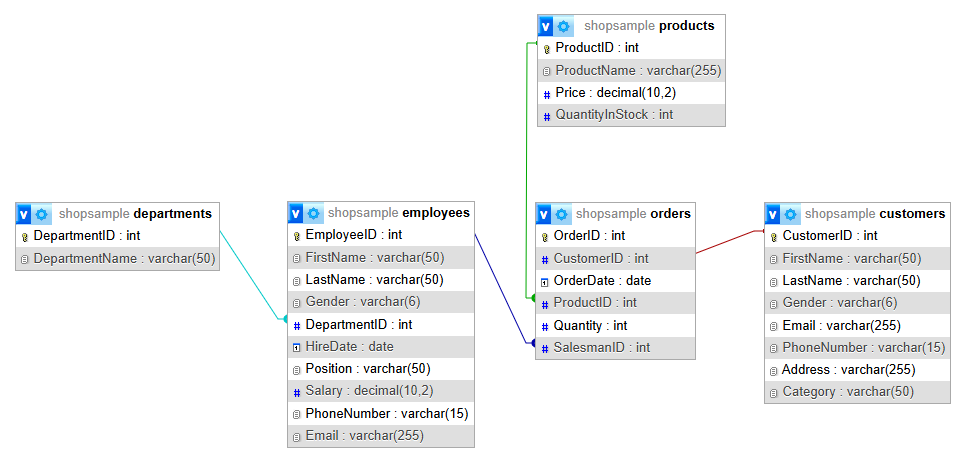
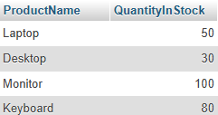
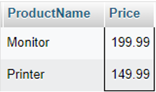
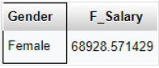
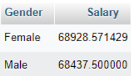
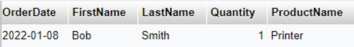

# Langage SQL : Structured Query Language

> * Auteur :  Gwénaël LAURENT
> * Date : 22-11-2025

 [Licence Creative Commons](https://creativecommons.org/licenses/by-nc-sa/3.0/fr/)

Sommaire :
- [Langage SQL : Structured Query Language](#langage-sql--structured-query-language)
- [1. Présentation](#1-présentation)
- [2. Base de données utilisée en exemple](#2-base-de-données-utilisée-en-exemple)
- [3. Recherche de données avec **SELECT**](#3-recherche-de-données-avec-select)
  - [3.1. SELECT sur une seule table](#31-select-sur-une-seule-table)
  - [3.2. SELECT sur plusieurs tables](#32-select-sur-plusieurs-tables)
- [4. Ajouter des lignes avec **INSERT**](#4-ajouter-des-lignes-avec-insert)
- [5. Modifier des données avec **UPDATE**](#5-modifier-des-données-avec-update)
- [6. Supprimer des lignes avec **DELETE**](#6-supprimer-des-lignes-avec-delete)


# 1. Présentation
Langage **SQL** (_Structured Query Language_, langage de requêtes structurées) = Langage informatique standardisé qui est utilisé pour stocker, manipuler et récupérer des données.

C'est un **langage déclaratif** = Décrit le résultat voulu sans décrire la manière de l'obtenir.\
Les SGBDR déterminent automatiquement la manière optimale d'effectuer les opérations nécessaires à l'obtention du résultat.

Dans SQL, il existe deux grands groupes d’instructions :
* des instructions pour la **création de la structure** appelées DDL (_Data Definition Language_)
  * Création de tables : **CREATE**
  * Modifie la structure des tables (colonnes, types de données, PK et FK) : **ALTER**
  * …
* des instructions de **manipulation de données** appelé DML (_Data Manipulation Language_).
  * Recherche de données : 	**SELECT**
  * Ajout de données : 		**INSERT**
  * Modification de données : 	**UPDATE**
  * Suppression de données : 	**DELETE**

> Les 4 instructions de manipulation des données SELECT, INSERT, UPDATE et DELETE sont souvent désignées sous l’acronyme **CRUD** (_Create, Read, Update, Delete_).

Vous trouverez un cours complet (en français) sur le langage SQL à cette adresse : https://sql.sh/cours

# 2. Base de données utilisée en exemple
Les exemples de requêtes suivantes utilisent la base de données [shopsample.sql](bdd_exemple/shopsample.sql).

La structure de la base est la suivante :



# 3. Recherche de données avec **SELECT**
La recherche de données (ou extraction de données) s’effectue à l’aide de l’instruction SELECT.

Le **résultat d’une requête SELECT** peut contenir 0 ou plusieurs lignes de résultat. On appelle ce résultat un « **jeu d’enregistrement** » (_recordset_).


## 3.1. SELECT sur une seule table

📌 Sélectionner toutes les données d’**une ou plusieurs colonnes** :
```sql
SELECT noms_colonnes_séparés_par_virgules
FROM nom_table;
```
* _Exemple :_
  ```sql
  SELECT ProductName, QuantityInStock
  FROM products;
  ```
  

📌 Sélectionner toutes les données de **toutes les colonnes** :
```sql
SELECT *
FROM nom_table;
```

📌 Limiter le nombre de lignes dans le résultat
```sql
SELECT *
FROM nom_table
LIMIT num_premiere_ligne , nbre_de_lignes ;
```

📌 Pour sélectionner une seule occurrence de chaque valeur d’une colonne :
```sql
SELECT DISTINCT nom_colonne
FROM nom_table ;
```

📌 Sélectionner uniquement les **lignes qui respectent une condition** :
```sql
SELECT noms_colonnes_séparés_par_virgules
FROM nom_table 
WHERE {condition};
```
La condition du **WHERE** porte sur les valeurs des colonnes.
* Utilisation d'opérateurs de comparaison : =, <>, !=, >, >=, <, <=
* Utilisation d'opérateurs booléens : AND, OR

* _Exemple :_
  ```sql
  SELECT ProductName, Price
  FROM products
  WHERE Price > 130
  AND Price < 200.0;
  ```
* _Résultat :_\
  

⚠️ Attention à la **notation des valeurs en fonction des types** de données : les chaînes de caractères (varchar) s’écrivent entourée d’apostrophes ou de guillemets. Ex : ```… WHERE ProductName = 'Printer'```

🔍 Pour les chaînes de caractères, on peut rechercher des correspondances exactes avec `=`, ou **rechercher sur un modèle particulier** avec `LIKE` et `%`.\
Il est par exemple possible de rechercher les enregistrements dont la valeur d’une colonne commence par telle ou telle sous-chaîne. Ex : ```WHERE ProductName LIKE 'Pr%'```

📌 **Trier** les données selon la colonne précisée :
```sql
SELECT noms_colonnes_séparés_par_virgules
FROM nom_table
ORDER BY nom_colonne ASC;
```
Par défaut, le tri est dans l'ordre croissant (ASC), `DESC` permet d'obtenir l'ordre décroissant.


📌 Changer l'affichage et le nommage des colonnes :
```sql
SELECT abrev.nom_colonne AS nom_affiché
FROM nom_table AS abrev ;
```
* **`AS` associé à un nom de colonne** : change le nom affiché de la colonne dans le résultat.
* **`AS` associé à un nom de table** : permet d’abréger le nom de la table pour préciser de quelle table provient une colonne dont le nom est utilisé par plusieurs tables.\
  _Cette abréviation **doit** être utilisée dans le reste de la requête._


📌 Appliquer une **fonction de calcul** sur les données d’une colonne :
```sql
SELECT FONCTION(nom_colonne)
FROM nom_table;
```
_FONCTION_ doit être remplacé par les fonctions de calcul suivantes :
* **COUNT** : compte le nombre de lignes sélectionnées.
* **MIN** ou **MAX** : renvoie la valeur minimum ou maximum de la colonne, parmi les lignes sélectionnées
* **SUM** ou **AVG** : calcule la somme ou la moyenne des valeurs numériques de la colonne, parmi les lignes sélectionnées

* _Exemple :_
  ```sql
  SELECT Gender, AVG(Salary) AS F_Salary
  FROM employees
  WHERE Gender = 'Female';
  ```
* _Résultat :_\
  


📌 Utiliser une **fonction de calcul sur un groupe de résultat**
```sql
SELECT FONCTION(nom_colonne), autre_colonne
FROM nom_table
GROUP BY autre_colonne;
```
* Permet par exemple de faire des sous totaux
* ⚠️ La commande `GROUP BY` doit toujours s’utiliser après la commande `WHERE`

* _Exemple :_
  ```sql
  SELECT Gender, AVG(Salary) AS Salary
  FROM employees
  GROUP BY Gender;
  ```
* _Résultat :_\
  

## 3.2. SELECT sur plusieurs tables
📌 Sélectionner des données venant de plusieurs tables (**Jointures**)
```sql
SELECT *
FROM table1
INNER JOIN table2 ON table1.id = table2.fk_id
WHERE {condition};
```
* Génère uniquement les associations entre les lignes qui sont liées par des clés primaires et étrangères identiques.
* À utiliser pour chaque association de deux tables ou plus

* _Exemple :_
  ```sql
  SELECT OrderDate, FirstName, LastName, Quantity, ProductName
  FROM orders
  INNER JOIN customers ON orders.CustomerID = customers.CustomerID
  INNER JOIN products ON orders.ProductID = products.ProductID
  WHERE orders.OrderID = 13;
  ```
* _Résultat :_\
  


# 4. Ajouter des lignes avec **INSERT**
📌 Ajouter une nouvelle ligne de données dans une table
```sql
INSERT INTO nom_table (liste_nom_colonnes_à_remplir)
VALUES (liste_des_valeurs_à_insérer_dans_ordre_liste_colonnes);
```

📌 Pour ajouter des données qui viennent d’autres tables, il faut insérer le résultat d'un SELECT (avec jointures si besoin). Exemple :
```sql
INSERT INTO table_cible (col1, col2)
SELECT a.col1, b.col2
FROM tableA a
INNER JOIN tableB b ON a.id = b.id;
```
* ⚠️ Les colonnes de INSERT INTO doivent correspondre en nombre et en type à celles du SELECT
* ⚠️ C’est l’ordre qui compte, pas le nom


# 5. Modifier des données avec **UPDATE**
📌 Mettre à jour la ou les lignes qui respectent la clause du WHERE
```sql
UPDATE nom_table 
SET nom_colonne1=valeur1, nom_colonne2=valeur2
WHERE {condition};
```

📌 Mettre à jour une table en fonction des données d'autres tables : il faut utiliser les jointures. Exemple pour MySQL / MariaDB :
```sql
UPDATE table1 t1
INNER JOIN table2 t2 ON t1.id = t2.id
SET t1.col = t2.val
WHERE t2.statut = 'ACTIF';
```
* ⚠️ Ce n’est pas du SQL 100% standard. La syntaxe dépend du SGBD

# 6. Supprimer des lignes avec **DELETE**
📌 Effacer la ou les lignes d'une table qui respectent la clause du WHERE
```sql
DELETE FROM nom_table 
WHERE {condition};
```

📌 Effacer la ou les lignes d'une table en fonction des données d'autres tables : il faut utiliser les jointures. Exemple pour MySQL / MariaDB :
```sql
DELETE t1
FROM table1 t1
INNER JOIN table2 t2 ON t1.id = t2.id
WHERE t2.statut = 'INACTIF';
```
* ⚠️ Ce n’est pas du SQL 100% standard. La syntaxe dépend du SGBD

