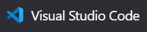

# Utilisation de Visual Studio Code

> * Auteur : Gwénaël LAURENT
> * Date : 13/09/2024
> * OS : Windows 10
> * VScode : version 1.90.2

 [Licence Creative Commons](https://creativecommons.org/licenses/by-nc-sa/3.0/fr/)

## Objectifs
Installation et utilisation de VS code pour le codage et le débogage. Les informations contenues ici sont destinées à mes étudiants et élèves pour qu'ils puissent progresser dans l'apprentissage du codage. J'ai essayé de simplifier au maximum la configuration de l'éditeur VScode.

# 1. Installation de VScode
* [Installation de VScode sur son ordinateur Windows](./vscode-install.md)
* [Résumé de la configuration de VScode en BTS CIEL](./vscode-bts-ciel.md)

# 2. Configuration et utilisation de VScode
* [VScode : thèmes, couleurs et icones](./vscode-themes-colors-icons.md)
* [VScode pour coder du HTML/CSS](./vscode-html-css.md)
* [VScode pour coder du JavaScript](./vscode-js.md)
* [VScode pour coder du PHP](vscode-php.md)
* [VScode pour coder du C++ (appli console Windows)](./vscode-cpp.md)
* [VScode - Installation de PlatformIO (arduino, ESP8266, ESP32)](vscode-platformio.md)
* [VScode pour coder du Node.js](vscode-nodejs.md)
* [VScode pour coder à distance (en utilisant SSH)](vscode-remote.md)
* [VScode pour coder en C++ sur un Raspberry distant](vscode-cpp-raspberry.md)
* [VScode pour coder du Markdown](./vscode-markdown.md)
* [VScode pour coder du Python](vscode-python.md)
* [Utiliser l'invite de commande CMD directement dans VScode](./vscode-terminal-cmd.md)
* [Création de snippets pour configurer le débogage](./vscode-debug-snippets.md)
